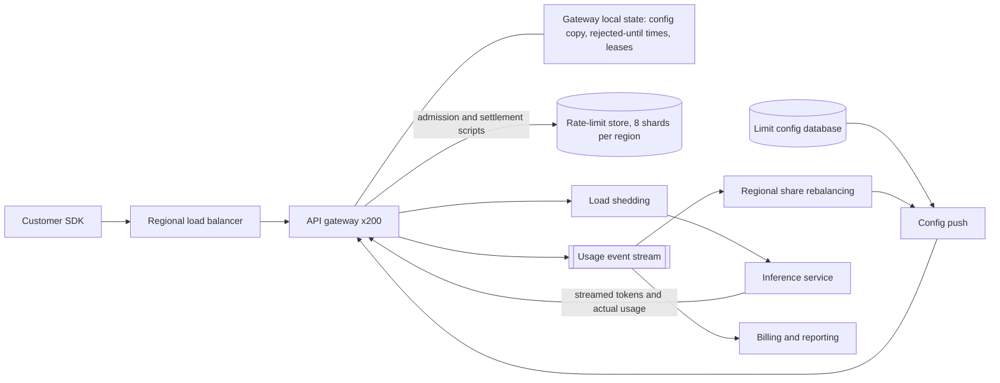

# Design API Rate Limiting

## Problem

Design the rate limiter for a public LLM API.

**What you have.**

- Customers call the generation endpoint `POST /v1/messages` as an *organization*.
- Each organization has three limits per model class: requests per minute (RPM), input tokens per
  minute (ITPM) and output tokens per minute (OTPM).
- An organization can give its workspaces lower sub-limits. The organization-wide limit always
  applies as well.

If you ask, the interviewer gives these numbers (all practice assumptions):

**Scale.**

- **100,000 requests/s** at peak, arriving at **200 API gateway instances** in **3 regions**. A round
  trip between regions takes about **100 ms**.
- **200,000 active organizations**, each with on average 3 active (model class × workspace)
  combinations.
- The largest organization sends **10%** of peak traffic.
- An example customer has limits of **4,000 RPM, 2,000,000 ITPM and 400,000 OTPM**. Its typical
  request has 2,000 input tokens and 400 output tokens, but sets `max_tokens` to 4,000. Responses
  are streamed and last about 10 seconds.

**Requirements.**

- The rate-limit check adds at most **5 ms at p99** to each request.
- A request over the limit gets a `429` that tells the client how long to wait.
- Short bursts are allowed, within a bound: the long-run average stays within the limit, and over any
  period the extra admitted is at most a burst allowance set in advance.
- Limits are global: an organization's usage in all three regions counts together.
- A failure of the rate limiter itself must not make the whole API unavailable.
- When an admin changes a limit, the change takes effect within **10 seconds**.

**Design:**

1. A capacity estimate: how big the rate-limit state is, and how many calls per second the store
   has to handle.
2. The data model, the internal interfaces, and the external `429` response.
3. The architecture, and the path one request takes through the rate limiter.

**Topics the interviewer will dig into.**

- **(a) Algorithm.** Which rate-limiting algorithm do you pick, and why?
- **(b) Atomic check-and-deduct.** How do you make "check the limit, then deduct" a single atomic
  step?
- **(c) Hot spot.** How do you handle the hot spot the largest customer creates?
- **(d) Output tokens.** Output tokens are not known when a request is admitted. How do you account
  for them?
- **(e) Failures and regions.** What happens when the rate limiter fails, and how do you handle
  three regions?

**Out of scope:** authentication, billing and monthly spend caps, abuse detection, and scheduling and
load shedding inside the inference cluster.

The external shape (three limit dimensions, token buckets, `429` with `retry-after`) follows the
public Claude API docs ([Rate limits](https://platform.claude.com/docs/en/api/rate-limits)). Only that
external shape is borrowed; nothing here describes any company's internal implementation. For the
single-process coding version, see [Rate Limiter Bug Hunt](#/openai/coding/rate-limiter-debug); this
page is about many gateways, shared state and failures.

## Reference solution

<details>
<summary>Show the reference solution</summary>

Before you start, confirm three things. First, how many buckets a request has to pass at once: one each for requests, input tokens, and output tokens; if the workspace has sub-limits, it must pass the workspace's three as well. If any one is short, reject, and a rejected request must not deduct from the other buckets. Second, how precise it has to be: the problem allows bounded over-admission, so there is no need for globally consistent coordination on every request, which is what makes 5 ms achievable. Third, whether a failed rate limiter admits or rejects: the problem says it must not take down the API, so the default is fail-open, but with a local fallback so it doesn't turn into unlimited admission.

### Requirements and scale

**Functional**: an admission check on every request before it is forwarded to the inference service; if it is short, return `429` with the number of seconds to wait; responses carry headers with the remaining quota; after a request ends, settle by the actual token counts; admins change organization and workspace limits.

**Non-functional**: see the problem statement.

**Estimates** (every number is recomputed and asserted by the code in "Estimate checks" at the end):

| Quantity | Calculation | Result |
|---|---|---|
| Per gateway | 100,000 / 200 | 500 requests/s |
| Store calls | One admission and one settlement per request (merging settlements only lowers this) | 200,000 calls/s |
| Store shards | Assume one node can sustain 50,000 script calls/s (a practice assumption; in reality, load-test it) | At least 4; use 8 shards at 25,000 calls/s each, 50% utilization |
| Number of token buckets | 200,000 organizations × 3 combinations × 3 dimensions | 1.8 million; about 200 B each (including key name and overhead, assumed), 360 MB total |
| For comparison: sliding log | Peak 100,000 × 60 s | 6 million entries at 50 B each (assumed), 300 MB; the largest customer alone has 600,000 entries in one key |
| Which limit the example customer hits first | RPM 4,000; ITPM 2,000,000 / 2,000 = 1,000; OTPM 400,000 / 400 = 1,000 | 1,000 requests per minute. Both token limits bind at once, and only 1/4 of the RPM is used |
| Example customer's refill rate | 400,000 / 60; 2,000,000 / 60 | 6,666.7 output tokens and 33,333 input tokens per second |
| Largest customer | 100,000 × 10% | 10,000 requests/s, i.e. 20,000 store calls/s, all on one shard; that shard does 20,000 + 22,500 = 42,500 calls/s, 85% utilization |
| Largest customer per gateway | 10,000 / 200 | 50 requests/s, 5 every 100 ms |
| Largest customer with leases | 200 gateways × one renewal every 100 ms | 2,000 calls/s, 1/10 of before; the shard drops to 24,500 calls/s, 49% utilization |
| Small customer | 60 RPM spread over 200 gateways | 0.005 requests per second per gateway; a lease doesn't pay off |
| Cross-region | 100 ms round trip vs. a 5 ms budget | 20× off; you can't synchronize across regions on every request |

These numbers say two things. First, the total is not hard: 1.8 million buckets in memory are only a few hundred MB, and 8 shards average 50% utilization. Second, the hard part is the hot spot. The script has to change all of an organization's buckets atomically (see (b)), so all of an organization's buckets must be on the same shard; the largest customer alone pushes its shard to 85%. (c) deals with exactly this.

### Data model and API

**Limit configuration** (a relational database, the source of truth; the `sql` below is for display only):

```sql
CREATE TABLE rate_limits (
  org_id        BIGINT NOT NULL,
  workspace_id  BIGINT NOT NULL,          -- 0 = the organisation-wide limit
  model_class   TEXT   NOT NULL,
  dimension     TEXT   NOT NULL,          -- 'rpm' | 'itpm' | 'otpm'
  per_minute    BIGINT NOT NULL,
  burst         BIGINT NOT NULL,          -- bucket capacity, default = per_minute
  updated_at    TIMESTAMPTZ NOT NULL,
  PRIMARY KEY (org_id, workspace_id, model_class, dimension)
);
```

**Bucket state** (Redis hashes, one key per bucket):

- Key names look like `{org:7}:<model class>:rpm` (organization level) and `{org:7}:ws:3:<model class>:rpm` (workspace level); the estimate checks omit the model class. The part in braces is a hash tag: Redis Cluster uses only that part to compute the hash slot, so all buckets of one organization land in the same slot.
- Fields: `tokens` is the current token count, which can be fractional and can be negative (meaning debt, see (d)); `ts` is the server time of the last update (milliseconds).
- Expiry: the time needed to refill the bucket, plus 1 second. An expired key is equivalent to a full bucket, so only recently active buckets take up memory.

**Gateway memory**: how much each in-flight request pre-charged in each bucket (needed for settlement); each organization's "rejected until" time (see the follow-ups); lease balances (see (c)); a local copy of the limit configuration.

**Internal interfaces** (the gateway calls the store; each one is a single script call):

| Call | Arguments | Returns |
|---|---|---|
| `ADMIT` | List of keys; for each bucket (limit per minute, burst allowance, amount to deduct this time) | `{1, 0}` admit; `{0, wait in ms}` reject, nothing written |
| `SETTLE` | List of keys; for each bucket (limit per minute, burst allowance, positive to charge extra, negative to refund) | `1` |

**External**:

- Over the limit returns `429`, says which limit was exceeded, and carries `retry-after` (seconds, rounded up).
- Responses carry headers with the remaining quota. The public Claude API docs list `anthropic-ratelimit-requests-limit`, `-remaining`, `-reset`, and the same kind of headers for input and output tokens; `reset` is the time the bucket will be full again.
- Admin interface: `PUT /v1/organizations/{org}/workspaces/{ws}/rate_limits`, which writes to the configuration database.

### Architecture



**The path of one request**

1. The SDK reaches a gateway through the regional load balancer. The gateway authenticates, gets the organization, workspace, and model class, and takes the relevant limits from its local config copy: three at the organization level, plus three more if the workspace has sub-limits.
2. If the gateway has a local record that this organization was just rejected and the `retry-after` time hasn't arrived yet, it returns `429` directly without touching the store. This may reject for a little longer than the store's true state warrants (quota refunded by other requests' settlements only becomes usable after the expiry), in exchange for keeping rejected traffic off the store.
3. Estimate this request's cost: 1 request; input tokens roughly estimated from the request size for now; how many output tokens to pre-charge is discussed in (d).
4. Call the `ADMIT` script with `EVALSHA`, with a 3 ms timeout. If the server returns `NOSCRIPT` (the script isn't in its script cache, e.g. the node just restarted), send the full script once with `EVAL` instead.
5. If admitted, forward to the load-shedding layer and the inference service. If rejected, return `429` with `retry-after` = wait in ms divided by 1,000, rounded up, and record the rejected-until time locally.
6. During streaming, the gateway counts the tokens each organization produces on this gateway and merges them into one `SETTLE` per second; when the request ends, it charges or refunds the difference according to the actual input and output token counts reported by the inference service. Usage is also written separately to the event stream for billing and reporting; rate limiting does not read billing data, and billing does not depend on the rate-limit store.
7. A store call times out or a shard is unavailable: decide by the local fallback rule in (e), and don't let the request hang.

### Deep dives

**(a) Which algorithm**

Take 60 per minute as the example. The client is silent until second 59.9, then requests as much as it can every 0.1 seconds until second 180. The worst cases measured in the estimate checks:

| Algorithm | What it stores | Most admitted in 0.2 s | Most admitted in any 60 s | Notes |
|---|---|---|---|---|
| Fixed window | One counter per window | 120 | 120 | A full quota is admitted on each side of a window boundary, 2× in an instant |
| Sliding log | The time of every request in the window | 60 | 60 | Exact, but state and work are proportional to the number of requests |
| Sliding window counter | Two counters, this window and the previous one | 60 | 119 | The previous window's count is weighted by the fraction of it still in view. This assumes the previous window's requests were uniform, and is inaccurate when a burst is packed at the end of a window |
| Token bucket, burst 60 | Token count and timestamp | 60 | 119 | At most burst + rate × 60 = 120 |
| Token bucket, burst 10 | Same as above | 10 | 69 | At most 10 + 60 = 70 |

Under steady sustained requests, all five admit 59 to 60 per minute; they differ only on bursts.

The token bucket's guarantee fits in one sentence: in any period of length $T$, the total cost admitted is at most $\text{burst} + \text{rate} \times T$. The estimate checks verify this for $T$ = 1, 10, 60 seconds with random arrival times and random costs (1 to 5). This is exactly the "bounded burst" the problem asks for, and the burst allowance is an explicit parameter.

Recommend the token bucket, because:

- Its state is two numbers, independent of traffic. At this scale a sliding log actually uses about the same total memory (300 MB vs. 360 MB); the problem is that it grows with traffic and concentrates on large customers: the largest customer has 600,000 entries in one key. Token limits need the sum of costs in the window; a sorted set can count entries by score range but doesn't sum them, so you either iterate every time or store a running sum separately and subtract entries one by one as they expire.
- It naturally supports deducting by cost (one request deducts 2,000 input tokens), and it can compute an exact wait time: (cost − current tokens) / rate, used directly as `retry-after`.
- The burst allowance is a product decision. Set it to one minute's limit and a customer can use a whole minute's worth in one go after being idle, approaching 2× in any 60 seconds; set it smaller and traffic is smoother. The public Claude API docs describe exactly this behavior: continuous replenishment with a token bucket rather than a reset at fixed times; 60 requests per minute might be enforced as 1 per second.

GCRA (generic cell rate algorithm) is another way of writing the token bucket that stores only a "theoretical arrival time" (TAT). The estimate checks verify that it makes the same decision as the token bucket at every step on random input, and that the token count always equals burst − rate × max(0, TAT − t). It saves one field, but storing two fields in a hash isn't expensive, and the token count can go straight into the remaining-quota header, so this problem uses the token-bucket form.

**(b) "Check and deduct" must be one step**

200 gateways share the same set of buckets. Some straightforward approaches:

- **`GET` then `SET` in the gateway**: two gateways both read "1 token left" and both admit. The estimate checks enumerate all 6 interleavings of two gateways with two steps each, and 4 of them admit 2 requests.
- **`INCR` then `EXPIRE`, as two calls** (the common way to write a fixed window): `INCR` itself is atomic, but if the client crashes between the two calls, the counter never expires. In the estimate checks the limit is 3: normally each window admits 3; after one crash, no later window admits anything. The Redis `INCR` docs also point out this race in their rate-limiting example and suggest switching to a Lua script.
- **`MULTI` / `EXEC`**: the commands in the transaction are queued and run in order at `EXEC`, with no other client's commands inserted in between. But the values read only come back after `EXEC`, so you can't "read, decide, then choose whether to write". If one command fails when it runs, the others still run; nothing is rolled back.
- **`WATCH` + `MULTI` / `EXEC`** (optimistic check-and-set): if a `WATCH`ed key is changed by someone else before `EXEC`, `EXEC` returns nil, and the client rereads and retries. The result is correct (in the estimate checks all 6 interleavings admit only 1), but every conflict costs an extra round trip, and conflicts are most frequent on exactly the hottest keys.

Recommended: **write the whole piece of logic as one Lua script that runs atomically on the server**. Redis processes no other commands while a script runs, so the script should be short; here it is just one constant-time computation for each of 3 to 6 buckets. Key points:

1. Check all buckets first, and deduct from all of them together only if they are all sufficient (all or nothing). If you deduct bucket by bucket and stop at the first insufficient one, a rejected request also eats the quota of the earlier buckets. In the estimate checks: 100 requests rejected for lack of input tokens ate the RPM bucket down from 3,999 to 3,899.
2. Pass all keys through `KEYS`; don't build key names inside the script. Redis Cluster uses them to decide which node to send the script to; all keys in one call must be in the same hash slot, or the call is rejected. The hash tag `{org:7}` puts all of an organization's buckets (workspace buckets included) in the same slot.
3. Take the time from the server with `redis.call('TIME')` in the script rather than using a time passed in by the gateway, so clock skew across 200 gateways doesn't affect the result. When Redis replicates a script, what goes to the replicas is the write commands the script produced (effect replication), not the script itself, so reading the time in a script is allowed. After a failover the new primary's clock may be slightly behind; `math.max(0, now - ts)` ensures tokens are never deducted because of that.
4. On rejection, write nothing and just return the number of milliseconds to wait; on admission, write back the token count and the time, and set the expiry to "time needed to refill + 1 second".

```lua
-- ADMIT: KEYS = buckets; ARGV = limit_per_min, burst, cost for each bucket, in the same order
local t = redis.call('TIME')
local now = t[1] * 1000 + math.floor(t[2] / 1000)
local have, wait = {}, 0
for i = 1, #KEYS do
  local limit, burst, cost = tonumber(ARGV[3*i-2]), tonumber(ARGV[3*i-1]), tonumber(ARGV[3*i])
  local s = redis.call('HMGET', KEYS[i], 'tokens', 'ts')
  local tokens = burst
  if s[1] then
    tokens = math.min(burst, tonumber(s[1]) + math.max(0, now - tonumber(s[2])) * limit / 60000)
  end
  have[i] = tokens
  if tokens < cost then
    wait = math.max(wait, (cost - tokens) * 60000 / limit)
  end
end
if wait > 0 then
  return {0, math.ceil(wait)}
end
for i = 1, #KEYS do
  local limit, burst, cost = tonumber(ARGV[3*i-2]), tonumber(ARGV[3*i-1]), tonumber(ARGV[3*i])
  local left = have[i] - cost
  redis.call('HSET', KEYS[i], 'tokens', left, 'ts', now)
  redis.call('PEXPIRE', KEYS[i], math.ceil((burst - left) * 60000 / limit) + 1000)
end
return {1, 0}

-- SETTLE: ARGV = limit_per_min, burst, delta for each bucket (delta > 0 charges, < 0 refunds)
local t = redis.call('TIME')
local now = t[1] * 1000 + math.floor(t[2] / 1000)
for i = 1, #KEYS do
  local limit, burst, delta = tonumber(ARGV[3*i-2]), tonumber(ARGV[3*i-1]), tonumber(ARGV[3*i])
  local s = redis.call('HMGET', KEYS[i], 'tokens', 'ts')
  local tokens = burst
  if s[1] then
    tokens = math.min(burst, tonumber(s[1]) + math.max(0, now - tonumber(s[2])) * limit / 60000)
  end
  local left = math.min(burst, tokens - delta)
  redis.call('HSET', KEYS[i], 'tokens', left, 'ts', now)
  redis.call('PEXPIRE', KEYS[i], math.ceil((burst - left) * 60000 / limit) + 1000)
end
return 1
```

These are two separate scripts, registered separately. Section 4 of the estimate checks is their Python reference version: the same formulas, the same all-or-nothing behavior. The author also compared the scripts against the reference version call by call, on both return values and stored values, using fakeredis (an in-process Redis emulator that runs real Lua through lupa); it is not a real Redis server.

An example from the estimate checks: first a request for 1.5 million input tokens is admitted, then one for 1 million is rejected with a wait of 15,000 ms (it is 500,000 short, and at a refill of 2 million per minute that is exactly 15 seconds), `retry-after` is 15 seconds, and the RPM bucket is untouched. A retry at 14,999 ms is still rejected; at 15,000 ms it is admitted.

**(c) The largest customer: don't let one organization overwhelm a shard**

In the estimates the largest customer sends 10,000 requests per second, all on one shard, pushing it to 85%; a little more growth and it exceeds a single node's capacity. Some options:

- **Check the central store on every request** (the default): most accurate, but the number of calls is proportional to the number of requests.
- **Count locally and report periodically**: every gateway admits on its own based on the "100 left" from the last sync. In the estimate checks 20 gateways each admit 100, 2,000 in total, over-admitting by 1,900. To avoid over-admission, you would have to split the remaining quota evenly across gateways, which turns into a static split.
- **Split the bucket into k sub-buckets** on different shards, with each gateway always using one of them: the calls are spread out, but each sub-bucket has only 1/k of the quota. When traffic is uneven, some sub-buckets sit idle while others are rejecting.
- **Leases**: a gateway takes a small chunk of quota from the central bucket at a time (say 10 requests), spends it locally, and returns whatever is unspent when the lease expires. Taking and returning are each one atomic script call, and the central bucket always treats leased quota as already spent, so there is no over-admission; the cost is that quota may sit idle on a gateway that can't use it. Settlements are also accumulated locally and reported along with the renewal; a renewal returns the rest of the previous chunk and takes a new one in a single call (the estimates count it as one call; the simulation below counts taking and returning separately, which is more conservative).

The estimate checks simulate an organization with 6,000 RPM and a burst of 100, sending 150 requests per second to 20 gateways, for 120 seconds:

| Approach | Admitted | Central store calls | Most admitted in any 60 s |
|---|---|---|---|
| Check on every request | 12,098 | 18,000 | 6,097 |
| Leases: 10 at a time, 1-second lease period | 12,019 (99.3%) | 2,885 (16%) | 6,037 |

Two tuning rules. The chunk taken each time has to cover the requests one gateway receives in one lease period: here each gateway gets 7.5 per second, and taking only 5 at a time drops admissions below 90% of per-request checking. The lease period has to be long enough to see several requests, otherwise it saves almost no calls: with a 100 ms lease period, the number of calls is still over 80% of per-request checking.

Small customers are the opposite. An organization with 60 RPM and a burst of 10 has 10 requests land on 10 different gateways within 10 milliseconds. Per-request checking admits them all; with leases of 5 at a time, the first two gateways take all 10 tokens, the remaining 8 requests are rejected, and not one of the 10 calls is saved.

Recommended: tier by organization. By default check the central store on every request; when an organization's rate on a single gateway exceeds a threshold (say more than 5 requests visible in one lease period), switch it to lease mode. The largest customer in the estimates has 5 requests every 100 ms on each gateway; a 100 ms lease period with about 10 taken per lease cuts its calls from 20,000/s to 2,000/s, and the shard's utilization from 85% to 49%.

**(d) Output tokens are not known at admission time**

At admission you only know `max_tokens` (4,000); the actual output is only known once generation finishes (the example customer averages 400). Three ways to account for it:

1. **Pre-charge `max_tokens`**, and refund the excess at the end. Never goes into debt, but is very unfair to customers who set a large `max_tokens`.
2. **Pre-charge an estimate** (say this organization's recent average output of 400), and refund or charge the difference at the end.
3. **Charge as tokens are generated**: no pre-charge; every chunk of streamed output is deducted from the bucket as it is produced. The bucket can go negative (debt), and while it is in debt every new request is rejected.

The estimate checks simulate the example customer's output bucket in 100 ms steps (limit 400,000/minute, burst 400,000, each response lasts 10 seconds):

| Scenario | Pre-charge max_tokens | Pre-charge an estimate | Charge as generated |
|---|---|---|---|
| (A) 300 requests arrive at once on a full bucket, each outputs 400 | Admits 100; while rejecting 200, only 10% of this minute's quota is used | Admits 300, bucket bottoms at 280,000 | Admits 300, bucket bottoms at 346,000 |
| (B) The same 300 requests, but every one writes the full 4,000 | Admits 100, 400,000 output in total, bucket bottoms at 0 | Admits 300, bucket drops to about −733,333 at settlement | Admits 300, 1.2 million output within 10 s, bucket bottoms at −734,000 |
| (C) Sustained requests at about 2.4× the limit (40 per second, outputting 100 or 700) | 400,219 per minute | 400,024 per minute | 400,000 per minute |

How to read it:

- (C) shows that over the long run all three converge to the limit (error under 1%); they differ only on bursts and fairness.
- (A) is the problem with approach 1: a customer who sets a large `max_tokens` to avoid truncation is treated as if it really will use that much.
- (B) is the problem with approaches 2 and 3: a batch of long responses admitted at once outputs 1.2 million in the first minute, 1.5× "a 400,000 burst + 400,000 of refill in one minute". After that it has to be paid back slowly at 6,666.7 per second, and for about 110 seconds every new request is rejected. An estimate only postpones the debt until settlement.

The upper bound on debt is "number of concurrent streams × `max_tokens`". So the recommendation is **approach 3, plus a per-organization concurrency limit**. With a concurrency limit of 100, (B) admits only 100, the bucket bottoms at 66,000, and there is no debt; in general the debt can't exceed 100 × 4,000 = 400,000, exactly one burst allowance. Streams already running are not cut off midway, otherwise the compute already spent is wasted; debt only blocks new requests. The gateway merges each organization's tokens produced per second into one `SETTLE`, so the number of calls doesn't grow with the number of tokens.

The settlement rules are also in the estimate checks: a refund never lifts a bucket above its burst allowance; a charge can push it negative. With the bucket 20,000 in debt, the next request has to wait 3,001 ms (refilling at 400,000 per minute until there is 1 token), and `retry-after` rounded up is 4 seconds.

The external behavior described in the public Claude API docs belongs to approach 3: OTPM is computed in real time as output tokens are produced, only tokens actually generated count, and `max_tokens` does not affect OTPM. Input tokens are a different case: the docs say ITPM is estimated at the start of a request and adjusted to the actual count during the request, and input tokens read from prompt caching don't count toward ITPM. The docs don't say how this is implemented internally; here they only serve to show that these product choices really exist. For another example of cost-based admission, see [Streaming AI Product Feature](#/openai/system-design/realtime-ai-feature).

**(e) Failures, multiple regions, and how rate limiting and load shedding split the work**

When the store fails:

- **Fail-closed**: the rate-limit store becomes a single point of failure for the whole API, violating the requirements.
- **Fully open**: during the failure any single customer can saturate the backend.
- **Recommended: admit, but with a local fallback**. Each gateway keeps a conservative local token bucket per organization, with rate = organization limit / number of gateways × a relaxation factor (say 2). When a store call times out (3 ms) or the circuit breaker is open, the gateway decides with it. All gateways together admit at most the relaxation factor times the limit, so over-admission is bounded; the cost is that small customers get rejected somewhat more during the fallback, because their quota is spread thin across 200 gateways. The backend also has its own load-shedding protection, so it won't be overwhelmed because rate limiting was relaxed.
- **Failover**: Redis Cluster replicates asynchronously, and the official docs say plainly that acknowledged writes can be lost during a failover. For rate limiting, what is lost is the last few deductions, so the bucket looks fuller than it really is, and for a short time after the failover somewhat more is admitted. That is acceptable. Compare [Design a Banking App](#/anthropic/system-design/banking-app): that design avoids storing idempotency keys in Redis for exactly this reason, because losing one could mean charging money twice; here a small error just admits a few extra requests.

Multiple regions:

- Checking a global bucket across regions on every request: a 100 ms round trip is 20× the 5 ms budget, so no.
- A static split into three: the example customer gets 1,333 RPM per region. When traffic is concentrated in one region, the customer can only use a third.
- **Recommended: one store per region, each holding a share of the quota, with a background job reallocating the shares about once per second according to recent usage**, so that the three shares sum to the limit. Most organizations' traffic is concentrated in one region anyway, so nearly all of the share sits there. When traffic moves between regions, at most one reallocation period's worth is over-rejected or over-admitted. Organization-level and workspace-level buckets are split the same way.

**Rate limiting and load shedding are two different things**. Rate limiting answers "has this customer exceeded their quota", computed per customer, and returns `429` when exceeded. Load shedding answers "can the backend take it right now", computed by capacity, and returns `503` when it can't. You need both: even with every customer within their limit, the total can exceed cluster capacity, because the sum of limits is usually larger than capacity (not every customer uses their full limit at the same time); conversely, when the backend is idle, a customer's limit still shouldn't be lifted. For load shedding and admission control, see [LLM Inference API with Batched GPU Serving](#/anthropic/system-design/inference-api-batching).

### Follow-ups

- **What if a customer retries immediately on `429` and overloads the store too?** `retry-after` has to be accurate (computed from the bucket), and the SDK backs off by it, adding random jitter. The gateway remembers locally that "this organization will be rejected until a certain time" and rejects directly until then without touching the store; for a customer firing at 10× its limit, the vast majority of requests are stopped locally at the gateway. The script also writes nothing to the store on rejection.
- **How does a limit change take effect?** After the write to the configuration database, it is pushed to all gateways, and as a fallback each gateway also pulls the full configuration every 10 seconds. The limit and burst allowance are passed to the script as arguments on every call, so the very next call uses the new values; when the burst allowance is lowered, the `math.min(burst, …)` in the script trims off the excess tokens.
- **Input tokens that hit the cache don't count toward ITPM, but at admission you don't know yet whether they'll hit. What do you do?** Estimate on the full input first, and refund the cached part at settlement; if the estimate itself was low, charge the rest at settlement. Like output tokens, it is "estimate first, settle later", but here the pre-charge is usually too high, so debt is rare.
- **How do you stop an organization from jumping from almost no usage straight to its full limit?** Add another layer, a growth-rate limit: allowed usage per minute = recent peak + one step, rising by at most one step per minute, capped at the limit. It is implemented as just another bucket, whose limit is updated by a background job from historical usage. The public Claude API docs describe the external behavior of this kind of "ramp limit".
- **How do you test it?** Don't use real time. Inject the clock, replay arrival sequences in virtual time as the estimate checks do, and assert that "the amount admitted in any $T$ seconds ≤ burst + rate × $T$", that rejected requests don't change state, and that the script and the reference implementation agree call by call. For concurrency issues, enumerate interleavings (like the 6 in (b)), or open two connections in a test and really interleave them. For common bugs in a single-process rate limiter, see [Rate Limiter Bug Hunt](#/openai/coding/rate-limiter-debug).

<details>
<summary>Estimate checks (runnable)</summary>

```python
import heapq
import itertools
import math
import random
from collections import deque
from fractions import Fraction

# ---------------------------------------------------------------- 1. estimates
peak_rps = 100_000
gateways = 200
assert peak_rps / gateways == 500

store_calls = 2 * peak_rps                   # one admit call + one settle call per request
node_capacity = 50_000                       # assumed safe script calls per second on one store node
assert store_calls == 200_000 and store_calls / node_capacity == 4
shards = 8
assert store_calls / shards == 25_000 and store_calls / shards / node_capacity == 0.5

orgs = 200_000
bucket_count = orgs * 3 * 3                  # 3 active (model class, workspace) scopes x 3 dimensions
assert bucket_count == 1_800_000 and bucket_count * 200 / 1e6 == 360.0          # MB
log_entries = peak_rps * 60                  # a sliding log keeps every request of the last minute
assert log_entries == 6_000_000 and log_entries * 50 / 1e6 == 300.0             # MB

# which of the three limits binds for the example customer
rpm, itpm, otpm = 4_000, 2_000_000, 400_000
in_tok, out_tok = 2_000, 400
assert (rpm, itpm / in_tok, otpm / out_tok) == (4_000, 1_000, 1_000)
assert min(rpm, itpm / in_tok, otpm / out_tok) == 1_000
assert round(otpm / 60, 1) == 6_666.7 and round(itpm / 60) == 33_333

# the largest organisation: 10% of peak traffic, and all of its buckets live on one shard
big_rps = peak_rps // 10
others_per_shard = (store_calls - 2 * big_rps) / shards
assert big_rps == 10_000 and others_per_shard == 22_500
assert big_rps * 60 == 600_000               # a sliding log for this one organisation: 600,000 entries in one key
assert (2 * big_rps + others_per_shard) / node_capacity == 0.85
assert big_rps / gateways == 50 and big_rps / gateways / 10 == 5     # 50 requests/s per gateway, 5 per 100 ms
lease_calls = gateways * 10                  # every gateway renews its lease every 100 ms
assert lease_calls == 2_000 and 2 * big_rps / lease_calls == 10
assert (lease_calls + others_per_shard) / node_capacity == 0.49
# a small organisation: 60 requests per minute spread over 200 gateways
assert 60 / 60 / gateways == 0.005 and gateways * 1 > 60

cross_region_ms, budget_ms = 100, 5
assert cross_region_ms / budget_ms == 20
assert round(rpm / 3) == 1_333               # a static three-way split of the example RPM

# ---------------------------------------------------------------- 2. worst cases of the four algorithms
WINDOW = 60


class FixedWindow:
    def __init__(self, limit):
        self.limit, self.idx, self.count = limit, None, 0

    def allow(self, t):
        idx = t // WINDOW
        if idx != self.idx:
            self.idx, self.count = idx, 0
        if self.count < self.limit:
            self.count += 1
            return True
        return False


class SlidingLog:
    def __init__(self, limit):
        self.limit, self.log = limit, deque()

    def allow(self, t):
        while self.log and self.log[0] <= t - WINDOW:
            self.log.popleft()
        if len(self.log) < self.limit:
            self.log.append(t)
            return True
        return False


class SlidingCounter:
    """This window's count, plus the previous window's count weighted by how much of it is still in view."""

    def __init__(self, limit):
        self.limit, self.idx, self.count, self.prev = limit, None, 0, 0

    def allow(self, t):
        idx = t // WINDOW
        if idx != self.idx:
            self.prev = self.count if self.idx is not None and idx == self.idx + 1 else 0
            self.idx, self.count = idx, 0
        elapsed = Fraction(t - idx * WINDOW, WINDOW)
        if self.prev * (1 - elapsed) + self.count + 1 <= self.limit:
            self.count += 1
            return True
        return False


class TokenBucket:
    def __init__(self, limit, burst):
        self.rate, self.burst, self.tokens, self.ts = Fraction(limit, WINDOW), burst, Fraction(burst), 0

    def allow(self, t, cost=1):
        self.tokens = min(self.burst, self.tokens + (t - self.ts) * self.rate)
        self.ts = t
        if self.tokens >= cost:
            self.tokens -= cost
            return True
        return False


def worst_window(spent, length=WINDOW):
    """Largest total cost admitted inside any half-open window (t - length, t]. spent: [(time, cost)]."""
    best = total = left = 0
    for t, cost in spent:
        total += cost
        while spent[left][0] <= t - length:
            total -= spent[left][1]
            left += 1
        best = max(best, total)
    return best


def greedy(limiter, start, end, step=Fraction(1, 10)):
    """A client that stays silent until `start`, then asks as often as it can."""
    admitted, t = [], start
    while t < end:
        while limiter.allow(t):
            admitted.append((t, 1))
        t += step
    return admitted


L = 60                                                       # 60 requests per 60 seconds
late = Fraction(599, 10)                                     # 59.9 s: just before the first window ends
INSTANT = Fraction(1, 5)                                     # a 0.2 s window: how big is the largest burst
makers = {"fixed": lambda: FixedWindow(L), "log": lambda: SlidingLog(L), "counter": lambda: SlidingCounter(L),
          "bucket60": lambda: TokenBucket(L, burst=60), "bucket10": lambda: TokenBucket(L, burst=10)}
worst = {}
for name, make in makers.items():
    spent = greedy(make(), late, 180)
    worst[name] = (worst_window(spent, INSTANT), worst_window(spent))
assert worst == {
    "fixed": (120, 120),        # twice the limit inside 0.2 s, straddling the window boundary
    "log": (60, 60),            # exact
    "counter": (60, 119),       # no instant doubling, but almost twice the limit over one minute
    "bucket60": (60, 119),      # <= burst + rate x 60 = 120
    "bucket10": (10, 69),       # <= burst + rate x 60 = 70
}
# under a steady flood every one of them lets through about one limit's worth per minute
for name, make in makers.items():
    per_minute = sum(1 for t, _ in greedy(make(), 0, 600) if t >= 60) / 9
    assert 59 <= per_minute <= 60, (name, per_minute)

# the token-bucket bound for arbitrary arrivals and costs: any window of length T admits <= burst + rate * T
rng = random.Random(1)
for _ in range(100):
    limit, burst = rng.choice([30, 60, 600]), rng.choice([5, 20, 60])
    bucket, t, spent = TokenBucket(limit, burst), Fraction(0), []
    for _ in range(300):
        t += Fraction(rng.choice([0, 0, 1, 5, 20, 300]), 10)
        cost = rng.randint(1, 5)
        if bucket.allow(t, cost):
            spent.append((t, cost))
    assert len(spent) > 50
    for T in (1, 10, 60):
        assert worst_window(spent, T) <= burst + Fraction(limit, WINDOW) * T


class GCRA:
    """The same decisions as a token bucket, kept as one number: the theoretical arrival time."""

    def __init__(self, limit, burst):
        self.rate, self.burst, self.tat = Fraction(limit, WINDOW), burst, Fraction(0)

    def allow(self, t, cost=1):
        if max(self.tat, t) - t <= (self.burst - cost) / self.rate:
            self.tat = max(self.tat, t) + cost / self.rate
            return True
        return False


for _ in range(100):
    limit, burst = rng.choice([30, 60, 600]), rng.choice([5, 20, 60])
    one, two, t = TokenBucket(limit, burst), GCRA(limit, burst), Fraction(0)
    for _ in range(300):
        t += Fraction(rng.choice([0, 0, 1, 5, 20, 300]), 10)
        cost = rng.randint(1, 5)
        assert one.allow(t, cost) == two.allow(t, cost)
        assert one.tokens == burst - one.rate * max(0, two.tat - t)


# ---------------------------------------------------------------- 3. check and deduct must be one step
def interleavings(n_clients, steps_each):
    return sorted(set(itertools.permutations([c for c in range(n_clients) for _ in range(steps_each)])))


def admitted_get_then_set(order):
    store, seen, admitted = {"tokens": 1}, {}, 0
    for client in order:
        if client not in seen:
            seen[client] = store["tokens"]                   # step 1: GET
        elif seen[client] >= 1:                              # step 2: decide in the gateway, then SET
            store["tokens"] = seen[client] - 1
            admitted += 1
    return admitted


def admitted_atomic(order):
    store, admitted = {"tokens": 1}, 0
    for _ in order:                                          # the whole check-and-decrement is one step
        if store["tokens"] >= 1:
            store["tokens"] -= 1
            admitted += 1
    return admitted


def admitted_check_and_set(order):
    """WATCH / MULTI / EXEC: the write is applied only if the key has not changed since it was read."""
    store, version, seen, admitted = {"tokens": 1}, 0, {}, 0
    pending = list(order)
    while pending:
        client = pending.pop(0)
        if client not in seen:
            seen[client] = (store["tokens"], version)
            continue
        tokens, read_version = seen.pop(client)
        if read_version != version:
            pending += [client, client]                      # EXEC returned nil: read again and try again
        elif tokens >= 1:
            store["tokens"], version, admitted = tokens - 1, version + 1, admitted + 1
    return admitted


orders = interleavings(2, 2)
assert len(orders) == 6
assert sorted(admitted_get_then_set(o) for o in orders) == [1, 1, 2, 2, 2, 2]    # 4 of 6 spend the one token twice
assert {admitted_atomic(o) for o in interleavings(2, 1)} == {1}
assert {admitted_check_and_set(o) for o in orders} == {1}


def incr_then_expire(crash_between, attempts=5, limit=3):
    """A fixed window as two calls. If the client dies after INCR and before EXPIRE the counter never resets."""
    counter, has_ttl, admitted_per_window = 0, False, []
    for window in range(3):
        if has_ttl:
            counter, has_ttl = 0, False                      # the key expired at the end of the window
        admitted = 0
        for _ in range(attempts):
            counter += 1                                     # INCR
            if counter == 1 and not (crash_between and window == 0):
                has_ttl = True                               # EXPIRE, sent as a second call by the client that saw 1
            admitted += counter <= limit
        admitted_per_window.append(admitted)
    return admitted_per_window


assert incr_then_expire(crash_between=False) == [3, 3, 3]
assert incr_then_expire(crash_between=True) == [3, 0, 0]     # locked out for good


# ---------------------------------------------------------------- 4. Python reference version of the scripts: several buckets, all or nothing
def refilled(state, key, limit, burst, now_ms):
    if key not in state:
        return burst                                         # a missing key is a full bucket
    tokens, ts = state[key]
    return min(burst, tokens + max(0, now_ms - ts) * limit / 60_000)


def admit(state, now_ms, buckets):
    """buckets: [(key, limit per minute, burst, cost)]. Returns (allowed, milliseconds to wait)."""
    have, wait = [], 0
    for key, limit, burst, cost in buckets:
        have.append(refilled(state, key, limit, burst, now_ms))
        if have[-1] < cost:
            wait = max(wait, (cost - have[-1]) * 60_000 / limit)
    if wait > 0:
        return False, math.ceil(wait)                        # rejected: nothing is written
    for (key, limit, burst, cost), tokens in zip(buckets, have):
        state[key] = (tokens - cost, now_ms)
    return True, 0


def settle(state, now_ms, buckets):
    """buckets: [(key, limit per minute, burst, delta)]. delta > 0 charges, delta < 0 refunds. Debt is allowed."""
    for key, limit, burst, delta in buckets:
        state[key] = (min(burst, refilled(state, key, limit, burst, now_ms) - delta), now_ms)


def one_by_one(state, now_ms, buckets):
    """The bug to avoid: take from one bucket after another and stop at the first refusal."""
    return all(admit(state, now_ms, [bucket])[0] for bucket in buckets)


RPM_KEY, ITPM_KEY, OTPM_KEY = "{org:7}:rpm", "{org:7}:itpm", "{org:7}:otpm"


def request(input_tokens):
    return [(RPM_KEY, rpm, rpm, 1), (ITPM_KEY, itpm, itpm, input_tokens)]


state = {}
assert admit(state, 0, request(1_500_000)) == (True, 0)
assert admit(state, 0, request(1_000_000)) == (False, 15_000)    # 500,000 short at 2,000,000 per minute
assert state[RPM_KEY] == (3_999, 0)                              # the refused request cost nothing
assert admit(state, 14_999, request(1_000_000))[0] is False
assert admit(state, 15_000, request(1_000_000)) == (True, 0)     # and waiting as told is enough
careless = {}
assert one_by_one(careless, 0, request(1_500_000))
assert not any(one_by_one(careless, 0, request(1_000_000)) for _ in range(100))
assert careless[RPM_KEY] == (3_899, 0)                           # 100 refused requests ate 100 request slots
# a refund never lifts a bucket above its burst; a charge may push it into debt, and debt blocks admission
state = {}
settle(state, 0, [(OTPM_KEY, otpm, otpm, -5_000)])
assert state[OTPM_KEY] == (400_000, 0)
settle(state, 0, [(OTPM_KEY, otpm, otpm, 420_000)])
assert state[OTPM_KEY] == (-20_000, 0)
assert admit(state, 0, [(OTPM_KEY, otpm, otpm, 1)]) == (False, 3_001)    # 20,001 tokens at 400,000 per minute
assert admit(state, 3_001, [(OTPM_KEY, otpm, otpm, 1)]) == (True, 0)
assert [math.ceil(ms / 1_000) for ms in (15_000, 3_001)] == [15, 4]     # retry-after is whole seconds, rounded up


# ---------------------------------------------------------------- 5. output tokens are not known in advance: three ways to account
def run_output(mode, arrivals, seconds, limit=400_000, max_tokens=4_000, estimate=400, stream_s=10, max_running=None):
    """One organisation's output-token bucket in 100 ms steps. arrivals[step] = [actual output tokens, ...].
    Returns (requests admitted, lowest bucket level, tokens produced in each step)."""
    per_step, burst, stream_steps = Fraction(limit, 600), limit, stream_s * 10
    reserve = {"reserve_max": max_tokens, "reserve_estimate": estimate, "pay_as_produced": 0}[mode]
    tokens, lowest, admitted, running, flow = Fraction(burst), burst, 0, 0, Fraction(0)
    ending, produced = {}, []
    for step in range(seconds * 10):
        tokens = min(burst, tokens + per_step)
        if not reserve:
            tokens -= flow                                   # charge what the open streams produced in this step
        produced.append(flow)
        for actual in ending.pop(step, []):
            running, flow = running - 1, flow - Fraction(actual, stream_steps)
            if reserve:
                tokens = min(burst, tokens + reserve - actual)   # refund the unused part, or charge the excess
        for actual in arrivals.get(step, []):
            if tokens >= max(reserve, 1) and (max_running is None or running < max_running):
                tokens -= reserve
                admitted, running, flow = admitted + 1, running + 1, flow + Fraction(actual, stream_steps)
                ending.setdefault(step + stream_steps, []).append(actual)
        lowest = min(lowest, tokens)
    return admitted, lowest, produced


# (A) 300 ordinary requests at once on a full bucket: each asks for max_tokens = 4,000 and really produces 400
typical = {0: [400] * 300}
a_max, low_max, _ = run_output("reserve_max", typical, 60)
a_est, low_est, _ = run_output("reserve_estimate", typical, 60)
a_pay, low_pay, _ = run_output("pay_as_produced", typical, 60)
assert (a_max, low_max) == (100, 0)                          # 200 of 300 refused, yet only 10% of the minute was used
assert 100 * 400 / 400_000 == 0.1
assert (a_est, low_est) == (300, 280_000)
assert (a_pay, low_pay) == (300, 346_000)                    # 120,000 produced in 10 s while 66,000 flowed back in

# (B) the same 300 requests, but every one runs to its max_tokens
greedy_users = {0: [4_000] * 300}
b_max, low_b_max, made_max = run_output("reserve_max", greedy_users, 180)
b_est, low_b_est, _ = run_output("reserve_estimate", greedy_users, 180)
b_pay, low_b_pay, made_pay = run_output("pay_as_produced", greedy_users, 180)
b_cap, low_b_cap, _ = run_output("pay_as_produced", greedy_users, 180, max_running=100)
assert (b_max, low_b_max) == (100, 0) and sum(made_max) == 400_000
assert b_pay == 300 and sum(made_pay) == 1_200_000 and low_b_pay == -734_000
assert b_est == 300 and round(low_b_est) == -733_333         # an estimate only moves the debt to settlement time
assert sum(made_pay[:600]) / (400_000 + 400_000) == 1.5      # 1.5 x what burst + one minute of refill allows
assert round(734_000 / (400_000 / 60)) == 110                # seconds of lock-out while the debt is repaid
assert (b_cap, low_b_cap) == (100, 66_000)                   # a concurrency cap of 100 keeps this case out of debt
assert 100 * 4_000 == 400_000                                # debt can never exceed open streams x max_tokens

# (C) sustained demand at 2.4 times the limit: 40 requests/s producing 100 or 700 tokens (400 on average)
steady = {step: [100, 700, 100, 700] for step in range(0, 6_000)}
assert sum(map(sum, steady.values())) / 10 / 400_000 == 2.4  # 960,000 tokens a minute against 400,000
per_minute, lowest_level = {}, {}
for mode in ("reserve_max", "reserve_estimate", "pay_as_produced"):
    _, lowest_level[mode], produced = run_output(mode, steady, 600)
    per_minute[mode] = float(sum(produced[3_000:]) / 5)       # the last five minutes
assert all(abs(value / 400_000 - 1) < 0.01 for value in per_minute.values()), per_minute   # all converge to the limit
assert lowest_level["reserve_max"] == 0 and lowest_level["pay_as_produced"] < 0


# ---------------------------------------------------------------- 6. leasing quota to gateways
def random_arrivals(seed, n_gateways, rps, seconds):
    rnd = random.Random(seed)
    return sorted((rnd.randrange(seconds * 1_000), rnd.randrange(n_gateways)) for _ in range(rps * seconds))


def run_fleet(scheme, arrivals, limit_per_min, burst, chunk=10, lease_ms=1_000):
    """arrivals: [(time in ms, gateway)]. Returns (admitted [(time, 1)], calls made to the central store)."""
    bucket = {"tokens": float(burst), "ts": 0, "calls": 0}

    def call(now, want):                     # one atomic call: refill, then grant up to `want` (or take back -want)
        tokens = min(burst, bucket["tokens"] + (now - bucket["ts"]) * limit_per_min / 60_000)
        grant = min(want, math.floor(tokens)) if want > 0 else want
        bucket.update(tokens=min(burst, tokens - grant), ts=now, calls=bucket["calls"] + 1)
        return grant

    held, expires, timers, admitted = {}, {}, [], []
    for now, g in arrivals:
        while timers and timers[0][0] <= now:                # a lease that ran out gives its unused tokens back
            at, h = heapq.heappop(timers)
            if held[h] > 0:
                call(at, -held[h])
                held[h] = 0
        if scheme == "central":
            if call(now, 1) == 1:
                admitted.append((now, 1))
            continue
        if held.get(g, 0) == 0 and now >= expires.get(g, 0):     # at most one lease per gateway per lease period
            held[g], expires[g] = call(now, chunk), now + lease_ms
            heapq.heappush(timers, (expires[g], g))
        if held[g] > 0:
            held[g] -= 1
            admitted.append((now, 1))
    return admitted, bucket["calls"]


# a large organisation: 6,000 requests/min, burst 100, asking for 150 requests/s through 20 gateways
busy = random_arrivals(3, 20, 150, 120)
central_ok, central_calls = run_fleet("central", busy, 6_000, 100)
lease_ok, lease_calls_made = run_fleet("lease", busy, 6_000, 100, chunk=10)
assert central_calls == len(busy) == 18_000
assert worst_window(central_ok, 60_000) <= 100 + 6_000
assert worst_window(lease_ok, 60_000) <= 100 + 6_000 + 100   # a leased token may be spent up to one lease later
assert len(lease_ok) >= 0.99 * len(central_ok) and lease_calls_made <= 0.2 * central_calls
# the exact figures quoted in the text (seeded, so they do not change between runs)
assert (len(central_ok), len(lease_ok)) == (12_098, 12_019) and lease_calls_made == 2_885
assert (worst_window(central_ok, 60_000), worst_window(lease_ok, 60_000)) == (6_097, 6_037)
assert round(len(lease_ok) / len(central_ok), 3) == 0.993 and round(lease_calls_made / central_calls, 2) == 0.16
# the chunk has to cover what a gateway sees in one lease period (7.5 requests here) ...
too_small, _ = run_fleet("lease", busy, 6_000, 100, chunk=5)
assert len(too_small) < 0.9 * len(central_ok)
# ... and the period has to be long enough to see several requests, or almost nothing is saved
_, short_calls = run_fleet("lease", busy, 6_000, 100, chunk=10, lease_ms=100)
assert short_calls > 0.8 * central_calls

# a small organisation: 60 requests/min, burst 10; ten requests land on ten different gateways within 10 ms
scattered = [(ms, ms) for ms in range(10)]
assert len(run_fleet("central", scattered, 60, 10)[0]) == 10
small_ok, small_calls = run_fleet("lease", scattered, 60, 10, chunk=5)
assert (len(small_ok), small_calls) == (2, 10)               # two gateways took everything; no call was saved

# counting locally and reporting once per interval: every gateway spends the same stale remainder
n, remaining, demand_per_gateway = 20, 100, 250
spent_locally = [min(remaining, demand_per_gateway)] * n
assert sum(spent_locally) == 2_000 and remaining - sum(spent_locally) == -1_900

print(f"estimates: {store_calls:,} store calls/s, {shards} shards at {store_calls // shards:,} calls/s each; "
      f"largest customer's shard {2 * big_rps + others_per_shard:,.0f} calls/s, {lease_calls + others_per_shard:,.0f} calls/s with leases")
print("worst cases (within 0.2 s, within 60 s):", worst)
print("output per minute under sustained ~2.4x overload:", {mode: round(value) for mode, value in per_minute.items()})
print(f"leases: admitted {len(lease_ok)} / per-request checks {len(central_ok)}, store calls {lease_calls_made} / {central_calls}")
print("all assertions passed")
```

</details>

</details>
