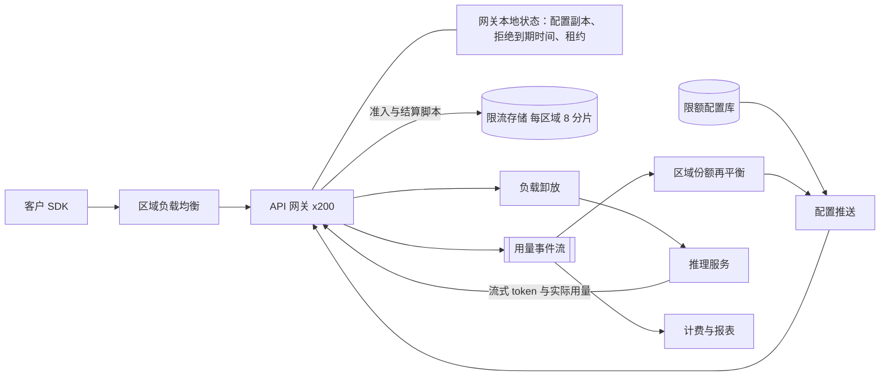

# 设计 API 限流

## 题目

Design the rate limiter for a public LLM API.

**What you have.**

- Customers call the generation endpoint `POST /v1/messages` as an *organization*.
- Each organization has three limits per model class: requests per minute (RPM), input tokens per
  minute (ITPM) and output tokens per minute (OTPM).
- An organization can give its workspaces lower sub-limits. The organization-wide limit always
  applies as well.

If you ask, the interviewer gives these numbers (all practice assumptions):

**Scale.**

- **100,000 requests/s** at peak, arriving at **200 API gateway instances** in **3 regions**. A round
  trip between regions takes about **100 ms**.
- **200,000 active organizations**, each with on average 3 active (model class × workspace)
  combinations.
- The largest organization sends **10%** of peak traffic.
- An example customer has limits of **4,000 RPM, 2,000,000 ITPM and 400,000 OTPM**. Its typical
  request has 2,000 input tokens and 400 output tokens, but sets `max_tokens` to 4,000. Responses
  are streamed and last about 10 seconds.

**Requirements.**

- The rate-limit check adds at most **5 ms at p99** to each request.
- A request over the limit gets a `429` that tells the client how long to wait.
- Short bursts are allowed, within a bound: the long-run average stays within the limit, and over any
  period the extra admitted is at most a burst allowance set in advance.
- Limits are global: an organization's usage in all three regions counts together.
- A failure of the rate limiter itself must not make the whole API unavailable.
- When an admin changes a limit, the change takes effect within **10 seconds**.

**Design:**

1. A capacity estimate: how big the rate-limit state is, and how many calls per second the store
   has to handle.
2. The data model, the internal interfaces, and the external `429` response.
3. The architecture, and the path one request takes through the rate limiter.

**Topics the interviewer will dig into.**

- **(a) Algorithm.** Which rate-limiting algorithm do you pick, and why?
- **(b) Atomic check-and-deduct.** How do you make "check the limit, then deduct" a single atomic
  step?
- **(c) Hot spot.** How do you handle the hot spot the largest customer creates?
- **(d) Output tokens.** Output tokens are not known when a request is admitted. How do you account
  for them?
- **(e) Failures and regions.** What happens when the rate limiter fails, and how do you handle
  three regions?

**Out of scope:** authentication, billing and monthly spend caps, abuse detection, and scheduling and
load shedding inside the inference cluster.

The external shape (three limit dimensions, token buckets, `429` with `retry-after`) follows the
public Claude API docs ([Rate limits](https://platform.claude.com/docs/en/api/rate-limits)). Only that
external shape is borrowed; nothing here describes any company's internal implementation. For the
single-process coding version, see [Rate Limiter Bug Hunt](#/openai/coding/rate-limiter-debug); this
page is about many gateways, shared state and failures.

## 参考解答

<details>
<summary>展开参考解答</summary>

动手之前先确认三件事。第一，一个请求要同时过几个桶：请求数、输入 token、输出 token 各一个；工作区设了子限额，还要再过工作区的三个。任何一个不够就拒绝，而且被拒的请求不能扣掉别的桶。第二，精度要多高：题目允许有界的超发，所以不需要每个请求都做全局一致的协调，这是能做到 5 ms 的前提。第三，限流器挂了是放行还是拒绝：题目要求不能拖垮 API，所以默认放行（fail-open），但要有本地兜底，不能变成无限放行。

### 需求与规模

**功能**：每个请求转给推理服务之前做准入检查；不够就返回 `429` 和需要等待的秒数；响应带剩余额度的响应头；请求结束后按实际 token 数结算；管理员修改组织和工作区的限额。

**非功能**：见题目。

**估算**（每个数字都由文末"估算核对"里的代码重算并断言）：

| 量 | 算法 | 结果 |
|---|---|---|
| 每个网关 | 100,000 / 200 | 500 请求/秒 |
| 存储调用 | 每个请求一次准入、一次结算（结算合并后只会更少） | 200,000 次/秒 |
| 存储分片 | 假设单个节点能稳定承载 50,000 次脚本调用/秒（练习假设，实际要压测） | 至少 4 个；用 8 个分片，各 25,000 次/秒，利用率 50% |
| 令牌桶个数 | 20 万组织 × 3 个组合 × 3 个维度 | 180 万个；每个约 200 B（含键名和开销，假设），共 360 MB |
| 对比：滑动日志 | 峰值 100,000 × 60 秒 | 600 万条，每条 50 B（假设），300 MB；最大客户一个键里就有 60 万条 |
| 示例客户哪个限额先到 | RPM 4,000；ITPM 2,000,000 / 2,000 = 1,000；OTPM 400,000 / 400 = 1,000 | 每分钟 1,000 个请求。两个 token 限额同时卡住，RPM 只用到 1/4 |
| 示例客户的补充速率 | 400,000 / 60；2,000,000 / 60 | 每秒 6,666.7 个输出 token，33,333 个输入 token |
| 最大客户 | 100,000 × 10% | 10,000 请求/秒，即 20,000 次存储调用/秒，全在一个分片上；该分片 20,000 + 22,500 = 42,500 次/秒，利用率 85% |
| 最大客户在每个网关 | 10,000 / 200 | 50 请求/秒，每 100 ms 5 个 |
| 最大客户改用租约后 | 200 个网关 × 每 100 ms 续租一次 | 2,000 次/秒，是原来的 1/10；该分片降到 24,500 次/秒，利用率 49% |
| 小客户 | 60 RPM 分到 200 个网关 | 每个网关每秒 0.005 个请求，租约不划算 |
| 跨区域 | 往返 100 ms，预算 5 ms | 差 20 倍，不能每个请求都跨区域同步 |

这组数字说明两件事。第一，总量不难：180 万个桶放在内存里只有几百 MB，8 个分片平均利用率 50%。第二，难的是热点。脚本要原子地改一个组织的所有桶（见 (b)），所以一个组织的桶必须在同一个分片上；最大客户一家就让它所在的分片到 85%。(c) 专门处理这件事。

### 数据模型与 API

**限额配置**（关系数据库，是事实来源。下面的 `sql` 只做展示）：

```sql
CREATE TABLE rate_limits (
  org_id        BIGINT NOT NULL,
  workspace_id  BIGINT NOT NULL,          -- 0 = the organisation-wide limit
  model_class   TEXT   NOT NULL,
  dimension     TEXT   NOT NULL,          -- 'rpm' | 'itpm' | 'otpm'
  per_minute    BIGINT NOT NULL,
  burst         BIGINT NOT NULL,          -- bucket capacity, default = per_minute
  updated_at    TIMESTAMPTZ NOT NULL,
  PRIMARY KEY (org_id, workspace_id, model_class, dimension)
);
```

**桶状态**（Redis 哈希，每个桶一个键）：

- 键名形如 `{org:7}:<模型类别>:rpm`（组织级）和 `{org:7}:ws:3:<模型类别>:rpm`（工作区级）；估算核对里省略了模型类别。花括号里的部分是哈希标签（hash tag）：Redis Cluster 只用它算哈希槽（hash slot），所以同一组织的所有桶都在同一个槽里。
- 字段：`tokens` 是当前令牌数，可以是小数，也可以是负数（表示欠账，见 (d)）；`ts` 是上次更新时的服务器时间（毫秒）。
- 过期时间：桶补满所需的时间再加 1 秒。键过期等价于满桶，所以只有最近活跃的桶占内存。

**网关内存**：每个进行中的请求在每个桶预扣了多少（结算要用）；每个组织的"拒绝到期时间"（见追问）；租约余额（见 (c)）；限额配置的本地副本。

**内部接口**（网关调存储，每次都是一次脚本调用）：

| 调用 | 参数 | 返回 |
|---|---|---|
| `ADMIT` | 键列表；每个桶的（每分钟限额，突发额度，本次扣多少） | `{1, 0}` 放行；`{0, 等待毫秒数}` 拒绝，什么都不写 |
| `SETTLE` | 键列表；每个桶的（每分钟限额，突发额度，补扣为正、退还为负） | `1` |

**对外**：

- 超限返回 `429`，说明超的是哪个限额，带 `retry-after`（秒，向上取整）。
- 响应带剩余额度的响应头。公开的 Claude API 文档列出的是 `anthropic-ratelimit-requests-limit`、`-remaining`、`-reset`，以及输入、输出 token 的同类头；`reset` 是桶补满的时刻。
- 管理接口：`PUT /v1/organizations/{org}/workspaces/{ws}/rate_limits`，写配置库。

### 架构



**一个请求的路径**

1. SDK 经区域负载均衡到某个网关。网关鉴权，得到组织、工作区和模型类别，从本地配置副本取出相关的限额：组织级三个，工作区设了子限额再加三个。
2. 如果本地记着这个组织刚被拒、还没到 `retry-after` 的时间，直接返回 `429`，不访问存储。这可能比存储里的真实状态多拒一小会儿（别的请求结算退回的额度要到期后才用得上），换来的是被拒的流量不打到存储上。
3. 估算本次代价：请求数 1；输入 token 先按请求大小粗估；输出 token 预扣多少见 (d)。
4. 用 `EVALSHA` 调 `ADMIT` 脚本，超时 3 ms。如果服务器返回 `NOSCRIPT`（脚本缓存里没有，比如节点刚重启），改用 `EVAL` 发一次完整脚本。
5. 放行就转给负载卸放层和推理服务。拒绝就返回 `429`，`retry-after` = 等待毫秒数除以 1,000 向上取整，同时在本地记下拒绝到期时间。
6. 流式输出期间，网关数出每个组织在本网关上产出的 token，每秒合并成一次 `SETTLE`；请求结束时按推理服务报告的实际输入、输出 token 数补扣或退还差额。用量另外写进事件流给计费和报表；限流不读计费数据，计费也不依赖限流存储。
7. 存储调用超时或分片不可用：按 (e) 的本地兜底规则决定，不让请求卡住。

### 深入话题

**(a) 选哪种算法**

以每分钟 60 次为例。客户端先静默到第 59.9 秒，然后每 0.1 秒尽可能多地请求，一直到第 180 秒。估算核对里测出的最坏情况：

| 算法 | 存什么 | 0.2 秒内最多放行 | 任意 60 秒内最多放行 | 说明 |
|---|---|---|---|---|
| 固定窗口计数（fixed window） | 每个窗口一个计数 | 120 | 120 | 窗口边界两侧各放行一个满额，瞬间 2 倍 |
| 滑动日志（sliding log） | 窗口内每个请求的时间 | 60 | 60 | 精确，但状态和工作量正比于请求数 |
| 滑动窗口计数（sliding window counter） | 本窗口和上一窗口两个计数 | 60 | 119 | 上一窗口的计数按它还留在视野里的比例加权。这假设上一窗口的请求是均匀的，突发挤在窗口末尾时就不准 |
| 令牌桶（token bucket），突发 60 | 令牌数和时间戳 | 60 | 119 | 不超过 突发 + 速率 × 60 = 120 |
| 令牌桶，突发 10 | 同上 | 10 | 69 | 不超过 10 + 60 = 70 |

持续稳定地请求时，五种都是每分钟放行 59 到 60 个，差别只在突发上。

令牌桶的保证可以写成一句话：任意长度为 $T$ 的时间段里，放行的总代价不超过 $\text{burst} + \text{rate} \times T$。估算核对用随机的到达时间和随机代价（1 到 5）检查了 $T$ = 1、10、60 秒。这正是题目要的"有界突发"，而且突发额度是一个明确的参数。

推荐令牌桶，理由：

- 状态是两个数，和流量无关。滑动日志在这个规模下总内存其实差不多（300 MB 对 360 MB），问题是它随流量增长，而且集中在大客户身上：最大客户一个键里有 60 万条。token 限额要的是窗口内代价之和，有序集合（sorted set）能按分数范围数条数，但不会求和；要么每次遍历，要么另存一个累计和、过期时逐条减掉。
- 天然支持按代价扣（一个请求扣 2,000 个输入 token），还能算出精确的等待时间：（代价 − 现有令牌）/ 速率，直接用作 `retry-after`。
- 突发额度是产品决定。设成一分钟的限额，空闲之后可以一口气用完一分钟的量，任意 60 秒内最多接近 2 倍；设小一些就更平滑。公开的 Claude API 文档描述的就是这种行为：用令牌桶持续补充，而不是在固定时刻重置；每分钟 60 个请求可能按每秒 1 个执行。

GCRA（generic cell rate algorithm）是令牌桶的另一种写法，只存一个"理论到达时间"（TAT）。估算核对验证了它和令牌桶在随机输入上每一步的决定都相同，而且令牌数恒等于 burst − rate × max(0, TAT − t)。它省一个字段，但哈希里存两个字段并不贵，令牌数还能直接放进剩余额度的响应头，所以本题用令牌桶的写法。

**(b) "检查并扣减"必须是一步**

200 个网关共享同一组桶。几种直接的写法：

- **网关里先 `GET` 再 `SET`**：两个网关都读到"剩 1 个令牌"，都放行。估算核对穷举了两个网关各两步的全部 6 种交错，其中 4 种放行了 2 个请求。
- **`INCR` 再 `EXPIRE`，分两次调用**（固定窗口的常见写法）：`INCR` 本身是原子的，但客户端如果在两次调用之间崩溃，计数器就永远不会过期。估算核对里限额是 3：正常时每个窗口放行 3 个；崩溃一次之后，后面的窗口一个都不放行。Redis 的 `INCR` 文档在限流示例里也指出了这个竞态，建议改成 Lua 脚本。
- **`MULTI` / `EXEC`**：事务里的命令先排队，`EXEC` 时依次执行，中间不会插入别的客户端的命令。但读到的值要到 `EXEC` 之后才拿到，所以没法"读出来、判断、再决定写不写"。某条命令执行时出错，其余命令照样执行，不回滚。
- **`WATCH` + `MULTI` / `EXEC`**（乐观的检查并设置）：被 `WATCH` 的键在 `EXEC` 之前被别人改过，`EXEC` 就返回空，客户端重读重试。结果是对的（估算核对里 6 种交错都只放行 1 个），但每次冲突多一次往返，而冲突最多的恰好是最热的键。

推荐：**把整段逻辑写成一个 Lua 脚本，在服务器端原子执行**。Redis 执行脚本期间不处理别的命令，所以脚本要短；这里只是对 3 到 6 个桶各做一次常数时间的计算。要点：

1. 先检查所有桶，全部够了才一起扣（全有或全无）。如果一个桶一个桶地扣、在第一个不够的桶停下，被拒的请求也会吃掉前面桶的额度。估算核对里：100 个因为输入 token 不够被拒的请求，把 RPM 桶从 3,999 吃到了 3,899。
2. 所有键都通过 `KEYS` 传入，不在脚本里拼键名。Redis Cluster 靠它决定把脚本发到哪个节点；一次调用涉及的键必须在同一个哈希槽，否则会被拒绝。哈希标签 `{org:7}` 让同一组织的所有桶（包括工作区的桶）都在同一个槽里。
3. 时间用脚本里的 `redis.call('TIME')` 取服务器时间，不用网关传进来的时间，这样 200 个网关的时钟偏差不影响结果。Redis 复制脚本时传给副本的是脚本产生的写命令（效果复制），不是脚本本身，所以在脚本里读时间是允许的。主从切换后新主库的时钟可能略慢，`math.max(0, now - ts)` 保证不会因此倒扣令牌。
4. 拒绝时什么都不写，只返回要等的毫秒数；放行时写回令牌数和时间，并把过期时间设成"补满所需时间 + 1 秒"。

```lua
-- ADMIT: KEYS = buckets; ARGV = limit_per_min, burst, cost for each bucket, in the same order
local t = redis.call('TIME')
local now = t[1] * 1000 + math.floor(t[2] / 1000)
local have, wait = {}, 0
for i = 1, #KEYS do
  local limit, burst, cost = tonumber(ARGV[3*i-2]), tonumber(ARGV[3*i-1]), tonumber(ARGV[3*i])
  local s = redis.call('HMGET', KEYS[i], 'tokens', 'ts')
  local tokens = burst
  if s[1] then
    tokens = math.min(burst, tonumber(s[1]) + math.max(0, now - tonumber(s[2])) * limit / 60000)
  end
  have[i] = tokens
  if tokens < cost then
    wait = math.max(wait, (cost - tokens) * 60000 / limit)
  end
end
if wait > 0 then
  return {0, math.ceil(wait)}
end
for i = 1, #KEYS do
  local limit, burst, cost = tonumber(ARGV[3*i-2]), tonumber(ARGV[3*i-1]), tonumber(ARGV[3*i])
  local left = have[i] - cost
  redis.call('HSET', KEYS[i], 'tokens', left, 'ts', now)
  redis.call('PEXPIRE', KEYS[i], math.ceil((burst - left) * 60000 / limit) + 1000)
end
return {1, 0}

-- SETTLE: ARGV = limit_per_min, burst, delta for each bucket (delta > 0 charges, < 0 refunds)
local t = redis.call('TIME')
local now = t[1] * 1000 + math.floor(t[2] / 1000)
for i = 1, #KEYS do
  local limit, burst, delta = tonumber(ARGV[3*i-2]), tonumber(ARGV[3*i-1]), tonumber(ARGV[3*i])
  local s = redis.call('HMGET', KEYS[i], 'tokens', 'ts')
  local tokens = burst
  if s[1] then
    tokens = math.min(burst, tonumber(s[1]) + math.max(0, now - tonumber(s[2])) * limit / 60000)
  end
  local left = math.min(burst, tokens - delta)
  redis.call('HSET', KEYS[i], 'tokens', left, 'ts', now)
  redis.call('PEXPIRE', KEYS[i], math.ceil((burst - left) * 60000 / limit) + 1000)
end
return 1
```

这是两个独立的脚本，分别注册。估算核对第 4 节是它们的 Python 对照版：同样的公式，同样的全有或全无。作者另外用 fakeredis（一个进程内的 Redis 模拟器，用 lupa 执行真正的 Lua）把脚本和对照版逐次比较过返回值和存储值；它不是真正的 Redis 服务器。

估算核对里的例子：先放行一个 150 万输入 token 的请求，再来一个 100 万的被拒，返回要等 15,000 ms（差 50 万，按每分钟 200 万补充正好 15 秒），`retry-after` 是 15 秒，RPM 桶没被动。第 14,999 ms 重试仍被拒，第 15,000 ms 放行。

**(c) 最大客户：别让一个组织压垮一个分片**

估算里最大客户每秒 10,000 个请求，全在一个分片上，把它推到 85%，再涨一点就超过单节点容量。几种办法：

- **每个请求都查中心存储**（默认）：最准，但调用量正比于请求数。
- **本地计数、定期上报**：每个网关拿着上次同步时的"剩余 100"各自放行。估算核对里 20 个网关各放行 100 个，合计 2,000 个，超发 1,900。要不超发，只能把剩余额度按网关数平分，那就成了静态拆分。
- **把桶拆成 k 个子桶**放到不同分片，每个网关固定用其中一个：调用量分散了，但每个子桶只有 1/k 的额度。流量不均时，有的子桶闲着，有的子桶在拒绝。
- **租约（lease）**：网关一次从中心桶领一小块额度（比如 10 个请求），在本地花，到期把没花完的还回去。领和还都是一次原子的脚本调用，中心桶始终把租出去的额度当作已经花掉，所以不会超发；代价是额度可能闲置在用不上它的网关里。结算也攒在本地，随续租一起上报；续租时一次调用同时还回上一块剩下的、领新的一块（估算里按一次算，下面的模拟把领和还分开算，更保守）。

估算核对模拟了一个 6,000 RPM、突发 100 的组织，以每秒 150 个请求打到 20 个网关上，跑 120 秒：

| 做法 | 放行 | 中心存储调用 | 任意 60 秒内最多放行 |
|---|---|---|---|
| 每个请求都查 | 12,098 | 18,000 | 6,097 |
| 租约：每次 10 个，租期 1 秒 | 12,019（99.3%） | 2,885（16%） | 6,037 |

两条调参规律。每次领的量要盖住一个网关在一个租期里收到的请求：这里每个网关每秒 7.5 个，每次只领 5 个时，放行量掉到逐次检查的 90% 以下。租期要长到能看到好几个请求，否则几乎省不了调用：租期改成 100 ms，调用量仍是逐次检查的 80% 以上。

小客户正好相反。一个 60 RPM、突发 10 的组织，10 个请求在 10 毫秒内落到 10 个不同的网关上。逐次检查全部放行；用每次 5 个的租约，前两个网关把 10 个令牌领光，后面 8 个请求被拒，10 次调用一次也没省。

推荐：按组织分档。默认每个请求查中心存储；某个组织在单个网关上的速率超过阈值（比如一个租期里能看到 5 个以上请求）就切到租约模式。估算里的最大客户在每个网关上每 100 ms 有 5 个请求，租期 100 ms、每次领 10 个左右，就能把它的调用量从 20,000 次/秒降到 2,000 次/秒，分片利用率从 85% 降到 49%。

**(d) 输出 token 在准入时还不知道**

准入时只知道 `max_tokens`（4,000），实际输出要生成完才知道（示例客户平均 400）。三种记账方式：

1. **按 `max_tokens` 预扣**，结束时退还多扣的。永远不会欠账，但对把 `max_tokens` 设得大的客户很不公平。
2. **按估计值预扣**（比如这个组织最近的平均输出 400），结束时多退少补。
3. **边生成边扣**：不预扣，流式输出每产生一段就从桶里扣掉。桶可以被扣成负数（欠账），欠账期间新请求一律拒绝。

估算核对用 100 ms 一步模拟示例客户的输出桶（限额 400,000/分钟，突发 400,000，每个回复持续 10 秒）：

| 场景 | 按 max_tokens 预扣 | 按估计值预扣 | 边生成边扣 |
|---|---|---|---|
| (A) 满桶时同时来 300 个请求，各输出 400 | 放行 100 个；拒掉 200 个时，这一分钟只用了 10% 的额度 | 放行 300 个，桶最低 280,000 | 放行 300 个，桶最低 346,000 |
| (B) 同样 300 个请求，但每个都写满 4,000 | 放行 100 个，共输出 400,000，桶最低 0 | 放行 300 个，结算时桶跌到约 −733,333 | 放行 300 个，10 秒内输出 120 万，桶最低 −734,000 |
| (C) 持续以约 2.4 倍限额请求（每秒 40 个，输出 100 或 700） | 每分钟 400,219 | 每分钟 400,024 | 每分钟 400,000 |

怎么读：

- (C) 说明长期来看三种方式都收敛到限额（误差不到 1%），差别只在突发和公平性上。
- (A) 是方式 1 的问题：客户为了不被截断把 `max_tokens` 设大，就被当成真要用这么多。
- (B) 是方式 2 和 3 的问题：一批长回复同时放行，第一分钟输出了 120 万，是"突发 40 万 + 一分钟补充 40 万"的 1.5 倍。之后要按每秒 6,666.7 个慢慢还，大约 110 秒内新请求全被拒。估计值只是把欠账推迟到结算时才出现。

欠账的上界是"同时在跑的流的个数 × `max_tokens`"。所以推荐**方式 3，再加每个组织的并发上限**。并发上限设成 100 时，(B) 只放行 100 个，桶最低 66,000，不欠账；一般情况下欠账也不会超过 100 × 4,000 = 400,000，正好一个突发额度。已经在跑的流不中途掐断，否则已经花掉的算力就白费了；欠账只挡新请求。网关按组织把每秒产出的 token 合并成一次 `SETTLE`，调用量不随 token 数增长。

结算的规则也在估算核对里：退还不会让桶超过突发额度；补扣可以扣成负数。桶欠 20,000 时，下一个请求要等 3,001 ms（每分钟补 40 万，补到 1 个令牌），`retry-after` 向上取整是 4 秒。

公开的 Claude API 文档描述的对外行为属于方式 3：OTPM 在输出 token 产生时实时计算，只计实际生成的 token，`max_tokens` 不影响 OTPM。输入 token 是另一种情况：文档说 ITPM 在请求开始时估算、请求过程中按实际数调整，而且从提示缓存（prompt caching）读出的输入 token 不计入 ITPM。文档没讲内部怎么实现，这里只拿它说明这些产品选择确实存在。按成本准入的另一个例子见 [实时 AI 功能](#/openai/system-design/realtime-ai-feature)。

**(e) 故障、多区域，以及限流和负载卸放的分工**

存储出故障时：

- **拒绝（fail-closed）**：限流存储成了整个 API 的单点，违反题目要求。
- **完全放开**：故障期间任何一个客户都能打满后端。
- **推荐：放行，但用本地兜底**。网关给每个组织在本地维护一个保守的令牌桶，速率 = 组织限额 / 网关数 × 放宽系数（比如 2）。存储调用超时（3 ms）或熔断时就用它决定。所有网关加起来最多放行放宽系数倍的限额，超发有上界；代价是小客户在兜底期间会被多拒一些，因为它的额度被摊薄到了 200 个网关上。后端另外有负载卸放保护，不会因为限流放宽而被打垮。
- **主从切换**：Redis Cluster 是异步复制，官方文档明说故障切换时可能丢掉已经确认的写。对限流来说，丢掉的是最近几次扣减，桶看起来比实际满，结果是切换后短时间多放行一些。这可以接受。对比 [银行 App](#/anthropic/system-design/banking-app)：那里正是因为这一点不用 Redis 存幂等键，因为丢一次就可能扣两次钱；这里错一点只是多放几个请求。

多区域：

- 每个请求跨区域查一个全球桶：往返 100 ms，是 5 ms 预算的 20 倍，不行。
- 静态拆成三份：示例客户每个区域 1,333 RPM。流量集中在一个区域时，客户只能用到三分之一。
- **推荐：每个区域一套存储、各持一份额度，后台按最近的用量大约每秒重新分配一次**，三份之和等于限额。大部分组织的流量本来就集中在一个区域，份额几乎全在那里。流量在区域之间迁移时，最多在一个再分配周期里多拒或多放一些。组织级的桶和工作区级的桶用同样的分法。

**限流和负载卸放是两件事**。限流回答"这个客户有没有超过他的额度"，按客户算，超了返回 `429`。负载卸放回答"后端此刻还接不接得住"，按容量算，接不住返回 `503`。两者都要：所有客户都在限额内，加起来也可能超过集群容量，因为限额之和通常大于容量（不是每个客户都同时用满）；反过来，后端很闲时也不该放开某个客户的限额。负载卸放和准入控制见 [推理 API 与批处理](#/anthropic/system-design/inference-api-batching)。

### 追问

- **客户收到 `429` 立刻重试，把存储也打爆怎么办？** `retry-after` 要准（从桶算出来），SDK 按它退避并加随机抖动（jitter）。网关本地记住"这个组织在某时刻之前会被拒"，到期前直接拒绝，不访问存储；一个按 10 倍限额狂发的客户，绝大多数请求在网关本地就被挡掉了。脚本拒绝时也不写存储。
- **限额改了怎么生效？** 配置库写入后推送给所有网关，网关另外每 10 秒全量拉一次兜底。限额和突发额度每次都作为参数传给脚本，所以下一次调用就用新值；调低突发额度时，脚本里的 `math.min(burst, …)` 会把多出来的令牌截掉。
- **缓存命中的输入 token 不计入 ITPM，可准入时还不知道会不会命中，怎么办？** 先按全部输入估，结算时把命中缓存的部分退回；估算本身偏低时，结算补扣。和输出 token 一样是"先估后结"，但这里预扣多半偏多，很少欠账。
- **怎么防止一个组织从几乎不用突然涨到满额？** 再加一层增长速度限制：允许的每分钟用量 = 最近一段时间的峰值 + 一个步长，每分钟最多涨一个步长，到限额封顶。实现上还是一个桶，只是它的限额由后台按历史用量更新。公开的 Claude API 文档描述过这类"ramp limit"的对外行为。
- **怎么测试？** 不要用真实时间。把时钟注入进去，像估算核对那样在虚拟时间里重放到达序列，断言"任意 $T$ 秒内放行的量 ≤ burst + rate × $T$"、被拒的请求不改状态、脚本和对照实现逐次一致。并发问题用穷举交错（像 (b) 里的 6 种），或者在测试里开两个连接真的交错执行。单进程限流器常见的 bug 见 [限流器找 bug](#/openai/coding/rate-limiter-debug)。

<details>
<summary>估算核对（可运行）</summary>

```python
import heapq
import itertools
import math
import random
from collections import deque
from fractions import Fraction

# ---------------------------------------------------------------- 1. 估算
peak_rps = 100_000
gateways = 200
assert peak_rps / gateways == 500

store_calls = 2 * peak_rps                   # one admit call + one settle call per request
node_capacity = 50_000                       # assumed safe script calls per second on one store node
assert store_calls == 200_000 and store_calls / node_capacity == 4
shards = 8
assert store_calls / shards == 25_000 and store_calls / shards / node_capacity == 0.5

orgs = 200_000
bucket_count = orgs * 3 * 3                  # 3 active (model class, workspace) scopes x 3 dimensions
assert bucket_count == 1_800_000 and bucket_count * 200 / 1e6 == 360.0          # MB
log_entries = peak_rps * 60                  # a sliding log keeps every request of the last minute
assert log_entries == 6_000_000 and log_entries * 50 / 1e6 == 300.0             # MB

# which of the three limits binds for the example customer
rpm, itpm, otpm = 4_000, 2_000_000, 400_000
in_tok, out_tok = 2_000, 400
assert (rpm, itpm / in_tok, otpm / out_tok) == (4_000, 1_000, 1_000)
assert min(rpm, itpm / in_tok, otpm / out_tok) == 1_000
assert round(otpm / 60, 1) == 6_666.7 and round(itpm / 60) == 33_333

# the largest organisation: 10% of peak traffic, and all of its buckets live on one shard
big_rps = peak_rps // 10
others_per_shard = (store_calls - 2 * big_rps) / shards
assert big_rps == 10_000 and others_per_shard == 22_500
assert big_rps * 60 == 600_000               # a sliding log for this one organisation: 600,000 entries in one key
assert (2 * big_rps + others_per_shard) / node_capacity == 0.85
assert big_rps / gateways == 50 and big_rps / gateways / 10 == 5     # 50 requests/s per gateway, 5 per 100 ms
lease_calls = gateways * 10                  # every gateway renews its lease every 100 ms
assert lease_calls == 2_000 and 2 * big_rps / lease_calls == 10
assert (lease_calls + others_per_shard) / node_capacity == 0.49
# a small organisation: 60 requests per minute spread over 200 gateways
assert 60 / 60 / gateways == 0.005 and gateways * 1 > 60

cross_region_ms, budget_ms = 100, 5
assert cross_region_ms / budget_ms == 20
assert round(rpm / 3) == 1_333               # a static three-way split of the example RPM

# ---------------------------------------------------------------- 2. 四种算法的最坏情况
WINDOW = 60


class FixedWindow:
    def __init__(self, limit):
        self.limit, self.idx, self.count = limit, None, 0

    def allow(self, t):
        idx = t // WINDOW
        if idx != self.idx:
            self.idx, self.count = idx, 0
        if self.count < self.limit:
            self.count += 1
            return True
        return False


class SlidingLog:
    def __init__(self, limit):
        self.limit, self.log = limit, deque()

    def allow(self, t):
        while self.log and self.log[0] <= t - WINDOW:
            self.log.popleft()
        if len(self.log) < self.limit:
            self.log.append(t)
            return True
        return False


class SlidingCounter:
    """This window's count, plus the previous window's count weighted by how much of it is still in view."""

    def __init__(self, limit):
        self.limit, self.idx, self.count, self.prev = limit, None, 0, 0

    def allow(self, t):
        idx = t // WINDOW
        if idx != self.idx:
            self.prev = self.count if self.idx is not None and idx == self.idx + 1 else 0
            self.idx, self.count = idx, 0
        elapsed = Fraction(t - idx * WINDOW, WINDOW)
        if self.prev * (1 - elapsed) + self.count + 1 <= self.limit:
            self.count += 1
            return True
        return False


class TokenBucket:
    def __init__(self, limit, burst):
        self.rate, self.burst, self.tokens, self.ts = Fraction(limit, WINDOW), burst, Fraction(burst), 0

    def allow(self, t, cost=1):
        self.tokens = min(self.burst, self.tokens + (t - self.ts) * self.rate)
        self.ts = t
        if self.tokens >= cost:
            self.tokens -= cost
            return True
        return False


def worst_window(spent, length=WINDOW):
    """Largest total cost admitted inside any half-open window (t - length, t]. spent: [(time, cost)]."""
    best = total = left = 0
    for t, cost in spent:
        total += cost
        while spent[left][0] <= t - length:
            total -= spent[left][1]
            left += 1
        best = max(best, total)
    return best


def greedy(limiter, start, end, step=Fraction(1, 10)):
    """A client that stays silent until `start`, then asks as often as it can."""
    admitted, t = [], start
    while t < end:
        while limiter.allow(t):
            admitted.append((t, 1))
        t += step
    return admitted


L = 60                                                       # 60 requests per 60 seconds
late = Fraction(599, 10)                                     # 59.9 s: just before the first window ends
INSTANT = Fraction(1, 5)                                     # a 0.2 s window: how big is the largest burst
makers = {"fixed": lambda: FixedWindow(L), "log": lambda: SlidingLog(L), "counter": lambda: SlidingCounter(L),
          "bucket60": lambda: TokenBucket(L, burst=60), "bucket10": lambda: TokenBucket(L, burst=10)}
worst = {}
for name, make in makers.items():
    spent = greedy(make(), late, 180)
    worst[name] = (worst_window(spent, INSTANT), worst_window(spent))
assert worst == {
    "fixed": (120, 120),        # twice the limit inside 0.2 s, straddling the window boundary
    "log": (60, 60),            # exact
    "counter": (60, 119),       # no instant doubling, but almost twice the limit over one minute
    "bucket60": (60, 119),      # <= burst + rate x 60 = 120
    "bucket10": (10, 69),       # <= burst + rate x 60 = 70
}
# under a steady flood every one of them lets through about one limit's worth per minute
for name, make in makers.items():
    per_minute = sum(1 for t, _ in greedy(make(), 0, 600) if t >= 60) / 9
    assert 59 <= per_minute <= 60, (name, per_minute)

# the token-bucket bound for arbitrary arrivals and costs: any window of length T admits <= burst + rate * T
rng = random.Random(1)
for _ in range(100):
    limit, burst = rng.choice([30, 60, 600]), rng.choice([5, 20, 60])
    bucket, t, spent = TokenBucket(limit, burst), Fraction(0), []
    for _ in range(300):
        t += Fraction(rng.choice([0, 0, 1, 5, 20, 300]), 10)
        cost = rng.randint(1, 5)
        if bucket.allow(t, cost):
            spent.append((t, cost))
    assert len(spent) > 50
    for T in (1, 10, 60):
        assert worst_window(spent, T) <= burst + Fraction(limit, WINDOW) * T


class GCRA:
    """The same decisions as a token bucket, kept as one number: the theoretical arrival time."""

    def __init__(self, limit, burst):
        self.rate, self.burst, self.tat = Fraction(limit, WINDOW), burst, Fraction(0)

    def allow(self, t, cost=1):
        if max(self.tat, t) - t <= (self.burst - cost) / self.rate:
            self.tat = max(self.tat, t) + cost / self.rate
            return True
        return False


for _ in range(100):
    limit, burst = rng.choice([30, 60, 600]), rng.choice([5, 20, 60])
    one, two, t = TokenBucket(limit, burst), GCRA(limit, burst), Fraction(0)
    for _ in range(300):
        t += Fraction(rng.choice([0, 0, 1, 5, 20, 300]), 10)
        cost = rng.randint(1, 5)
        assert one.allow(t, cost) == two.allow(t, cost)
        assert one.tokens == burst - one.rate * max(0, two.tat - t)


# ---------------------------------------------------------------- 3. 检查和扣减必须是一步
def interleavings(n_clients, steps_each):
    return sorted(set(itertools.permutations([c for c in range(n_clients) for _ in range(steps_each)])))


def admitted_get_then_set(order):
    store, seen, admitted = {"tokens": 1}, {}, 0
    for client in order:
        if client not in seen:
            seen[client] = store["tokens"]                   # step 1: GET
        elif seen[client] >= 1:                              # step 2: decide in the gateway, then SET
            store["tokens"] = seen[client] - 1
            admitted += 1
    return admitted


def admitted_atomic(order):
    store, admitted = {"tokens": 1}, 0
    for _ in order:                                          # the whole check-and-decrement is one step
        if store["tokens"] >= 1:
            store["tokens"] -= 1
            admitted += 1
    return admitted


def admitted_check_and_set(order):
    """WATCH / MULTI / EXEC: the write is applied only if the key has not changed since it was read."""
    store, version, seen, admitted = {"tokens": 1}, 0, {}, 0
    pending = list(order)
    while pending:
        client = pending.pop(0)
        if client not in seen:
            seen[client] = (store["tokens"], version)
            continue
        tokens, read_version = seen.pop(client)
        if read_version != version:
            pending += [client, client]                      # EXEC returned nil: read again and try again
        elif tokens >= 1:
            store["tokens"], version, admitted = tokens - 1, version + 1, admitted + 1
    return admitted


orders = interleavings(2, 2)
assert len(orders) == 6
assert sorted(admitted_get_then_set(o) for o in orders) == [1, 1, 2, 2, 2, 2]    # 4 of 6 spend the one token twice
assert {admitted_atomic(o) for o in interleavings(2, 1)} == {1}
assert {admitted_check_and_set(o) for o in orders} == {1}


def incr_then_expire(crash_between, attempts=5, limit=3):
    """A fixed window as two calls. If the client dies after INCR and before EXPIRE the counter never resets."""
    counter, has_ttl, admitted_per_window = 0, False, []
    for window in range(3):
        if has_ttl:
            counter, has_ttl = 0, False                      # the key expired at the end of the window
        admitted = 0
        for _ in range(attempts):
            counter += 1                                     # INCR
            if counter == 1 and not (crash_between and window == 0):
                has_ttl = True                               # EXPIRE, sent as a second call by the client that saw 1
            admitted += counter <= limit
        admitted_per_window.append(admitted)
    return admitted_per_window


assert incr_then_expire(crash_between=False) == [3, 3, 3]
assert incr_then_expire(crash_between=True) == [3, 0, 0]     # locked out for good


# ---------------------------------------------------------------- 4. 脚本的 Python 对照版：多个桶，全有或全无
def refilled(state, key, limit, burst, now_ms):
    if key not in state:
        return burst                                         # a missing key is a full bucket
    tokens, ts = state[key]
    return min(burst, tokens + max(0, now_ms - ts) * limit / 60_000)


def admit(state, now_ms, buckets):
    """buckets: [(key, limit per minute, burst, cost)]. Returns (allowed, milliseconds to wait)."""
    have, wait = [], 0
    for key, limit, burst, cost in buckets:
        have.append(refilled(state, key, limit, burst, now_ms))
        if have[-1] < cost:
            wait = max(wait, (cost - have[-1]) * 60_000 / limit)
    if wait > 0:
        return False, math.ceil(wait)                        # rejected: nothing is written
    for (key, limit, burst, cost), tokens in zip(buckets, have):
        state[key] = (tokens - cost, now_ms)
    return True, 0


def settle(state, now_ms, buckets):
    """buckets: [(key, limit per minute, burst, delta)]. delta > 0 charges, delta < 0 refunds. Debt is allowed."""
    for key, limit, burst, delta in buckets:
        state[key] = (min(burst, refilled(state, key, limit, burst, now_ms) - delta), now_ms)


def one_by_one(state, now_ms, buckets):
    """The bug to avoid: take from one bucket after another and stop at the first refusal."""
    return all(admit(state, now_ms, [bucket])[0] for bucket in buckets)


RPM_KEY, ITPM_KEY, OTPM_KEY = "{org:7}:rpm", "{org:7}:itpm", "{org:7}:otpm"


def request(input_tokens):
    return [(RPM_KEY, rpm, rpm, 1), (ITPM_KEY, itpm, itpm, input_tokens)]


state = {}
assert admit(state, 0, request(1_500_000)) == (True, 0)
assert admit(state, 0, request(1_000_000)) == (False, 15_000)    # 500,000 short at 2,000,000 per minute
assert state[RPM_KEY] == (3_999, 0)                              # the refused request cost nothing
assert admit(state, 14_999, request(1_000_000))[0] is False
assert admit(state, 15_000, request(1_000_000)) == (True, 0)     # and waiting as told is enough
careless = {}
assert one_by_one(careless, 0, request(1_500_000))
assert not any(one_by_one(careless, 0, request(1_000_000)) for _ in range(100))
assert careless[RPM_KEY] == (3_899, 0)                           # 100 refused requests ate 100 request slots
# a refund never lifts a bucket above its burst; a charge may push it into debt, and debt blocks admission
state = {}
settle(state, 0, [(OTPM_KEY, otpm, otpm, -5_000)])
assert state[OTPM_KEY] == (400_000, 0)
settle(state, 0, [(OTPM_KEY, otpm, otpm, 420_000)])
assert state[OTPM_KEY] == (-20_000, 0)
assert admit(state, 0, [(OTPM_KEY, otpm, otpm, 1)]) == (False, 3_001)    # 20,001 tokens at 400,000 per minute
assert admit(state, 3_001, [(OTPM_KEY, otpm, otpm, 1)]) == (True, 0)
assert [math.ceil(ms / 1_000) for ms in (15_000, 3_001)] == [15, 4]     # retry-after is whole seconds, rounded up


# ---------------------------------------------------------------- 5. 输出 token 事先不知道：三种记账
def run_output(mode, arrivals, seconds, limit=400_000, max_tokens=4_000, estimate=400, stream_s=10, max_running=None):
    """One organisation's output-token bucket in 100 ms steps. arrivals[step] = [actual output tokens, ...].
    Returns (requests admitted, lowest bucket level, tokens produced in each step)."""
    per_step, burst, stream_steps = Fraction(limit, 600), limit, stream_s * 10
    reserve = {"reserve_max": max_tokens, "reserve_estimate": estimate, "pay_as_produced": 0}[mode]
    tokens, lowest, admitted, running, flow = Fraction(burst), burst, 0, 0, Fraction(0)
    ending, produced = {}, []
    for step in range(seconds * 10):
        tokens = min(burst, tokens + per_step)
        if not reserve:
            tokens -= flow                                   # charge what the open streams produced in this step
        produced.append(flow)
        for actual in ending.pop(step, []):
            running, flow = running - 1, flow - Fraction(actual, stream_steps)
            if reserve:
                tokens = min(burst, tokens + reserve - actual)   # refund the unused part, or charge the excess
        for actual in arrivals.get(step, []):
            if tokens >= max(reserve, 1) and (max_running is None or running < max_running):
                tokens -= reserve
                admitted, running, flow = admitted + 1, running + 1, flow + Fraction(actual, stream_steps)
                ending.setdefault(step + stream_steps, []).append(actual)
        lowest = min(lowest, tokens)
    return admitted, lowest, produced


# (A) 300 ordinary requests at once on a full bucket: each asks for max_tokens = 4,000 and really produces 400
typical = {0: [400] * 300}
a_max, low_max, _ = run_output("reserve_max", typical, 60)
a_est, low_est, _ = run_output("reserve_estimate", typical, 60)
a_pay, low_pay, _ = run_output("pay_as_produced", typical, 60)
assert (a_max, low_max) == (100, 0)                          # 200 of 300 refused, yet only 10% of the minute was used
assert 100 * 400 / 400_000 == 0.1
assert (a_est, low_est) == (300, 280_000)
assert (a_pay, low_pay) == (300, 346_000)                    # 120,000 produced in 10 s while 66,000 flowed back in

# (B) the same 300 requests, but every one runs to its max_tokens
greedy_users = {0: [4_000] * 300}
b_max, low_b_max, made_max = run_output("reserve_max", greedy_users, 180)
b_est, low_b_est, _ = run_output("reserve_estimate", greedy_users, 180)
b_pay, low_b_pay, made_pay = run_output("pay_as_produced", greedy_users, 180)
b_cap, low_b_cap, _ = run_output("pay_as_produced", greedy_users, 180, max_running=100)
assert (b_max, low_b_max) == (100, 0) and sum(made_max) == 400_000
assert b_pay == 300 and sum(made_pay) == 1_200_000 and low_b_pay == -734_000
assert b_est == 300 and round(low_b_est) == -733_333         # an estimate only moves the debt to settlement time
assert sum(made_pay[:600]) / (400_000 + 400_000) == 1.5      # 1.5 x what burst + one minute of refill allows
assert round(734_000 / (400_000 / 60)) == 110                # seconds of lock-out while the debt is repaid
assert (b_cap, low_b_cap) == (100, 66_000)                   # a concurrency cap of 100 keeps this case out of debt
assert 100 * 4_000 == 400_000                                # debt can never exceed open streams x max_tokens

# (C) sustained demand at 2.4 times the limit: 40 requests/s producing 100 or 700 tokens (400 on average)
steady = {step: [100, 700, 100, 700] for step in range(0, 6_000)}
assert sum(map(sum, steady.values())) / 10 / 400_000 == 2.4  # 960,000 tokens a minute against 400,000
per_minute, lowest_level = {}, {}
for mode in ("reserve_max", "reserve_estimate", "pay_as_produced"):
    _, lowest_level[mode], produced = run_output(mode, steady, 600)
    per_minute[mode] = float(sum(produced[3_000:]) / 5)       # the last five minutes
assert all(abs(value / 400_000 - 1) < 0.01 for value in per_minute.values()), per_minute   # all converge to the limit
assert lowest_level["reserve_max"] == 0 and lowest_level["pay_as_produced"] < 0


# ---------------------------------------------------------------- 6. 把额度租给网关
def random_arrivals(seed, n_gateways, rps, seconds):
    rnd = random.Random(seed)
    return sorted((rnd.randrange(seconds * 1_000), rnd.randrange(n_gateways)) for _ in range(rps * seconds))


def run_fleet(scheme, arrivals, limit_per_min, burst, chunk=10, lease_ms=1_000):
    """arrivals: [(time in ms, gateway)]. Returns (admitted [(time, 1)], calls made to the central store)."""
    bucket = {"tokens": float(burst), "ts": 0, "calls": 0}

    def call(now, want):                     # one atomic call: refill, then grant up to `want` (or take back -want)
        tokens = min(burst, bucket["tokens"] + (now - bucket["ts"]) * limit_per_min / 60_000)
        grant = min(want, math.floor(tokens)) if want > 0 else want
        bucket.update(tokens=min(burst, tokens - grant), ts=now, calls=bucket["calls"] + 1)
        return grant

    held, expires, timers, admitted = {}, {}, [], []
    for now, g in arrivals:
        while timers and timers[0][0] <= now:                # a lease that ran out gives its unused tokens back
            at, h = heapq.heappop(timers)
            if held[h] > 0:
                call(at, -held[h])
                held[h] = 0
        if scheme == "central":
            if call(now, 1) == 1:
                admitted.append((now, 1))
            continue
        if held.get(g, 0) == 0 and now >= expires.get(g, 0):     # at most one lease per gateway per lease period
            held[g], expires[g] = call(now, chunk), now + lease_ms
            heapq.heappush(timers, (expires[g], g))
        if held[g] > 0:
            held[g] -= 1
            admitted.append((now, 1))
    return admitted, bucket["calls"]


# a large organisation: 6,000 requests/min, burst 100, asking for 150 requests/s through 20 gateways
busy = random_arrivals(3, 20, 150, 120)
central_ok, central_calls = run_fleet("central", busy, 6_000, 100)
lease_ok, lease_calls_made = run_fleet("lease", busy, 6_000, 100, chunk=10)
assert central_calls == len(busy) == 18_000
assert worst_window(central_ok, 60_000) <= 100 + 6_000
assert worst_window(lease_ok, 60_000) <= 100 + 6_000 + 100   # a leased token may be spent up to one lease later
assert len(lease_ok) >= 0.99 * len(central_ok) and lease_calls_made <= 0.2 * central_calls
# the exact figures quoted in the text (seeded, so they do not change between runs)
assert (len(central_ok), len(lease_ok)) == (12_098, 12_019) and lease_calls_made == 2_885
assert (worst_window(central_ok, 60_000), worst_window(lease_ok, 60_000)) == (6_097, 6_037)
assert round(len(lease_ok) / len(central_ok), 3) == 0.993 and round(lease_calls_made / central_calls, 2) == 0.16
# the chunk has to cover what a gateway sees in one lease period (7.5 requests here) ...
too_small, _ = run_fleet("lease", busy, 6_000, 100, chunk=5)
assert len(too_small) < 0.9 * len(central_ok)
# ... and the period has to be long enough to see several requests, or almost nothing is saved
_, short_calls = run_fleet("lease", busy, 6_000, 100, chunk=10, lease_ms=100)
assert short_calls > 0.8 * central_calls

# a small organisation: 60 requests/min, burst 10; ten requests land on ten different gateways within 10 ms
scattered = [(ms, ms) for ms in range(10)]
assert len(run_fleet("central", scattered, 60, 10)[0]) == 10
small_ok, small_calls = run_fleet("lease", scattered, 60, 10, chunk=5)
assert (len(small_ok), small_calls) == (2, 10)               # two gateways took everything; no call was saved

# counting locally and reporting once per interval: every gateway spends the same stale remainder
n, remaining, demand_per_gateway = 20, 100, 250
spent_locally = [min(remaining, demand_per_gateway)] * n
assert sum(spent_locally) == 2_000 and remaining - sum(spent_locally) == -1_900

print(f"估算: 存储调用 {store_calls:,} 次/秒, {shards} 个分片各 {store_calls // shards:,} 次/秒; "
      f"最大客户所在分片 {2 * big_rps + others_per_shard:,.0f} 次/秒, 用租约后 {lease_calls + others_per_shard:,.0f} 次/秒")
print("最坏情况 (0.2 秒内, 60 秒内):", worst)
print("持续约 2.4 倍过载时每分钟产出:", {mode: round(value) for mode, value in per_minute.items()})
print(f"租约: 放行 {len(lease_ok)} / 逐次检查 {len(central_ok)}, 存储调用 {lease_calls_made} / {central_calls}")
print("所有断言通过")
```

</details>

</details>
