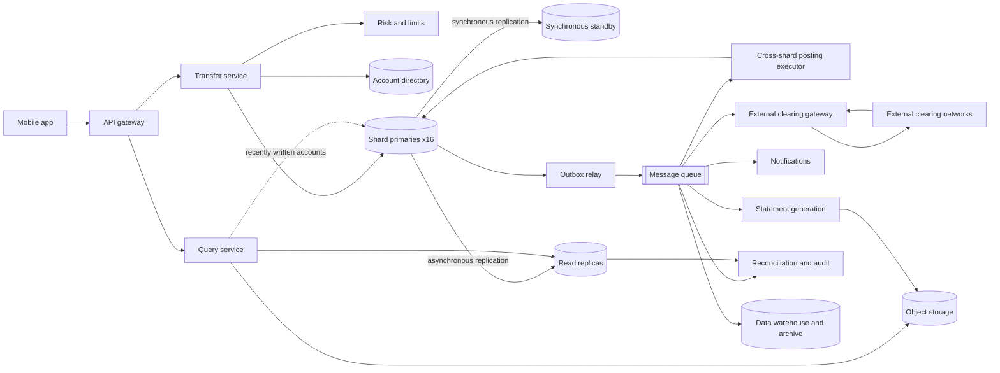

# Design a Banking App

## Problem

Design the backend of a banking app: users open accounts, check balances, transfer money to each
other, and view their transaction history and monthly statements.

If you ask, the interviewer gives these numbers (all practice assumptions):

**Scale.**

- **20 million users** with 1.5 accounts each on average (30 million accounts). **5 million daily
  active users.**
- Each daily active user makes **4 money movements a day** on average. A quarter of them are
  transfers between users. The rest are deposits, withdrawals and card payments, where the other
  side is one of the bank's own internal accounts (a clearing account, a card settlement account,
  and so on).
- Each daily active user checks a balance or the history **12 times a day**.
- Peak is **5×** the daily average.

**Requirements.**

- Transfer API p99 under **500 ms**; balance query p99 under **100 ms**.
- Money is never created or lost.
- A customer account can never be overdrawn.
- A client that retries after a timeout must not be charged twice.
- Right after a transfer, the user's own balance and history must show it. Other people's views and
  reports may lag by a few seconds.
- No confirmed transfer is ever lost (**RPO = 0**).
- After a single database node fails, writes resume within 60 seconds (**RTO < 60 s**).
- The ledger is kept for **7 years** (a practice assumption; the real period depends on local
  regulation).
- One currency. Amounts are integers in the smallest unit (cents).

**Design:**

1. A capacity estimate, and what sharding is actually for.
2. The ledger data model and the public API.
3. The architecture, and the path of one transfer and of one balance query.

**Topics the interviewer will dig into.**

- **(a) Double-entry.** Why does the ledger use double-entry bookkeeping?
- **(b) Retries.** Why can a retried transfer never charge twice?
- **(c) Isolation.** Which isolation level do you use, and which anomaly does each mechanism
  prevent?
- **(d) Cross-shard and interbank transfers.** How do you make sure these never lose money?
- **(e) Operations.** Freezes, reconciliation, audit and retention.

**Out of scope:** how card networks work internally, identity checks at account opening (KYC), loans
and interest, foreign exchange, the front end, and the risk model itself (just leave a hook for it).

Anthropic's online assessment has a bank-system coding problem
([Online Assessment: Banking System](#/anthropic/coding/oa-bank-system)): deposits, withdrawals,
transfers, freezes and account merges in a single process. This page is its system-design
counterpart: similar rules, but the hard parts become concurrency, failures and many machines.

## Reference solution

<details>
<summary>Show the reference solution</summary>

Three things are worth confirming before you start designing. First, is the balance "recorded" or "stored"? A bank's answer is that the ledger is the source of truth and the balance is just a summary of the ledger. Second, "never charge twice" means the same user intent takes effect only once, which needs an idempotency key at the API layer; database transactions alone can't do it. Third, the traffic in this problem is actually small, about 1,157 transactions per second at peak. What really deserves the time is correctness, not throughput.

### Requirements and scale

**Functional**: open, close and freeze accounts; check balances (posted balance and available balance); transfers between users; deposits and withdrawals; card holds and captures; paginated transaction history; monthly statements.

**Non-functional**: see the problem statement. They boil down to three invariants, and every design decision below is checked against them:

1. The entries of each transaction sum to 0, so the whole ledger always sums to 0.
2. A customer account's available balance (posted balance minus held amount) is never below 0.
3. One idempotency key produces at most one transaction.

**Estimates** (every number is recomputed and asserted by the code in "Estimate check" at the end):

| Quantity | Calculation | Result |
|---|---|---|
| Money movements | 5M daily active users × 4 | 20M transactions/day; average 231.5/s, peak 1,157/s |
| Of which transfers between users | 1/4 | 5M/day (the other 15M are against internal accounts) |
| Reads | 5M × 12 | 60M/day; average 694.4/s, peak 3,472/s; read:write ratio 3:1 |
| Entries | 2 per transaction | 40M/day |
| Ledger storage | 150 B per entry, plus 300 B per transaction (including indexes, assumed) | 12 GB/day, 4.38 TB/year, 30.66 TB over 7 years |
| Idempotency keys | Kept 7 days × 20M/day, 200 B per row | 140M rows, 28 GB |
| Statements | 30M accounts × one 100 KB statement a month | 3 TB/month, 36 TB/year, 252 TB over 7 years; with statement days staggered, 1M a day, about 11.6/s |

**Sharding**. Hash `account_id` into 16 shards. The probability that two random accounts land on the same shard is 1/16 = 6.25%, so 93.75% of transfers between users are cross-shard: 4.6875M/day, average 54.25/s, peak 271/s. A cross-shard transfer runs one local transaction on each of the two shards, so the total number of local transactions is 15M + 312.5K + 2 × 4.6875M = 24.6875M/day; per shard that is 1,542,969/day, average 17.9/s, peak 89.3/s. Cross-shard transfers write two extra in-transit entries (see deep dive (d)), 9.375M more a day, 23.4% above the baseline. Each shard's ledger over 7 years is about 1.92 TB (excluding in-transit entries).

These numbers show that **throughput is not the reason to shard**. A peak of a little over a thousand short transactions a second is usually within what one reasonably provisioned relational database primary can handle (a practice assumption; in reality you would load-test). Sharding is for fault isolation (a problem on one shard only affects 1/16 of users), for keeping the data size and maintenance time of each database under control, and for leaving room for 10× growth. In the interview you can say it directly: a single database plus time-based partitioning would also be enough to launch, and the price of sharding is the cross-shard transfer in (d).

Money is always integer cents. In binary floating point, even 0.1 + 0.2 doesn't equal 0.3.

### Data model and API

**Tables** (one set per shard. The `sql` below is for display only; a runnable SQLite version is in the estimate check):

```sql
CREATE TABLE accounts (
  account_id  BIGINT PRIMARY KEY,
  owner_id    BIGINT NOT NULL,
  kind        TEXT   NOT NULL,              -- 'customer' | 'internal'
  status      TEXT   NOT NULL,              -- 'open' | 'frozen' | 'closed'
  posted      BIGINT NOT NULL DEFAULT 0,    -- posted balance = sum of this account's entries (materialised)
  held        BIGINT NOT NULL DEFAULT 0,    -- sum of active holds
  next_seq    BIGINT NOT NULL DEFAULT 1,    -- per-account sequence number of the next entry
  CHECK (held >= 0),
  CHECK (kind = 'internal' OR posted - held >= 0)
);
CREATE TABLE ledger_txns (                  -- insert-only
  txn_id      BIGINT PRIMARY KEY,
  kind        TEXT NOT NULL,                -- 'transfer' | 'deposit' | 'card_capture' | 'reversal' ...
  transfer_id BIGINT,                       -- the business object, if any
  reverses    BIGINT,                       -- the transaction this one reverses, if any
  created_at  TIMESTAMPTZ NOT NULL
);
CREATE TABLE entries (                      -- insert-only
  txn_id        BIGINT NOT NULL REFERENCES ledger_txns,
  account_id    BIGINT NOT NULL REFERENCES accounts,
  seq           BIGINT NOT NULL,            -- 1, 2, 3 ... within the account
  amount        BIGINT NOT NULL CHECK (amount <> 0),   -- signed: money in > 0, money out < 0
  balance_after BIGINT NOT NULL,
  PRIMARY KEY (account_id, seq)
);
CREATE TABLE idempotency (
  owner_id     BIGINT NOT NULL,
  idem_key     TEXT   NOT NULL,
  request_hash BYTEA  NOT NULL,
  response     JSONB,
  created_at   TIMESTAMPTZ NOT NULL,
  PRIMARY KEY (owner_id, idem_key)
);
CREATE TABLE transfers (                    -- business state machine, updatable
  transfer_id BIGINT PRIMARY KEY,
  src BIGINT NOT NULL, dst BIGINT NOT NULL, amount BIGINT NOT NULL,
  state TEXT NOT NULL                       -- 'debited' | 'done' | 'refunded' | 'rejected' | 'pending_review'
);
CREATE TABLE holds  (hold_id BIGINT PRIMARY KEY, account_id BIGINT, amount BIGINT, state TEXT, expires_at TIMESTAMPTZ);
CREATE TABLE limits (owner_id BIGINT, day DATE, used BIGINT NOT NULL, PRIMARY KEY (owner_id, day));
CREATE TABLE outbox (event_id BIGINT PRIMARY KEY, topic TEXT, payload JSONB, created_at TIMESTAMPTZ);
```

The ledger uses signed amounts: each entry records one change to one account, positive for money in and negative for money out. The entries of a transaction sum to 0; this is what double-entry bookkeeping looks like in code. A customer depositing 100 is two entries: "clearing account −10,000, customer account +10,000." Internal accounts may be negative, representing what the bank owes to or is owed by the outside world.

`accounts.posted` is a materialized balance, updated in the same database transaction as the entries. `seq` and `balance_after` let anyone re-verify, entry by entry, "how this account's balance came to be."

**API** (external REST, all amounts in integer cents):

| Endpoint | Description |
|---|---|
| `POST /v1/transfers`, header `Idempotency-Key` | Body `{from, to, amount, memo}`. On success returns `201 {transfer_id, status: posted, seq}`; if cross-shard and not finished within the wait time, returns `202 {status: pending}`; same key with a different body returns `409`; insufficient balance returns `422 insufficient_funds`; frozen account returns `422 account_not_open` |
| `GET /v1/transfers/{id}` | Check status (after `pending` it becomes `done` or `refunded`) |
| `GET /v1/accounts/{id}/balance?min_seq=` | Returns `{posted, available, as_of_seq}`; `min_seq` is used to guarantee read-your-writes (see Architecture) |
| `GET /v1/accounts/{id}/entries?before_seq=&limit=50` | Keyset pagination on `seq`, no `OFFSET` |
| `GET /v1/accounts/{id}/statements/{yyyy-mm}` | Returns a short-lived download link to the statement file |
| Internal: `POST /internal/holds`, `/holds/{id}/capture`, `/holds/{id}/release` | Hold at card authorization, post at capture, release on expiry or cancellation; also carry an idempotency key |

### Architecture



**One transfer (write path)**

1. When the user taps "Confirm," the app generates an idempotency key (a UUID) and stores it locally; every retry of this transfer carries the same key.
2. The API gateway handles authentication and per-user rate limiting, and forwards to the stateless transfer service.
3. The transfer service first calls the risk and limits service (time budget 50 ms). The outcome is allow, require step-up verification, send to manual review (funds held first, state `pending_review`), or reject. A risk timeout is handled by amount: small amounts are allowed, large amounts go to manual review (fail-closed).
4. Look up the account directory to find which shards the two accounts live on. Same shard: open one local transaction on that shard's primary and, in order: insert the idempotency key row; do a conditional update on the daily limit; for each of the two accounts in ascending `account_id` order, do a "check and debit/credit" conditional update and insert the entry; insert the outbox event; commit. The commit waits for the synchronous standby in another availability zone to flush the commit record to disk, then returns `posted` and the new `seq`. If the primary fails, it fails over automatically to the synchronous standby, meeting RPO = 0 and RTO < 60 s.
5. Different shards: first run a local transaction on the source shard (idempotency key, `transfers` row in state `debited`, debit from the source account to the in-transit account, outbox event), then the cross-shard posting executor posts on the destination shard, and finally it goes back to the source shard to finish up. The whole thing usually takes a few hundred milliseconds. The API waits at most 300 ms and returns `pending` if it isn't done yet; the app gets the result via `GET /v1/transfers/{id}` or a push notification.
6. The outbox relay process publishes events to the message queue. Downstream are notifications, statements, reconciliation and audit, and the data warehouse, all of which deduplicate by event ID.

**One balance query (read path)**

The query service reads from read replicas by default. Read replicas are replicated asynchronously and may lag by a few hundred milliseconds; a user who sees the old balance right after a transfer will think the money is lost. The fix: the write API returns the account's latest `seq`, and the app sends `min_seq` with its next balance query; if the replica's `next_seq - 1` for this account hasn't reached `min_seq` yet, read from the primary instead. That way only the small fraction of reads on "just written" accounts falls on the primary.

Synchronous replication by itself doesn't mean read-your-writes. Taking PostgreSQL as an example, with a synchronous standby configured, `synchronous_commit = on` (the default) only waits for the standby to receive the commit record and flush it to durable storage, not to replay it; to make the commit visible to queries on the standby you need `remote_apply`, at the cost of higher commit latency. So the synchronous standby is responsible for RPO = 0, and read-your-writes is solved separately with `min_seq`.

Older history is read from read replicas, paginated by `(account_id, seq)`; statements are downloaded directly from object storage.

**Statements**. Each account has a fixed statement day, spread evenly over the 30 days of a month, so about 1M statements a day. A statement records the `seq` range it covers: the opening balance is the `balance_after` of the entry just before the range, opening balance plus this period's entries equals the closing balance, and this period's closing balance must equal the next period's opening balance. Statements are immutable once generated. Entries posted after the statement day go into the next period; if an error is found, issue a corrected statement rather than quietly regenerating it.

### Deep dives

**(a) The ledger is the source of truth: entries are immutable, balances are derived**

Three approaches:

- Store only a mutable balance field. Simplest, but when something goes wrong you can't answer "where did the money go," and you can't reconcile. Rejected.
- Store only entries, and compute the balance with `SUM` every time. The ledger is clean, but reading a balance is O(number of entries). Worse, on the write path "sum first, then check whether it's enough" is itself a read-modify-write, so it still needs locking under concurrency.
- **Entries plus a materialized balance, written in the same transaction** (recommended). Entries are insert-only; `accounts.posted` and `next_seq` are updated along with the entries; every entry carries `seq` and `balance_after`. Reading a balance is one primary-key lookup, and re-verification is one `GROUP BY`.

How to enforce immutability: the application's database account has only `INSERT` and `SELECT` privileges on `entries`; add triggers as a backstop (the estimate check demonstrates this with SQLite triggers: `UPDATE` and `DELETE` are both rejected); for stronger tamper resistance, hash-chain each account's entries. Fixing a mistake doesn't mean editing entries; it means recording a reversal transaction that references the original.

**Holds and captures**. Available balance = posted balance − held amount. At card authorization, only `held` increases; no entry is written. When the merchant captures, one transaction ends the hold and writes entries for the actual amount (which may be less than the authorized amount). A hold is released when it expires or is cancelled. A duplicate capture must do nothing. The estimate check demonstrates: with a balance of 10,000 and a 6,000 hold, available is 4,000, so a 5,000 transfer out is rejected; after a 5,500 capture, both posted and available balance are 4,500; a second capture has no effect. For the merchant side's authorization, capture, void and settlement, see [Coffee Shop Payments](#/openai/system-design/payment-coffee-shop); level 3 of the OA banking system, "a transfer is held first, posted when the recipient accepts, and returned on expiry," is the same state machine.

**(b) Taking effect exactly once: the idempotency key commits together with the entries**

After a network timeout the client doesn't know whether the transfer succeeded and can only retry. A database transaction guarantees that one request is either fully done or not done at all, but it can't tell "this is a new request" from "a retry of the last one." So:

- The client generates the key once per user intent. The server puts a unique key on `(owner_id, idem_key)` and stores a hash of the request body. The same key with a different body returns `409`, rather than quietly replaying the old result.
- **The key row and the entries are committed in the same database transaction**. If the transaction commits, the key and the money both exist; if it doesn't, neither does, and a retry executes again.
- Two requests with the same key arriving at once: make inserting the key row the first step of the transaction. Taking PostgreSQL as an example, when the second transaction inserts the same unique key, it waits for the first transaction to finish; if the first commits, the second gets a unique violation (`23505`), rolls back, and reads and returns the stored result. The SQLite version in the estimate check uses `BEGIN IMMEDIATE` to serialize write transactions as a whole, so check-then-insert is also safe there.
- Store the final business outcome: both `posted` and `rejected: insufficient_funds` are stored, so a retry gets the same answer. Transient errors such as timeouts, exhausted serialization-failure retries, and 5xx are not stored, so a retry has a chance to succeed. If the user tops up and wants to try the transfer again, the app must use a new key.
- Keys are kept for 7 days, which must be longer than the client's retry window (e.g. the app only retries within 24 hours).

Rejected: "first claim the key in Redis with `SET NX`, then write to the database." These are two systems, and a crash in between leaves "key but no money" or "money but no key"; moreover Redis Cluster replicates asynchronously, and its official documentation says plainly that acknowledged writes can be lost during failover, and a lost key means a second execution.

Downstream has to be idempotent too. Kafka by default provides at-least-once delivery: the consumer processes first and then commits the offset, and if it crashes after processing but before committing, it processes again after restarting. Kafka transactions can make "read from Kafka, write to Kafka" exactly-once; for effects written to external systems, the official documentation recommends storing the offset and the output in the same place, and otherwise the processing itself must be idempotent. So every consumer deduplicates by `event_id` or `transfer_id`, and the cross-shard posting executor uses a `(transfer_id, leg)` unique constraint on the destination shard to guarantee posting only once.

In the estimate check: replaying the same key returns the same result and the number of entries doesn't change; the same key with a different body raises an error; over 600 random operations, 30% of which are replays of old requests, the final balances match a plain dictionary model exactly.

**(c) Isolation levels: lost updates and write skew, and which mechanism prevents each**

Two anomalies that matter for money:

- **Lost update**: two transactions read the same balance of 100, each computes a new value and writes back an absolute value, and the later write overwrites the earlier one.
- **Write skew**: two transactions read the same set of data, each checks a rule that spans rows and passes, then each writes **a different row**. Neither row has a conflict on its own, but together the rule is broken. Banking examples: "checking + savings ≥ 0" (overdrafts covered by savings), with two withdrawals taken from the two accounts respectively; or "total transferred out today ≤ 5,000" checked by a `SUM` over today's transfers, with two transfers each inserting a row.

Taking PostgreSQL as an example (the default isolation level is Read Committed), here is what each approach does:

| Approach | Read Committed | Repeatable Read (i.e. snapshot isolation) | Serializable |
|---|---|---|---|
| Read the balance in the application, compute the new value, `SET balance = new value` | **Lost update** | The later updating transaction gets `40001` and must retry | Gets `40001`, must retry |
| A single statement `SET balance = balance - x WHERE id = ? AND balance >= x` | Correct: the later one waits for the earlier to commit, then re-evaluates the `WHERE` on the new version | Correct, but after the earlier one commits the later one gets `40001` | Same as left |
| First lock the row with `SELECT … FOR UPDATE`, then compute and write | Correct: the later one blocks at the `SELECT`, then gets the new value | The earlier one committed a change, so the later one gets `40001` | Same as left |
| A rule spanning rows, two transactions writing different rows | **Write skew** | **Write skew** (snapshot isolation doesn't prevent it) | Correct: one of them gets `40001` |

A few things to get exactly right:

- PostgreSQL's Repeatable Read is snapshot isolation. The documentation says plainly that enforcing business rules through transactions at this level is "unlikely to be correct" without careful use of explicit locks.
- Serializable uses Serializable Snapshot Isolation (SSI): reads take no blocking locks, and when a dangerous read/write dependency is detected, one of the transactions fails (`40001`, "could not serialize access due to read/write dependencies among transactions"). Its guarantee applies only to transactions that **all commit successfully at the Serializable level**. After a failure you must retry the **entire** transaction, including the application logic that decides which SQL to send; PostgreSQL does not retry automatically.
- `FOR UPDATE` only blocks writes and locks on the same row, not ordinary reads.

Recommendation:

- Debit a single account with one conditional `UPDATE`, so the check and the write are in the same statement. Add `CHECK (posted - held >= 0)` as a backstop: if some piece of code skips the check, the database still refuses.
- For rules spanning rows, "materialize" the conflict onto a single row. For the daily limit, use one row in `limits(owner_id, day, used)` with the conditional update `used = used + x WHERE used + x <= limit`; for "the two accounts together ≥ 0," first lock one row for this user (e.g. their row in an `owners` table). That turns write skew into a write conflict on the same row, which Read Committed can prevent.
- Or run everything at Serializable, with `40001` retries on every transaction. That is also correct, but the retry rate rises when conflicts are frequent, and a single transaction not at Serializable loses the guarantee. The former approach is preferable, because it is obvious which mechanism guarantees each rule.

**Deadlock**. If A→B and B→A transfers run at the same time and each locks its source account first, they wait on each other. PostgreSQL detects the deadlock and aborts one of the transactions (`40P01`, retryable). The real fix is a uniform locking order: always lock the two accounts in ascending `account_id`. In the estimate check, `post` sorts the entries first; `can_deadlock` enumerates every schedule: locking in opposite orders deadlocks, locking in the same order doesn't.

**Where risk and limits plug in**. Limits are hard rules and must be in the same database transaction as the debit (the `limits` row above); put them in an external service and they become another check-then-write. Risk scoring is a soft judgment, called synchronously before the transaction with a time budget, and its result has four tiers: allow, step-up verification, manual review (funds held first), reject. Separately, heavier models run asynchronously off the event stream, and when they find a problem the account can be frozen after the fact.

The estimate check uses Python's built-in `sqlite3` with two connections to reproduce these for real: read first and write an absolute value, and 30 is lost; the second conditional `UPDATE` affects 0 rows; when both transactions read first, the one that writes second gets `SQLITE_BUSY_SNAPSHOT` and must start over; `BEGIN IMMEDIATE` makes the second transaction fail to get the write lock right at the start; the `CHECK` constraint rejects an overdraft. Note that SQLite allows only one write transaction at a time, unlike PostgreSQL's row locks, so what this demonstrates is the phenomenon, not PostgreSQL's implementation. Write skew is reproduced with a small multiversion (MVCC) simulation that enumerates all 70 interleavings of two withdrawals: under snapshot isolation the worst total is −100 and no transaction is aborted; with read-set validation added (a simple optimistic validation, not PostgreSQL's SSI algorithm) or with a materialized guard row, the worst total is 50 in both cases.

**(d) Cross-shard and interbank transfers: two-phase commit or a saga**

A transfer within one shard is a single local transaction, with nothing hard about it. Cross-shard has two options.

**Two-phase commit (2PC)**. The coordinator first asks every participant to "prepare": each participant persists the changes it will make and its locks, then votes "yes." If all vote yes, the coordinator records the decision "commit" and then notifies everyone; otherwise it tells them to roll back. What it guarantees is atomicity (either all commit or all roll back), not a consistent snapshot read across shards: the two shards receive "commit" at different moments, and someone reading both in between may see only half.

Get the failure modes exactly right:

- A participant crashes after voting "yes": the prepared state is on disk, so after restarting it is still prepared, still holds its locks, and waits for the coordinator's decision.
- The coordinator crashes after collecting all votes but before delivering the decision: prepared participants can neither commit nor roll back on their own (another participant may already have committed), so they can only wait holding their locks. This is called blocking. If one participant decides on its own to roll back while another has already committed, 200 vanishes into thin air; the estimate check simulates this case.
- So the coordinator's decision log must be durable, ideally replicated; otherwise a single coordinator failure can keep accounts locked for a long time.
- PostgreSQL's `PREPARE TRANSACTION` is disabled by default (`max_prepared_transactions` defaults to 0, and changing it requires a restart). The documentation says it isn't meant for direct use by applications unless you are writing a transaction manager. A prepared transaction left unfinished for a long time keeps holding locks and gets in the way of `VACUUM`, and in extreme cases may force the database to shut down to prevent transaction ID wraparound.

When it is acceptable: all participants are under your control and all support prepare, the coordinator is highly available, transactions are short, and the business does not allow intermediate states to be visible. The other case is when the database does it for you internally: some distributed SQL databases replicate both participant and coordinator state with a consensus protocol, which makes blocking much less of a problem, and the application just sees an ordinary transaction.

**Saga** (recommended for this problem). Split the transfer into several local transactions, where each step either has a compensation or is guaranteed to complete going forward:

1. Source shard: debit the source account, credit the source shard's in-transit (transit) account, set `transfers.state = debited`, and write the outbox in the same transaction.
2. Destination shard: move the money from the in-transit account into the destination account, deduplicated by `transfer_id`; if the destination account is frozen or closed, record "rejected."
3. Source shard finish: if posting succeeded, mark `done`; if rejected, compensate by recording a **new** reversing transaction that returns the money to the source account, and mark `refunded`.

Key points: debit first, credit second, so that a crash at any point leaves money only "in transit," never created out of nothing. Users can see the intermediate state (`pending`), so it must be designed to be harmless: the money has been taken out of the available balance, but you can see where it went. Once step 2 succeeds, that is the pivot: from then on it only moves forward, with no more compensation. The orchestration state lives in the source shard's `transfers` table and is recovered from that table after a crash. In-transit accounts are matched by `transfer_id`; anything unmatched for a long time is a stuck saga and should raise an alert.

When it is acceptable: the intermediate state can be made harmless, every step can be replayed idempotently, and every step either has a compensation or is guaranteed to eventually complete going forward. The costs are no isolation, and two extra in-transit entries (the +23.4% in the estimate above).

In the estimate check, a crash is injected at every point after 0 to 4 steps, followed by recovery plus one duplicate delivery: with a normal destination account the result is always `(300, 300, DONE)`, with a frozen destination it is always `(500, 100, REFUNDED)`, the total money is always 600, and the in-transit accounts end at zero. Counterexample: remove the posting deduplication and crash after posting, and the recipient is credited twice (100 becomes 500); each shard's books still balance on their own, and what exposes the problem is the two in-transit accounts summing to −200. That is exactly why reconciliation has to check the in-transit accounts.

**Interbank** is always saga-style. External clearing networks carry messages and batch files; nobody will do two-phase commit with you, and the other bank may return a payment days later, which can only be handled with compensating entries. Outgoing transfers are also first debited to a "pending clearing" internal account, cleared when the clearing confirmation arrives, and reversed when a return arrives.

**(e) Reconciliation, audit and retention**

- **Continuously check internal invariants**: each transaction's entries sum to 0; the whole ledger sums to 0; each account's `seq` is contiguous, `balance_after` is the running sum, the materialized balance equals the sum of entries, and `held` equals the sum of open holds; customer accounts are not negative. `check_ledger` in the estimate check is this set of queries; in production it runs incrementally on read replicas, checking only entries since the last check.
- **Aging of in-transit and pending-clearing accounts**: match by `transfer_id`, and list anything still unmatched past a threshold.
- **External reconciliation**: every day, take the settlement files from the clearing networks and card schemes and match them one by one against the entries in the "pending clearing" accounts. All three kinds of discrepancy (we have it and they don't, they have it and we don't, amounts differ) go into a manual queue and are resolved with adjustment transactions, without changing the original entries.
- **Audit**: who did what and when (including manual operations by support and operations staff, and permission changes) goes into an append-only audit log. It is stored separately from the ledger, and the service that writes it also has append-only privileges.
- **Retention**: entries and statements are kept for 7 years (a practice assumption; follow the compliance department's requirements). Hot data stays in the shards; partitions older than a year or two are exported to write-once-read-many (WORM) archives in object storage, and the data warehouse keeps a queryable copy. Personally identifiable information lives in separate tables, and the ledger references only an opaque `owner_id`; when a user deletes their account or the retention period ends, the personal information is deleted or pseudonymized while the entries stay untouched. How to handle conflicts between deletion requests and retention obligations is up to the legal team.

### Follow-up questions

- **What about hot accounts?** Internal clearing accounts are touched by almost every transaction, and their rows become lock hotspots. Internal accounts may go negative and need no balance check, so the increments and decrements on them commute: use one sub-account per shard (which sharding gives you naturally), or don't update their materialized balance in every transaction; just write entries and aggregate periodically. Debits on customer accounts still must check the balance, so they can't do this.
- **What if the client retries with a new idempotency key and the transfer goes through twice?** The server can't tell "the user really wants to transfer twice" from "the app has a bug." The only backstop is at the product level: ask for confirmation when the same pair of accounts and the same amount are submitted again within a few minutes; and fix the app so the key is generated and persisted the moment the user confirms.
- **The materialized balance doesn't match the entries?** The entries win. First stop writes to this account, recompute the balance from the entries, and find out which code bypassed the normal path. If the entries themselves are wrong, correct them with an adjustment transaction and leave an audit record.
- **Multiple currencies?** Each account has exactly one currency. A currency exchange is four entries in one transaction, balanced separately in each of the two currencies, passing through the bank's FX position accounts. The exchange rate and fees are stored as attributes of the transaction.
- **Why not use a Kafka log as the source of truth (event sourcing)?** You could, but you need to know the current balance before debiting, which means each account's events must be processed serially; atomicity across accounts, ad hoc queries and constraint checking all have to be built yourself. A relational database plus an outbox gives you all of that directly, and you still get an event stream.
- **Can a primary failover lose money or double-charge?** Commits wait for the synchronous standby to flush to disk, so confirmed transfers are not lost. During failover the old primary has to be fenced, so that two primaries never write at the same time. Requests in flight at the moment of failover have unknown outcomes; the client retries with the same idempotency key, and the idempotency table tells it whether it already succeeded or needs to execute again.
- **How does this relate to the OA banking system problem?** The OA problem implements the rules in a single process: balances can't go negative, transfers are held first and then posted, expired ones are returned, accounts can be merged. This page puts the same rules on many machines: the balance check becomes a conditional update, holds become the `holds` table, returning on expiry becomes a compensating transaction; when the two accounts are on different shards, a merge is a saga (move the balance over, keep the old account and mark it as merged).

<details>
<summary>Estimate check (runnable)</summary>

```python
import hashlib
import itertools
import json
import os
import random
import sqlite3
import tempfile

# ---------------------------------------------------------------- 1. estimates
DAY = 86_400
GB, TB = 1e9, 1e12

users = 20_000_000
accounts = int(users * 1.5)
dau = 5_000_000
tx_per_day = dau * 4                       # money movements
assert accounts == 30_000_000 and tx_per_day == 20_000_000

tx_avg = tx_per_day / DAY
tx_peak = tx_avg * 5
assert round(tx_avg, 1) == 231.5 and round(tx_peak) == 1_157

p2p_per_day = tx_per_day // 4              # 1 in 4 is a user-to-user transfer
internal_per_day = tx_per_day - p2p_per_day
assert (p2p_per_day, internal_per_day) == (5_000_000, 15_000_000)

reads_per_day = dau * 12
assert reads_per_day == 60_000_000
assert round(reads_per_day / DAY, 1) == 694.4 and round(reads_per_day / DAY * 5) == 3_472
assert reads_per_day / tx_per_day == 3.0

entries_per_day = 2 * tx_per_day
assert entries_per_day == 40_000_000
bytes_per_day = entries_per_day * 150 + tx_per_day * 300
assert bytes_per_day / GB == 12.0
per_year_tb = bytes_per_day * 365 / TB
assert round(per_year_tb, 2) == 4.38 and round(per_year_tb * 7, 2) == 30.66

idem_rows = tx_per_day * 7                 # keys kept 7 days
assert idem_rows == 140_000_000 and idem_rows * 200 / GB == 28.0

stmt_month_tb = accounts * 100_000 / TB    # one 100 KB PDF per account per month
assert stmt_month_tb == 3.0 and stmt_month_tb * 12 == 36.0 and stmt_month_tb * 12 * 7 == 252.0
stmt_per_day = accounts / 30
assert stmt_per_day == 1_000_000 and round(stmt_per_day / DAY, 1) == 11.6

SHARDS = 16
same_shard = 1 / SHARDS
assert same_shard == 0.0625 and 1 - same_shard == 0.9375
cross_per_day = p2p_per_day * (1 - same_shard)
assert cross_per_day == 4_687_500
assert round(cross_per_day / DAY, 2) == 54.25 and round(cross_per_day / DAY * 5) == 271
# local database transactions: internal + same-shard P2P are 1 each, a cross-shard transfer is 2
local_tx = internal_per_day + p2p_per_day * same_shard + 2 * cross_per_day
assert local_tx == 24_687_500
assert round(local_tx / SHARDS) == 1_542_969
assert round(local_tx / SHARDS / DAY, 1) == 17.9 and round(local_tx / SHARDS / DAY * 5, 1) == 89.3
# a cross-shard transfer writes 4 entries instead of 2 (two transit legs)
extra_entries = 2 * cross_per_day
assert extra_entries == 9_375_000 and round(extra_entries / entries_per_day * 100, 1) == 23.4
assert round(per_year_tb * 7 / SHARDS, 2) == 1.92

# money is integer minor units: binary floats cannot even add 0.10 + 0.20
assert 0.1 + 0.2 != 0.3 and 10 + 20 == 30

# ---------------------------------------------------------------- 2. the ledger (sqlite3)
SCHEMA = """
CREATE TABLE accounts (
  account_id INTEGER PRIMARY KEY,
  owner_id   INTEGER NOT NULL,
  kind       TEXT    NOT NULL CHECK (kind IN ('customer', 'internal')),
  status     TEXT    NOT NULL DEFAULT 'open',
  posted     INTEGER NOT NULL DEFAULT 0,     -- minor units; equals the sum of this account's entries
  held       INTEGER NOT NULL DEFAULT 0,     -- active holds
  next_seq   INTEGER NOT NULL DEFAULT 1,
  CHECK (held >= 0),
  CHECK (kind = 'internal' OR posted - held >= 0)
);
CREATE TABLE transactions (
  txn_id INTEGER PRIMARY KEY AUTOINCREMENT,
  kind   TEXT NOT NULL,
  memo   TEXT NOT NULL DEFAULT ''
);
CREATE TABLE entries (
  entry_id      INTEGER PRIMARY KEY AUTOINCREMENT,
  txn_id        INTEGER NOT NULL REFERENCES transactions(txn_id),
  account_id    INTEGER NOT NULL REFERENCES accounts(account_id),
  seq           INTEGER NOT NULL,            -- 1, 2, 3 ... per account
  amount        INTEGER NOT NULL CHECK (amount <> 0),
  balance_after INTEGER NOT NULL,
  UNIQUE (account_id, seq)
);
CREATE TABLE idempotency (
  owner_id     INTEGER NOT NULL,
  idem_key     TEXT    NOT NULL,
  request_hash TEXT    NOT NULL,
  response     TEXT    NOT NULL,
  PRIMARY KEY (owner_id, idem_key)
);
CREATE TABLE holds (
  hold_id    INTEGER PRIMARY KEY AUTOINCREMENT,
  account_id INTEGER NOT NULL,
  amount     INTEGER NOT NULL CHECK (amount > 0),
  state      TEXT    NOT NULL DEFAULT 'active'
);
CREATE TRIGGER entries_no_update BEFORE UPDATE ON entries
BEGIN SELECT RAISE(ABORT, 'entries are immutable'); END;
CREATE TRIGGER entries_no_delete BEFORE DELETE ON entries
BEGIN SELECT RAISE(ABORT, 'entries are immutable'); END;
"""


class Reject(Exception):
    pass


def post(db, legs, kind, memo=""):
    """Append one balanced transaction; the caller already holds the write transaction."""
    assert len(legs) >= 2 and sum(amount for _, amount in legs) == 0
    txn_id = db.execute("INSERT INTO transactions (kind, memo) VALUES (?, ?)", (kind, memo)).lastrowid
    for account_id, amount in sorted(legs):                 # one fixed order for every caller
        cur = db.execute(
            "UPDATE accounts SET posted = posted + :a, next_seq = next_seq + 1 "
            "WHERE account_id = :id AND status = 'open' "
            "AND (kind = 'internal' OR posted - held + :a >= 0)",
            {"a": amount, "id": account_id})
        if cur.rowcount != 1:                               # the check and the write are one statement
            status = db.execute("SELECT status FROM accounts WHERE account_id = ?", (account_id,)).fetchone()
            raise Reject("insufficient_funds" if status == ("open",) else "account_not_open")
        seq, balance = db.execute(
            "SELECT next_seq - 1, posted FROM accounts WHERE account_id = ?", (account_id,)).fetchone()
        db.execute("INSERT INTO entries (txn_id, account_id, seq, amount, balance_after) VALUES (?, ?, ?, ?, ?)",
                   (txn_id, account_id, seq, amount, balance))
    return txn_id


def transfer(db, owner_id, idem_key, src, dst, amount):
    """Exactly-once transfer: the idempotency row commits together with the ledger entries."""
    assert amount > 0 and src != dst
    request_hash = hashlib.sha256(json.dumps([src, dst, amount]).encode()).hexdigest()
    db.execute("BEGIN IMMEDIATE")
    try:
        seen = db.execute("SELECT request_hash, response FROM idempotency WHERE owner_id = ? AND idem_key = ?",
                          (owner_id, idem_key)).fetchone()
        if seen is not None:
            db.execute("ROLLBACK")
            if seen[0] != request_hash:
                raise ValueError("idempotency key reused with a different request")
            return json.loads(seen[1])
        db.execute("SAVEPOINT legs")
        try:
            response = {"status": "posted", "txn_id": post(db, [(src, -amount), (dst, amount)], "transfer")}
        except Reject as why:
            db.execute("ROLLBACK TO legs")                  # undo a leg that was already applied
            response = {"status": "rejected", "reason": str(why)}
        db.execute("INSERT INTO idempotency VALUES (?, ?, ?, ?)",
                   (owner_id, idem_key, request_hash, json.dumps(response)))
        db.execute("COMMIT")
        return response
    except BaseException:
        if db.in_transaction:
            db.execute("ROLLBACK")
        raise


def place_hold(db, account_id, amount):
    db.execute("BEGIN IMMEDIATE")
    cur = db.execute("UPDATE accounts SET held = held + :a WHERE account_id = :id AND posted - held - :a >= 0",
                     {"a": amount, "id": account_id})
    if cur.rowcount != 1:
        db.execute("ROLLBACK")
        raise Reject("insufficient_funds")
    hold_id = db.execute("INSERT INTO holds (account_id, amount) VALUES (?, ?)", (account_id, amount)).lastrowid
    db.execute("COMMIT")
    return hold_id


def finish_hold(db, hold_id, capture_amount, settlement_account):
    """capture_amount > 0 posts that much (<= the hold); 0 releases. A second call changes nothing."""
    db.execute("BEGIN IMMEDIATE")
    row = db.execute("SELECT account_id, amount FROM holds WHERE hold_id = ? AND state = 'active'",
                     (hold_id,)).fetchone()
    if row is None:
        db.execute("ROLLBACK")
        return False
    account_id, held = row
    assert 0 <= capture_amount <= held
    db.execute("UPDATE holds SET state = ? WHERE hold_id = ?", ("captured" if capture_amount else "released", hold_id))
    db.execute("UPDATE accounts SET held = held - ? WHERE account_id = ?", (held, account_id))
    if capture_amount:
        post(db, [(account_id, -capture_amount), (settlement_account, capture_amount)], "card_capture")
    db.execute("COMMIT")
    return True


def balances(db, account_id):
    posted, held = db.execute("SELECT posted, held FROM accounts WHERE account_id = ?", (account_id,)).fetchone()
    return posted, posted - held                             # (posted, available)


def check_ledger(db):
    """The reconciliation queries: every one of them must come back empty / equal."""
    unbalanced = db.execute("SELECT txn_id FROM entries GROUP BY txn_id HAVING SUM(amount) <> 0").fetchall()
    assert unbalanced == [], unbalanced
    assert db.execute("SELECT COALESCE(SUM(amount), 0) FROM entries").fetchone()[0] == 0
    for account_id, kind, posted, held, next_seq in db.execute(
            "SELECT account_id, kind, posted, held, next_seq FROM accounts").fetchall():
        rows = db.execute("SELECT seq, amount, balance_after FROM entries WHERE account_id = ? ORDER BY seq",
                          (account_id,)).fetchall()
        running = 0
        for i, (seq, amount, balance_after) in enumerate(rows, start=1):
            running += amount
            assert seq == i and balance_after == running     # no gap, running balance is consistent
        assert running == posted and next_seq == len(rows) + 1
        active = db.execute("SELECT COALESCE(SUM(amount), 0) FROM holds WHERE account_id = ? AND state = 'active'",
                            (account_id,)).fetchone()[0]
        assert held == active
        assert kind == "internal" or posted - held >= 0


CLEARING, CARD_SETTLEMENT = 900, 901


def new_ledger(path=":memory:"):
    db = sqlite3.connect(path, isolation_level=None, timeout=0)   # explicit BEGIN / COMMIT only
    db.executescript(SCHEMA)
    db.executemany("INSERT INTO accounts (account_id, owner_id, kind) VALUES (?, ?, ?)",
                   [(1, 11, "customer"), (2, 22, "customer"), (3, 33, "customer"),
                    (CLEARING, 0, "internal"), (CARD_SETTLEMENT, 0, "internal")])
    return db


def deposit(db, account_id, amount):
    db.execute("BEGIN IMMEDIATE")
    post(db, [(CLEARING, -amount), (account_id, amount)], "deposit")
    db.execute("COMMIT")


db = new_ledger()
deposit(db, 1, 10_000)                                       # 100.00 arrives from outside
first = transfer(db, 11, "k-1", 1, 2, 3_000)
assert first["status"] == "posted"
assert balances(db, 1) == (7_000, 7_000) and balances(db, 2) == (3_000, 3_000)

# the same key again: same answer, nothing new in the ledger
n_entries = db.execute("SELECT COUNT(*) FROM entries").fetchone()[0]
assert transfer(db, 11, "k-1", 1, 2, 3_000) == first
assert db.execute("SELECT COUNT(*) FROM entries").fetchone()[0] == n_entries
assert balances(db, 1) == (7_000, 7_000)
# the same key with a different body is an error, not a silent replay
try:
    transfer(db, 11, "k-1", 1, 2, 9_999)
    raise AssertionError("expected an error")
except ValueError:
    pass
# overdraw: rejected whichever leg is applied first, and the rejection leaves no entries behind
before = db.execute("SELECT COUNT(*) FROM entries").fetchone()[0]
assert transfer(db, 11, "k-2", 1, 2, 7_001) == {"status": "rejected", "reason": "insufficient_funds"}
assert transfer(db, 22, "k-3", 2, 1, 3_001) == {"status": "rejected", "reason": "insufficient_funds"}
assert db.execute("SELECT COUNT(*) FROM entries").fetchone()[0] == before
assert balances(db, 1) == (7_000, 7_000) and balances(db, 2) == (3_000, 3_000)

# a frozen destination: rejected, again without a trace in the ledger
db.execute("UPDATE accounts SET status = 'frozen' WHERE account_id = 3")
assert transfer(db, 11, "k-3b", 1, 3, 100) == {"status": "rejected", "reason": "account_not_open"}
assert db.execute("SELECT COUNT(*) FROM entries").fetchone()[0] == before and balances(db, 1) == (7_000, 7_000)

# entries are append-only; a mistake is corrected by a reversing transaction
for bad in ("UPDATE entries SET amount = 1 WHERE entry_id = 1", "DELETE FROM entries WHERE entry_id = 1"):
    try:
        db.execute(bad)
        raise AssertionError("expected the trigger to refuse")
    except sqlite3.IntegrityError as e:
        assert "immutable" in str(e)
assert transfer(db, 22, "k-4-reversal-of-k-1", 2, 1, 3_000)["status"] == "posted"
assert balances(db, 1) == (10_000, 10_000) and balances(db, 2) == (0, 0)

# holds: available = posted - held; capture posts the final amount and frees the rest
hold = place_hold(db, 1, 6_000)
assert balances(db, 1) == (10_000, 4_000)
assert transfer(db, 11, "k-5", 1, 2, 5_000)["status"] == "rejected"       # 5,000 > 4,000 available
assert finish_hold(db, hold, 5_500, CARD_SETTLEMENT) is True
assert balances(db, 1) == (4_500, 4_500)
assert finish_hold(db, hold, 5_500, CARD_SETTLEMENT) is False             # a duplicate capture is a no-op
assert balances(db, 1) == (4_500, 4_500)
hold = place_hold(db, 1, 4_500)
assert finish_hold(db, hold, 0, CARD_SETTLEMENT) and balances(db, 1) == (4_500, 4_500)   # released
check_ledger(db)

# random traffic with replays, against a plain-dict model
rng = random.Random(7)
db = new_ledger()
model = {1: 0, 2: 0, 3: 0}
for acct in model:
    deposit(db, acct, 50_000)
    model[acct] += 50_000
history = []
posted_count = rejected_count = 0
for i in range(600):
    if history and rng.random() < 0.3:                       # a client retry of an old request
        owner, key, src, dst, amount, old = rng.choice(history)
        assert transfer(db, owner, key, src, dst, amount) == old
        continue
    src, dst = rng.sample([1, 2, 3], 2)
    amount = rng.randint(1, 40_000)
    result = transfer(db, src * 11, f"key-{i}", src, dst, amount)
    if model[src] >= amount:
        model[src] -= amount
        model[dst] += amount
        assert result["status"] == "posted"
        posted_count += 1
    else:
        assert result == {"status": "rejected", "reason": "insufficient_funds"}
        rejected_count += 1
    history.append((src * 11, f"key-{i}", src, dst, amount, result))
assert posted_count > 100 and rejected_count > 20
assert {a: balances(db, a)[0] for a in model} == model and sum(model.values()) == 150_000
check_ledger(db)

# ---------------------------------------------------------------- 3. two connections: lost update (sqlite3)
tmp = tempfile.mkdtemp()
path = os.path.join(tmp, "race.db")


def connect():
    return sqlite3.connect(path, isolation_level=None, timeout=0)


a, b = connect(), connect()
a.execute("PRAGMA journal_mode=WAL")
a.execute("CREATE TABLE acct (id INTEGER PRIMARY KEY, balance INTEGER NOT NULL CHECK (balance >= 0))")


def reset(value=100):
    a.execute("DELETE FROM acct")
    a.execute("INSERT INTO acct VALUES (1, ?)", (value,))


def read(c):
    return c.execute("SELECT balance FROM acct WHERE id = 1").fetchone()[0]


# (1) read in the application, compute, write back an absolute value
reset()
seen_a, seen_b = read(a), read(b)
a.execute("UPDATE acct SET balance = ? WHERE id = 1", (seen_a - 30,))
b.execute("UPDATE acct SET balance = ? WHERE id = 1", (seen_b - 50,))
assert read(a) == 50                                         # 100 - 30 - 50 = 20 was expected: 30 is lost

# (2) one statement that checks and writes
reset()
debit = "UPDATE acct SET balance = balance - 80 WHERE id = 1 AND balance >= 80"
assert (a.execute(debit).rowcount, b.execute(debit).rowcount) == (1, 0)
assert read(a) == 20

# (3) both transactions read first; the one that writes second is refused and must start over
reset()
a.execute("BEGIN")
b.execute("BEGIN")
seen_a, seen_b = read(a), read(b)
a.execute("UPDATE acct SET balance = ? WHERE id = 1", (seen_a - 30,))
a.execute("COMMIT")
try:
    b.execute("UPDATE acct SET balance = ? WHERE id = 1", (seen_b - 50,))
    raise AssertionError("expected SQLITE_BUSY_SNAPSHOT")
except sqlite3.OperationalError as e:
    assert e.sqlite_errorname == "SQLITE_BUSY_SNAPSHOT"
b.execute("ROLLBACK")
b.execute("BEGIN")
b.execute("UPDATE acct SET balance = ? WHERE id = 1", (read(b) - 50,))       # retry: reads 70
b.execute("COMMIT")
assert read(a) == 20

# (4) take the write lock before reading: the second one cannot even start
reset()
a.execute("BEGIN IMMEDIATE")
try:
    b.execute("BEGIN IMMEDIATE")
    raise AssertionError("expected SQLITE_BUSY")
except sqlite3.OperationalError as e:
    assert e.sqlite_errorname == "SQLITE_BUSY"
a.execute("UPDATE acct SET balance = ? WHERE id = 1", (read(a) - 30,))
a.execute("COMMIT")
b.execute("BEGIN IMMEDIATE")
b.execute("UPDATE acct SET balance = ? WHERE id = 1", (read(b) - 50,))
b.execute("COMMIT")
assert read(a) == 20

# (5) the CHECK constraint is the last line of defence
try:
    a.execute("UPDATE acct SET balance = balance - 1000 WHERE id = 1")
    raise AssertionError("expected a constraint error")
except sqlite3.IntegrityError:
    pass
a.close()
b.close()

# ---------------------------------------------------------------- 4. snapshot isolation and write skew (a small MVCC simulation)
class Abort(Exception):
    pass


class Store:
    """Multi-version store. 'si': snapshot reads + first committer wins on write-write conflicts.
    'serializable': additionally abort if anything this transaction READ was overwritten by a
    transaction that committed after its snapshot (plain optimistic validation, not PostgreSQL's SSI)."""

    def __init__(self, data):
        self.clock = 0
        self.versions = {k: [(0, v)] for k, v in data.items()}
        self.commits = []                                    # (commit_ts, frozenset of written keys)

    def latest(self, key):
        return self.versions[key][-1][1]


class Txn:
    def __init__(self, store, level):
        self.store, self.level, self.snapshot = store, level, store.clock
        self.reads, self.writes = set(), {}

    def read(self, key):
        self.reads.add(key)
        if key in self.writes:
            return self.writes[key]
        return [v for ts, v in self.store.versions[key] if ts <= self.snapshot][-1]

    def write(self, key, value):
        self.writes[key] = value

    def commit(self):
        for ts, keys in self.store.commits:
            if ts > self.snapshot:
                if keys & self.writes.keys():
                    raise Abort("write-write conflict")
                if self.level == "serializable" and keys & self.reads:
                    raise Abort("read-write conflict")
        if self.writes:
            self.store.clock += 1
            for key, value in self.writes.items():
                self.store.versions[key].append((self.store.clock, value))
            self.store.commits.append((self.store.clock, frozenset(self.writes)))


# lost update under snapshot isolation: the second committer is aborted, the retry is correct
s = Store({"acct": 100})
t1, t2 = Txn(s, "si"), Txn(s, "si")
t1.write("acct", t1.read("acct") - 30)
t2.write("acct", t2.read("acct") - 50)
t1.commit()
try:
    t2.commit()
    raise AssertionError("expected an abort")
except Abort as e:
    assert str(e) == "write-write conflict"
t3 = Txn(s, "si")
t3.write("acct", t3.read("acct") - 50)
t3.commit()
assert s.latest("acct") == 20


def withdraw_ops(account, amount, guard):
    """Rule: checking + savings of one owner must stay >= 0. Returns the transaction as a list of steps."""
    def begin(ctx, store, level):
        ctx["t"] = Txn(store, level)

    def check(ctx, store, level):
        t = ctx["t"]
        ctx["ok"] = t.read("checking") + t.read("savings") - amount >= 0

    def act(ctx, store, level):
        t = ctx["t"]
        if ctx["ok"]:
            t.write(account, t.read(account) - amount)
            if guard:                                        # materialise the conflict on one shared row
                t.write("owner_guard", t.read("owner_guard") + 1)

    def commit(ctx, store, level):
        try:
            ctx["t"].commit()
        except Abort:
            ctx["aborted"] = True

    return [begin, check, act, commit]


def worst_total(level, guard):
    """Run every interleaving of two withdrawals of 150 from different accounts; return the lowest total."""
    lowest, aborted_some = None, False
    for order in set(itertools.permutations([0] * 4 + [1] * 4)):
        store = Store({"checking": 100, "savings": 100, "owner_guard": 0})
        plans = [withdraw_ops("checking", 150, guard), withdraw_ops("savings", 150, guard)]
        ctxs, pos = [{}, {}], [0, 0]
        for who in order:
            plans[who][pos[who]](ctxs[who], store, level)
            pos[who] += 1
        total = store.latest("checking") + store.latest("savings")
        lowest = total if lowest is None else min(lowest, total)
        aborted_some |= any(c.get("aborted") for c in ctxs)
    return lowest, aborted_some


assert len(set(itertools.permutations([0] * 4 + [1] * 4))) == 70
assert worst_total("si", guard=False) == (-100, False)       # write skew: both commit, nobody is aborted
assert worst_total("serializable", guard=False) == (50, True)
assert worst_total("si", guard=True) == (50, True)           # the guard row turns it into a write-write conflict


# ---------------------------------------------------------------- 5. lock ordering and deadlock
def can_deadlock(lock_orders):
    """Two transactions each take two row locks in the given order; explore every schedule."""
    def explore(pos, held):
        if all(p == 2 for p in pos):
            return False
        moved = False
        for i in (0, 1):
            if pos[i] < 2:
                want = lock_orders[i][pos[i]]
                if held.get(want, i) == i:                   # free (or already ours)
                    moved = True
                    nxt_held = dict(held)
                    nxt_held[want] = i
                    nxt_pos = list(pos)
                    nxt_pos[i] += 1
                    if nxt_pos[i] == 2:                      # commit: release this transaction's locks
                        nxt_held = {k: v for k, v in nxt_held.items() if v != i}
                    if explore(nxt_pos, nxt_held):
                        return True
        return not moved                                     # somebody is unfinished and nobody can move

    return explore([0, 0], {})


assert can_deadlock([("A", "B"), ("B", "A")]) is True        # A->B and B->A, each locks its source first
assert can_deadlock([("A", "B"), ("A", "B")]) is False       # both lock in ascending account id


# ---------------------------------------------------------------- 6. cross-shard transfer: saga + in-transit accounts
class Shard:
    def __init__(self, balances_, open_accounts):
        self.bal = dict(balances_, transit=0)
        self.open = set(open_accounts)
        self.saga = {}                                       # transfer id -> state (source shard)
        self.credit_result = {}                              # transfer id -> outcome (destination shard)


def step_debit(src_shard, t):                                # one local transaction on the source shard
    if t["id"] in src_shard.saga:
        return
    if src_shard.bal[t["src"]] < t["amount"]:
        src_shard.saga[t["id"]] = "REJECTED"
        return
    src_shard.bal[t["src"]] -= t["amount"]
    src_shard.bal["transit"] += t["amount"]
    src_shard.saga[t["id"]] = "DEBITED"                      # state + outbox row commit with the debit


def step_credit(dst_shard, t, idempotent=True):              # one local transaction on the destination shard
    if idempotent and t["id"] in dst_shard.credit_result:
        return dst_shard.credit_result[t["id"]]
    if t["dst"] in dst_shard.open:
        dst_shard.bal["transit"] -= t["amount"]
        dst_shard.bal[t["dst"]] += t["amount"]
        outcome = "CREDITED"
    else:
        outcome = "REFUSED"
    dst_shard.credit_result[t["id"]] = outcome
    return outcome


def step_finish(src_shard, t, outcome):                      # one local transaction on the source shard
    if src_shard.saga[t["id"]] != "DEBITED":
        return
    if outcome == "CREDITED":
        src_shard.saga[t["id"]] = "DONE"
    else:                                                    # compensation: a new transaction, not an undo
        src_shard.bal["transit"] -= t["amount"]
        src_shard.bal[t["src"]] += t["amount"]
        src_shard.saga[t["id"]] = "REFUNDED"


def run_saga(src_shard, dst_shard, t, crash_after, idempotent=True):
    """Execute at most `crash_after` atomic steps, then lose all memory and recover from durable state."""
    budget = [crash_after]

    def alive():
        budget[0] -= 1
        return budget[0] >= 0

    def drive(check_alive):
        if not check_alive():
            return
        step_debit(src_shard, t)
        if src_shard.saga[t["id"]] != "DEBITED":
            return
        if not check_alive():
            return
        outcome = step_credit(dst_shard, t, idempotent)
        if not check_alive():
            return
        step_finish(src_shard, t, outcome)

    drive(alive)                                             # first attempt, cut short by the crash
    drive(lambda: True)                                      # recovery: re-read the saga table, redo the rest
    drive(lambda: True)                                      # a duplicate delivery on top


def money(*shards):
    return sum(sum(s.bal.values()) for s in shards)


for dst_open in (True, False):
    for crash_after in range(0, 5):
        s1 = Shard({"alice": 500}, {"alice"})
        s2 = Shard({"bob": 100}, {"bob"} if dst_open else set())
        t = {"id": "tr-1", "src": "alice", "dst": "bob", "amount": 200}
        run_saga(s1, s2, t, crash_after)
        assert money(s1, s2) == 600                          # nothing created, nothing destroyed
        if dst_open:
            assert (s1.bal["alice"], s2.bal["bob"], s1.saga["tr-1"]) == (300, 300, "DONE")
            assert s1.bal["transit"] + s2.bal["transit"] == 0
        else:
            assert (s1.bal["alice"], s2.bal["bob"], s1.saga["tr-1"]) == (500, 100, "REFUNDED")
            assert s1.bal["transit"] == 0 == s2.bal["transit"]

# while the saga is half way, the money is visible in the transit account, not missing
s1, s2 = Shard({"alice": 500}, {"alice"}), Shard({"bob": 100}, {"bob"})
step_debit(s1, {"id": "tr-2", "src": "alice", "dst": "bob", "amount": 200})
assert (s1.bal["alice"], s1.bal["transit"], s2.bal["bob"]) == (300, 200, 100) and money(s1, s2) == 600

# negative control: without the dedupe on the credit step, a crash after the credit pays twice
s1, s2 = Shard({"alice": 500}, {"alice"}), Shard({"bob": 100}, {"bob"})
run_saga(s1, s2, {"id": "tr-3", "src": "alice", "dst": "bob", "amount": 200}, crash_after=2, idempotent=False)
assert s2.bal["bob"] == 500 and s1.bal["alice"] == 300      # bob was credited twice for one debit
assert money(s1, s2) == 600                                  # each shard's books still balance on their own,
assert s1.bal["transit"] + s2.bal["transit"] == -200         # so it is the transit accounts that expose it

# insufficient funds: rejected in the first step, nothing else happens
s1, s2 = Shard({"alice": 100}, {"alice"}), Shard({"bob": 100}, {"bob"})
run_saga(s1, s2, {"id": "tr-4", "src": "alice", "dst": "bob", "amount": 200}, crash_after=9)
assert (s1.bal, s2.bal, s1.saga["tr-4"]) == ({"alice": 100, "transit": 0}, {"bob": 100, "transit": 0}, "REJECTED")


# ---------------------------------------------------------------- 7. two-phase commit: the coordinator crashes after prepare
class Participant:
    def __init__(self, balance):
        self.balance, self.state, self.delta, self.locked = balance, "idle", 0, False

    def prepare(self, delta):
        if self.locked or self.balance + delta < 0:
            return False
        self.delta, self.state, self.locked = delta, "prepared", True     # durable promise, lock kept
        return True

    def finish(self, commit):
        if self.state == "prepared":
            if commit:
                self.balance += self.delta
            self.state, self.locked = ("committed" if commit else "aborted"), False


src, dst = Participant(500), Participant(100)
assert src.prepare(-200) and dst.prepare(+200)
decision_log = "commit"                                      # the coordinator made this durable, then died
assert src.locked and dst.locked and (src.balance, dst.balance) == (500, 100)
assert src.prepare(-50) is False                             # another transfer on this account must wait
# a participant that gives up on its own breaks atomicity: 200 disappears
lost_src, lost_dst = Participant(500), Participant(100)
lost_src.prepare(-200)
lost_dst.prepare(+200)
lost_src.finish(commit=True)                                 # this one heard "commit" before the crash
lost_dst.finish(commit=False)                                # this one timed out and aborted by itself
assert lost_src.balance + lost_dst.balance == 400
# the only safe move is to wait for the coordinator (or its replicated log) and apply its decision
src.finish(decision_log == "commit")
dst.finish(decision_log == "commit")
assert (src.balance, dst.balance, src.locked, dst.locked) == (300, 300, False, False)
assert src.prepare(-50) is True

print(f"estimates: average {tx_avg:.1f} txn/s, peak {tx_peak:.0f} txn/s, 7-year ledger {per_year_tb * 7:.2f} TB, "
      f"cross-shard share of user-to-user transfers {100 * (1 - same_shard):.2f}%")
print("ledger, idempotency, holds, lost update, write skew, deadlock, saga, two-phase commit: all assertions passed")
```

</details>

</details>
