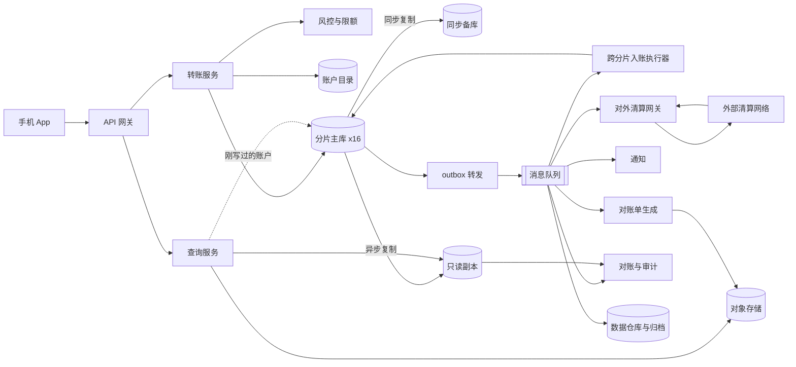

# 设计一个银行 App

## 题目

Design the backend of a banking app: users open accounts, check balances, transfer money to each
other, and view their transaction history and monthly statements.

If you ask, the interviewer gives these numbers (all practice assumptions):

**Scale.**

- **20 million users** with 1.5 accounts each on average (30 million accounts). **5 million daily
  active users.**
- Each daily active user makes **4 money movements a day** on average. A quarter of them are
  transfers between users. The rest are deposits, withdrawals and card payments, where the other
  side is one of the bank's own internal accounts (a clearing account, a card settlement account,
  and so on).
- Each daily active user checks a balance or the history **12 times a day**.
- Peak is **5×** the daily average.

**Requirements.**

- Transfer API p99 under **500 ms**; balance query p99 under **100 ms**.
- Money is never created or lost.
- A customer account can never be overdrawn.
- A client that retries after a timeout must not be charged twice.
- Right after a transfer, the user's own balance and history must show it. Other people's views and
  reports may lag by a few seconds.
- No confirmed transfer is ever lost (**RPO = 0**).
- After a single database node fails, writes resume within 60 seconds (**RTO < 60 s**).
- The ledger is kept for **7 years** (a practice assumption; the real period depends on local
  regulation).
- One currency. Amounts are integers in the smallest unit (cents).

**Design:**

1. A capacity estimate, and what sharding is actually for.
2. The ledger data model and the public API.
3. The architecture, and the path of one transfer and of one balance query.

**Topics the interviewer will dig into.**

- **(a) Double-entry.** Why does the ledger use double-entry bookkeeping?
- **(b) Retries.** Why can a retried transfer never charge twice?
- **(c) Isolation.** Which isolation level do you use, and which anomaly does each mechanism
  prevent?
- **(d) Cross-shard and interbank transfers.** How do you make sure these never lose money?
- **(e) Operations.** Freezes, reconciliation, audit and retention.

**Out of scope:** how card networks work internally, identity checks at account opening (KYC), loans
and interest, foreign exchange, the front end, and the risk model itself (just leave a hook for it).

Anthropic's online assessment has a bank-system coding problem
([Online Assessment: Banking System](#/anthropic/coding/oa-bank-system)): deposits, withdrawals,
transfers, freezes and account merges in a single process. This page is its system-design
counterpart: similar rules, but the hard parts become concurrency, failures and many machines.

## 参考解答

<details>
<summary>展开参考解答</summary>

动手设计之前值得先确认三件事。第一，余额是"记出来的"还是"存出来的"：银行的答案是以账本（ledger）为准，余额只是账本的汇总。第二，"不能扣两次"指的是同一个用户意图只生效一次，这要靠接口层的幂等键（idempotency key），数据库事务自己做不到。第三，这道题的流量其实不大，峰值约 1,157 笔/秒。真正要花时间讲的是正确性，不是吞吐。

### 需求与规模

**功能**：开户、销户、冻结账户；查余额（入账余额和可用余额）；用户之间转账；存入、取出；刷卡的冻结（hold）与入账；交易明细分页；月度对账单。

**非功能**：见题目。归纳成三条不变量（invariant），后面每个设计决定都拿它们来检验：

1. 每笔交易的分录加起来等于 0，所以全账本加起来永远等于 0。
2. 客户账户的可用余额（入账余额减去冻结金额）永远不小于 0。
3. 同一个幂等键最多产生一笔交易。

**估算**（每个数字都由文末"估算核对"里的代码重算并断言）：

| 量 | 算法 | 结果 |
|---|---|---|
| 资金变动 | 500 万日活 × 4 | 2,000 万笔/天；平均 231.5 笔/秒，峰值 1,157 笔/秒 |
| 其中用户间转账 | 1/4 | 500 万笔/天（另外 1,500 万笔对内部账户） |
| 读 | 500 万 × 12 | 6,000 万次/天；平均 694.4 次/秒，峰值 3,472 次/秒；读写比 3:1 |
| 分录 | 每笔 2 条 | 4,000 万条/天 |
| 账本存储 | 每条分录 150 B，每笔交易另加 300 B（含索引，假设） | 12 GB/天，4.38 TB/年，7 年 30.66 TB |
| 幂等键 | 保留 7 天 × 2,000 万/天，每行 200 B | 1.4 亿行，28 GB |
| 对账单 | 3,000 万账户 × 每月一份 100 KB | 3 TB/月，36 TB/年，7 年 252 TB；账单日错开后每天 100 万份，约 11.6 份/秒 |

**分片**。按 `account_id` 哈希分成 16 个分片（shard）。两个随机账户落在同一分片的概率是 1/16 = 6.25%，所以 93.75% 的用户间转账要跨分片：468.75 万笔/天，平均 54.25 笔/秒，峰值 271 笔/秒。一笔跨分片转账在两个分片上各做一个本地事务，所以本地事务总数是 1,500 万 + 31.25 万 + 2 × 468.75 万 = 2,468.75 万个/天；每个分片 1,542,969 个/天，平均 17.9 个/秒，峰值 89.3 个/秒。跨分片转账要多写两条在途分录（见深入话题 (d)），每天多 937.5 万条，比基线多 23.4%。每个分片 7 年的账本约 1.92 TB（不含在途分录）。

这组数字说明：**吞吐不是分片的理由**。峰值每秒一千多个短事务，一台配置正常的关系数据库主库通常扛得住（练习假设，实际要压测）。分片是为了故障隔离（一个分片出事只影响 1/16 的用户）、控制单库数据量和维护时间，以及给十倍增长留余量。面试时可以直接说：先用单库加按时间分区也能上线，分片的代价就是 (d) 里的跨分片转账。

钱一律用整数分。二进制浮点数连 0.1 + 0.2 都不等于 0.3。

### 数据模型与 API

**表**（每个分片一套。下面的 `sql` 只做展示，可运行的 SQLite 版本在估算核对里）：

```sql
CREATE TABLE accounts (
  account_id  BIGINT PRIMARY KEY,
  owner_id    BIGINT NOT NULL,
  kind        TEXT   NOT NULL,              -- 'customer' | 'internal'
  status      TEXT   NOT NULL,              -- 'open' | 'frozen' | 'closed'
  posted      BIGINT NOT NULL DEFAULT 0,    -- posted balance = sum of this account's entries (materialised)
  held        BIGINT NOT NULL DEFAULT 0,    -- sum of active holds
  next_seq    BIGINT NOT NULL DEFAULT 1,    -- per-account sequence number of the next entry
  CHECK (held >= 0),
  CHECK (kind = 'internal' OR posted - held >= 0)
);
CREATE TABLE ledger_txns (                  -- insert-only
  txn_id      BIGINT PRIMARY KEY,
  kind        TEXT NOT NULL,                -- 'transfer' | 'deposit' | 'card_capture' | 'reversal' ...
  transfer_id BIGINT,                       -- the business object, if any
  reverses    BIGINT,                       -- the transaction this one reverses, if any
  created_at  TIMESTAMPTZ NOT NULL
);
CREATE TABLE entries (                      -- insert-only
  txn_id        BIGINT NOT NULL REFERENCES ledger_txns,
  account_id    BIGINT NOT NULL REFERENCES accounts,
  seq           BIGINT NOT NULL,            -- 1, 2, 3 ... within the account
  amount        BIGINT NOT NULL CHECK (amount <> 0),   -- signed: money in > 0, money out < 0
  balance_after BIGINT NOT NULL,
  PRIMARY KEY (account_id, seq)
);
CREATE TABLE idempotency (
  owner_id     BIGINT NOT NULL,
  idem_key     TEXT   NOT NULL,
  request_hash BYTEA  NOT NULL,
  response     JSONB,
  created_at   TIMESTAMPTZ NOT NULL,
  PRIMARY KEY (owner_id, idem_key)
);
CREATE TABLE transfers (                    -- business state machine, updatable
  transfer_id BIGINT PRIMARY KEY,
  src BIGINT NOT NULL, dst BIGINT NOT NULL, amount BIGINT NOT NULL,
  state TEXT NOT NULL                       -- 'debited' | 'done' | 'refunded' | 'rejected' | 'pending_review'
);
CREATE TABLE holds  (hold_id BIGINT PRIMARY KEY, account_id BIGINT, amount BIGINT, state TEXT, expires_at TIMESTAMPTZ);
CREATE TABLE limits (owner_id BIGINT, day DATE, used BIGINT NOT NULL, PRIMARY KEY (owner_id, day));
CREATE TABLE outbox (event_id BIGINT PRIMARY KEY, topic TEXT, payload JSONB, created_at TIMESTAMPTZ);
```

记账用有符号金额：每条分录记一个账户的一次变动，流入为正，流出为负。一笔交易的分录加起来等于 0，这就是复式记账（double-entry）在代码里的样子。客户存入 100 元，是"清算账户 −10,000，客户账户 +10,000"两条分录。内部账户可以是负数，表示银行和外部之间的应收应付。

`accounts.posted` 是物化余额，和分录在同一个数据库事务里更新。`seq` 和 `balance_after` 让任何人都能逐条复核"这个账户的余额是怎么来的"。

**API**（对外 REST，金额都是整数分）：

| 接口 | 说明 |
|---|---|
| `POST /v1/transfers`，请求头 `Idempotency-Key` | 请求体 `{from, to, amount, memo}`。成功返回 `201 {transfer_id, status: posted, seq}`；跨分片且在等待时间内没完成，返回 `202 {status: pending}`；同一个键换了请求体返回 `409`；余额不足返回 `422 insufficient_funds`；账户被冻结返回 `422 account_not_open` |
| `GET /v1/transfers/{id}` | 查状态（`pending` 之后变成 `done` 或 `refunded`） |
| `GET /v1/accounts/{id}/balance?min_seq=` | 返回 `{posted, available, as_of_seq}`；`min_seq` 用来保证读到自己的写（见架构） |
| `GET /v1/accounts/{id}/entries?before_seq=&limit=50` | 按 `seq` 做键集分页（keyset pagination），不用 `OFFSET` |
| `GET /v1/accounts/{id}/statements/{yyyy-mm}` | 返回对账单文件的短期下载链接 |
| 内部：`POST /internal/holds`、`/holds/{id}/capture`、`/holds/{id}/release` | 刷卡授权时冻结、请款时入账、到期或撤销时释放；同样带幂等键 |

### 架构



**一笔转账（写路径）**

1. App 在用户点"确认"时生成一个幂等键（UUID）并存在本地，这次转账之后的所有重试都带同一个键。
2. API 网关做认证和按用户限流，转给无状态的转账服务。
3. 转账服务先调风控与限额服务（时间预算 50 ms），结果是放行、要求二次验证、转人工审核（资金先冻结，状态 `pending_review`）或拒绝。风控超时按金额处理：小额放行，大额转人工（fail-closed）。
4. 查账户目录，得到两个账户所在的分片。同一分片：在该分片主库上开一个本地事务，依次插入幂等键行；对日限额做条件更新；按 `account_id` 升序对两个账户各做一次"检查并扣减/增加"的条件更新，并插入分录；插入 outbox 事件；提交。提交要等另一个可用区的同步备库把提交记录刷盘，然后返回 `posted` 和新的 `seq`。主库故障时自动切换到同步备库，满足 RPO = 0 和 RTO < 60 s。
5. 不同分片：先在源分片做一个本地事务（幂等键、`transfers` 行状态 `debited`、从源账户扣到在途账户、outbox 事件），再由跨分片入账执行器在目标分片入账，最后回源分片收尾。整个过程通常几百毫秒。接口最多等 300 ms，没完成就返回 `pending`，App 用 `GET /v1/transfers/{id}` 或推送拿结果。
6. outbox 转发进程把事件发到消息队列。下游是通知、对账单、对账与审计、数据仓库，它们都按事件 ID 去重。

**一次查余额（读路径）**

查询服务默认读只读副本。只读副本是异步复制的，可能落后几百毫秒；用户刚转完账看到旧余额，会以为钱丢了。做法是：写接口返回该账户最新的 `seq`，App 下次查余额时带上 `min_seq`；如果副本上这个账户的 `next_seq - 1` 还没到 `min_seq`，就改读主库。这样只有"刚写过"的那一小部分读会落到主库。

同步复制本身不等于读到自己的写。以 PostgreSQL 为例，在配置了同步备库时，`synchronous_commit = on`（默认值）只等备库收到提交记录并刷到持久存储，不等它重放；要让提交在备库上对查询可见，得用 `remote_apply`，代价是提交延迟更大。所以同步备库负责 RPO = 0，读到自己的写另外用 `min_seq` 解决。

较早的明细从只读副本按 `(account_id, seq)` 分页读取；对账单直接从对象存储下载。

**对账单**。每个账户有固定的账单日，均匀错开在一个月的 30 天里，所以每天约 100 万份。一份对账单记下本期覆盖的 `seq` 区间：期初余额是区间前一条分录的 `balance_after`，期初加本期分录等于期末，而且本期期末必须等于下期期初。对账单生成后不可变。账单日之后才入账的分录进下一期；发现错误就出更正对账单，不悄悄重新生成。

### 深入话题

**(a) 账本是事实来源：分录不可变，余额是派生出来的**

三种做法：

- 只存一个可变的余额字段。最简单，但出了错没法回答"钱去哪了"，也无法对账。不选。
- 只存分录，余额每次用 `SUM` 算出来。账本干净，但读余额是 O(分录数)。更糟的是，写路径上"先求和、再判断够不够"本身就是一次读-改-写，并发时照样要加锁。
- **分录加物化余额，在同一个事务里写**（推荐）。分录只插入；`accounts.posted` 和 `next_seq` 跟分录一起更新；每条分录带 `seq` 和 `balance_after`。读余额是一次主键查询，复核是一条 `GROUP BY`。

不可变怎么落地：应用的数据库账号对 `entries` 只有 `INSERT` 和 `SELECT` 权限；再加触发器兜底（估算核对里用 SQLite 触发器演示，`UPDATE` 和 `DELETE` 都被拒绝）；要更强的防篡改，可以给每个账户的分录做哈希链。改错不是改分录，而是记一笔反向的冲正交易（reversal），并引用原交易。

**冻结与入账**。可用余额 = 入账余额 − 冻结金额。刷卡授权时只增加 `held`，不写分录。商户请款（capture）时，在一个事务里结束冻结，并按实际金额写分录（可以小于授权金额）。冻结到期或被撤销就释放。重复的请款必须什么都不做。估算核对里演示了：余额 10,000 冻结 6,000 后可用 4,000，这时转出 5,000 被拒；请款 5,500 后入账余额和可用余额都是 4,500；第二次请款不生效。商户一侧的授权、请款、作废和结算见 [咖啡店支付](#/openai/system-design/payment-coffee-shop)；OA 银行系统第三级"转账先冻结、对方接受后入账、过期退回"也是同一个状态机。

**(b) 只生效一次：幂等键和分录一起提交**

网络超时之后，客户端不知道转账成功没有，只能重试。数据库事务保证一次请求要么全做要么全不做，但分辨不了"这是新请求"还是"上一次的重试"。所以：

- 键由客户端为每个用户意图生成一次。服务端按 `(owner_id, idem_key)` 建唯一键，并存请求体的哈希。同一个键换了请求体返回 `409`，而不是悄悄重放旧结果。
- **键行和分录在同一个数据库事务里提交**。事务提交了，键和钱一起存在；没提交，两样都不存在，重试会重新执行。
- 同一个键的两个请求同时到达：把插入键行作为事务的第一步。以 PostgreSQL 为例，第二个事务插入同一个唯一键时会等第一个事务结束；第一个提交了，第二个就得到唯一键冲突（`23505`），回滚后读出已存的结果返回。估算核对里的 SQLite 版用 `BEGIN IMMEDIATE` 让写事务整体串行，所以先查后插也安全。
- 存最终的业务结果：`posted` 和 `rejected: insufficient_funds` 都存，重试会得到同样的回答。超时、序列化失败重试用尽、5xx 这类临时错误不存，让重试有机会成功。用户充值后想再转一次，App 要用新键。
- 键保留 7 天，必须长于客户端的重试期限（比如 App 只在 24 小时内重试）。

不选"先在 Redis 里 `SET NX` 占住键，再写数据库"：这是两个系统，中间崩溃会留下"有键没钱"或"有钱没键"；而且 Redis Cluster 是异步复制，官方文档明说故障切换时可能丢掉已经确认的写，键丢了就会执行第二次。

下游同样要幂等。Kafka 默认提供至少一次（at-least-once）投递：消费者先处理再提交位移（offset），如果处理完、提交前崩溃，重启后会再处理一遍。Kafka 事务能让"从 Kafka 读、往 Kafka 写"做到恰好一次；写到外部系统的效果，官方文档建议把位移和输出存在同一个地方，否则就要让处理本身幂等。所以每个消费者都按 `event_id` 或 `transfer_id` 去重，跨分片入账执行器在目标分片用 `(transfer_id, leg)` 唯一约束保证只入账一次。

估算核对里：同一个键重放返回同样结果，分录数不变；同一个键换请求体会报错；600 次随机操作里 30% 是旧请求的重放，最后余额和一个普通字典模型完全一致。

**(c) 隔离级别：丢失更新和写偏斜，各用什么机制防**

和钱有关的两种异常：

- **丢失更新（lost update）**：两个事务读到同一个余额 100，各自算出新值写回绝对值，后写的覆盖了先写的。
- **写偏斜（write skew）**：两个事务读同一组数据，各自检查一条跨行规则都通过，然后写**不同的行**。单看哪一行都没有冲突，合起来规则被破坏。银行里的例子："支票账户 + 储蓄账户 ≥ 0"（透支由储蓄兜底），两笔取款分别从两个账户取；或者"今天转出总额 ≤ 5,000"靠 `SUM` 当天的转账来检查，两笔转账各插入一行。

以 PostgreSQL 为例（默认隔离级别是读已提交 Read Committed），各种写法的结果：

| 写法 | 读已提交 | 可重复读（Repeatable Read，即快照隔离） | 可串行化（Serializable） |
|---|---|---|---|
| 应用里读余额、算新值、`SET balance = 新值` | **丢失更新** | 后更新的事务报 `40001`，要重试 | 报 `40001`，要重试 |
| 一条语句 `SET balance = balance - x WHERE id = ? AND balance >= x` | 正确：后来者等前者提交，再在新版本上重新判断 `WHERE` | 正确，但前者提交后后来者报 `40001` | 同左 |
| 先 `SELECT … FOR UPDATE` 锁行，再算再写 | 正确：后来者在 `SELECT` 处阻塞，之后拿到新值 | 前者提交了修改，后来者报 `40001` | 同左 |
| 跨行规则，两个事务写不同的行 | **写偏斜** | **写偏斜**（快照隔离防不住） | 正确：其中一个报 `40001` |

几点要说准：

- PostgreSQL 的可重复读就是快照隔离。文档明说，在这个级别下靠事务来保证业务规则，"不加小心使用的显式锁，不太可能正确"。
- 可串行化用的是可串行化快照隔离（SSI）：读不加阻塞锁，发现危险的读写依赖时让其中一个事务失败（`40001`，"could not serialize access due to read/write dependencies among transactions"）。它的保证只针对**都在可串行化级别下成功提交**的事务。失败后必须重试**整个**事务，包括决定发什么 SQL 的应用逻辑；PostgreSQL 不会自动重试。
- `FOR UPDATE` 只挡住对同一行的写和加锁，不挡普通读。

推荐：

- 单账户扣款用一条条件 `UPDATE`，检查和写入在同一条语句里。再用 `CHECK (posted - held >= 0)` 兜底：哪段代码漏了检查，数据库也会拒绝。
- 跨行规则把冲突"物化"到一行上。日限额用 `limits(owner_id, day, used)` 一行，条件更新 `used = used + x WHERE used + x <= 限额`；"两个账户合计 ≥ 0"就先锁住这个用户的一行（比如 `owners` 表里的行）。这样写偏斜变成同一行上的写冲突，读已提交就能防住。
- 或者全部用可串行化，所有事务都带 `40001` 重试。这样也正确，但冲突多时重试率上升，而且只要有一个事务不在可串行化级别，就失去保证。更推荐前一种，因为每条规则靠什么机制保证一目了然。

**死锁**。A→B 和 B→A 同时转账，如果各自先锁源账户，就会互相等待。PostgreSQL 会检测到死锁并中止其中一个事务（`40P01`，可以重试）。根本办法是统一加锁顺序：两个账户总是按 `account_id` 升序加锁。估算核对里的 `post` 先给分录排序；`can_deadlock` 穷举所有调度，反序加锁会死锁，同序不会。

**风控和限额的接入点**。限额是硬规则，必须和扣款在同一个数据库事务里（上面的 `limits` 行）；放在外部服务里，又成了一次"先查后写"。风控评分是软判断，在事务之前同步调用，有时间预算，结果分四档：放行、二次验证、转人工审核（资金先冻结）、拒绝。另外从事件流异步跑更重的模型，发现问题可以事后冻结账户。

估算核对里用 Python 自带的 `sqlite3` 开两个连接，真实复现：先读后写绝对值，丢了 30；条件 `UPDATE` 的第二次影响 0 行；两个事务都先读，后写的那个收到 `SQLITE_BUSY_SNAPSHOT`，必须重来；`BEGIN IMMEDIATE` 让第二个事务一开始就拿不到写锁；`CHECK` 约束拒绝透支。注意 SQLite 同一时刻只允许一个写事务，和 PostgreSQL 的行锁不同，这里演示的是现象，不是 PostgreSQL 的实现。写偏斜用一个小型多版本（MVCC）模拟，穷举两笔取款的全部 70 种交错：快照隔离下最坏合计 −100，而且没有事务被中止；加上读集校验（一种简单的乐观校验，不是 PostgreSQL 的 SSI 算法）或者物化一个守卫行，最坏合计都是 50。

**(d) 跨分片和跨银行转账：两阶段提交还是 saga**

同一分片的转账是一个本地事务，没有难点。跨分片有两条路。

**两阶段提交（2PC）**。协调者先让每个参与者"准备"（prepare）：参与者把要做的修改和锁都持久化，然后投票"可以"。全部可以，协调者就记下"提交"的决定再通知大家；否则通知回滚。它保证的是原子性（要么都提交，要么都回滚），不保证跨分片读到一致的快照：两个分片收到"提交"的时刻不同，中间有人读两边，可能只看到一半。

失败方式要讲准：

- 参与者投了"可以"之后崩溃：准备好的状态在磁盘上，重启后仍处于准备状态、仍持有锁，等协调者的决定。
- 协调者在收齐投票之后、把决定送到之前崩溃：已准备的参与者既不能自己提交，也不能自己回滚（别的参与者可能已经提交了），只能持锁等待。这叫阻塞。一个参与者自作主张回滚、另一个已经提交，200 就凭空消失了，估算核对里模拟了这个情形。
- 所以协调者的决定日志必须持久化，最好多副本；否则一个协调者故障就能把账户锁很久。
- PostgreSQL 的 `PREPARE TRANSACTION` 默认关闭（`max_prepared_transactions` 默认是 0，修改要重启）。文档说它不是给应用直接用的，除非你在写事务管理器。长时间不结束的准备事务会一直持锁、妨碍 `VACUUM`，极端情况下可能迫使数据库停机，以防事务 ID 回卷。

什么时候可以接受：所有参与者都归你管、都支持准备，协调者高可用，事务很短，而且业务上不允许出现中间状态。另一种情况是数据库在内部替你做：有的分布式 SQL 数据库把参与者和协调者的状态都用共识协议复制，阻塞问题小得多，应用只看到普通事务。

**Saga**（本题推荐）。把转账拆成几个本地事务，每一步要么有补偿，要么保证能向前完成：

1. 源分片：扣源账户，记入源分片的在途账户（transit），`transfers.state = debited`，同一个事务写 outbox。
2. 目标分片：从在途账户转入目标账户，按 `transfer_id` 去重；目标账户已冻结或已销户就记"拒收"。
3. 源分片收尾：入账成功就标 `done`；被拒收就补偿，记一笔**新的**反向交易把钱退回源账户，标 `refunded`。

要点：先扣后加，中途任何时刻崩溃，钱只会"在途"，不会凭空多出来。中间状态用户看得到（`pending`），所以要设计成无害的：钱已从可用余额扣掉，但能查到去向。第二步一旦成功就是转折点（pivot），之后只向前走，不再补偿。编排状态存在源分片的 `transfers` 表里，崩溃后从表里恢复。在途账户按 `transfer_id` 配对，配不上而且放了很久的，就是卡住的 saga，要告警。

可以接受的条件：中间状态能做成无害的，每一步都能幂等重放，并且每一步要么有补偿，要么保证最终能向前完成。代价是没有隔离，以及多两条在途分录（上面估算的 +23.4%）。

估算核对里，在 0 到 4 步之后的每个位置注入崩溃、恢复，再加一次重复投递：目标账户正常时结果总是 `(300, 300, DONE)`，目标被冻结时总是 `(500, 100, REFUNDED)`，钱的总数始终是 600，在途账户最后归零。反例：去掉入账去重、在入账之后崩溃，对方被入账两次（100 变成 500）；两个分片各自的账都平，暴露问题的是两个在途账户合计 −200。这正是对账要查在途账户的原因。

**跨银行**永远是 saga 式的。外部清算网络传的是消息和批量文件，没有人会和你做两阶段提交；对方银行可能几天后才退回（return），只能用补偿分录处理。对外转账也是先扣到"待清算"内部账户，收到清算确认再结转，收到退回再冲正。

**(e) 对账、审计与留存**

- **持续检查内部不变量**：每笔交易分录和为 0；全账本和为 0；每个账户 `seq` 连续、`balance_after` 是累加和、物化余额等于分录之和、`held` 等于未结束冻结之和；客户账户不为负。估算核对里的 `check_ledger` 就是这组查询；生产上在只读副本上增量跑，只查上次检查之后的新分录。
- **在途和待清算账户的账龄**：按 `transfer_id` 配对，超过阈值还没配上的列出来。
- **外部对账**：每天拿清算网络和卡组织的结算文件，和"待清算"账户里的分录逐笔匹配。我们有对方没有、对方有我们没有、金额不同，三类差异都进人工队列，用调整交易解决，不改原分录。
- **审计**：谁在什么时候做了什么（包括客服和运维的手工操作、权限变更）写进只追加的审计日志。它和账本分开存，写它的服务也只有追加权限。
- **留存**：分录和对账单保留 7 年（练习假设，以合规部门的要求为准）。热数据留在分片里；一两年以前的分区导出到对象存储的一次写入、多次读取（WORM）归档，数据仓库保留可查询的副本。个人身份信息放在单独的表里，账本只引用不透明的 `owner_id`；用户注销或留存到期时，删除或假名化个人信息，分录不动。删除请求和留存义务冲突时怎么处理，由法务决定。

### 追问

- **热点账户怎么办？** 内部清算账户几乎每笔都要碰，它那一行会成为锁热点。内部账户允许为负、不需要余额检查，所以对它的加减可以交换顺序：每个分片各用一个子账户（分片后天然如此），或者不在每笔交易里更新它的物化余额，只写分录、定期汇总。客户账户的扣款仍然必须检查余额，不能这样做。
- **客户端用了新的幂等键重试，转了两次怎么办？** 服务端分辨不了"用户真想转两次"和"App 有 bug"。只能在产品层面兜底：同一对账户、同样金额几分钟内再次提交时要求确认；同时修好 App，让键在用户确认的那一刻生成并持久化。
- **物化余额和分录对不上？** 以分录为准。先停止这个账户的写入，从分录重算余额，查清是哪段代码绕过了正常路径。如果是分录本身错了，用调整交易修正，并留审计记录。
- **多币种？** 每个账户只有一种币种。一笔换汇是一笔交易里的四条分录，两种币种各自平衡，中间经过银行的外汇头寸账户。汇率和手续费作为交易的属性存下来。
- **为什么不用 Kafka 日志做事实来源（事件溯源）？** 可以，但扣款前必须知道当前余额，等于要求每个账户的事件串行处理；跨账户的原子性、即席查询和约束检查也都要自己做。关系数据库加 outbox 把这些都直接给了你，事件流照样有。
- **主库故障切换会不会丢钱或重复扣？** 提交要等同步备库刷盘，所以已确认的转账不会丢。切换时要隔离（fencing）旧主库，防止两个主库同时写。切换瞬间在途的请求结果未知，客户端用同一个幂等键重试，幂等表会告诉它已经成功还是需要重新执行。
- **这和 OA 的银行系统题有什么关系？** OA 那题在一个进程里实现规则：余额不能为负、转账先冻结后入账、过期退回、合并账户。这一页把同样的规则放到多台机器上：余额检查变成条件更新，冻结变成 `holds` 表，过期退回变成补偿交易；两个账户在不同分片时，合并就是一次 saga（把余额转过去，旧账户保留并标记为已合并）。

<details>
<summary>估算核对（可运行）</summary>

```python
import hashlib
import itertools
import json
import os
import random
import sqlite3
import tempfile

# ---------------------------------------------------------------- 1. 估算
DAY = 86_400
GB, TB = 1e9, 1e12

users = 20_000_000
accounts = int(users * 1.5)
dau = 5_000_000
tx_per_day = dau * 4                       # money movements
assert accounts == 30_000_000 and tx_per_day == 20_000_000

tx_avg = tx_per_day / DAY
tx_peak = tx_avg * 5
assert round(tx_avg, 1) == 231.5 and round(tx_peak) == 1_157

p2p_per_day = tx_per_day // 4              # 1 in 4 is a user-to-user transfer
internal_per_day = tx_per_day - p2p_per_day
assert (p2p_per_day, internal_per_day) == (5_000_000, 15_000_000)

reads_per_day = dau * 12
assert reads_per_day == 60_000_000
assert round(reads_per_day / DAY, 1) == 694.4 and round(reads_per_day / DAY * 5) == 3_472
assert reads_per_day / tx_per_day == 3.0

entries_per_day = 2 * tx_per_day
assert entries_per_day == 40_000_000
bytes_per_day = entries_per_day * 150 + tx_per_day * 300
assert bytes_per_day / GB == 12.0
per_year_tb = bytes_per_day * 365 / TB
assert round(per_year_tb, 2) == 4.38 and round(per_year_tb * 7, 2) == 30.66

idem_rows = tx_per_day * 7                 # keys kept 7 days
assert idem_rows == 140_000_000 and idem_rows * 200 / GB == 28.0

stmt_month_tb = accounts * 100_000 / TB    # one 100 KB PDF per account per month
assert stmt_month_tb == 3.0 and stmt_month_tb * 12 == 36.0 and stmt_month_tb * 12 * 7 == 252.0
stmt_per_day = accounts / 30
assert stmt_per_day == 1_000_000 and round(stmt_per_day / DAY, 1) == 11.6

SHARDS = 16
same_shard = 1 / SHARDS
assert same_shard == 0.0625 and 1 - same_shard == 0.9375
cross_per_day = p2p_per_day * (1 - same_shard)
assert cross_per_day == 4_687_500
assert round(cross_per_day / DAY, 2) == 54.25 and round(cross_per_day / DAY * 5) == 271
# local database transactions: internal + same-shard P2P are 1 each, a cross-shard transfer is 2
local_tx = internal_per_day + p2p_per_day * same_shard + 2 * cross_per_day
assert local_tx == 24_687_500
assert round(local_tx / SHARDS) == 1_542_969
assert round(local_tx / SHARDS / DAY, 1) == 17.9 and round(local_tx / SHARDS / DAY * 5, 1) == 89.3
# a cross-shard transfer writes 4 entries instead of 2 (two transit legs)
extra_entries = 2 * cross_per_day
assert extra_entries == 9_375_000 and round(extra_entries / entries_per_day * 100, 1) == 23.4
assert round(per_year_tb * 7 / SHARDS, 2) == 1.92

# money is integer minor units: binary floats cannot even add 0.10 + 0.20
assert 0.1 + 0.2 != 0.3 and 10 + 20 == 30

# ---------------------------------------------------------------- 2. 账本（sqlite3）
SCHEMA = """
CREATE TABLE accounts (
  account_id INTEGER PRIMARY KEY,
  owner_id   INTEGER NOT NULL,
  kind       TEXT    NOT NULL CHECK (kind IN ('customer', 'internal')),
  status     TEXT    NOT NULL DEFAULT 'open',
  posted     INTEGER NOT NULL DEFAULT 0,     -- minor units; equals the sum of this account's entries
  held       INTEGER NOT NULL DEFAULT 0,     -- active holds
  next_seq   INTEGER NOT NULL DEFAULT 1,
  CHECK (held >= 0),
  CHECK (kind = 'internal' OR posted - held >= 0)
);
CREATE TABLE transactions (
  txn_id INTEGER PRIMARY KEY AUTOINCREMENT,
  kind   TEXT NOT NULL,
  memo   TEXT NOT NULL DEFAULT ''
);
CREATE TABLE entries (
  entry_id      INTEGER PRIMARY KEY AUTOINCREMENT,
  txn_id        INTEGER NOT NULL REFERENCES transactions(txn_id),
  account_id    INTEGER NOT NULL REFERENCES accounts(account_id),
  seq           INTEGER NOT NULL,            -- 1, 2, 3 ... per account
  amount        INTEGER NOT NULL CHECK (amount <> 0),
  balance_after INTEGER NOT NULL,
  UNIQUE (account_id, seq)
);
CREATE TABLE idempotency (
  owner_id     INTEGER NOT NULL,
  idem_key     TEXT    NOT NULL,
  request_hash TEXT    NOT NULL,
  response     TEXT    NOT NULL,
  PRIMARY KEY (owner_id, idem_key)
);
CREATE TABLE holds (
  hold_id    INTEGER PRIMARY KEY AUTOINCREMENT,
  account_id INTEGER NOT NULL,
  amount     INTEGER NOT NULL CHECK (amount > 0),
  state      TEXT    NOT NULL DEFAULT 'active'
);
CREATE TRIGGER entries_no_update BEFORE UPDATE ON entries
BEGIN SELECT RAISE(ABORT, 'entries are immutable'); END;
CREATE TRIGGER entries_no_delete BEFORE DELETE ON entries
BEGIN SELECT RAISE(ABORT, 'entries are immutable'); END;
"""


class Reject(Exception):
    pass


def post(db, legs, kind, memo=""):
    """Append one balanced transaction; the caller already holds the write transaction."""
    assert len(legs) >= 2 and sum(amount for _, amount in legs) == 0
    txn_id = db.execute("INSERT INTO transactions (kind, memo) VALUES (?, ?)", (kind, memo)).lastrowid
    for account_id, amount in sorted(legs):                 # one fixed order for every caller
        cur = db.execute(
            "UPDATE accounts SET posted = posted + :a, next_seq = next_seq + 1 "
            "WHERE account_id = :id AND status = 'open' "
            "AND (kind = 'internal' OR posted - held + :a >= 0)",
            {"a": amount, "id": account_id})
        if cur.rowcount != 1:                               # the check and the write are one statement
            status = db.execute("SELECT status FROM accounts WHERE account_id = ?", (account_id,)).fetchone()
            raise Reject("insufficient_funds" if status == ("open",) else "account_not_open")
        seq, balance = db.execute(
            "SELECT next_seq - 1, posted FROM accounts WHERE account_id = ?", (account_id,)).fetchone()
        db.execute("INSERT INTO entries (txn_id, account_id, seq, amount, balance_after) VALUES (?, ?, ?, ?, ?)",
                   (txn_id, account_id, seq, amount, balance))
    return txn_id


def transfer(db, owner_id, idem_key, src, dst, amount):
    """Exactly-once transfer: the idempotency row commits together with the ledger entries."""
    assert amount > 0 and src != dst
    request_hash = hashlib.sha256(json.dumps([src, dst, amount]).encode()).hexdigest()
    db.execute("BEGIN IMMEDIATE")
    try:
        seen = db.execute("SELECT request_hash, response FROM idempotency WHERE owner_id = ? AND idem_key = ?",
                          (owner_id, idem_key)).fetchone()
        if seen is not None:
            db.execute("ROLLBACK")
            if seen[0] != request_hash:
                raise ValueError("idempotency key reused with a different request")
            return json.loads(seen[1])
        db.execute("SAVEPOINT legs")
        try:
            response = {"status": "posted", "txn_id": post(db, [(src, -amount), (dst, amount)], "transfer")}
        except Reject as why:
            db.execute("ROLLBACK TO legs")                  # undo a leg that was already applied
            response = {"status": "rejected", "reason": str(why)}
        db.execute("INSERT INTO idempotency VALUES (?, ?, ?, ?)",
                   (owner_id, idem_key, request_hash, json.dumps(response)))
        db.execute("COMMIT")
        return response
    except BaseException:
        if db.in_transaction:
            db.execute("ROLLBACK")
        raise


def place_hold(db, account_id, amount):
    db.execute("BEGIN IMMEDIATE")
    cur = db.execute("UPDATE accounts SET held = held + :a WHERE account_id = :id AND posted - held - :a >= 0",
                     {"a": amount, "id": account_id})
    if cur.rowcount != 1:
        db.execute("ROLLBACK")
        raise Reject("insufficient_funds")
    hold_id = db.execute("INSERT INTO holds (account_id, amount) VALUES (?, ?)", (account_id, amount)).lastrowid
    db.execute("COMMIT")
    return hold_id


def finish_hold(db, hold_id, capture_amount, settlement_account):
    """capture_amount > 0 posts that much (<= the hold); 0 releases. A second call changes nothing."""
    db.execute("BEGIN IMMEDIATE")
    row = db.execute("SELECT account_id, amount FROM holds WHERE hold_id = ? AND state = 'active'",
                     (hold_id,)).fetchone()
    if row is None:
        db.execute("ROLLBACK")
        return False
    account_id, held = row
    assert 0 <= capture_amount <= held
    db.execute("UPDATE holds SET state = ? WHERE hold_id = ?", ("captured" if capture_amount else "released", hold_id))
    db.execute("UPDATE accounts SET held = held - ? WHERE account_id = ?", (held, account_id))
    if capture_amount:
        post(db, [(account_id, -capture_amount), (settlement_account, capture_amount)], "card_capture")
    db.execute("COMMIT")
    return True


def balances(db, account_id):
    posted, held = db.execute("SELECT posted, held FROM accounts WHERE account_id = ?", (account_id,)).fetchone()
    return posted, posted - held                             # (posted, available)


def check_ledger(db):
    """The reconciliation queries: every one of them must come back empty / equal."""
    unbalanced = db.execute("SELECT txn_id FROM entries GROUP BY txn_id HAVING SUM(amount) <> 0").fetchall()
    assert unbalanced == [], unbalanced
    assert db.execute("SELECT COALESCE(SUM(amount), 0) FROM entries").fetchone()[0] == 0
    for account_id, kind, posted, held, next_seq in db.execute(
            "SELECT account_id, kind, posted, held, next_seq FROM accounts").fetchall():
        rows = db.execute("SELECT seq, amount, balance_after FROM entries WHERE account_id = ? ORDER BY seq",
                          (account_id,)).fetchall()
        running = 0
        for i, (seq, amount, balance_after) in enumerate(rows, start=1):
            running += amount
            assert seq == i and balance_after == running     # no gap, running balance is consistent
        assert running == posted and next_seq == len(rows) + 1
        active = db.execute("SELECT COALESCE(SUM(amount), 0) FROM holds WHERE account_id = ? AND state = 'active'",
                            (account_id,)).fetchone()[0]
        assert held == active
        assert kind == "internal" or posted - held >= 0


CLEARING, CARD_SETTLEMENT = 900, 901


def new_ledger(path=":memory:"):
    db = sqlite3.connect(path, isolation_level=None, timeout=0)   # explicit BEGIN / COMMIT only
    db.executescript(SCHEMA)
    db.executemany("INSERT INTO accounts (account_id, owner_id, kind) VALUES (?, ?, ?)",
                   [(1, 11, "customer"), (2, 22, "customer"), (3, 33, "customer"),
                    (CLEARING, 0, "internal"), (CARD_SETTLEMENT, 0, "internal")])
    return db


def deposit(db, account_id, amount):
    db.execute("BEGIN IMMEDIATE")
    post(db, [(CLEARING, -amount), (account_id, amount)], "deposit")
    db.execute("COMMIT")


db = new_ledger()
deposit(db, 1, 10_000)                                       # 100.00 arrives from outside
first = transfer(db, 11, "k-1", 1, 2, 3_000)
assert first["status"] == "posted"
assert balances(db, 1) == (7_000, 7_000) and balances(db, 2) == (3_000, 3_000)

# the same key again: same answer, nothing new in the ledger
n_entries = db.execute("SELECT COUNT(*) FROM entries").fetchone()[0]
assert transfer(db, 11, "k-1", 1, 2, 3_000) == first
assert db.execute("SELECT COUNT(*) FROM entries").fetchone()[0] == n_entries
assert balances(db, 1) == (7_000, 7_000)
# the same key with a different body is an error, not a silent replay
try:
    transfer(db, 11, "k-1", 1, 2, 9_999)
    raise AssertionError("expected an error")
except ValueError:
    pass
# overdraw: rejected whichever leg is applied first, and the rejection leaves no entries behind
before = db.execute("SELECT COUNT(*) FROM entries").fetchone()[0]
assert transfer(db, 11, "k-2", 1, 2, 7_001) == {"status": "rejected", "reason": "insufficient_funds"}
assert transfer(db, 22, "k-3", 2, 1, 3_001) == {"status": "rejected", "reason": "insufficient_funds"}
assert db.execute("SELECT COUNT(*) FROM entries").fetchone()[0] == before
assert balances(db, 1) == (7_000, 7_000) and balances(db, 2) == (3_000, 3_000)

# a frozen destination: rejected, again without a trace in the ledger
db.execute("UPDATE accounts SET status = 'frozen' WHERE account_id = 3")
assert transfer(db, 11, "k-3b", 1, 3, 100) == {"status": "rejected", "reason": "account_not_open"}
assert db.execute("SELECT COUNT(*) FROM entries").fetchone()[0] == before and balances(db, 1) == (7_000, 7_000)

# entries are append-only; a mistake is corrected by a reversing transaction
for bad in ("UPDATE entries SET amount = 1 WHERE entry_id = 1", "DELETE FROM entries WHERE entry_id = 1"):
    try:
        db.execute(bad)
        raise AssertionError("expected the trigger to refuse")
    except sqlite3.IntegrityError as e:
        assert "immutable" in str(e)
assert transfer(db, 22, "k-4-reversal-of-k-1", 2, 1, 3_000)["status"] == "posted"
assert balances(db, 1) == (10_000, 10_000) and balances(db, 2) == (0, 0)

# holds: available = posted - held; capture posts the final amount and frees the rest
hold = place_hold(db, 1, 6_000)
assert balances(db, 1) == (10_000, 4_000)
assert transfer(db, 11, "k-5", 1, 2, 5_000)["status"] == "rejected"       # 5,000 > 4,000 available
assert finish_hold(db, hold, 5_500, CARD_SETTLEMENT) is True
assert balances(db, 1) == (4_500, 4_500)
assert finish_hold(db, hold, 5_500, CARD_SETTLEMENT) is False             # a duplicate capture is a no-op
assert balances(db, 1) == (4_500, 4_500)
hold = place_hold(db, 1, 4_500)
assert finish_hold(db, hold, 0, CARD_SETTLEMENT) and balances(db, 1) == (4_500, 4_500)   # released
check_ledger(db)

# random traffic with replays, against a plain-dict model
rng = random.Random(7)
db = new_ledger()
model = {1: 0, 2: 0, 3: 0}
for acct in model:
    deposit(db, acct, 50_000)
    model[acct] += 50_000
history = []
posted_count = rejected_count = 0
for i in range(600):
    if history and rng.random() < 0.3:                       # a client retry of an old request
        owner, key, src, dst, amount, old = rng.choice(history)
        assert transfer(db, owner, key, src, dst, amount) == old
        continue
    src, dst = rng.sample([1, 2, 3], 2)
    amount = rng.randint(1, 40_000)
    result = transfer(db, src * 11, f"key-{i}", src, dst, amount)
    if model[src] >= amount:
        model[src] -= amount
        model[dst] += amount
        assert result["status"] == "posted"
        posted_count += 1
    else:
        assert result == {"status": "rejected", "reason": "insufficient_funds"}
        rejected_count += 1
    history.append((src * 11, f"key-{i}", src, dst, amount, result))
assert posted_count > 100 and rejected_count > 20
assert {a: balances(db, a)[0] for a in model} == model and sum(model.values()) == 150_000
check_ledger(db)

# ---------------------------------------------------------------- 3. 两个连接：丢失更新（sqlite3）
tmp = tempfile.mkdtemp()
path = os.path.join(tmp, "race.db")


def connect():
    return sqlite3.connect(path, isolation_level=None, timeout=0)


a, b = connect(), connect()
a.execute("PRAGMA journal_mode=WAL")
a.execute("CREATE TABLE acct (id INTEGER PRIMARY KEY, balance INTEGER NOT NULL CHECK (balance >= 0))")


def reset(value=100):
    a.execute("DELETE FROM acct")
    a.execute("INSERT INTO acct VALUES (1, ?)", (value,))


def read(c):
    return c.execute("SELECT balance FROM acct WHERE id = 1").fetchone()[0]


# (1) read in the application, compute, write back an absolute value
reset()
seen_a, seen_b = read(a), read(b)
a.execute("UPDATE acct SET balance = ? WHERE id = 1", (seen_a - 30,))
b.execute("UPDATE acct SET balance = ? WHERE id = 1", (seen_b - 50,))
assert read(a) == 50                                         # 100 - 30 - 50 = 20 was expected: 30 is lost

# (2) one statement that checks and writes
reset()
debit = "UPDATE acct SET balance = balance - 80 WHERE id = 1 AND balance >= 80"
assert (a.execute(debit).rowcount, b.execute(debit).rowcount) == (1, 0)
assert read(a) == 20

# (3) both transactions read first; the one that writes second is refused and must start over
reset()
a.execute("BEGIN")
b.execute("BEGIN")
seen_a, seen_b = read(a), read(b)
a.execute("UPDATE acct SET balance = ? WHERE id = 1", (seen_a - 30,))
a.execute("COMMIT")
try:
    b.execute("UPDATE acct SET balance = ? WHERE id = 1", (seen_b - 50,))
    raise AssertionError("expected SQLITE_BUSY_SNAPSHOT")
except sqlite3.OperationalError as e:
    assert e.sqlite_errorname == "SQLITE_BUSY_SNAPSHOT"
b.execute("ROLLBACK")
b.execute("BEGIN")
b.execute("UPDATE acct SET balance = ? WHERE id = 1", (read(b) - 50,))       # retry: reads 70
b.execute("COMMIT")
assert read(a) == 20

# (4) take the write lock before reading: the second one cannot even start
reset()
a.execute("BEGIN IMMEDIATE")
try:
    b.execute("BEGIN IMMEDIATE")
    raise AssertionError("expected SQLITE_BUSY")
except sqlite3.OperationalError as e:
    assert e.sqlite_errorname == "SQLITE_BUSY"
a.execute("UPDATE acct SET balance = ? WHERE id = 1", (read(a) - 30,))
a.execute("COMMIT")
b.execute("BEGIN IMMEDIATE")
b.execute("UPDATE acct SET balance = ? WHERE id = 1", (read(b) - 50,))
b.execute("COMMIT")
assert read(a) == 20

# (5) the CHECK constraint is the last line of defence
try:
    a.execute("UPDATE acct SET balance = balance - 1000 WHERE id = 1")
    raise AssertionError("expected a constraint error")
except sqlite3.IntegrityError:
    pass
a.close()
b.close()

# ---------------------------------------------------------------- 4. 快照隔离与写偏斜（小型 MVCC 模拟）
class Abort(Exception):
    pass


class Store:
    """Multi-version store. 'si': snapshot reads + first committer wins on write-write conflicts.
    'serializable': additionally abort if anything this transaction READ was overwritten by a
    transaction that committed after its snapshot (plain optimistic validation, not PostgreSQL's SSI)."""

    def __init__(self, data):
        self.clock = 0
        self.versions = {k: [(0, v)] for k, v in data.items()}
        self.commits = []                                    # (commit_ts, frozenset of written keys)

    def latest(self, key):
        return self.versions[key][-1][1]


class Txn:
    def __init__(self, store, level):
        self.store, self.level, self.snapshot = store, level, store.clock
        self.reads, self.writes = set(), {}

    def read(self, key):
        self.reads.add(key)
        if key in self.writes:
            return self.writes[key]
        return [v for ts, v in self.store.versions[key] if ts <= self.snapshot][-1]

    def write(self, key, value):
        self.writes[key] = value

    def commit(self):
        for ts, keys in self.store.commits:
            if ts > self.snapshot:
                if keys & self.writes.keys():
                    raise Abort("write-write conflict")
                if self.level == "serializable" and keys & self.reads:
                    raise Abort("read-write conflict")
        if self.writes:
            self.store.clock += 1
            for key, value in self.writes.items():
                self.store.versions[key].append((self.store.clock, value))
            self.store.commits.append((self.store.clock, frozenset(self.writes)))


# lost update under snapshot isolation: the second committer is aborted, the retry is correct
s = Store({"acct": 100})
t1, t2 = Txn(s, "si"), Txn(s, "si")
t1.write("acct", t1.read("acct") - 30)
t2.write("acct", t2.read("acct") - 50)
t1.commit()
try:
    t2.commit()
    raise AssertionError("expected an abort")
except Abort as e:
    assert str(e) == "write-write conflict"
t3 = Txn(s, "si")
t3.write("acct", t3.read("acct") - 50)
t3.commit()
assert s.latest("acct") == 20


def withdraw_ops(account, amount, guard):
    """Rule: checking + savings of one owner must stay >= 0. Returns the transaction as a list of steps."""
    def begin(ctx, store, level):
        ctx["t"] = Txn(store, level)

    def check(ctx, store, level):
        t = ctx["t"]
        ctx["ok"] = t.read("checking") + t.read("savings") - amount >= 0

    def act(ctx, store, level):
        t = ctx["t"]
        if ctx["ok"]:
            t.write(account, t.read(account) - amount)
            if guard:                                        # materialise the conflict on one shared row
                t.write("owner_guard", t.read("owner_guard") + 1)

    def commit(ctx, store, level):
        try:
            ctx["t"].commit()
        except Abort:
            ctx["aborted"] = True

    return [begin, check, act, commit]


def worst_total(level, guard):
    """Run every interleaving of two withdrawals of 150 from different accounts; return the lowest total."""
    lowest, aborted_some = None, False
    for order in set(itertools.permutations([0] * 4 + [1] * 4)):
        store = Store({"checking": 100, "savings": 100, "owner_guard": 0})
        plans = [withdraw_ops("checking", 150, guard), withdraw_ops("savings", 150, guard)]
        ctxs, pos = [{}, {}], [0, 0]
        for who in order:
            plans[who][pos[who]](ctxs[who], store, level)
            pos[who] += 1
        total = store.latest("checking") + store.latest("savings")
        lowest = total if lowest is None else min(lowest, total)
        aborted_some |= any(c.get("aborted") for c in ctxs)
    return lowest, aborted_some


assert len(set(itertools.permutations([0] * 4 + [1] * 4))) == 70
assert worst_total("si", guard=False) == (-100, False)       # write skew: both commit, nobody is aborted
assert worst_total("serializable", guard=False) == (50, True)
assert worst_total("si", guard=True) == (50, True)           # the guard row turns it into a write-write conflict


# ---------------------------------------------------------------- 5. 加锁顺序与死锁
def can_deadlock(lock_orders):
    """Two transactions each take two row locks in the given order; explore every schedule."""
    def explore(pos, held):
        if all(p == 2 for p in pos):
            return False
        moved = False
        for i in (0, 1):
            if pos[i] < 2:
                want = lock_orders[i][pos[i]]
                if held.get(want, i) == i:                   # free (or already ours)
                    moved = True
                    nxt_held = dict(held)
                    nxt_held[want] = i
                    nxt_pos = list(pos)
                    nxt_pos[i] += 1
                    if nxt_pos[i] == 2:                      # commit: release this transaction's locks
                        nxt_held = {k: v for k, v in nxt_held.items() if v != i}
                    if explore(nxt_pos, nxt_held):
                        return True
        return not moved                                     # somebody is unfinished and nobody can move

    return explore([0, 0], {})


assert can_deadlock([("A", "B"), ("B", "A")]) is True        # A->B and B->A, each locks its source first
assert can_deadlock([("A", "B"), ("A", "B")]) is False       # both lock in ascending account id


# ---------------------------------------------------------------- 6. 跨分片转账：saga + 在途账户
class Shard:
    def __init__(self, balances_, open_accounts):
        self.bal = dict(balances_, transit=0)
        self.open = set(open_accounts)
        self.saga = {}                                       # transfer id -> state (source shard)
        self.credit_result = {}                              # transfer id -> outcome (destination shard)


def step_debit(src_shard, t):                                # one local transaction on the source shard
    if t["id"] in src_shard.saga:
        return
    if src_shard.bal[t["src"]] < t["amount"]:
        src_shard.saga[t["id"]] = "REJECTED"
        return
    src_shard.bal[t["src"]] -= t["amount"]
    src_shard.bal["transit"] += t["amount"]
    src_shard.saga[t["id"]] = "DEBITED"                      # state + outbox row commit with the debit


def step_credit(dst_shard, t, idempotent=True):              # one local transaction on the destination shard
    if idempotent and t["id"] in dst_shard.credit_result:
        return dst_shard.credit_result[t["id"]]
    if t["dst"] in dst_shard.open:
        dst_shard.bal["transit"] -= t["amount"]
        dst_shard.bal[t["dst"]] += t["amount"]
        outcome = "CREDITED"
    else:
        outcome = "REFUSED"
    dst_shard.credit_result[t["id"]] = outcome
    return outcome


def step_finish(src_shard, t, outcome):                      # one local transaction on the source shard
    if src_shard.saga[t["id"]] != "DEBITED":
        return
    if outcome == "CREDITED":
        src_shard.saga[t["id"]] = "DONE"
    else:                                                    # compensation: a new transaction, not an undo
        src_shard.bal["transit"] -= t["amount"]
        src_shard.bal[t["src"]] += t["amount"]
        src_shard.saga[t["id"]] = "REFUNDED"


def run_saga(src_shard, dst_shard, t, crash_after, idempotent=True):
    """Execute at most `crash_after` atomic steps, then lose all memory and recover from durable state."""
    budget = [crash_after]

    def alive():
        budget[0] -= 1
        return budget[0] >= 0

    def drive(check_alive):
        if not check_alive():
            return
        step_debit(src_shard, t)
        if src_shard.saga[t["id"]] != "DEBITED":
            return
        if not check_alive():
            return
        outcome = step_credit(dst_shard, t, idempotent)
        if not check_alive():
            return
        step_finish(src_shard, t, outcome)

    drive(alive)                                             # first attempt, cut short by the crash
    drive(lambda: True)                                      # recovery: re-read the saga table, redo the rest
    drive(lambda: True)                                      # a duplicate delivery on top


def money(*shards):
    return sum(sum(s.bal.values()) for s in shards)


for dst_open in (True, False):
    for crash_after in range(0, 5):
        s1 = Shard({"alice": 500}, {"alice"})
        s2 = Shard({"bob": 100}, {"bob"} if dst_open else set())
        t = {"id": "tr-1", "src": "alice", "dst": "bob", "amount": 200}
        run_saga(s1, s2, t, crash_after)
        assert money(s1, s2) == 600                          # nothing created, nothing destroyed
        if dst_open:
            assert (s1.bal["alice"], s2.bal["bob"], s1.saga["tr-1"]) == (300, 300, "DONE")
            assert s1.bal["transit"] + s2.bal["transit"] == 0
        else:
            assert (s1.bal["alice"], s2.bal["bob"], s1.saga["tr-1"]) == (500, 100, "REFUNDED")
            assert s1.bal["transit"] == 0 == s2.bal["transit"]

# while the saga is half way, the money is visible in the transit account, not missing
s1, s2 = Shard({"alice": 500}, {"alice"}), Shard({"bob": 100}, {"bob"})
step_debit(s1, {"id": "tr-2", "src": "alice", "dst": "bob", "amount": 200})
assert (s1.bal["alice"], s1.bal["transit"], s2.bal["bob"]) == (300, 200, 100) and money(s1, s2) == 600

# negative control: without the dedupe on the credit step, a crash after the credit pays twice
s1, s2 = Shard({"alice": 500}, {"alice"}), Shard({"bob": 100}, {"bob"})
run_saga(s1, s2, {"id": "tr-3", "src": "alice", "dst": "bob", "amount": 200}, crash_after=2, idempotent=False)
assert s2.bal["bob"] == 500 and s1.bal["alice"] == 300      # bob was credited twice for one debit
assert money(s1, s2) == 600                                  # each shard's books still balance on their own,
assert s1.bal["transit"] + s2.bal["transit"] == -200         # so it is the transit accounts that expose it

# insufficient funds: rejected in the first step, nothing else happens
s1, s2 = Shard({"alice": 100}, {"alice"}), Shard({"bob": 100}, {"bob"})
run_saga(s1, s2, {"id": "tr-4", "src": "alice", "dst": "bob", "amount": 200}, crash_after=9)
assert (s1.bal, s2.bal, s1.saga["tr-4"]) == ({"alice": 100, "transit": 0}, {"bob": 100, "transit": 0}, "REJECTED")


# ---------------------------------------------------------------- 7. 两阶段提交：协调者在准备之后宕机
class Participant:
    def __init__(self, balance):
        self.balance, self.state, self.delta, self.locked = balance, "idle", 0, False

    def prepare(self, delta):
        if self.locked or self.balance + delta < 0:
            return False
        self.delta, self.state, self.locked = delta, "prepared", True     # durable promise, lock kept
        return True

    def finish(self, commit):
        if self.state == "prepared":
            if commit:
                self.balance += self.delta
            self.state, self.locked = ("committed" if commit else "aborted"), False


src, dst = Participant(500), Participant(100)
assert src.prepare(-200) and dst.prepare(+200)
decision_log = "commit"                                      # the coordinator made this durable, then died
assert src.locked and dst.locked and (src.balance, dst.balance) == (500, 100)
assert src.prepare(-50) is False                             # another transfer on this account must wait
# a participant that gives up on its own breaks atomicity: 200 disappears
lost_src, lost_dst = Participant(500), Participant(100)
lost_src.prepare(-200)
lost_dst.prepare(+200)
lost_src.finish(commit=True)                                 # this one heard "commit" before the crash
lost_dst.finish(commit=False)                                # this one timed out and aborted by itself
assert lost_src.balance + lost_dst.balance == 400
# the only safe move is to wait for the coordinator (or its replicated log) and apply its decision
src.finish(decision_log == "commit")
dst.finish(decision_log == "commit")
assert (src.balance, dst.balance, src.locked, dst.locked) == (300, 300, False, False)
assert src.prepare(-50) is True

print(f"估算: 平均 {tx_avg:.1f} 笔/秒, 峰值 {tx_peak:.0f} 笔/秒, 7 年账本 {per_year_tb * 7:.2f} TB, "
      f"跨分片转账占用户间转账的 {100 * (1 - same_shard):.2f}%")
print("账本、幂等、冻结、丢失更新、写偏斜、死锁、saga、两阶段提交: 所有断言通过")
```

</details>

</details>
