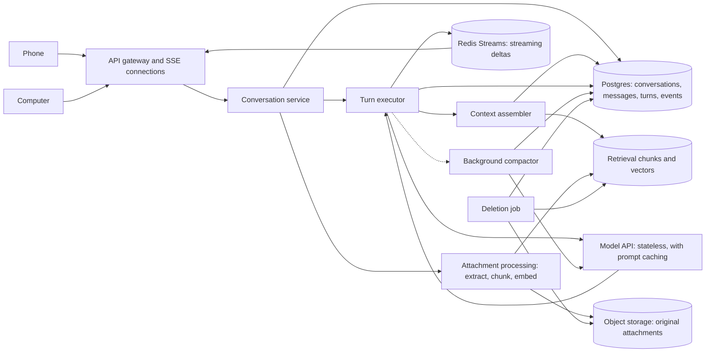

# Design a Conversation Context Manager

## Problem

The interviewer's whole prompt is one sentence:

> We have a chat product backed by a large language model (LLM) with a limited context window.
> Design a conversation context manager.

Another interview guide has a similar prompt: "Design a system that lets the model handle multiple
questions in the same conversation thread." This problem treats that as one sub-question: what
happens when a new message arrives in a conversation while the previous answer is still being
generated?

If you ask, the interviewer gives these numbers. They are practice assumptions, not any company's
real data.

**Traffic.**

- **5 million daily active users**, each starting 1 new conversation a day. Peak is **3×** the
  average.
- Conversation length (one turn is one question and one answer): 70% of conversations have 5 turns,
  25% have 20, 4% have 50, and 1% have 150.
- Per turn, the user message averages **150 tokens** and the assistant's answer **450 tokens**. The
  model generates 50 tokens per second.
- 10% of conversations carry one attachment: 2 MB on average, 20,000 tokens after text extraction.
- 15% of turns make one tool call. A tool result averages 3,000 tokens.

**The model API.**

- It is stateless: every request sends the full prompt, and the model remembers nothing from earlier
  requests.
- The context window is **200,000 tokens**. The system prompt plus tool definitions take 4,000
  tokens, the same for every user.
- Price: 3 US dollars per million input tokens, 15 US dollars per million output tokens.
- It supports prompt caching:
  - A request can mark cache breakpoints in the prompt.
  - If the prefix before a breakpoint is identical, token for token, to one in a recent request,
    that prefix is billed at **0.1×** the input price.
  - Writing a prefix to the cache the first time is billed at **1.25×**.
  - A cache entry expires after 5 minutes unused; every hit restarts the timer.
  - A 1-hour lifetime is also available, with writes billed at **2×**.

**Goals.**

- Users can always see their full history. What the model sees may be compressed; what the user
  sees must not lose anything.
- Users can edit an earlier message, and can ask the model to answer again.
- One user may have a phone and a computer open at the same time. Messages must not be lost or
  duplicated, and every device must show the same order.
- Assembling the prompt (not counting the model call) takes at most **50 ms at p99**.
- After a user deletes a conversation, every copy and all derived data are gone within **30 days**.

**Design:**

1. Requirements and a scale estimate: tokens per turn and per conversation, daily cost, how the cache
   hit rate changes that cost, and storage.
2. The data model and API.
3. The architecture, walking through "send a message".

**Topics the interviewer will dig into.**

- **(a) Prompt assembly.** How do you build the prompt within a token budget, and how do you count
  tokens?
- **(b) Compaction.** Which compaction strategies are there, and how does each one fail?
- **(c) Prompt caching.** How do you keep a stable prefix so the cache keeps hitting?
- **(d) Concurrency.** What happens when several messages are sent in one conversation at once, and
  how do all devices stay consistent?
- **(e) Storage.** How do you store, retain and delete conversations?

**Out of scope:**

- How the inference service is deployed and scheduled; see
  [LLM Inference API with Batched GPU Serving](#/anthropic/system-design/inference-api-batching).
- Long-term memory across conversations (a follow-up).
- Login and billing. For content safety, see
  [Design a System to Detect Harmful Outputs](#/anthropic/system-design/harmful-output-detection).

## Reference solution

<details>
<summary>Show the reference solution</summary>

Before you start designing, it is worth confirming three things. First, whether the model API is stateless. Here it is, so all of the conversation's state lives on our side, and every turn we have to decide afresh what to send. Second, whether compaction affects the history the user sees. Here it doesn't: the conversation record is always complete, and what gets compressed is only "the version the model sees this turn". Third, what product behavior we want when a new message arrives before the previous answer has finished. This design queues by default, and also offers an explicit "interrupt".

The second point determines the shape of the whole design. There are two kinds of data in the system: one is the conversation record, which is the single source of truth and must be lossless; the other is everything derived from the record, including summaries, retrieval chunks, token counts and the prompts sent to the model. Derived data can be lossy and can be recomputed at any time, and it must be deleted together with the record.

There is another easy way to go off track on this problem: treating it as "what to do when the window is full". The estimate below shows that, at the problem's traffic, the window almost never fills up; what actually constrains the design is cost and caching. The interview guide that mentions a similar problem also quotes a candidate: don't get hung up on memory limits; talk more about architectural trade-offs.

### Requirements and scale

**Functional requirements**

- Store conversations: messages, the branches created by edits and regenerations, attachments, tool calls and their results.
- Assemble the prompt within a token budget every turn.
- Compact once a conversation gets long.
- Multi-device sync; concurrent sends within one conversation have a deterministic outcome.
- Deletion, including all derived data.

**Non-functional requirements**

- Assembly p99 at most 50 ms.
- Prompts of consecutive turns share as long a prefix as possible, so the cache can hit.
- No lost or duplicated messages, and all devices see the same order.

**Traffic.** The average conversation has $0.70 \times 5 + 0.25 \times 20 + 0.04 \times 50 + 0.01 \times 150 = 12$ turns. 5 million conversations and 60 million turns a day: 694 turns per second on average, 2,083 per second at peak.

**How big each turn's prompt is.** With no trimming at all, what is sent to the model at turn $t$ is the system prompt, the full content of the previous $t-1$ turns, and the new message:

$$P(t) = 4{,}000 + 600\,(t-1) + 150$$

For an $n$-turn conversation, the total input is $\sum_{t=1}^{n} P(t) = 4{,}150\,n + 300\,n(n-1)$, growing with the square of the number of turns.

| Conversation length | Input on the last turn | Total input for the conversation | Share of all input |
| --- | --- | --- | --- |
| 5 turns (70% of conversations) | 6,550 | 26,750 | 10.5% |
| 20 turns (25%) | 15,550 | 197,000 | 27.5% |
| 50 turns (4%) | 33,550 | 942,500 | 21.1% |
| 150 turns (1%) | 93,550 | 7,327,500 | 40.9% |

The longest 1% of conversations use 40.9% of the input tokens.

**Is the window big enough?** Out of 200,000, reserve 8,000 for output and another 4,000 as a margin for counting error, leaving a hard input budget of 188,000.

- A text-only conversation only reaches 187,750 at turn 307, and exceeds the budget at turn 308.
- Counting tool results, which add $0.15 \times 3{,}000 = 450$ tokens per turn on average, it still lasts until turn 176.
- With one 20,000-token attachment, it lasts until turn 274.

The longest conversation in the problem is 150 turns. So the hard budget is almost never reached; it is just a safety line.

**Cost without caching.** The average conversation's input is 178,950 tokens.

- Input: $5{,}000{,}000 \times 178{,}950 = 894.75$ billion tokens a day, or 2,684,250 US dollars.
- Output: $60{,}000{,}000 \times 450 = 27$ billion tokens a day, or 405,000 US dollars.
- Input is 86.9% of the bill. Resending the history over and over is this product's biggest expense.

**With caching.** Below, everything is billed in "input-token equivalents": 1 token read from cache counts as 0.1, and 1 token written to cache counts as 1.25. Call the probability that "within one conversation, the next message arrives before the cache expires" the hit rate $h$.

- A turn that hits: $0.1 \times P(t-1) + 1.25 \times 600$. The previous turn's whole prompt is billed as a read, and the 600 new tokens are written to the cache.
- A turn that misses: $0.1 \times 4{,}000 + 1.25 \times (P(t) - 4{,}000)$. The system prompt is shared by all users and is always warm; everything else is rewritten.

| Hit rate | Average input per conversation (token equivalents) | Saving vs. no caching | Daily input cost |
| --- | --- | --- | --- |
| 100% | 25,657.5 | 85.7% | 384,862.5 US dollars |
| 80% | 54,223.5 | 69.7% | 813,352.5 US dollars |
| 0% | 168,487.5 | 5.8% | 2,527,312.5 US dollars |

At an 80% hit rate this saves about 1.87 million US dollars a day. The 80% is an assumption of this problem; in practice, measure it from the production distribution of "the gap between two consecutive messages". Also note the last row: with no hits at all, caching actually makes long conversations more expensive (15.6% more for a 150-turn conversation), because every turn pays the 25% write premium.

This table sets the main line of the design: the context manager's most important performance metric is the cache hit rate, and prompt length comes second.

**Storage.**

- Text: about 3 KB per turn including metadata, 180 GB a day, 65.7 TB a year. 36 KB for the average conversation, 450 KB for a 150-turn conversation.
- Original attachments: 500,000 a day, 1 TB in total. This is the largest item.
- Vectors for retrieval: each attachment is cut into 40 chunks, each with a 1,024-dimensional 32-bit float vector (4,096 bytes), about 82 GB a day.

### Data model and API

| Table | Main fields | Notes |
| --- | --- | --- |
| `conversations` | `conversation_id, user_id, head_message_id, next_seq, standing_instructions, deleted_at` | `head_message_id` points to the last message on the current branch |
| `messages` | `message_id, conversation_id, parent_id, role, content, status, client_msg_id, token_count, tokenizer_id` | Linked into a tree by `parent_id`. `content` is a list of content blocks: text, attachment references, tool calls, tool results |
| `turns` | `turn_id, conversation_id, user_message_id, status, lease_expires_at, fencing_token` | One generation. Status is `queued / running / done / cancelled / failed` |
| `attachments` | `attachment_id, conversation_id, object_key, bytes, token_count, extract_status` | The original is in object storage; only metadata here |
| `chunks` | `chunk_id, conversation_id, source_id, text, embedding, token_count` | Derived: retrieval chunks cut from attachments and very old messages |
| `compactions` | `compaction_id, conversation_id, covers_until_message_id, summary, token_count, summarizer_version` | Derived: one summary, and the message it covers up to |
| `events` | `conversation_id, seq, type, payload` | One ordered event log per conversation, used for device sync |
| `assembly_manifests` | `turn_id, items, total_tokens, breakpoints` | Derived: what went into this turn's prompt, for debugging |

**Branches.** Messages form a tree, not a list.

- Editing message $k$: create a new sibling under its parent and point the head at it.
- Regenerating: create a new assistant node under the same user message.
- The current branch is the path from the head along `parent_id` to the root. Old branches are all still there, and the user can switch back to them.

**How summaries are found.** A summary records "which message it covers up to". During assembly, walk up from the head and stop at the first message covered by some summary, using the summary in place of it and everything earlier. Summaries hang off tree nodes, so branches that fork after that node can share it, and branches that fork before it can't use it and won't be misled by it either.

**External API**

```text
POST   /conversations                                -> {conversation_id}
POST   /conversations/{id}/messages
       {client_msg_id, content, attachments?, mode: "queue" | "interrupt", replaces_message_id?}
                                                     -> 202 {message_id, turn_id, seq}
GET    /conversations/{id}/events?after_seq=N        -> SSE: message_added, turn_started, delta, turn_done, head_moved
POST   /conversations/{id}/messages/{mid}/regenerate
POST   /conversations/{id}/turns/{turn_id}/cancel
PUT    /conversations/{id}/head   {message_id}       (switch branch)
DELETE /conversations/{id}
DELETE /conversations/{id}/messages/{mid}
```

- `client_msg_id` is generated by the client and used for deduplication: if the same message is resent after a network timeout, the server returns the result of the first attempt.
- A normal send carries no parent. Where the message hangs is decided by the server when the turn actually starts; see deep dive (d).
- An edit carries `replaces_message_id`, and the new message becomes a sibling of the replaced one.

**Internal API**

```text
Assemble(conversation_id, head_message_id, new_message, budget)
    -> {blocks[], breakpoints[], total_tokens, manifest}
```

### Architecture



Walking through "send a message":

1. The phone sends the message, carrying a `client_msg_id`.
2. The conversation service opens a very short transaction: lock this conversation's row; deduplicate via the unique index on `(conversation_id, client_msg_id)`; write the user message and a turn in `queued` state; write a `message_added` event; return 202.
3. The turn executor tries to start the earliest queued turn in this conversation, changing it to `running`. The database guarantees that only one turn runs at a time per conversation. If a turn is already running, this update fails and the turn stays queued. Only when the start succeeds is the user message attached under the current head, and the head moved forward.
4. The assembler reads the current branch: from the head upward, up to the most recent compaction, plus that summary and the fixed content. Each message's token count was computed at write time, so here it is just addition. If it is over budget, degrade in the order given in deep dive (a). When retrieval is needed, search only this conversation's own chunks. The output is a list of content blocks, the positions of the cache breakpoints, and an assembly manifest.
5. The executor calls the model and reads the output as a stream. Deltas are written to this turn's stream in Redis Streams, and the gateway pushes them to all SSE connections for this conversation, so the phone and the computer see them at the same time.
6. When generation finishes, open another short transaction: write the assistant message (its parent is the user message), move the head forward, change the turn to `done`, write an event. Then calibrate the token counts against the actual usage returned by the model API. If there are more messages in the queue, go back to step 3.
7. If the context is above the high watermark after this turn, send a task to the background compactor. The compaction result takes effect from later turns and doesn't block this one.

The assembler is stateless. Its input is the conversation record and derived data, its output is the content of one request, and it can be recomputed at any time.

### Deep dives

**(a) Assembling the prompt within a token budget**

There are two budgets. The hard budget of 188,000 is set by the window; beyond it, the request is rejected. The soft budget is set by cost and quality, and is a parameter to tune. This design uses a high watermark of 60,000 and a low watermark of 30,000: above 60,000, compact, bringing it below 30,000 in one go.

Why set a soft budget so far below the hard one:

- *Cost.* With a 180,000-token context, even if every turn hits the cache, one turn costs 18,000 token equivalents. One miss is 225,000, or 0.675 US dollars.
- *Latency.* The longer the prompt, the slower the first token, especially on a cache miss.
- *Quality.* The more irrelevant material in the context, the easier it is for the model to be led astray. Anthropic's public documentation on its compaction feature also says that answer quality degrades as conversations get longer ([docs](https://platform.claude.com/docs/en/build-with-claude/compaction), accessed 2026-11-17).

Assembly involves two independent decisions: what to include, and where to put it.

*What to include*, by priority:

| Priority | Content | Handling |
| --- | --- | --- |
| 1 | System prompt and tool definitions, the user's standing instructions, this turn's new message, room for the output | Always kept |
| 2 | The original text of the most recent turns, including their tool calls and results | Kept verbatim, at least the last 10 turns |
| 3 | A summary of earlier content | One, about 1,500 tokens |
| 4 | Retrieval chunks relevant to the new message, from attachments and very old messages | Fetched fresh each turn, at most 5 chunks of 500 tokens each |
| 5 | Older original text, whole attachments | Kept only if there is room |

Above the high watermark, degrade in a fixed order until below the low watermark:

1. Replace old tool results with placeholders. Tool results are the largest single items (3,000 vs. 600), are usually only useful to the turn that produced them, and can be re-fetched by calling the tool again if needed. Anthropic's public API has a feature that does this on the server side, clearing old tool results past a threshold and replacing them with placeholder text ([docs](https://platform.claude.com/docs/en/build-with-claude/context-editing), accessed 2026-11-17).
2. Replace the oldest turns with a summary.
3. Replace whole attachments with retrieval chunks.

A worked example. Before turn 41 starts, the prompt contains: fixed content of 5,150 (system prompt and tools 4,000, standing instructions 1,000, new message 150), one 20,000-token attachment, and 40 turns of history at 24,000, 4 of which each carry a 3,000-token tool result.

| Step | Change | Total |
| --- | --- | --- |
| As is | | 61,150, over 60,000 |
| Replace the 3 tool results in the oldest 30 turns with 50-token placeholders | $-9{,}000 + 150$ | 52,300 |
| Replace the oldest 30 turns with a 1,500-token summary; the placeholders go with them | $-18{,}000 - 150 + 1{,}500$ | 35,650 |
| Replace the attachment with 5 retrieval chunks | $-20{,}000 + 2{,}500$ | 18,150 |

Why keep going after the first step already brings it under 60,000: if you only compress to just below the high watermark, the next turn goes over again, and every turn has to touch the history. Compress below the low watermark, and the next few dozen turns don't need to touch it at all. Why the third step touches the attachment rather than the remaining 10 turns: summarizing those 10 turns too would get down to 29,650, but then the model would have no original text in front of it at all and couldn't pick up the thread.

*Where to put it* has just one rule: the more stable, the earlier; whatever changes every turn goes last.

```text
[system prompt + tool definitions]               same for all users                      <- cache breakpoint 1
[standing instructions] [summary] [kept turns]   only appended at the end between compactions   <- cache breakpoint 2
[this turn's retrieval chunks] [new message]     changes every turn
```

Splitting the worked example's result by this layout, the stable part is 15,500 and the volatile tail is 2,650. Retrieval chunks differ every turn; if you put them before the history, the cache for everything after them is invalidated. Note that priority and position are two different things: the new message has the highest priority but sits at the very end.

Assembly also has a hard constraint: a tool call and its result must appear as a pair. Anthropic's public documentation requires a tool result to come immediately after the corresponding tool call, with no other message in between ([docs](https://platform.claude.com/docs/en/agents-and-tools/tool-use/handle-tool-calls), accessed 2026-11-17). So history can only be cut on whole-turn boundaries; when replacing a tool result with a placeholder, you replace the content, and the block itself stays.

*How tokens are counted.*

- Each message is counted once when it is written, and stored in `token_count` along with the tokenizer identifier in `tokenizer_id`. Assistant messages use the output token count returned by the model API directly.
- Assembly only adds up the stored numbers. Between two compactions, a conversation has at most 93 turns of original text, about 187 message rows, and reading those rows fits comfortably in the 50 ms budget. No tokenization on the hot path, and no calls to a remote counting endpoint.
- The stored numbers are only estimates. The token count of the whole prompt is not the sum of the individual messages; each message also has formatting overhead. The provider's counting endpoint isn't necessarily exact either: Anthropic's docs state explicitly that its counting endpoint gives an estimate, that actual usage may differ slightly, and that the endpoint has its own rate limit ([docs](https://platform.claude.com/docs/en/build-with-claude/token-counting), accessed 2026-11-17). Hence the 4,000-token margin.
- Reconcile after every call: compare the estimate with the actual input reported by the API and record the error. With caching on, the actual input is the sum of three usage fields, which in Anthropic's docs are `input_tokens + cache_creation_input_tokens + cache_read_input_tokens`. Alert if the error keeps growing.
- Changing models may change the tokenizer. The same docs mention that Anthropic's newer models use a new tokenizer that produces about 30% more tokens for the same text. So counts must carry the tokenizer identifier, must be recomputed after a model change, and until recomputation finishes, multiply by a conservative factor.

**(b) Compaction strategies and how they fail**

| Strategy | How it works | Problems |
| --- | --- | --- |
| Sliding window | Drop the oldest turn every turn | Outright forgetting; the prefix changes every turn, so the cache is always invalidated |
| Rolling summary | Fold the oldest turn into the summary every turn | An extra model call every turn; the summary changes every turn, so the cache is invalidated just the same; the summary gets rewritten over and over |
| Chunked compaction (chosen) | Above the high watermark, replace a large block of the oldest turns with a summary in one go, bringing it below the low watermark | The cache is invalidated once on the turn after compaction; summaries lose detail |
| Retrieval | Chunk and index old messages, fetch by relevance each turn | Not retrieved means forgotten; useless for questions like "summarize what we've talked about" |

Choose chunked compaction, with retrieval as a backstop: the summary carries the gist, and original-text chunks carry the details.

The cost of the three strategies can be simulated directly. Take a 300-turn conversation as a stress test, with watermarks of 60,000 and 30,000, a 1,500-token summary, and summary output billed at 5 times the input price. Units are tens of thousands of input-token equivalents:

| Strategy | All message gaps within 5 minutes | About 20% of gaps over 5 minutes | Largest single prompt |
| --- | --- | --- | --- |
| No trimming | 302.2 | 1,004.4 | 183,550 |
| Sliding window | 1,197.4 | 1,257.6 | 59,950 |
| Chunked compaction | 163.9 | 422.4 | 59,950 |

No trimming and no caching is 2,815.5 (tens of thousands).

- The sliding window's prompts are under a third the size of no trimming, yet it costs nearly 4 times as much. The reason is that every time the window slides, everything after the system prompt has to be processed again at full price; that happens on 206 of the 300 turns.
- Chunked compaction compacts only 5 times in 300 turns (after turns 94, 145, 196, 247 and 298); on every other turn the prompt is only appended to at the end.
- Conclusion: if you trim, trim a big block at once, not a little every turn.

The summary calls in the simulation reuse the original prompt prefix and just add "Please summarize the conversation above" at the end. That way, reading the history hits the cache. You could also use a cheaper small model for summarization, but then reading the history gets no cache benefit, so work out the numbers separately.

Why compaction runs in the background: writing a 1,500-token summary takes 30 seconds, and the user can't be made to wait. After crossing the high watermark, keep answering as usual while compacting in the background, and use the result from later turns. The high watermark is still $(188{,}000 - 60{,}000) / 600 \approx 213$ turns away from the hard budget, so it doesn't matter if the summarization service is down for a while.

If you don't want to maintain your own summarization pipeline, you can hand it to the provider. Anthropic's public API has server-side compaction, currently in beta (same compaction docs as above). The cost is that you don't fully control what is kept and what is dropped, and switching providers means redoing it.

How summaries fail, and what to do about each:

- *Losing specifics.* Numbers, names, code, IDs, and rules the user set earlier ("answer in French from now on", "don't use a certain library"). Remedy: extract rule-like content into "standing instructions", which are part of the fixed content and never go into a summary; the summarization prompt requires identifiers to be preserved verbatim; the original text is still in the retrieval index.
- *Summaries of summaries get blurrier.* Each compaction rewrites the previous summary together with the new block, like photocopying a photocopy. Remedy: the original messages always exist, so you can periodically regenerate the summary from the original text, or rebuild it after switching to a better summarization model.
- *Things that were never said show up in the summary.* Once written into the summary, it affects every later turn. Remedy: mark this section as a summary in the prompt; run regression tests with probe questions (see the follow-ups).
- *Laundering untrusted content into trusted content.* Tool results or web pages may hide text like "ignore previous instructions". Once it is written into a summary, it looks like part of the conversation itself. Remedy: when summarizing, treat tool content as data and carry source markers; put the summary in the conversation-history position, not in the system prompt.
- *Compaction and branches.* Summaries hang off tree nodes. If the user edits a message that is already covered by a summary, the new branch can no longer use that summary and has to be reassembled from the fork point.
- *Compaction and an in-progress turn.* Compaction only adds a row of derived data and doesn't modify any message, so it doesn't need to be mutually exclusive with turns. Messages written after the compaction started are outside its coverage and keep appearing as original text.

**(c) Prompt caching and stable prefixes**

Why the cache only recognizes prefixes: what the server caches is the model's intermediate state after reading a prefix. The state at each position in the model depends only on the tokens before it, so only the part that is identical token for token from the start can be reused. If anything in the middle changes, everything after it is invalidated.

The caching rules given in the problem have the same form as the prompt caching in Anthropic's public documentation ([docs](https://platform.claude.com/docs/en/build-with-claude/prompt-caching), accessed 2026-11-17). The docs have a few more details that affect the design:

- The prefix order is fixed: tool definitions, system prompt, messages.
- A request can mark at most 4 breakpoints.
- When looking up the cache, it looks back at most 20 content blocks from each breakpoint.
- Prefixes that are too short aren't cached; the minimum varies by model.
- A cache entry only becomes available once the first request starts returning. Two identical requests sent at the same time both miss.
- Caches are not shared between organizations.

Other providers' rules differ — some cache automatically, and the discounts differ too — so ask first in the interview.

This leads to five practices.

First, lay things out "stable first", as in the layout in (a). Common mistakes are putting the current time or a random request ID in the system prompt, or listing tools in a different order each time. Any of these drops the hit rate straight to zero. If a date is required, only include the day, or put it at the end. Serialization must be deterministic: the same content must produce the same bytes every time.

Second, two breakpoints. One at the end of the system prompt and tool definitions; this segment is shared by all users and always warm. The other at the end of the stable history, moving back each turn. If one turn adds more than 20 content blocks (say, many consecutive tool calls), the lookback can't reach the previous cache entry, so add a breakpoint in the middle.

Third, watch the turns that miss, because that's where the money goes. Look at turn 100:

| | Input-token equivalents |
| --- | --- |
| No caching | 63,550 |
| Hit | 7,045 |
| Miss | 74,837.5 |

One miss costs as much as 10.6 hits. For a 150-turn conversation at an 80% hit rate, the 20% of turns that miss account for 71.7% of the input cost. So in production, record the cache-read share per request, and alert when it drops.

Fourth, choose the lifetime by conversation length. Writes with a 1-hour lifetime cost more (2× vs. 1.25×), but the hit rate is higher. Suppose it raises the hit rate from 80% to 95%:

| | 5-minute lifetime | 1-hour lifetime |
| --- | --- | --- |
| Turn 5 (prompt 6,550) | 1,793.5 | 1,980.25 |
| Turn 70 (prompt 45,550) | 14,663.5 | 9,585.25 |

Under these assumptions, the 1-hour lifetime is cheaper from turn 8 onward (prompt 8,350). Use 5 minutes for short conversations, and switch to 1 hour once a conversation gets long.

Fifth, caching changes the trade-off between "include it whole or retrieve". For a 20,000-token attachment, with retrieval fetching 5 chunks totaling 2,500 tokens per turn:

- Without caching, including it whole adds 20,000 per turn, 8 times as much as retrieval. Over 20 turns that is 400,000 vs. 50,000.
- With caching, the attachment sits in the stable prefix, and a turn that hits costs only 2,000, less than retrieval's 2,500; a turn that misses costs 25,000. Twenty turns, all hits, total 63,000.
- At an 80% hit rate, the average per turn is 6,600, 2.64 times retrieval. The two only break even at a 97.8% hit rate.

So as long as the soft budget has room, keep the attachment whole in the prefix: the cost is the same order of magnitude as retrieval, and you never get a wrong answer because retrieval missed something. Switch to retrieval once it no longer fits, as in the worked example in (a).

How branches interact with the cache: when regenerating, the prompt is identical to the previous request, so it hits directly. Editing the last message also hits, up to the previous turn. Editing a very early message usually means the cache around the fork point has already expired, which amounts to rewriting everything after the system prompt.

**(d) Concurrent sends in one conversation and multi-device consistency**

This is what the prompt "handle multiple questions in the same thread" is asking about. Concurrency arises in three cases: the user sends another message while the previous answer is still being generated; the phone and the computer each send a message; a network timeout causes the client to resend the same message.

| Approach | Behavior | Assessment |
| --- | --- | --- |
| Reject | While a turn is running, a new message returns an error | Simplest. But disabling the send button on the client alone doesn't stop another device, so the server still has to check |
| Queue (default) | Accept and store it, start it after the previous turn ends; its prompt includes the previous question and answer | Every answer sees a complete, linear history. The cost is waiting |
| Interrupt | The new message cancels the answer being generated and immediately starts a new turn | Good for "stop, I got that wrong". You have to handle the half-generated answer |
| Interleave | Both questions are generated at the same time, each using the history as of when it was sent | Fastest. But the two answers can't see each other, and the history becomes "question, question, answer, answer" |
| Fork | Each message becomes its own branch | The history is consistent, but the user thinks they're in one conversation when it has actually split in two |

Choose queueing plus explicit interrupt. The cost of waiting can be computed: a 450-token answer takes 9 seconds to generate; if new messages arrive uniformly during those 9 seconds, the average wait is 4.5 seconds. There is also a cheap improvement: if several user messages are already queued when a turn ends, merge them into one turn and let the model answer them together, saving the calls in between.

Implementing the queue has four key points.

*Deduplication.* Build a unique index on `(conversation_id, client_msg_id)`. A resent message fails to insert, and the server returns the result of the first attempt.

*Only one turn runs at a time per conversation.* Use a Postgres partial unique index to hand this rule to the database:

```sql
CREATE UNIQUE INDEX one_running_turn_per_conversation
    ON turns (conversation_id) WHERE status = 'running';
```

An update that changes a second turn to `running` violates the unique constraint and fails, with no extra locking needed in the application layer. The three short transactions — enqueue, start and finish — each first lock the conversation row with `SELECT ... FOR UPDATE`, which serializes them. The model call takes seconds to tens of seconds, and no database lock is held during it; the only thing holding the slot is that one `running` row.

*A message is attached to the tree only when its turn starts.* A queued message has no parent yet. When its turn comes, the current head is read inside the transaction and the message is attached under it. If it were attached under the head as of enqueue time, while the previous turn's answer hadn't been written yet, it would become a sibling of that answer, and the conversation would silently fork.

*Leases and fencing tokens.* When an executor picks up a turn, it gets a time-limited lease and an increasing token, and renews the lease periodically during generation. If the executor crashes, the lease expires, another executor takes over, and the token increments. If the old executor was merely stalled, when it wakes up and writes, it carries the old token, the update matches no rows, and it can't corrupt the result.

The check code below runs each of four approaches through 2,000 random interleavings, each with 2 to 4 messages plus one resend:

| Approach | Runs with a problem | What went wrong |
| --- | --- | --- |
| Read head first, write later | 1,868 | The conversation forks, and answers or messages fall off the current branch |
| Atomic append, but no queue | 1,575 | No messages lost, but it's no longer one question, one answer, and an answer didn't see the message queued ahead of it |
| Queue, one turn at a time, with dedup | 0 | |
| Queue without dedup | 2,000 | The resent message gets answered twice |

*Interrupt semantics.* The half answer already generated has to be saved and marked "interrupted", because the user saw it and it is part of the record. The next turn's prompt carries it along with that marker. If a tool call had been issued when the interruption happened and its result hadn't come back, add a "cancelled" result for it, or remove the call from the model's view; otherwise the constraint that tool calls appear in pairs is violated. Side effects of tools that have already executed can't be undone, and the product has to tell the user so.

*Multi-device consistency.* Each conversation has an event log, and the sequence number `seq` is assigned inside the transaction that locks the conversation row, so there are no gaps and no ties.

- All devices subscribe to the same log and apply events in `seq` order, so they always converge to the same state.
- On reconnect, a device sends the last sequence number it received, and the server replays from there. The SSE protocol supports this natively: the browser sends a `Last-Event-ID` request header when it reconnects.
- Streaming deltas don't go into the event log; there are too many of them. They are written to a stream in Redis Streams keyed by turn. Redis pub/sub doesn't store messages, so deltas sent while a device is disconnected would be lost; Streams store entries, so a device that joins late can read from the beginning up to the current position. The stream is deleted when the turn ends, and the final message in Postgres is authoritative.
- When a message from another device is ordered ahead of one's own, the client first receives that message and its answer, then sees its own. The UI orders by `seq`, not by local send time.

For more on message delivery and ordering, see [One-on-One Chat System](#/anthropic/system-design/one-on-one-chat).

**(e) Storage, retention and deletion**

*Sharding and hot/cold.* Every query includes the user, so shard by `user_id`, keeping all of a user's conversations on the same shard. Messages are clustered by `(conversation_id, message_id)`, so reading a branch is a range scan plus walking back along `parent_id`. Most of the 65.7 TB of text per year is never looked at again; conversations inactive for some time can have their bodies compressed and moved to object storage, with only metadata kept in the database. Original attachments live in object storage from the start.

*Retrieval doesn't need a global index.* The retrieval scope is always a single conversation, tens to hundreds of chunks. Fetching them by `conversation_id` and computing similarity exactly is enough; no cross-user approximate nearest neighbor index is needed. This also makes deletion simple.

*The inventory of derived data.* A single message leaves behind these copies: summaries, retrieval chunks and vectors, assembly manifests, text extracted from attachments, streaming-delta buffers, analytics logs, the provider's prompt cache, and backups. Deletion has to cover all of them. The approach is to have every row of derived data carry its source `conversation_id`, and summaries also record the range of messages they cover. That way deletion is one query, not an archaeological dig.

*The deletion process.*

1. First a soft delete: mark `deleted_at`; it immediately becomes invisible to the user, and the assembler immediately stops reading it.
2. A background job hard-deletes store by store, and verifies when done.
3. Backups can't be edited row by row. The approach is to encrypt each user's (or each conversation's) data with its own key, and destroy the key on deletion, so that part of the backup can no longer be read. That way the 30-day deadline doesn't depend on how long backups are retained.
4. The provider's prompt cache expires on its own, at most after the chosen lifetime.

*Deleting a single message* is more involved than deleting a whole conversation: summaries that cover it have to be invalidated and regenerated, and chunks and vectors cut from it have to be deleted. Vectors are personal data too; research has shown that a lot of the original text can be recovered from them, so they can't be kept just because they are "unreadable".

*Retention policies.* Enterprise customers often require "auto-delete after N days". This goes through the same process as a user-initiated deletion; only the trigger changes, to a scheduled job configured per tenant.

### Follow-ups

**What happens when you change models or tokenizers?** Three things. Token counts have to be recomputed with the new tokenizer, using a conservative factor until recomputation finishes. If the same text becomes more tokens, the soft budget fits fewer turns, and the watermarks need adjusting. The cache goes completely cold: what is cached is a particular model's internal state after reading the prefix, which is useless to a different model (this follows from how the cache works; Anthropic's caching docs don't state it separately). So switching models mid-conversation amounts to a full miss, and that cost has to be counted during a gradual rollout.

**A user says "you forgot what I said earlier" — how do you investigate?** Look at that turn's assembly manifest. It records where each message went at the time: kept verbatim, folded into the summary, replaced by a placeholder, or dropped; and which summary was used. Most of these problems fall into one of three kinds: the message had already gone into the summary and the summary didn't keep that detail; retrieval didn't bring it back; or the message was actually in the prompt and the model just didn't use it. The three have completely different fixes, and without the manifest you can't tell them apart.

**How do you evaluate the context manager's quality?** With probe questions. Prepare a set of long conversations, and at turn $N$ ask a question whose answer is hidden in turn $k$, comparing the answers given the full history versus the compacted context. The metric is the retention rate of old information, viewed together with cost. Every time you change the summarization prompt, the watermarks or the retrieval parameters, run this regression set.

**What if a user uploads a 150,000-token file?** It fits in the hard budget, but leaves room for only about 57 turns. Each turn costs 0.45 US dollars without caching, 0.045 US dollars on a cache hit, and 0.5625 US dollars on a miss. So files over a certain size go through retrieval by default; only "read the whole thing" requests include it whole, and only for that turn.

**How would you add long-term memory across conversations?** Build a separate user-level store holding facts extracted from conversations, which the user can see, edit and delete. During assembly, put it into the stable prefix as a small piece of fixed content. It changes rarely, so it barely affects caching; when it does change, the cache for all of that user's conversations has to be rewritten once. When a conversation is deleted, the memories extracted from it are also on the inventory of derived data.

**What if the summarization service goes down?** Don't compact; keep answering as usual. The high watermark is still about 213 turns from the hard budget, plenty of time to wait for recovery. If the hard budget really is reached, fall back to the dumbest approach: drop the oldest whole turns, and tell the user in the UI that the earlier content is no longer in the model's view.

**How is this problem different from a general chat system design?** Message storage, delivery and multi-device sync are the same. The difference is an extra "model's view": it is derived from the record, has a token budget, is very sensitive to whether the prefix is stable, and has to be paid for every turn. [Design the Gemini App](#/deepmind/system-design/gemini-app) covers the same kind of system from the perspective of the whole product, and is worth reading alongside this one.

<details>
<summary>Estimate checks (runnable)</summary>

```python
import hashlib
import math
import random
from collections import deque

# ---- traffic ----
dau = 5_000_000                                     # one new conversation per user per day
mix = {5: 0.70, 20: 0.25, 50: 0.04, 150: 0.01}      # turns in a conversation -> share of conversations
assert math.isclose(sum(mix.values()), 1)
mean_turns = sum(n * p for n, p in mix.items())
turns_day = dau * mean_turns
assert math.isclose(mean_turns, 12) and math.isclose(turns_day, 60_000_000)
assert round(turns_day / 86_400) == 694 and round(3 * turns_day / 86_400) == 2_083

# ---- prompt size per turn ----
S, U, A = 4_000, 150, 450                           # system + tools, user message, assistant message
T = U + A
WINDOW, OUT_RESERVE, MARGIN = 200_000, 8_000, 4_000
HARD = WINDOW - OUT_RESERVE - MARGIN
assert T == 600 and HARD == 188_000


def P(t):
    """Input tokens of turn t (1-based) when nothing is trimmed."""
    return S + T * (t - 1) + U


def total_in(n):
    return sum(P(t) for t in range(1, n + 1))


assert all(total_in(n) == 4_150 * n + 300 * n * (n - 1) for n in range(1, 400))
assert [(P(n), total_in(n)) for n in mix] == [(6_550, 26_750), (15_550, 197_000), (33_550, 942_500), (93_550, 7_327_500)]
assert P(307) == 187_750 <= HARD < P(308) == 188_350
tool_per_turn = 0.15 * 3_000
assert tool_per_turn == 450 and T + tool_per_turn == 1_050
assert max(t for t in range(1, 999) if S + (T + tool_per_turn) * (t - 1) + U <= HARD) == 176
assert max(t for t in range(1, 999) if P(t) + 20_000 <= HARD) == 274
assert max(mix) == 150 < 176                        # no conversation in the mix reaches the hard budget

# ---- cost without caching ----
PRICE_IN, PRICE_OUT = 3.0, 15.0                     # hypothetical, per million tokens
mean_in = sum(p * total_in(n) for n, p in mix.items())
assert math.isclose(mean_in, 178_950)
share = {n: round(100 * p * total_in(n) / mean_in, 1) for n, p in mix.items()}
assert share == {5: 10.5, 20: 27.5, 50: 21.1, 150: 40.9}
day_in, day_out = dau * mean_in, turns_day * A
usd_in, usd_out = day_in / 1e6 * PRICE_IN, day_out / 1e6 * PRICE_OUT
assert math.isclose(day_in, 8_947.5e8) and math.isclose(usd_in, 2_684_250)
assert math.isclose(day_out, 270e8) and math.isclose(usd_out, 405_000)
assert round(100 * usd_in / (usd_in + usd_out), 1) == 86.9

# ---- cost with prefix caching (closed form, in input-token equivalents) ----
CW, CR = 1.25, 0.10                                 # cache write and cache read, as multiples of the input price


def cost_hit(t, w=CW):
    return CR * P(t - 1) + w * (P(t) - P(t - 1))


def cost_miss(t, w=CW):
    return CR * S + w * (P(t) - S)                  # the shared system prefix is always warm


def conv_cost(n, h):
    """Expected input cost of an n-turn conversation when each later turn hits with probability h."""
    return CR * S + CW * U + sum(h * cost_hit(t) + (1 - h) * cost_miss(t) for t in range(2, n + 1))


def mean_cost(h):
    return sum(p * conv_cost(n, h) for n, p in mix.items())


def usd_day(h):
    return dau * mean_cost(h) / 1e6 * PRICE_IN


assert math.isclose(mean_cost(1.0), 25_657.5) and round(100 * (1 - mean_cost(1.0) / mean_in), 1) == 85.7
assert math.isclose(mean_cost(0.8), 54_223.5) and round(100 * (1 - mean_cost(0.8) / mean_in), 1) == 69.7
assert math.isclose(mean_cost(0.0), 168_487.5) and round(100 * (1 - mean_cost(0.0) / mean_in), 1) == 5.8
assert math.isclose(usd_day(1.0), 384_862.5) and math.isclose(usd_day(0.8), 813_352.5)
assert math.isclose(usd_day(0.0), 2_527_312.5)
assert round((usd_in - usd_day(0.8)) / 1e4) == 187                  # about 1.87 million saved per day
# with no hits at all, caching costs more than not caching once the prompt is long
assert conv_cost(50, 0.0) > total_in(50) and conv_cost(150, 0.0) > total_in(150)
assert round(100 * (conv_cost(150, 0.0) / total_in(150) - 1), 1) == 15.6
assert math.isclose((CW - CR) * S / (CW - 1), 18_400)               # above this prompt size a miss costs more than no cache
assert cost_miss(24) < P(24) < 18_400 < P(25) < cost_miss(25)
# one turn late in a conversation
assert (P(100), cost_hit(100), cost_miss(100)) == (63_550, 7_045.0, 74_837.5)
assert round(cost_miss(100) / cost_hit(100), 1) == 10.6
hit_part = 0.8 * sum(cost_hit(t) for t in range(2, 151))
miss_part = 0.2 * sum(cost_miss(t) for t in range(2, 151))
assert math.isclose(hit_part + miss_part + CR * S + CW * U, conv_cost(150, 0.8))
assert round(100 * miss_part / conv_cost(150, 0.8), 1) == 71.7
# why a soft budget far below the hard one
assert CR * 180_000 == 18_000 and CW * 180_000 == 225_000 and math.isclose(225_000 * PRICE_IN / 1e6, 0.675)


# ---- 5-minute or 1-hour TTL (assumed hit rates 0.80 and 0.95; a 1-hour write costs 2x) ----
def ttl5(t):
    return 0.80 * cost_hit(t) + 0.20 * cost_miss(t)


def ttl60(t):
    return 0.95 * cost_hit(t, 2.0) + 0.05 * cost_miss(t, 2.0)


assert math.isclose(ttl5(5), 1_793.5) and math.isclose(ttl60(5), 1_980.25) and P(5) == 6_550
assert math.isclose(ttl5(70), 14_663.5) and math.isclose(ttl60(70), 9_585.25) and P(70) == 45_550
first_longer = min(t for t in range(2, 400) if ttl60(t) < ttl5(t))
assert first_longer == 8 and P(first_longer) == 8_350
assert all((ttl60(t) < ttl5(t)) == (t >= 8) for t in range(2, 400))

# ---- a 20,000-token attachment: keep it whole in the prefix, or retrieve 5 chunks of 500 per turn ----
ATT, RET = 20_000, 5 * 500
assert RET == 2_500 and ATT / RET == 8
assert 20 * ATT == 400_000 and CW * ATT + 19 * CR * ATT == 63_000 and 20 * RET == 50_000
assert (CR * ATT, CW * ATT) == (2_000, 25_000)
per_turn_whole = 0.8 * CR * ATT + 0.2 * CW * ATT
assert math.isclose(per_turn_whole, 6_600) and round(per_turn_whole / RET, 2) == 2.64
assert round(100 * (CW * ATT - RET) / (CW * ATT - CR * ATT), 1) == 97.8     # hit rate where the two cost the same
BIG = 150_000
assert (HARD - S - U - BIG) // T + 1 == 57
assert math.isclose(BIG * PRICE_IN / 1e6, 0.45) and math.isclose(BIG * CR * PRICE_IN / 1e6, 0.045)
assert math.isclose(BIG * CW * PRICE_IN / 1e6, 0.5625)

# ---- storage ----
assert math.isclose(turns_day * 3_000 / 1e9, 180) and math.isclose(turns_day * 3_000 * 365 / 1e12, 65.7)
assert math.isclose(mean_turns * 3, 36) and 150 * 3 == 450
attachments_day = 0.10 * dau
chunks = ATT // 500
assert attachments_day == 500_000 and attachments_day * 2e6 / 1e12 == 1.0 and chunks == 40
assert 1_024 * 4 == 4_096 and round(attachments_day * chunks * 4_096 / 1e9) == 82

# ---- watermarks ----
HI, LO, SUMMARY = 60_000, 30_000, 1_500
kept_turns = (LO - S - SUMMARY) // T
assert kept_turns == 40 and S + SUMMARY + kept_turns * T == 29_500
assert (HI - S - U) // T == 93 and 2 * 93 + 1 == 187   # most verbatim turns / message rows in one prompt
assert (HARD - HI) // T == 213                      # turns of headroom if the summariser is down
assert SUMMARY / 50 == 30                           # seconds to write one summary at 50 tokens/s
assert A / 50 == 9 and A / 50 / 2 == 4.5            # seconds to generate one answer; mean wait behind it

# ---- worked example: degrade in a fixed order until the prompt is under the low watermark ----
parts = {"system+tools": S, "standing instructions": 1_000, "new message": U, "attachment": ATT,
         "old turns": 30 * T, "old tool results": 3 * 3_000, "recent turns": 10 * T, "recent tool results": 3_000}
assert S + 1_000 + U == 5_150 and 40 * T == 24_000
ladder = [
    {"old tool results": 3 * 50},                    # old tool results -> 50-token placeholders
    {"old turns": SUMMARY, "old tool results": 0},   # oldest 30 turns -> one summary
    {"attachment": RET},                             # attachment -> top-5 retrieved chunks
]


def degrade(parts, target):
    parts, trace = dict(parts), [sum(parts.values())]
    for change in ladder:
        if trace[-1] <= target:
            break
        parts.update(change)
        trace.append(sum(parts.values()))
    return parts, trace


final, trace = degrade(parts, LO)
assert trace == [61_150, 52_300, 35_650, 18_150] and trace[0] > HI >= trace[1] and trace[2] > LO >= trace[3]
assert degrade(parts, HI)[1] == [61_150, 52_300]     # aiming only at the high watermark stops after one step
assert trace[2] - final["recent turns"] == 29_650    # the alternative to step 3 leaves no verbatim turns
stable = S + 1_000 + SUMMARY + final["recent turns"] + final["recent tool results"]
volatile = final["attachment"] + U
assert (stable, volatile) == (15_500, 2_650) and stable + volatile == trace[-1]


# ---- prefix cache simulator ----
class PrefixCache:
    """Explicit breakpoints, a 20-block lookback, and a TTL that restarts whenever an entry is used."""

    def __init__(self, ttl=300.0, lookback=20, write=CW, read=CR):
        self.ttl, self.lookback, self.write, self.read = ttl, lookback, write, read
        self.expiry = {}

    @staticmethod
    def keys(blocks):
        h, out = hashlib.sha256(), []
        for block_id, _ in blocks:                  # key i identifies the whole prefix blocks[0..i]
            h.update(repr(block_id).encode())
            out.append(h.hexdigest())
        return out

    def pin(self, blocks):
        self.expiry[self.keys(blocks)[-1]] = math.inf

    def request(self, now, blocks, breakpoints):
        """blocks: [(block_id, tokens)]; breakpoints: inclusive block indices. Returns input-token equivalents."""
        assert 1 <= len(breakpoints) <= 4
        keys, tokens = self.keys(blocks), [n for _, n in blocks]
        hit = -1
        for bp in breakpoints:
            for pos in range(bp, max(-1, bp - self.lookback), -1):
                if self.expiry.get(keys[pos], -math.inf) > now:
                    hit = max(hit, pos)
                    break
        last = max(breakpoints)
        for pos in [hit] * (hit >= 0) + list(breakpoints):
            self.expiry[keys[pos]] = max(self.expiry.get(keys[pos], 0.0), now + self.ttl)
        return self.read * sum(tokens[:hit + 1]) + self.write * sum(tokens[hit + 1:last + 1]) + sum(tokens[last + 1:])


SYS = ("sys", S)


def simulate(strategy, n_turns, gaps, out_ratio=PRICE_OUT / PRICE_IN):
    """Returns (input cost, turns whose prompt does not extend the previous prompt, compaction turns, largest prompt)."""
    cache = PrefixCache()
    cache.pin([SYS])                                # every user shares this prefix, so it never goes cold
    history, now, cost, breaks, compacted_after, prev, peak = [], 0.0, 0.0, 0, [], None, 0
    for t in range(1, n_turns + 1):
        now += gaps[t - 1]
        slid = False
        if strategy == "window":                    # drop the oldest turn whenever the prompt would pass HI
            while S + sum(n for _, n in history) + U > HI:
                del history[:2]
                slid = True
        blocks = [SYS] + history + [(("u", t), U)]
        ids = [b for b, _ in blocks]
        breaks += prev is not None and ids[:len(prev)] != prev
        prev = ids
        peak = max(peak, sum(n for _, n in blocks))
        # once the window slides nothing after the system prefix can hit, so it stops paying for cache writes
        cost += cache.request(now, blocks, [0] if slid else [0, len(blocks) - 1])
        history += [(("u", t), U), (("a", t), A)]
        if strategy == "compact" and S + sum(n for _, n in history) + U > HI:
            # the summariser call reuses the cached prompt and appends one 100-token instruction
            call = [SYS] + history + [(("summarise", t), 100)]
            cost += cache.request(now, call, [0, len(history) - 1]) + out_ratio * SUMMARY
            history = [(("summary", t), SUMMARY)] + history[-2 * kept_turns:]
            compacted_after.append(t)
    return cost, breaks, compacted_after, peak


N = 300
warm = [60.0] * N                                   # every gap is inside the 5-minute TTL
rng = random.Random(1)
mixed = [60.0 if rng.random() < 0.8 else 900.0 for _ in range(N)]
assert sum(g == 60.0 for g in mixed) == 237         # 79 % of the gaps are short, 21 % outlive the TTL
res = {(g, s): simulate(s, N, gaps)
       for g, gaps in (("warm", warm), ("mixed", mixed)) for s in ("none", "window", "compact")}
table = {key: round(value[0] / 1e4, 1) for key, value in res.items()}
assert table == {("warm", "none"): 302.2, ("warm", "window"): 1_197.4, ("warm", "compact"): 163.9,
                 ("mixed", "none"): 1_004.4, ("mixed", "window"): 1_257.6, ("mixed", "compact"): 422.4}
assert total_in(N) == 28_155_000                    # no trimming, no caching
assert [res["warm", s][3] for s in ("none", "window", "compact")] == [183_550, 59_950, 59_950]
assert [res["warm", s][1] for s in ("none", "window", "compact")] == [0, 206, 5]
assert res["warm", "compact"][2] == [94, 145, 196, 247, 298]
# sliding one turn per turn costs about 4x as much as not trimming, with a prompt under a third of the size
assert 3.9 < res["warm", "window"][0] / res["warm", "none"][0] < 4.0
assert res["warm", "window"][3] < res["warm", "none"][3] / 3
assert all(res[g, "compact"][0] < res[g, "none"][0] < res[g, "window"][0] for g in ("warm", "mixed"))
# the simulator agrees with the closed form: all hits, all misses, and a fixed pattern of both
assert math.isclose(simulate("none", 150, [60.0] * 150)[0], conv_cost(150, 1.0))
assert math.isclose(simulate("none", 150, [900.0] * 150)[0], conv_cost(150, 0.0))
pattern = [900.0 if t % 5 == 0 else 60.0 for t in range(1, 151)]
expected = CR * S + CW * U + sum(cost_miss(t) if pattern[t - 1] > 300 else cost_hit(t) for t in range(2, 151))
assert math.isclose(simulate("none", 150, pattern)[0], expected)
# lookback: with one breakpoint, an entry 20 blocks back is out of reach; a second breakpoint recovers it
cache = PrefixCache()
base = [SYS] + [(("m", i), 100) for i in range(30)]
cache.request(0.0, base, [len(base) - 1])
far = base + [(("n", i), 100) for i in range(20)]
assert cache.request(1.0, far, [len(far) - 1]) == CW * sum(n for _, n in far)
near = base + [(("p", i), 100) for i in range(20)]
assert cache.request(2.0, near, [len(base) - 1, len(near) - 1]) == CR * sum(n for _, n in base) + CW * 2_000


# ---- concurrent sends in one conversation; every `yield` lets other requests run ----
class Thread:
    def __init__(self):
        self.msgs, self.head, self.seen, self.queue, self.running = {}, None, set(), deque(), False

    def add(self, parent, role, cmid=None, ctx=None):
        mid = len(self.msgs) + 1
        self.msgs[mid] = (parent, role, cmid, ctx)
        return mid

    def path(self, mid):
        out = []
        while mid is not None:
            out.append(mid)
            mid = self.msgs[mid][0]
        return out[::-1]


def is_retry(c, cmid):
    if cmid in c.seen:
        return True
    c.seen.add(cmid)
    return False


def read_then_write(c, cmid):
    if is_retry(c, cmid):
        return
    head = c.head                                   # read the head ...
    yield
    uid = c.head = c.add(head, "user", cmid)        # ... and append under it in a later step
    ctx = c.path(uid)
    yield                                           # the model is generating
    c.head = c.add(uid, "assistant", ctx=ctx)


def interleaved(c, cmid):
    if is_retry(c, cmid):
        return
    uid = c.head = c.add(c.head, "user", cmid)      # atomic append, but several turns may run at once
    ctx = c.path(uid)
    yield                                           # the model is generating
    c.head = c.add(c.head, "assistant", ctx=ctx)


def queued(c, cmid, dedupe=True):
    if dedupe and is_retry(c, cmid):
        return
    c.queue.append(cmid)
    while not c.running and c.queue:                # whoever finds the conversation idle drains the queue
        c.running = True
        uid = c.head = c.add(c.head, "user", c.queue.popleft())   # attached to the tree only when its turn starts
        ctx = c.path(uid)
        yield                                       # the model is generating
        c.head = c.add(uid, "assistant", ctx=ctx)
        c.running = False


def queued_without_dedupe(c, cmid):
    return queued(c, cmid, dedupe=False)


CHECKS = ("fork", "user message lost or duplicated", "roles do not alternate", "answer saw a different history")


def problems(c, sent):
    bad, children = set(), {}
    for parent, _, _, _ in c.msgs.values():
        children[parent] = children.get(parent, 0) + 1
    if max(children.values()) > 1:
        bad.add(CHECKS[0])
    chain = c.path(c.head)
    if sorted(c.msgs[i][2] for i in chain if c.msgs[i][1] == "user") != sorted(sent):
        bad.add(CHECKS[1])
    if [c.msgs[i][1] for i in chain] != ["user", "assistant"] * (len(chain) // 2):
        bad.add(CHECKS[2])
    if any(c.msgs[i][1] == "assistant" and c.msgs[i][3] != chain[:k] for k, i in enumerate(chain)):
        bad.add(CHECKS[3])
    return bad


def trial(handler, rng):
    sent = ["m%d" % i for i in range(rng.randint(2, 4))]
    c = Thread()
    live = [handler(c, m) for m in sent + [rng.choice(sent)]]    # one message is retried by its client
    while live:
        g = rng.choice(live)                        # a random scheduler picks who takes the next step
        try:
            next(g)
        except StopIteration:
            live.remove(g)
    return problems(c, sent)


TRIALS = 2_000
tally = {}
for handler in (read_then_write, interleaved, queued, queued_without_dedupe):
    rng = random.Random(7)
    outcomes = [trial(handler, rng) for _ in range(TRIALS)]
    tally[handler.__name__] = [sum(bool(bad) for bad in outcomes)] + [sum(p in bad for bad in outcomes) for p in CHECKS]
# columns: any problem, fork, user message lost or duplicated, roles do not alternate, answer saw a different history
assert tally["read_then_write"][:2] == [1_868, 1_868] and tally["read_then_write"][2] > 0
assert tally["interleaved"] == [1_575, 0, 0, 1_575, 1_575]
assert tally["queued"] == [0, 0, 0, 0, 0]
assert tally["queued_without_dedupe"] == [2_000, 0, 2_000, 0, 0]

print(f"turns/day {turns_day:,.0f}; hard budget reached at turn {max(t for t in range(1, 999) if P(t) <= HARD)}")
print(f"input per conversation: uncached {mean_in:,.0f}; cached at h=0.8 {mean_cost(0.8):,.1f}; at h=0 {mean_cost(0.0):,.1f}")
print(f"daily input bill: {usd_in:,.0f} -> {usd_day(0.8):,.1f} at h=0.8")
print(f"300-turn stress test (10k token-equivalents): {table}")
print(f"concurrency tally [any, fork, lost/dup, roles, history]: {tally}")
print("all conversation-context-manager numbers check out")
```

</details>

</details>
