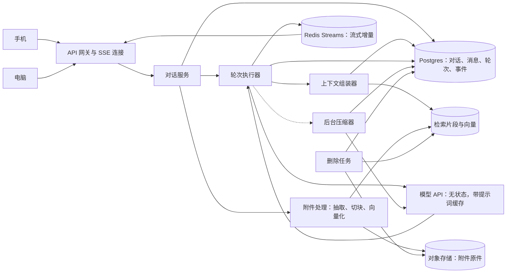

# 设计对话上下文管理器

## 题目

The interviewer's whole prompt is one sentence:

> We have a chat product backed by a large language model (LLM) with a limited context window.
> Design a conversation context manager.

Another interview guide has a similar prompt: "Design a system that lets the model handle multiple
questions in the same conversation thread." This problem treats that as one sub-question: what
happens when a new message arrives in a conversation while the previous answer is still being
generated?

If you ask, the interviewer gives these numbers. They are practice assumptions, not any company's
real data.

**Traffic.**

- **5 million daily active users**, each starting 1 new conversation a day. Peak is **3×** the
  average.
- Conversation length (one turn is one question and one answer): 70% of conversations have 5 turns,
  25% have 20, 4% have 50, and 1% have 150.
- Per turn, the user message averages **150 tokens** and the assistant's answer **450 tokens**. The
  model generates 50 tokens per second.
- 10% of conversations carry one attachment: 2 MB on average, 20,000 tokens after text extraction.
- 15% of turns make one tool call. A tool result averages 3,000 tokens.

**The model API.**

- It is stateless: every request sends the full prompt, and the model remembers nothing from earlier
  requests.
- The context window is **200,000 tokens**. The system prompt plus tool definitions take 4,000
  tokens, the same for every user.
- Price: 3 US dollars per million input tokens, 15 US dollars per million output tokens.
- It supports prompt caching:
  - A request can mark cache breakpoints in the prompt.
  - If the prefix before a breakpoint is identical, token for token, to one in a recent request,
    that prefix is billed at **0.1×** the input price.
  - Writing a prefix to the cache the first time is billed at **1.25×**.
  - A cache entry expires after 5 minutes unused; every hit restarts the timer.
  - A 1-hour lifetime is also available, with writes billed at **2×**.

**Goals.**

- Users can always see their full history. What the model sees may be compressed; what the user
  sees must not lose anything.
- Users can edit an earlier message, and can ask the model to answer again.
- One user may have a phone and a computer open at the same time. Messages must not be lost or
  duplicated, and every device must show the same order.
- Assembling the prompt (not counting the model call) takes at most **50 ms at p99**.
- After a user deletes a conversation, every copy and all derived data are gone within **30 days**.

**Design:**

1. Requirements and a scale estimate: tokens per turn and per conversation, daily cost, how the cache
   hit rate changes that cost, and storage.
2. The data model and API.
3. The architecture, walking through "send a message".

**Topics the interviewer will dig into.**

- **(a) Prompt assembly.** How do you build the prompt within a token budget, and how do you count
  tokens?
- **(b) Compaction.** Which compaction strategies are there, and how does each one fail?
- **(c) Prompt caching.** How do you keep a stable prefix so the cache keeps hitting?
- **(d) Concurrency.** What happens when several messages are sent in one conversation at once, and
  how do all devices stay consistent?
- **(e) Storage.** How do you store, retain and delete conversations?

**Out of scope:**

- How the inference service is deployed and scheduled; see
  [LLM Inference API with Batched GPU Serving](#/anthropic/system-design/inference-api-batching).
- Long-term memory across conversations (a follow-up).
- Login and billing. For content safety, see
  [Design a System to Detect Harmful Outputs](#/anthropic/system-design/harmful-output-detection).

## 参考解答

<details>
<summary>展开参考解答</summary>

动手设计之前值得先确认三件事。第一，模型 API 是不是无状态的。这里是，所以对话的全部状态都在我们这边，每一轮都要重新决定发什么。第二，压缩会不会影响用户看到的历史。这里不会：对话记录永远完整，被压缩的只是“模型这一轮看到的版本”。第三，上一个回答还没结束时又来一条消息，产品上想要什么行为。这份设计默认排队，另外提供显式的“打断”。

第二点决定了整个设计的形状。系统里有两种数据：一种是对话记录，是唯一的事实来源，不能有损；另一种是从记录派生出来的东西，包括摘要、检索片段、token 计数和发给模型的提示词。派生的东西可以有损、可以随时重算，删除时必须跟着记录一起删。

这道题还有一个容易答偏的地方：把它当成“窗口装不下了怎么办”。下面的估算会说明，按题目的流量，窗口几乎从来不会装满，真正起约束作用的是费用和缓存。那份提到同类题目的面试指南也引了一位候选人的话：别纠结内存限制，多讲架构上的取舍。

### 需求与规模

**功能需求**

- 保存对话：消息、编辑和重新回答形成的分支、附件、工具调用和结果。
- 每一轮在 token 预算内组装提示词。
- 对话变长之后压缩。
- 多设备同步；同一个对话里的并发发送有确定的结果。
- 删除，包括所有派生数据。

**非功能需求**

- 组装 p99 不超过 50 ms。
- 相邻两轮的提示词尽量共享前缀，让缓存能命中。
- 消息不丢、不重复，所有设备看到同一个顺序。

**流量。** 平均每个对话 $0.70 \times 5 + 0.25 \times 20 + 0.04 \times 50 + 0.01 \times 150 = 12$ 轮。每天 500 万个对话、6,000 万轮，平均每秒 694 轮，高峰每秒 2,083 轮。

**每一轮的提示词有多大。** 不做任何裁剪时，第 $t$ 轮发给模型的是系统提示词、前 $t-1$ 轮的全部内容和新消息：

$$P(t) = 4{,}000 + 600\,(t-1) + 150$$

一个 $n$ 轮的对话，输入合计是 $\sum_{t=1}^{n} P(t) = 4{,}150\,n + 300\,n(n-1)$，随轮数的平方增长。

| 对话长度 | 最后一轮的输入 | 整个对话的输入合计 | 占全部输入的比例 |
| --- | --- | --- | --- |
| 5 轮（70% 的对话） | 6,550 | 26,750 | 10.5% |
| 20 轮（25%） | 15,550 | 197,000 | 27.5% |
| 50 轮（4%） | 33,550 | 942,500 | 21.1% |
| 150 轮（1%） | 93,550 | 7,327,500 | 40.9% |

最长的那 1% 的对话用掉了 40.9% 的输入 token。

**窗口够不够。** 从 200,000 里留 8,000 给输出，再留 4,000 当计数误差的余量，输入的硬预算是 188,000。

- 纯文字的对话要到第 307 轮才用到 187,750，第 308 轮才超。
- 算上工具结果，平均每轮多 $0.15 \times 3{,}000 = 450$ 个 token，也要到第 176 轮。
- 带一个 20,000 token 的附件，能撑到第 274 轮。

题目里最长的对话是 150 轮。所以硬预算几乎碰不到，它只是一条安全线。

**不用缓存的费用。** 平均每个对话的输入是 178,950 个 token。

- 输入：每天 $5{,}000{,}000 \times 178{,}950 = 8{,}947.5$ 亿个 token，合 2,684,250 美元。
- 输出：每天 $60{,}000{,}000 \times 450 = 270$ 亿个 token，合 405,000 美元。
- 输入占账单的 86.9%。反复重发历史，是这个产品最大的一笔开销。

**用了缓存之后。** 下面统一用“等价输入 token”来计费：缓存读取的 1 个 token 算 0.1 个，缓存写入的算 1.25 个。把“同一个对话里，下一条消息在缓存过期之前到达”的概率记作命中率 $h$。

- 命中的一轮：$0.1 \times P(t-1) + 1.25 \times 600$。上一轮的整个提示词按读取计费，新增的 600 个 token 写入缓存。
- 没命中的一轮：$0.1 \times 4{,}000 + 1.25 \times (P(t) - 4{,}000)$。系统提示词所有用户共用，一直是热的；其余部分全部重新写入。

| 命中率 | 平均每个对话的输入（等价 token） | 比不用缓存省 | 每天的输入费用 |
| --- | --- | --- | --- |
| 100% | 25,657.5 | 85.7% | 384,862.5 美元 |
| 80% | 54,223.5 | 69.7% | 813,352.5 美元 |
| 0% | 168,487.5 | 5.8% | 2,527,312.5 美元 |

命中率 80% 时每天省下约 187 万美元。80% 是这道题的假设，实际要用线上“相邻两条消息的间隔”的分布来量。还要注意最后一行：完全不命中时，长对话用缓存反而更贵（150 轮的对话贵 15.6%），因为每次都在付 25% 的写入溢价。

这张表给出了设计的主线：上下文管理器最重要的性能指标是缓存命中率，其次才是提示词的长度。

**存储。**

- 文本：每轮连同元数据约 3 KB，每天 180 GB，一年 65.7 TB。平均每个对话 36 KB，150 轮的对话 450 KB。
- 附件原件：每天 50 万个，共 1 TB。这是最大的一项。
- 检索用的向量：每个附件切成 40 段，每段一个 1,024 维的 32 位浮点向量（4,096 字节），每天约 82 GB。

### 数据模型与 API

| 表 | 主要字段 | 说明 |
| --- | --- | --- |
| `conversations` | `conversation_id, user_id, head_message_id, next_seq, standing_instructions, deleted_at` | `head_message_id` 指向当前分支的最后一条消息 |
| `messages` | `message_id, conversation_id, parent_id, role, content, status, client_msg_id, token_count, tokenizer_id` | 用 `parent_id` 连成一棵树。`content` 是内容块的列表：文字、附件引用、工具调用、工具结果 |
| `turns` | `turn_id, conversation_id, user_message_id, status, lease_expires_at, fencing_token` | 一轮生成。状态是 `queued / running / done / cancelled / failed` |
| `attachments` | `attachment_id, conversation_id, object_key, bytes, token_count, extract_status` | 原件在对象存储里，这里只有元数据 |
| `chunks` | `chunk_id, conversation_id, source_id, text, embedding, token_count` | 派生：附件和很早的消息切成的检索片段 |
| `compactions` | `compaction_id, conversation_id, covers_until_message_id, summary, token_count, summarizer_version` | 派生：一份摘要，以及它覆盖到哪条消息为止 |
| `events` | `conversation_id, seq, type, payload` | 每个对话一条有序的事件日志，设备同步用 |
| `assembly_manifests` | `turn_id, items, total_tokens, breakpoints` | 派生：这一轮的提示词里放了什么，排查问题用 |

**分支。** 消息是一棵树，不是一个列表。

- 编辑第 $k$ 条消息：在它的父节点下面新建一个兄弟节点，把 head 指过去。
- 重新回答：在同一条用户消息下面新建一个助手节点。
- 当前分支就是从 head 沿 `parent_id` 走到根的那条路径。旧的分支都还在，用户可以切回去。

**摘要怎么找。** 一份摘要记着它“覆盖到哪条消息为止”。组装时从 head 往上走，遇到第一条被某份摘要覆盖的消息就停下，用摘要代替它以及更早的全部内容。摘要挂在树的节点上，所以在这个节点之后才分叉的分支可以共用它，在它之前分叉的分支用不到它，也不会被它误导。

**对外接口**

```text
POST   /conversations                                -> {conversation_id}
POST   /conversations/{id}/messages
       {client_msg_id, content, attachments?, mode: "queue" | "interrupt", replaces_message_id?}
                                                     -> 202 {message_id, turn_id, seq}
GET    /conversations/{id}/events?after_seq=N        -> SSE: message_added, turn_started, delta, turn_done, head_moved
POST   /conversations/{id}/messages/{mid}/regenerate
POST   /conversations/{id}/turns/{turn_id}/cancel
PUT    /conversations/{id}/head   {message_id}       (切换分支)
DELETE /conversations/{id}
DELETE /conversations/{id}/messages/{mid}
```

- `client_msg_id` 由客户端生成，用来去重：网络超时后重发同一条消息，服务端返回第一次的结果。
- 普通的发送不带父节点。消息挂在哪里由服务端在这一轮真正开始时决定，见深入话题 (d)。
- 编辑时带 `replaces_message_id`，新消息成为被替换消息的兄弟节点。

**内部接口**

```text
Assemble(conversation_id, head_message_id, new_message, budget)
    -> {blocks[], breakpoints[], total_tokens, manifest}
```

### 架构



顺着“发一条消息”走一遍：

1. 手机发出消息，带着 `client_msg_id`。
2. 对话服务开一个很短的事务：锁住这个对话的行；按 `(conversation_id, client_msg_id)` 上的唯一索引去重；写入用户消息和一条 `queued` 状态的轮次；写一条 `message_added` 事件；返回 202。
3. 轮次执行器尝试启动这个对话里最早的那条排队轮次，把它改成 `running`。数据库保证同一个对话同时只有一轮在跑。已经有一轮在跑时，这次更新失败，这一轮继续排队。启动成功时，才把用户消息挂到当前 head 的下面，并把 head 前移。
4. 组装器读出当前分支：从 head 往上，读到最近一次压缩为止，再加上那份摘要和固定内容。每条消息的 token 数在写入时已经算好，这里只做加法。超出预算就按深入话题 (a) 的顺序降级。需要检索时，只在这个对话自己的片段里找。输出是一串内容块、缓存断点的位置和一份组装清单。
5. 执行器调用模型并流式读取输出。增量写进 Redis Streams 里属于这一轮的流，网关把它推给这个对话的所有 SSE 连接，手机和电脑同时看到。
6. 生成结束后，再开一个短事务：写入助手消息（父节点是那条用户消息），head 前移，轮次改成 `done`，写事件。然后用模型 API 返回的实际用量校准 token 计数。队列里还有消息就回到第 3 步。
7. 这一轮之后上下文如果超过了高水位，给后台压缩器发一个任务。压缩结果从后面的轮次开始生效，不挡这一轮。

组装器是无状态的。它的输入是对话记录和派生数据，输出是一次请求的内容，随时可以重算。

### 深入话题

**(a) 在 token 预算内组装提示词**

预算有两个。硬预算 188,000 是窗口决定的，超过了请求会被拒绝。软预算是费用和质量决定的，是一个要调的参数。这份设计取高水位 60,000、低水位 30,000：超过 60,000 就压缩，一次压到 30,000 以下。

为什么要在离硬预算很远的地方设一条软预算：

- *费用。* 上下文 180,000 时，即使每轮都命中缓存，一轮也要 18,000 个等价 token。一次不命中是 225,000 个，合 0.675 美元。
- *延迟。* 提示词越长，首个 token 越慢，缓存不命中时尤其明显。
- *质量。* 上下文里无关的内容越多，模型越容易被带偏。Anthropic 关于压缩功能的公开文档里也写着，回答质量会随对话变长而下降（[文档](https://platform.claude.com/docs/en/build-with-claude/compaction)，2026-11-17 查阅）。

组装时有两个互相独立的决定：放什么，以及放在哪里。

*放什么*按优先级：

| 优先级 | 内容 | 处理 |
| --- | --- | --- |
| 1 | 系统提示词和工具定义、用户的长期指示、这一轮的新消息、留给输出的空间 | 一定保留 |
| 2 | 最近若干轮的原文，包括其中的工具调用和结果 | 原文保留，至少最近 10 轮 |
| 3 | 更早内容的摘要 | 一份，约 1,500 个 token |
| 4 | 和新消息相关的检索片段，来自附件和很早的消息 | 每轮现取，最多 5 段、每段 500 个 token |
| 5 | 更早的原文、整份附件 | 有空间才留 |

超过高水位时，按固定的顺序降级，直到低于低水位：

1. 老的工具结果换成占位符。工具结果单条最大（3,000 对 600），通常只对产生它的那一轮有用，需要时还能重新调用。Anthropic 的公开 API 里有一个在服务端做这件事的功能，会把超过阈值的旧工具结果清掉，换成占位文字（[文档](https://platform.claude.com/docs/en/build-with-claude/context-editing)，2026-11-17 查阅）。
2. 最老的若干轮换成一份摘要。
3. 整份附件换成检索片段。

一个算例。第 41 轮开始前，提示词里有：固定内容 5,150（系统提示词与工具 4,000、长期指示 1,000、新消息 150），一个 20,000 的附件，40 轮历史 24,000，其中 4 轮各带一个 3,000 的工具结果。

| 步骤 | 变化 | 合计 |
| --- | --- | --- |
| 原样 | | 61,150，超过 60,000 |
| 最老 30 轮里的 3 个工具结果换成各 50 个 token 的占位符 | $-9{,}000 + 150$ | 52,300 |
| 最老的 30 轮换成 1,500 的摘要，占位符随之消失 | $-18{,}000 - 150 + 1{,}500$ | 35,650 |
| 附件换成 5 段检索片段 | $-20{,}000 + 2{,}500$ | 18,150 |

为什么第一步之后已经低于 60,000 还要继续：如果只压到刚好低于高水位，下一轮又会超，每一轮都要动一次历史。压到低水位之下，接下来几十轮都不用再动。为什么第三步动的是附件而不是剩下的 10 轮：把那 10 轮也摘要掉能降到 29,650，但模型眼前就没有任何原文了，接不上话。

*放在哪里*只有一条规则：越稳定的越靠前，每轮都变的放在最后。

```text
[系统提示词 + 工具定义]              所有用户相同               <- 缓存断点 1
[长期指示] [摘要] [保留的原文轮次]     两次压缩之间只在末尾追加    <- 缓存断点 2
[这一轮的检索片段] [新消息]           每轮都变
```

算例的结果按这个布局分开，稳定部分是 15,500，易变的尾部是 2,650。检索片段每轮不同，如果把它们放在历史前面，后面所有内容的缓存都会作废。注意优先级和位置是两回事：新消息的优先级最高，位置却在最后。

组装时还有一条硬约束：工具调用和它的结果必须成对出现。Anthropic 的公开文档要求工具结果紧跟在对应的工具调用之后，中间不能插入别的消息（[文档](https://platform.claude.com/docs/en/agents-and-tools/tool-use/handle-tool-calls)，2026-11-17 查阅）。所以切历史只能切在整轮的边界上；把工具结果换成占位符时，换的是内容，块本身要留着。

*token 怎么数。*

- 每条消息在写入时算一次，连同分词器的标识存进 `token_count` 和 `tokenizer_id`。助手消息直接用模型 API 返回的输出 token 数。
- 组装时只对存好的数字做加法。两次压缩之间，一个对话最多有 93 轮原文，也就是约 187 行消息，50 ms 的预算里读这些行绰绰有余。热路径上不做分词，也不调远程的计数接口。
- 存下来的数字只是估计。整个提示词的 token 数不等于各条消息之和，每条消息还有格式上的开销。提供方的计数接口也未必精确：Anthropic 的文档明确说它的计数接口给的是估计值，实际用量可能略有出入，而且这个接口有单独的调用频率限制（[文档](https://platform.claude.com/docs/en/build-with-claude/token-counting)，2026-11-17 查阅）。所以留了 4,000 的余量。
- 每次调用之后对账：把估计值和 API 返回的实际输入量比较，记录误差。开了缓存时，实际输入量是三个用量字段之和，Anthropic 的文档里是 `input_tokens + cache_creation_input_tokens + cache_read_input_tokens`。误差持续变大就报警。
- 换模型可能换分词器。同一份文档提到，Anthropic 较新的模型换了分词器，同样的文本会多出约 30% 的 token。所以计数必须带分词器标识，换模型后要重算，重算完成之前先乘一个保守的系数。

**(b) 压缩策略和它们的失败方式**

| 策略 | 做法 | 问题 |
| --- | --- | --- |
| 滑动窗口 | 每轮丢掉最老的一轮 | 直接遗忘；每一轮前缀都变，缓存全部作废 |
| 滚动摘要 | 每轮把最老的一轮并进摘要 | 每轮多一次模型调用；摘要每轮都变，缓存同样作废；摘要被反复改写 |
| 分块压缩（选定） | 超过高水位时，一次把最老的一大段换成摘要，压到低水位以下 | 压缩后的那一轮缓存作废一次；摘要会丢细节 |
| 检索 | 老消息切块建索引，每轮按相关性取回 | 取不到就等于忘了；对“总结一下我们聊过什么”这类问题没用 |

选分块压缩，再用检索兜底：摘要负责大意，原文片段负责细节。

三种策略的费用可以直接模拟。取一个 300 轮的对话当压力测试，高低水位 60,000 和 30,000，摘要 1,500 个 token，摘要的输出按输入价的 5 倍计。单位是万个等价输入 token：

| 策略 | 消息间隔都在 5 分钟内 | 约两成的间隔超过 5 分钟 | 最大的一次提示词 |
| --- | --- | --- | --- |
| 不裁剪 | 302.2 | 1,004.4 | 183,550 |
| 滑动窗口 | 1,197.4 | 1,257.6 | 59,950 |
| 分块压缩 | 163.9 | 422.4 | 59,950 |

不裁剪也不用缓存是 2,815.5 万。

- 滑动窗口的提示词不到不裁剪的三分之一，费用却是它的近 4 倍。原因是窗口每滑动一次，系统提示词之后的全部内容都要按原价重新处理；300 轮里有 206 轮是这样。
- 分块压缩在 300 轮里只压了 5 次（第 94、145、196、247、298 轮之后），其余的轮次提示词都只在末尾追加。
- 结论：要裁剪就一次裁一大块，不要每轮裁一点。

模拟里的摘要调用沿用了原来的提示词前缀，只在末尾加一句“请总结以上对话”。这样读历史的部分能命中缓存。换一个更便宜的小模型来做摘要也可以，但那样读历史就没有缓存可用，要分别算一下。

压缩为什么放在后台：写 1,500 个 token 的摘要要 30 秒，不能让用户等。超过高水位之后照常回答，同时在后台压缩，结果从后面的轮次开始用。高水位离硬预算还有 $(188{,}000 - 60{,}000) / 600 \approx 213$ 轮的距离，摘要服务挂了一段时间也没关系。

如果不想自己维护摘要流程，也可以交给提供方。Anthropic 的公开 API 有服务端的压缩功能，目前是测试版（同上面的压缩文档）。代价是保留什么、丢掉什么不完全由自己控制，而且换提供方时要重做。

摘要的失败方式，以及对应的办法：

- *丢了具体的东西。* 数字、人名、代码、编号，还有用户早先说的规矩（“以后都用法语回答”“不要用某个库”）。办法：规矩类的内容抽出来放进“长期指示”，它属于固定内容，永远不进摘要；摘要的提示词要求原样保留标识符；原文还在检索索引里。
- *摘要的摘要越来越糊。* 每次压缩都把上一份摘要和新的一段合在一起重写，像反复复印。办法：原始消息永远都在，所以可以定期从原文重新生成摘要，也可以在换了更好的摘要模型之后重建。
- *摘要里出现了没说过的话。* 一旦写进摘要，后面每一轮都会受影响。办法：在提示词里标明这一段是摘要；用探针问题做回归测试（见追问）。
- *把不可信的内容洗成了可信的。* 工具结果或网页里可能藏着“忽略之前的指示”一类的文字。它被写进摘要之后，看起来就像对话本身的一部分。办法：摘要时把工具内容当作数据，带上来源标记；摘要放在对话历史的位置，不放进系统提示词。
- *压缩和分支。* 摘要挂在树的节点上。用户编辑了一条已经被摘要覆盖的消息，新分支就不能再用这份摘要，要从分叉点重新组装。
- *压缩和正在进行的轮次。* 压缩只是新增一行派生数据，不改任何消息，所以不用和轮次互斥。压缩开始之后才写入的消息不在它的覆盖范围里，会继续以原文出现。

**(c) 提示词缓存与稳定前缀**

为什么缓存只认前缀：服务端缓存的是模型读完一段前缀之后的中间状态。模型里每个位置的状态只依赖它之前的 token，所以只有从头开始逐字相同的部分才能复用。中间任何一处变了，后面的全部作废。

题目给的缓存规则，和 Anthropic 公开文档里的提示词缓存是同一种形式（[文档](https://platform.claude.com/docs/en/build-with-claude/prompt-caching)，2026-11-17 查阅）。文档里还有几条细节会影响设计：

- 前缀的顺序固定是工具定义、系统提示词、消息。
- 一次请求最多标 4 个断点。
- 查找缓存时，从每个断点往回最多看 20 个内容块。
- 太短的前缀不会被缓存，下限因模型而异。
- 一条缓存要等第一个请求开始返回之后才可用。同时发出的两个相同请求都不会命中。
- 不同的组织之间不共享缓存。

别家的规则不一样，有的自动缓存，折扣也不同，面试时先问清楚。

由此得到五条做法。

第一，按“稳定在前”排布，见 (a) 里的布局。常见的错误是在系统提示词里写当前时间、随机的请求编号，或者每次按不同的顺序列出工具。这些都会让命中率直接变成零。日期如果必须有，只写到天，或者放到末尾。序列化必须是确定的：同样的内容每次生成同样的字节。

第二，两个断点。一个在系统提示词和工具定义的末尾，这一段所有用户共用，永远是热的。另一个在稳定历史的末尾，每轮往后挪。如果一轮里新增的内容块超过 20 个（比如连续调了很多次工具），往回找就够不着上一次的缓存，要在中间补一个断点。

第三，盯住没命中的那些轮次，因为钱主要花在那里。看第 100 轮：

| | 等价输入 token |
| --- | --- |
| 不用缓存 | 63,550 |
| 命中 | 7,045 |
| 没命中 | 74,837.5 |

一次不命中抵得上 10.6 次命中。150 轮的对话在命中率 80% 时，那 20% 没命中的轮次占了输入费用的 71.7%。所以线上要按请求记录缓存读取的比例，掉下来就报警。

第四，按对话长度选有效期。1 小时的有效期写入更贵（2 倍对 1.25 倍），但命中率更高。假设它能把命中率从 80% 提到 95%：

| | 5 分钟有效期 | 1 小时有效期 |
| --- | --- | --- |
| 第 5 轮（提示词 6,550） | 1,793.5 | 1,980.25 |
| 第 70 轮（提示词 45,550） | 14,663.5 | 9,585.25 |

按这组假设，从第 8 轮开始（提示词 8,350）1 小时有效期更划算。短对话用 5 分钟，对话变长后切到 1 小时。

第五，缓存会改变“整份放进去还是检索”的取舍。一个 20,000 token 的附件，每轮检索 5 段共 2,500 个 token：

- 不用缓存时，整份放进去每轮多 20,000，是检索的 8 倍。20 轮下来是 400,000 对 50,000。
- 有缓存时，附件放在稳定前缀里，命中的一轮只要 2,000，比检索的 2,500 还少；没命中的一轮是 25,000。20 轮全命中合计 63,000。
- 命中率 80% 时平均每轮 6,600，是检索的 2.64 倍。命中率要到 97.8% 两者才持平。

所以只要软预算放得下，就把附件整份留在前缀里：费用和检索是同一个量级，而且不会因为没检索到而答错。放不下了再换成检索，就像 (a) 的算例那样。

分支和缓存的关系：重新回答时，提示词和上一次请求完全相同，直接命中。改最后一条消息也能命中到上一轮为止。改很早的一条消息，分叉点附近的缓存多半已经过期，相当于从系统提示词之后全部重写。

**(d) 同一个对话里的并发发送与多设备一致**

“同一个线程里处理多个问题”那句提示问的就是这里。会出现并发的情况有三种：上一个回答还在生成，用户又发了一条；手机和电脑各发了一条；网络超时，客户端把同一条消息重发了一次。

| 做法 | 行为 | 评价 |
| --- | --- | --- |
| 拒绝 | 有一轮在跑时，新消息返回错误 | 最简单。但只靠客户端禁用发送按钮挡不住另一台设备，服务端仍然要判断 |
| 排队（默认） | 接收并保存，等上一轮结束再开始；它的提示词里包含上一问和上一答 | 每个回答都看到完整、线性的历史。代价是等待 |
| 打断 | 新消息取消正在生成的回答，立即开始新的一轮 | 适合“停，我说错了”。要处理生成到一半的回答 |
| 交错 | 两个问题同时生成，各自用发送那一刻的历史 | 最快。但两个回答互相看不见，历史里变成“问、问、答、答” |
| 分叉 | 两条消息各成一个分支 | 历史是一致的，但用户以为自己在同一个对话里，实际上已经分成了两个 |

选排队加显式打断。等待的代价可以算：一个回答 450 个 token，生成 9 秒；新消息在这 9 秒里均匀到达，平均等 4.5 秒。还有一个便宜的改进：一轮结束时如果队列里已经排了好几条用户消息，把它们并成一轮，让模型一起回答，省掉中间的调用。

排队的实现有四个要点。

*去重。* `(conversation_id, client_msg_id)` 上建唯一索引。重发的消息插入失败，服务端返回第一次的结果。

*同一个对话同时只有一轮在跑。* 用 Postgres 的部分唯一索引把这条规则交给数据库：

```sql
CREATE UNIQUE INDEX one_running_turn_per_conversation
    ON turns (conversation_id) WHERE status = 'running';
```

把第二轮改成 `running` 的更新会违反唯一约束而失败，不需要应用层另外加锁。入队、开始、结束这三个短事务各自先用 `SELECT ... FOR UPDATE` 锁住对话行，保证彼此串行。模型调用要几秒到几十秒，期间不持有任何数据库锁，占位的只是那一行 `running`。

*消息在开始时才挂到树上。* 排队中的消息还没有父节点。轮到它时，才在事务里读出当前的 head，把它挂上去。如果在入队时就挂到当时的 head 下面，而那时上一轮的回答还没写入，它就会和那个回答成为兄弟节点，对话悄悄地分叉了。

*租约和防护令牌。* 执行器拿到一轮时得到一个有期限的租约和一个递增的令牌，生成期间定时续约。执行器崩溃后租约到期，别的执行器接手，令牌加一。旧的执行器如果只是卡住了，醒来后写入时带的是旧令牌，更新匹配不到任何行，不会污染结果。

下面的核对代码把四种做法各跑 2,000 次随机交错，每次 2 到 4 条消息，外加一次重发：

| 做法 | 出问题的次数 | 出了什么问题 |
| --- | --- | --- |
| 先读 head、之后再写 | 1,868 | 对话分叉，有回答或消息掉出了当前分支 |
| 原子追加，但不排队 | 1,575 | 消息没丢，但不再是一问一答，回答没看到排在它前面的消息 |
| 排队，同时只跑一轮，带去重 | 0 | |
| 排队但不去重 | 2,000 | 重发的那条消息被回答了两次 |

*打断的语义。* 已经生成的半个回答要存下来，标成“被打断”，因为用户看到过它，它是记录的一部分。下一轮的提示词里带着它和这个标记。如果被打断时有一个工具调用已经发出、结果还没回来，要给它补一个“已取消”的结果，或者从模型的视角里去掉这次调用，否则就违反了工具调用成对出现的约束。已经执行了的工具的副作用撤不回来，这一点要在产品上告诉用户。

*多设备一致。* 每个对话有一条事件日志，序号 `seq` 在锁住对话行的事务里分配，所以没有空洞，也没有并列。

- 所有设备订阅同一条日志，按 `seq` 的顺序应用事件，最后一定收敛到同一个状态。
- 断线重连时带上最后收到的序号，服务端从那之后补发。SSE 协议本身支持这一点：浏览器重连时会带上 `Last-Event-ID` 请求头。
- 流式的增量不进事件日志，量太大。它们写进 Redis Streams 里以轮次为键的流。Redis 的发布订阅不保存消息，断线期间的增量就丢了；Streams 会保存条目，后加入的设备可以从头读到当前位置。流在这一轮结束后删除，最终的消息以 Postgres 里的为准。
- 另一台设备发的消息排在了自己前面时，客户端会先收到那条消息和它的回答，再看到自己的。界面上按 `seq` 排，不按本地的发送时间排。

消息投递和排序的更多细节，见 [一对一聊天系统](#/anthropic/system-design/one-on-one-chat)。

**(e) 存储、留存与删除**

*分片和冷热。* 所有查询都带着用户，所以按 `user_id` 分片，一个用户的对话都在同一个分片上。消息按 `(conversation_id, message_id)` 聚集存放，读一个分支是一次范围扫描加沿 `parent_id` 的回溯。一年 65.7 TB 的文本大部分没人再看，一段时间不活跃的对话可以把正文压缩后挪到对象存储，数据库里只留元数据。附件原件从一开始就放在对象存储里。

*检索不需要全局索引。* 检索范围永远是一个对话，几十到几百个片段。按 `conversation_id` 取出来精确计算相似度就够了，不需要跨用户的近似最近邻索引。这也让删除变得简单。

*派生数据的清单。* 一条消息会留下这些副本：摘要、检索片段和向量、组装清单、附件抽出的文本、流式增量的缓冲、分析日志、提供方那边的提示词缓存、备份。删除要覆盖全部。办法是让每一行派生数据都带着来源的 `conversation_id`，摘要还要记下它覆盖的消息范围。这样删除是一次查询，不是一次考古。

*删除的流程。*

1. 先做软删除：标记 `deleted_at`，对用户立即不可见，组装器立即不再读它。
2. 后台任务逐个存储做硬删除，做完之后核对。
3. 备份没法逐行改。办法是每个用户（或每个对话）的数据用各自的密钥加密，删除时销毁密钥，备份里的那部分就读不出来了。这样 30 天的期限不取决于备份保留多久。
4. 提供方那边的提示词缓存会自己过期，最长是所选的有效期。

*删除单条消息*比删除整个对话麻烦：覆盖到它的摘要要作废并重新生成，由它切出来的片段和向量要删掉。向量也是个人数据，研究表明能从向量里还原出不少原文，不能因为“看不懂”就留着。

*留存策略。* 企业客户常常要求“超过 N 天自动删除”。这和用户主动删除走同一条流程，只是触发方式换成按租户配置的定时任务。

### 追问

**换模型或者换分词器，会发生什么？** 三件事。token 计数要按新的分词器重算，重算完成之前先用保守的系数。同样的文本如果变成更多的 token，软预算能装的轮数就变少，水位要跟着调。缓存会全部变冷：缓存的是某个模型读完前缀之后的内部状态，换了模型就用不上（这是从缓存的原理推出来的，Anthropic 的缓存文档没有单独写这一条）。所以对话中途换模型等于一次完整的不命中，灰度的时候要把这笔费用算进去。

**用户说“你把我前面说的忘了”，怎么查？** 看那一轮的组装清单。它记录了每条消息当时的去向：原文保留、进了摘要、换成了占位符，还是被丢掉；也记录了当时用的是哪一份摘要。大多数这类问题属于三种之一：那条消息已经进了摘要而摘要没保留那个细节；检索没取回来；消息其实在提示词里，是模型自己没用上。三种的修法完全不同，没有清单就分不清。

**怎么评估上下文管理器的质量？** 用探针问题。准备一批长对话，在第 $N$ 轮问一个答案藏在第 $k$ 轮的问题，比较“给完整历史”和“给压缩后的上下文”两种情况下的回答。指标是老信息的保留率，和费用一起看。每次改摘要的提示词、水位或者检索参数，都跑一遍这个回归集。

**用户上传了一个 150,000 token 的文件呢？** 硬预算里放得下，但只剩约 57 轮的空间。每轮不用缓存要 0.45 美元，命中缓存 0.045 美元，一次不命中 0.5625 美元。所以超过某个大小的文件默认走检索；只有“通读全文”类的请求才整份放进去，而且只放在那一轮。

**跨对话的长期记忆怎么加？** 另建一个用户级的存储，存从对话里抽取出来的事实，用户看得见、改得了、删得掉。组装时作为一小段固定内容放进稳定前缀。它变化很少，所以不怎么影响缓存；它变的那一次，这个用户所有对话的缓存都要重写一遍。删除一个对话时，从它抽出来的记忆也在派生数据的清单里。

**摘要服务挂了怎么办？** 不压缩，照常回答。高水位离硬预算还有约 213 轮，足够等它恢复。真的到了硬预算，就退回到最笨的办法：丢掉最老的若干整轮，并且在界面上告诉用户早先的内容已不在模型的视野里。

**这道题和通用的聊天系统设计有什么不同？** 消息的存储、投递、多设备同步是一样的。不同的是多了一个“模型的视角”：它是从记录派生出来的，有 token 预算，对前缀是否稳定非常敏感，而且每一轮都要为它付钱。[设计 Gemini App](#/deepmind/system-design/gemini-app) 从整个产品的角度讲了同一类系统，可以对照着看。

<details>
<summary>估算核对（可运行）</summary>

```python
import hashlib
import math
import random
from collections import deque

# ---- traffic ----
dau = 5_000_000                                     # one new conversation per user per day
mix = {5: 0.70, 20: 0.25, 50: 0.04, 150: 0.01}      # turns in a conversation -> share of conversations
assert math.isclose(sum(mix.values()), 1)
mean_turns = sum(n * p for n, p in mix.items())
turns_day = dau * mean_turns
assert math.isclose(mean_turns, 12) and math.isclose(turns_day, 60_000_000)
assert round(turns_day / 86_400) == 694 and round(3 * turns_day / 86_400) == 2_083

# ---- prompt size per turn ----
S, U, A = 4_000, 150, 450                           # system + tools, user message, assistant message
T = U + A
WINDOW, OUT_RESERVE, MARGIN = 200_000, 8_000, 4_000
HARD = WINDOW - OUT_RESERVE - MARGIN
assert T == 600 and HARD == 188_000


def P(t):
    """Input tokens of turn t (1-based) when nothing is trimmed."""
    return S + T * (t - 1) + U


def total_in(n):
    return sum(P(t) for t in range(1, n + 1))


assert all(total_in(n) == 4_150 * n + 300 * n * (n - 1) for n in range(1, 400))
assert [(P(n), total_in(n)) for n in mix] == [(6_550, 26_750), (15_550, 197_000), (33_550, 942_500), (93_550, 7_327_500)]
assert P(307) == 187_750 <= HARD < P(308) == 188_350
tool_per_turn = 0.15 * 3_000
assert tool_per_turn == 450 and T + tool_per_turn == 1_050
assert max(t for t in range(1, 999) if S + (T + tool_per_turn) * (t - 1) + U <= HARD) == 176
assert max(t for t in range(1, 999) if P(t) + 20_000 <= HARD) == 274
assert max(mix) == 150 < 176                        # no conversation in the mix reaches the hard budget

# ---- cost without caching ----
PRICE_IN, PRICE_OUT = 3.0, 15.0                     # hypothetical, per million tokens
mean_in = sum(p * total_in(n) for n, p in mix.items())
assert math.isclose(mean_in, 178_950)
share = {n: round(100 * p * total_in(n) / mean_in, 1) for n, p in mix.items()}
assert share == {5: 10.5, 20: 27.5, 50: 21.1, 150: 40.9}
day_in, day_out = dau * mean_in, turns_day * A
usd_in, usd_out = day_in / 1e6 * PRICE_IN, day_out / 1e6 * PRICE_OUT
assert math.isclose(day_in, 8_947.5e8) and math.isclose(usd_in, 2_684_250)
assert math.isclose(day_out, 270e8) and math.isclose(usd_out, 405_000)
assert round(100 * usd_in / (usd_in + usd_out), 1) == 86.9

# ---- cost with prefix caching (closed form, in input-token equivalents) ----
CW, CR = 1.25, 0.10                                 # cache write and cache read, as multiples of the input price


def cost_hit(t, w=CW):
    return CR * P(t - 1) + w * (P(t) - P(t - 1))


def cost_miss(t, w=CW):
    return CR * S + w * (P(t) - S)                  # the shared system prefix is always warm


def conv_cost(n, h):
    """Expected input cost of an n-turn conversation when each later turn hits with probability h."""
    return CR * S + CW * U + sum(h * cost_hit(t) + (1 - h) * cost_miss(t) for t in range(2, n + 1))


def mean_cost(h):
    return sum(p * conv_cost(n, h) for n, p in mix.items())


def usd_day(h):
    return dau * mean_cost(h) / 1e6 * PRICE_IN


assert math.isclose(mean_cost(1.0), 25_657.5) and round(100 * (1 - mean_cost(1.0) / mean_in), 1) == 85.7
assert math.isclose(mean_cost(0.8), 54_223.5) and round(100 * (1 - mean_cost(0.8) / mean_in), 1) == 69.7
assert math.isclose(mean_cost(0.0), 168_487.5) and round(100 * (1 - mean_cost(0.0) / mean_in), 1) == 5.8
assert math.isclose(usd_day(1.0), 384_862.5) and math.isclose(usd_day(0.8), 813_352.5)
assert math.isclose(usd_day(0.0), 2_527_312.5)
assert round((usd_in - usd_day(0.8)) / 1e4) == 187                  # about 1.87 million saved per day
# with no hits at all, caching costs more than not caching once the prompt is long
assert conv_cost(50, 0.0) > total_in(50) and conv_cost(150, 0.0) > total_in(150)
assert round(100 * (conv_cost(150, 0.0) / total_in(150) - 1), 1) == 15.6
assert math.isclose((CW - CR) * S / (CW - 1), 18_400)               # above this prompt size a miss costs more than no cache
assert cost_miss(24) < P(24) < 18_400 < P(25) < cost_miss(25)
# one turn late in a conversation
assert (P(100), cost_hit(100), cost_miss(100)) == (63_550, 7_045.0, 74_837.5)
assert round(cost_miss(100) / cost_hit(100), 1) == 10.6
hit_part = 0.8 * sum(cost_hit(t) for t in range(2, 151))
miss_part = 0.2 * sum(cost_miss(t) for t in range(2, 151))
assert math.isclose(hit_part + miss_part + CR * S + CW * U, conv_cost(150, 0.8))
assert round(100 * miss_part / conv_cost(150, 0.8), 1) == 71.7
# why a soft budget far below the hard one
assert CR * 180_000 == 18_000 and CW * 180_000 == 225_000 and math.isclose(225_000 * PRICE_IN / 1e6, 0.675)


# ---- 5-minute or 1-hour TTL (assumed hit rates 0.80 and 0.95; a 1-hour write costs 2x) ----
def ttl5(t):
    return 0.80 * cost_hit(t) + 0.20 * cost_miss(t)


def ttl60(t):
    return 0.95 * cost_hit(t, 2.0) + 0.05 * cost_miss(t, 2.0)


assert math.isclose(ttl5(5), 1_793.5) and math.isclose(ttl60(5), 1_980.25) and P(5) == 6_550
assert math.isclose(ttl5(70), 14_663.5) and math.isclose(ttl60(70), 9_585.25) and P(70) == 45_550
first_longer = min(t for t in range(2, 400) if ttl60(t) < ttl5(t))
assert first_longer == 8 and P(first_longer) == 8_350
assert all((ttl60(t) < ttl5(t)) == (t >= 8) for t in range(2, 400))

# ---- a 20,000-token attachment: keep it whole in the prefix, or retrieve 5 chunks of 500 per turn ----
ATT, RET = 20_000, 5 * 500
assert RET == 2_500 and ATT / RET == 8
assert 20 * ATT == 400_000 and CW * ATT + 19 * CR * ATT == 63_000 and 20 * RET == 50_000
assert (CR * ATT, CW * ATT) == (2_000, 25_000)
per_turn_whole = 0.8 * CR * ATT + 0.2 * CW * ATT
assert math.isclose(per_turn_whole, 6_600) and round(per_turn_whole / RET, 2) == 2.64
assert round(100 * (CW * ATT - RET) / (CW * ATT - CR * ATT), 1) == 97.8     # hit rate where the two cost the same
BIG = 150_000
assert (HARD - S - U - BIG) // T + 1 == 57
assert math.isclose(BIG * PRICE_IN / 1e6, 0.45) and math.isclose(BIG * CR * PRICE_IN / 1e6, 0.045)
assert math.isclose(BIG * CW * PRICE_IN / 1e6, 0.5625)

# ---- storage ----
assert math.isclose(turns_day * 3_000 / 1e9, 180) and math.isclose(turns_day * 3_000 * 365 / 1e12, 65.7)
assert math.isclose(mean_turns * 3, 36) and 150 * 3 == 450
attachments_day = 0.10 * dau
chunks = ATT // 500
assert attachments_day == 500_000 and attachments_day * 2e6 / 1e12 == 1.0 and chunks == 40
assert 1_024 * 4 == 4_096 and round(attachments_day * chunks * 4_096 / 1e9) == 82

# ---- watermarks ----
HI, LO, SUMMARY = 60_000, 30_000, 1_500
kept_turns = (LO - S - SUMMARY) // T
assert kept_turns == 40 and S + SUMMARY + kept_turns * T == 29_500
assert (HI - S - U) // T == 93 and 2 * 93 + 1 == 187   # most verbatim turns / message rows in one prompt
assert (HARD - HI) // T == 213                      # turns of headroom if the summariser is down
assert SUMMARY / 50 == 30                           # seconds to write one summary at 50 tokens/s
assert A / 50 == 9 and A / 50 / 2 == 4.5            # seconds to generate one answer; mean wait behind it

# ---- worked example: degrade in a fixed order until the prompt is under the low watermark ----
parts = {"system+tools": S, "standing instructions": 1_000, "new message": U, "attachment": ATT,
         "old turns": 30 * T, "old tool results": 3 * 3_000, "recent turns": 10 * T, "recent tool results": 3_000}
assert S + 1_000 + U == 5_150 and 40 * T == 24_000
ladder = [
    {"old tool results": 3 * 50},                    # old tool results -> 50-token placeholders
    {"old turns": SUMMARY, "old tool results": 0},   # oldest 30 turns -> one summary
    {"attachment": RET},                             # attachment -> top-5 retrieved chunks
]


def degrade(parts, target):
    parts, trace = dict(parts), [sum(parts.values())]
    for change in ladder:
        if trace[-1] <= target:
            break
        parts.update(change)
        trace.append(sum(parts.values()))
    return parts, trace


final, trace = degrade(parts, LO)
assert trace == [61_150, 52_300, 35_650, 18_150] and trace[0] > HI >= trace[1] and trace[2] > LO >= trace[3]
assert degrade(parts, HI)[1] == [61_150, 52_300]     # aiming only at the high watermark stops after one step
assert trace[2] - final["recent turns"] == 29_650    # the alternative to step 3 leaves no verbatim turns
stable = S + 1_000 + SUMMARY + final["recent turns"] + final["recent tool results"]
volatile = final["attachment"] + U
assert (stable, volatile) == (15_500, 2_650) and stable + volatile == trace[-1]


# ---- prefix cache simulator ----
class PrefixCache:
    """Explicit breakpoints, a 20-block lookback, and a TTL that restarts whenever an entry is used."""

    def __init__(self, ttl=300.0, lookback=20, write=CW, read=CR):
        self.ttl, self.lookback, self.write, self.read = ttl, lookback, write, read
        self.expiry = {}

    @staticmethod
    def keys(blocks):
        h, out = hashlib.sha256(), []
        for block_id, _ in blocks:                  # key i identifies the whole prefix blocks[0..i]
            h.update(repr(block_id).encode())
            out.append(h.hexdigest())
        return out

    def pin(self, blocks):
        self.expiry[self.keys(blocks)[-1]] = math.inf

    def request(self, now, blocks, breakpoints):
        """blocks: [(block_id, tokens)]; breakpoints: inclusive block indices. Returns input-token equivalents."""
        assert 1 <= len(breakpoints) <= 4
        keys, tokens = self.keys(blocks), [n for _, n in blocks]
        hit = -1
        for bp in breakpoints:
            for pos in range(bp, max(-1, bp - self.lookback), -1):
                if self.expiry.get(keys[pos], -math.inf) > now:
                    hit = max(hit, pos)
                    break
        last = max(breakpoints)
        for pos in [hit] * (hit >= 0) + list(breakpoints):
            self.expiry[keys[pos]] = max(self.expiry.get(keys[pos], 0.0), now + self.ttl)
        return self.read * sum(tokens[:hit + 1]) + self.write * sum(tokens[hit + 1:last + 1]) + sum(tokens[last + 1:])


SYS = ("sys", S)


def simulate(strategy, n_turns, gaps, out_ratio=PRICE_OUT / PRICE_IN):
    """Returns (input cost, turns whose prompt does not extend the previous prompt, compaction turns, largest prompt)."""
    cache = PrefixCache()
    cache.pin([SYS])                                # every user shares this prefix, so it never goes cold
    history, now, cost, breaks, compacted_after, prev, peak = [], 0.0, 0.0, 0, [], None, 0
    for t in range(1, n_turns + 1):
        now += gaps[t - 1]
        slid = False
        if strategy == "window":                    # drop the oldest turn whenever the prompt would pass HI
            while S + sum(n for _, n in history) + U > HI:
                del history[:2]
                slid = True
        blocks = [SYS] + history + [(("u", t), U)]
        ids = [b for b, _ in blocks]
        breaks += prev is not None and ids[:len(prev)] != prev
        prev = ids
        peak = max(peak, sum(n for _, n in blocks))
        # once the window slides nothing after the system prefix can hit, so it stops paying for cache writes
        cost += cache.request(now, blocks, [0] if slid else [0, len(blocks) - 1])
        history += [(("u", t), U), (("a", t), A)]
        if strategy == "compact" and S + sum(n for _, n in history) + U > HI:
            # the summariser call reuses the cached prompt and appends one 100-token instruction
            call = [SYS] + history + [(("summarise", t), 100)]
            cost += cache.request(now, call, [0, len(history) - 1]) + out_ratio * SUMMARY
            history = [(("summary", t), SUMMARY)] + history[-2 * kept_turns:]
            compacted_after.append(t)
    return cost, breaks, compacted_after, peak


N = 300
warm = [60.0] * N                                   # every gap is inside the 5-minute TTL
rng = random.Random(1)
mixed = [60.0 if rng.random() < 0.8 else 900.0 for _ in range(N)]
assert sum(g == 60.0 for g in mixed) == 237         # 79 % of the gaps are short, 21 % outlive the TTL
res = {(g, s): simulate(s, N, gaps)
       for g, gaps in (("warm", warm), ("mixed", mixed)) for s in ("none", "window", "compact")}
table = {key: round(value[0] / 1e4, 1) for key, value in res.items()}
assert table == {("warm", "none"): 302.2, ("warm", "window"): 1_197.4, ("warm", "compact"): 163.9,
                 ("mixed", "none"): 1_004.4, ("mixed", "window"): 1_257.6, ("mixed", "compact"): 422.4}
assert total_in(N) == 28_155_000                    # no trimming, no caching
assert [res["warm", s][3] for s in ("none", "window", "compact")] == [183_550, 59_950, 59_950]
assert [res["warm", s][1] for s in ("none", "window", "compact")] == [0, 206, 5]
assert res["warm", "compact"][2] == [94, 145, 196, 247, 298]
# sliding one turn per turn costs about 4x as much as not trimming, with a prompt under a third of the size
assert 3.9 < res["warm", "window"][0] / res["warm", "none"][0] < 4.0
assert res["warm", "window"][3] < res["warm", "none"][3] / 3
assert all(res[g, "compact"][0] < res[g, "none"][0] < res[g, "window"][0] for g in ("warm", "mixed"))
# the simulator agrees with the closed form: all hits, all misses, and a fixed pattern of both
assert math.isclose(simulate("none", 150, [60.0] * 150)[0], conv_cost(150, 1.0))
assert math.isclose(simulate("none", 150, [900.0] * 150)[0], conv_cost(150, 0.0))
pattern = [900.0 if t % 5 == 0 else 60.0 for t in range(1, 151)]
expected = CR * S + CW * U + sum(cost_miss(t) if pattern[t - 1] > 300 else cost_hit(t) for t in range(2, 151))
assert math.isclose(simulate("none", 150, pattern)[0], expected)
# lookback: with one breakpoint, an entry 20 blocks back is out of reach; a second breakpoint recovers it
cache = PrefixCache()
base = [SYS] + [(("m", i), 100) for i in range(30)]
cache.request(0.0, base, [len(base) - 1])
far = base + [(("n", i), 100) for i in range(20)]
assert cache.request(1.0, far, [len(far) - 1]) == CW * sum(n for _, n in far)
near = base + [(("p", i), 100) for i in range(20)]
assert cache.request(2.0, near, [len(base) - 1, len(near) - 1]) == CR * sum(n for _, n in base) + CW * 2_000


# ---- concurrent sends in one conversation; every `yield` lets other requests run ----
class Thread:
    def __init__(self):
        self.msgs, self.head, self.seen, self.queue, self.running = {}, None, set(), deque(), False

    def add(self, parent, role, cmid=None, ctx=None):
        mid = len(self.msgs) + 1
        self.msgs[mid] = (parent, role, cmid, ctx)
        return mid

    def path(self, mid):
        out = []
        while mid is not None:
            out.append(mid)
            mid = self.msgs[mid][0]
        return out[::-1]


def is_retry(c, cmid):
    if cmid in c.seen:
        return True
    c.seen.add(cmid)
    return False


def read_then_write(c, cmid):
    if is_retry(c, cmid):
        return
    head = c.head                                   # read the head ...
    yield
    uid = c.head = c.add(head, "user", cmid)        # ... and append under it in a later step
    ctx = c.path(uid)
    yield                                           # the model is generating
    c.head = c.add(uid, "assistant", ctx=ctx)


def interleaved(c, cmid):
    if is_retry(c, cmid):
        return
    uid = c.head = c.add(c.head, "user", cmid)      # atomic append, but several turns may run at once
    ctx = c.path(uid)
    yield                                           # the model is generating
    c.head = c.add(c.head, "assistant", ctx=ctx)


def queued(c, cmid, dedupe=True):
    if dedupe and is_retry(c, cmid):
        return
    c.queue.append(cmid)
    while not c.running and c.queue:                # whoever finds the conversation idle drains the queue
        c.running = True
        uid = c.head = c.add(c.head, "user", c.queue.popleft())   # attached to the tree only when its turn starts
        ctx = c.path(uid)
        yield                                       # the model is generating
        c.head = c.add(uid, "assistant", ctx=ctx)
        c.running = False


def queued_without_dedupe(c, cmid):
    return queued(c, cmid, dedupe=False)


CHECKS = ("fork", "user message lost or duplicated", "roles do not alternate", "answer saw a different history")


def problems(c, sent):
    bad, children = set(), {}
    for parent, _, _, _ in c.msgs.values():
        children[parent] = children.get(parent, 0) + 1
    if max(children.values()) > 1:
        bad.add(CHECKS[0])
    chain = c.path(c.head)
    if sorted(c.msgs[i][2] for i in chain if c.msgs[i][1] == "user") != sorted(sent):
        bad.add(CHECKS[1])
    if [c.msgs[i][1] for i in chain] != ["user", "assistant"] * (len(chain) // 2):
        bad.add(CHECKS[2])
    if any(c.msgs[i][1] == "assistant" and c.msgs[i][3] != chain[:k] for k, i in enumerate(chain)):
        bad.add(CHECKS[3])
    return bad


def trial(handler, rng):
    sent = ["m%d" % i for i in range(rng.randint(2, 4))]
    c = Thread()
    live = [handler(c, m) for m in sent + [rng.choice(sent)]]    # one message is retried by its client
    while live:
        g = rng.choice(live)                        # a random scheduler picks who takes the next step
        try:
            next(g)
        except StopIteration:
            live.remove(g)
    return problems(c, sent)


TRIALS = 2_000
tally = {}
for handler in (read_then_write, interleaved, queued, queued_without_dedupe):
    rng = random.Random(7)
    outcomes = [trial(handler, rng) for _ in range(TRIALS)]
    tally[handler.__name__] = [sum(bool(bad) for bad in outcomes)] + [sum(p in bad for bad in outcomes) for p in CHECKS]
# columns: any problem, fork, user message lost or duplicated, roles do not alternate, answer saw a different history
assert tally["read_then_write"][:2] == [1_868, 1_868] and tally["read_then_write"][2] > 0
assert tally["interleaved"] == [1_575, 0, 0, 1_575, 1_575]
assert tally["queued"] == [0, 0, 0, 0, 0]
assert tally["queued_without_dedupe"] == [2_000, 0, 2_000, 0, 0]

print(f"turns/day {turns_day:,.0f}; hard budget reached at turn {max(t for t in range(1, 999) if P(t) <= HARD)}")
print(f"input per conversation: uncached {mean_in:,.0f}; cached at h=0.8 {mean_cost(0.8):,.1f}; at h=0 {mean_cost(0.0):,.1f}")
print(f"daily input bill: {usd_in:,.0f} -> {usd_day(0.8):,.1f} at h=0.8")
print(f"300-turn stress test (10k token-equivalents): {table}")
print(f"concurrency tally [any, fork, lost/dup, roles, history]: {tally}")
print("all conversation-context-manager numbers check out")
```

</details>

</details>
