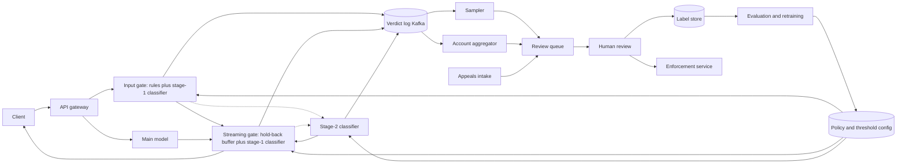

# Design a System to Detect Harmful Outputs

## Problem

The interviewer's whole prompt is one sentence:

> We have a large language model (LLM) API and a chat product. Design a system that detects and
> handles harmful model output.

If you ask, the interviewer gives these numbers. They are practice assumptions, not any company's
real data.

**Traffic.**

- **1,000 requests/s** on average; peak is **3×** the average.
- A request averages **1,500 input tokens** (including conversation history) and **400 output
  tokens**.
- Most requests are streamed. The main model's median time to first token is about **600 ms**; after
  that it generates **50 tokens/s**.
- About 2 million active accounts a day. A few large API customers send up to 100,000 requests a day
  from a single key.

**What "harmful" means.** The usage policy sorts violations into three tiers. The classifiers give one
score per category, and each category's threshold can be tuned on its own.

| Tier | Examples | Share of responses that violate | Required handling |
| --- | --- | --- | --- |
| S0, most severe | Sexual content involving minors; substantive help with weapons of mass destruction | 1 in a million | Must block, must get human review, may lead to action on the account |
| S1, severe | Specific self-harm methods, violent threats against a specific person, ready-to-use malicious code | 1 in 20,000 | Block |
| S2, moderate | Hate and harassment; adult content that some products don't allow | About 4.5 in 10,000 | Set by the deployer: block, replace with a safe answer, or only log |

Across the three tiers, **1 in every 2,000** responses actually violates the policy.

**Goals.**

- Recall: at least **95%** across all tiers, and at least **99%** for S0 alone.
- False blocks: at most **5 per 10,000** benign responses.
- Latency: on a streamed response, the median time until the user sees the first token is at most
  **100 ms** later than without detection.
- People: the trust and safety team has **40 reviewers**. Each reviews for 6 effective hours a day,
  at 45 seconds per item on average.

**Components you can use as given.**

- **Stage-1 classifier**: a small model. One GPU processes 200,000 tokens/s; one call takes about
  15 ms. On all traffic it reaches 98% recall at a 2% false positive rate.
- **Stage-2 classifier**: a mid-size LLM that reads the full context plus a 1,000-token policy
  description. One GPU processes 20,000 tokens/s; one verdict takes about 400 ms. Among the samples
  stage 1 escalates, it catches 97% of true violations and clears 99% of the false positives.
- With thresholds tuned for S0 alone, stage 1 reaches 99.8% recall at a 0.5% false positive rate,
  and stage 2 catches 99.5% of true violations while keeping only 0.2% of the false positives. These
  are already included in the totals above.
- Stage 1 must see the first **12 tokens** of a harmful passage before its score crosses the
  threshold.
- The main model spends 1.5 GPU-seconds per request on average. Classifier GPUs are provisioned for a
  60% target utilization.

**Design:**

1. Requirements and a scale estimate: how many true violations there are a day, how many get
   flagged, how many reviewer hours that takes, and how much latency and compute each request gains.
2. The data model and API.
3. The architecture, walking through one streamed request.

**Topics the interviewer will dig into.**

- **(a) Cascades at a low base rate.** When violations are this rare, what recall, false positives
  and review volume does a cascade of classifiers give you?
- **(b) Streaming.** Where do the checks go in a streamed response, and what do you do about tokens
  that were already sent and cannot be taken back?
- **(c) Evaluation and drift.** How do you measure the system, and notice when it gets worse?
- **(d) Abuse across requests.** How do you catch abuse that no single request reveals?
- **(e) Enforcement, appeals, privacy and retention.**

**Out of scope:**

- Training the main model to refuse on its own. That is a separate line of defense; this problem
  covers only detection outside the model.
- Writing the policy text itself.
- Images and audio. Text in, text out only; tool calls are a follow-up.

## Reference solution

<details>
<summary>Show the reference solution</summary>

Before designing anything, it is worth confirming three things. First, who defines “harmful”, and whether every product uses the same standard. This design assumes the company policy sets the tiers: S0 is the same for every deployment, and S2 lets the operator (a customer building a product on the API) loosen or tighten it within bounds the company sets. Second, how far handling goes once something is detected: just log it, block this one response, or take action on the account. Here all three are needed, decided by tier. Third, whether content may be stored. Here we assume ordinary traffic can be retained short-term, but some enterprise customers have signed zero-retention agreements, and for them verdicts can only be made in memory.

The easiest way to get this problem wrong is to treat it as “train a good classifier”. What the interviewer really wants to hear is this: violations are extremely rare, and that rewrites precision, review volume and the evaluation method; and streamed output turns “blocking” into an action with a latency cost. The estimates below work through both points first.

### Requirements and scale

**Functional requirements**

- Score every request's input and output against the policy taxonomy, producing a category, a score and a recommended action.
- In a streamed response, stop the output before the user sees harmful content (or as early as possible).
- Send verdicts on to human review, account enforcement and the appeals process.
- Thresholds and policies can be adjusted per category and per deployment, changes take effect within minutes, and every verdict can be traced back to the policy version and model version in effect at the time.

**Non-functional requirements**

- The median added latency to the first visible token is at most 100 ms.
- When the detection service fails, there are explicit degradation rules; it must not silently turn into “allow everything”.
- Most flagged content is actually benign, so there have to be rules for what is stored, for how long, and who can see it.

**Traffic.** $1{,}000 \times 86{,}400 = 86{,}400{,}000$ requests a day, 3,000 per second at peak. Each request has $1{,}500 + 400 = 1{,}900$ tokens to run through the classifiers, 1.9 million tokens per second on average and 5.7 million per second at peak.

**How many true violations there are a day.** $86{,}400{,}000 / 2{,}000 = 43{,}200$, of which about 86 are S0, 4,320 are S1 and about 38,794 are S2. There are 86,356,800 benign responses.

**First, a design that doesn't work.** A single classifier tuned to 95% recall at a 1% false positive rate sounds good. Work out how many responses it flags a day:

- True violations flagged: $43{,}200 \times 0.95 = 41{,}040$.
- Benign responses wrongly flagged: $86{,}356{,}800 \times 0.01 = 863{,}568$.
- 904,608 in total, for a precision of only $41{,}040 / 904{,}608 = 4.5\%$.

Each reviewer can look at $6 \times 3{,}600 / 45 = 480$ items a day, 19,200 for the whole team. Sending all 904,608 to humans would take 11,308 reviewer hours, i.e. 1,885 reviewers. The team has 40. Blocking all of these responses automatically doesn't work either: it would wrongly block 1 in every 100 benign responses, 20 times the target.

**The cascade.** A small stage-1 model sees all traffic and only has to pick out what looks suspicious; a large stage-2 model sees only what stage 1 picked out.

| | After stage 1 | After stage 2 |
| --- | --- | --- |
| True violations | $43{,}200 \times 0.98 = 42{,}336$ | $42{,}336 \times 0.97 \approx 41{,}066$ |
| False positives | $86{,}356{,}800 \times 0.02 = 1{,}727{,}136$ | $1{,}727{,}136 \times 0.01 \approx 17{,}271$ |
| Total | 1,769,472 (2.048% of traffic) | 58,337 |
| Precision | 2.4% | 70.4% |

- End-to-end recall is $0.98 \times 0.97 = 95.06\%$, just over the 95% line. About 2,134 a day are missed: 864 by stage 1 and about 1,270 by stage 2.
- The false block rate is $0.02 \times 0.01 = 0.02\%$, i.e. 1 in every 5,000 benign responses is wrongly blocked, within the “5 per 10,000” target.
- Even so, about 30% of the blocked responses are false blocks, affecting about 17,271 benign requests a day.
- Human review of all 58,337 blocked responses would take 729 reviewer hours, or 122 reviewers, still more than 40. So humans can only look at part of them; see the review budget below.

**S0 on its own.** There are about 86 S0 violations a day. With its own thresholds, recall is $0.998 \times 0.995 = 99.3\%$. False positives are $86{,}400{,}000 \times 0.005 \times 0.002 = 864$. So there are about 950 S0 alerts a day, with a precision of only 9%, but reviewing all of them takes just 11.9 reviewer hours, which two reviewers can cover. The most severe category can tolerate very low precision because its absolute volume is small, and a human always looks before any action is taken on an account.

**Review budget.** The 40 reviewers can look at 19,200 items a day, split by purpose:

| Purpose | Items per day | Notes |
| --- | --- | --- |
| S0 alerts | 950 | All reviewed |
| Appeals | 2,138 | Assumes 10% of wrongly blocked users appeal and 1% of correctly blocked ones do |
| Shadow sampling | 855 | Used to estimate how much stage 1 misses; see deep dive (c) |
| Quality sampling | 5,000 | Stratified sample of blocked and allowed responses |
| Total | 8,943 | About 112 reviewer hours, 46.6% of capacity |

The remaining half of capacity is kept for incidents and account-level reviews.

**Compute.**

- Stage 1: $1{,}900 / 200{,}000 = 9.5$ GPU-milliseconds per request. At a peak of 5.7 million tokens per second, that takes 28.5 GPUs at full load, or 48 provisioned at 60% utilization.
- Stage 2: each verdict reads $1{,}900 + 1{,}000 = 2{,}900$ tokens and costs 145 GPU-milliseconds. At peak there are $3{,}000 \times 2.048\% \approx 61.4$ escalations per second, so 15 GPUs provisioned at 60% utilization.
- 63 GPUs in total. Having stage 2 look at all traffic directly would take 725, 11.5 times the cascade.
- Per request on average: $9.5 + 2.048\% \times 145 \approx 12.47$ GPU-milliseconds, about 0.83% of the main model's 1.5 GPU-seconds. With stage 2 on all traffic it would be 9.7%.

**Latency.**

- The input check runs concurrently with the main model processing the input. The stage-1 classifier has its answer in 15 ms, long before the main model's first token at 600 ms, so the input check does not affect the first token of a normal request.
- The output check runs every 5 tokens. The first batch of 5 has to wait for the 5th token to be generated ($4 / 50 = 80$ ms) plus 15 ms for the verdict, so the first visible token arrives 95 ms later, within the 100 ms target. After that, the text the user sees lags generation by 55 ms on average.
- Responses escalated to stage 2 (about 2%) pause once mid-stream, for about 400 ms.

**Storage.** Each record flagged by stage 1, with its context, is about 10 KB: 17.7 GB a day, or about 531 GB over 30 days. Storage is not the hard part; the hard part is that 97.6% of these records belong to ordinary users. See deep dive (e).

### Data model and API

**Policy and configuration**

| Table | Main fields | Notes |
| --- | --- | --- |
| `policy_categories` | `category_id, tier, name, adjustable, default_action` | The policy taxonomy. `adjustable` says whether operators may tune it |
| `deployment_policies` | `deployment_id, category_id, flag_threshold, block_threshold, action, policy_version` | Two lines per deployment per category: a flag line and a block line |

Each category has two thresholds, not one. A score past the flag line is only recorded and may be sampled; only past the block line does a user-visible action happen. Both S0 lines are fixed by the company and cannot be changed by operators.

**Verdicts and evidence**

| Table | Main fields | Notes |
| --- | --- | --- |
| `verdicts` | `verdict_id, request_id, account_id, deployment_id, stage, category_id, score, action, token_span, classifier_version, policy_version, created_at` | One row per verdict, metadata only, no content |
| `flagged_content` | `verdict_id, ciphertext, retention_class, expires_at` | Content stored separately, encrypted, with an expiry time |
| `review_items` | `item_id, verdict_id, queue, priority, sampling_prob, status, label, reviewer_id` | `sampling_prob` records the probability with which this item was sampled; it is used as a weight when estimating population metrics |
| `enforcement_actions` | `action_id, account_id, type, evidence_verdict_ids, decided_by, expires_at` | Account-level actions, which must point to evidence |
| `appeals` | `appeal_id, target_id, status, outcome, reviewer_id` | Appeals and their outcomes |

Metadata and content are stored separately so that they can have different retention periods and access permissions: account aggregation and drift monitoring only need the metadata.

**Internal interfaces**

```text
CheckInput(request_id, deployment_id, messages)
    -> {decision: allow | block | escalate, category, score}

OpenGate(request_id, deployment_id, risk_hint)   -> gate_id
PushTokens(gate_id, tokens)
    -> {release_upto: int, decision: continue | pause | block, category}

Escalate(request_id, context, category)          -> {decision: allow | block, score}
```

The `release_upto` returned by `PushTokens` tells the streaming layer “tokens up to this index may be sent to the user”. The streaming gate keeps the state of each stream itself, so each call only needs to pass the new tokens.

**External behavior**

- A blocked response is not an error but a normally completed response, carrying a stop reason meaning “stopped for policy reasons” and the category. Clients can use it to show a notice instead of treating it as a network failure and retrying. Anthropic's public API documentation does exactly this: when a safety classifier fires, the response is HTTP 200 with the stop reason `refusal`, and `stop_details` gives the policy category that triggered it ([docs](https://platform.claude.com/docs/en/build-with-claude/handling-stop-reasons), accessed 2026-11-17).
- `POST /v1/appeals {request_id, reason}`: a user or operator appeals a block or an account action.

### Architecture



Walking through one streamed request:

1. The request reaches the gateway. The gateway hands it to the input gate and the main model at the same time, and the main model starts processing the input.
2. The input gate first runs rules and hash tables (known violating content, known jailbreak templates), which takes microseconds. Then the stage-1 classifier reads the full input. There are three outcomes: allow; the score is past the block line, so block immediately and cancel the main model's generation; or the score falls in between, so escalate to stage 2, in which case the first token is held until stage 2 returns a verdict.
3. The main model starts emitting tokens. The streaming gate puts them in a hold-back buffer, and every time 5 have accumulated, it lets the stage-1 classifier read on. Only when the verdict is clean are those 5 tokens sent to the client.
4. If a batch's score crosses the line, the gate stops releasing tokens and sends the full context so far to the stage-2 classifier. If stage 2 says allow, the stream continues; if stage 2 says block, the gate drops the tokens not yet released, tells the main model to stop generating (saving the compute for the rest), and sends the client a final event carrying the stop reason.
5. Every verdict is written to the verdict log. The log is Kafka, partitioned by account ID. Kafka only guarantees ordering within a partition, so this ensures events for the same account reach the account aggregator in order.
6. The sampler picks items from the log for human review according to its rules and writes them, with their sampling probabilities, to the review queue. The account aggregator also adds to the review queue when it finds an anomalous account.
7. Reviewer verdicts go three places: into the label store, for evaluation and retraining; to the enforcement service; and back as answers to appeals.
8. The evaluation pipeline produces new thresholds or new classifier versions, which are pushed out through the config service and take effect on the gates within minutes.

### Deep dives

**(a) Recall, false positives and review volume of a cascade at a low base rate**

Let $\pi$ be the share of violations, $r$ the classifier's recall and $f$ its false positive rate. The share of true violations among flagged responses is

$$\text{precision} = \frac{\pi r}{\pi r + (1-\pi) f}$$

At $\pi = 1/2{,}000$, the denominator is almost entirely the $(1-\pi) f$ term. Plugging in $r = 0.95, f = 0.01$ gives 4.5%. This comes from the base rate, and a better single-stage classifier can't fix much of it: to reach 90% precision at 95% recall, the false positive rate would have to be pushed down to 1 error in every 18,938 benign responses.

Three options:

- *A single small model on all traffic.* Cheap (48 GPUs), but at 4.5% precision you can neither block automatically nor hand it to humans.
- *A single large model on all traffic.* The best quality, but it takes 725 GPUs, adds 9.7% compute to every request, and its 400 ms verdict time doesn't fit in the streaming path.
- *A cascade (chosen).* The small model sees all traffic, the large model sees only 2% of it, 63 GPUs. The cost is that recalls multiply and the system is more complex.

A cascade has three easily overlooked rules of arithmetic.

First, recalls multiply. $0.98 \times 0.97 = 0.9506$. For 95% end to end, each stage has to be clearly above 95%, and here there is almost no margin: if either stage drops by 1 point, the whole system misses the target. So stage 1's threshold should be set very loose, erring toward escalating more.

Second, false positive rates multiply too, but the second factor is not stage 2's “usual” false positive rate. The false positives stage 1 picks out are the benign content that looks most like violations, such as toxicology course slides or novels depicting crimes. Stage 2's false positive rate on these samples (1%) will be much higher than on random traffic. Estimates must use the number measured “on the samples escalated by stage 1”, which is how the problem states it.

Third, even after the cascade, precision is only 70.4%. If every category blocked automatically, about 17,271 benign requests a day would be wrongly blocked. So each category gets two lines:

- S0 and S1: block once past the block line. A false block costs less than a miss.
- S2: block only at high confidence; the middle band is only flagged and goes into the sampling pool, without affecting the user. Operators can tighten this line (products for minors) or loosen it (adult content platforms, medical platforms).

Human review is not on the synchronous path. At 45 seconds per item, humans can only do four things: label samples, confirm S0, handle appeals, and sign off before account actions.

**(b) Streaming: where the checks go, and tokens that have been sent can't be taken back**

Checks can go in three places, and all three are needed.

- *Input check.* It can block before generation, so not a single token leaks, and it saves the generation compute. But it can't see the output: an innocent-looking question can get a harmful answer, and the entire point of a jailbreak prompt is to fool checks that only look at the input.
- *Streaming output check.* It looks directly at what the model says. It is the main line of defense, and also where the latency cost comes from.
- *After-the-fact check.* After the response ends, a slower, more accurate model rereads the full conversation offline. It can't block this response, but it can find what the first two missed, trigger account actions, and produce evaluation data.

There are three ways to do the streaming output check:

- *Check after the whole response is generated.* Nothing leaks, but the user waits $400 / 50 = 8$ seconds to see the first character, which defeats the purpose of streaming.
- *Release as generated, check afterwards.* No latency, but harmful content may go out in full.
- *Check in chunks with a hold-back (chosen).* Check every $k$ tokens, and release only after the check passes.

The chosen approach has three quantities: the check interval $k$; the extra hold-back $h$ (when releasing, keep the most recent $h$ tokens back as well); and the classifier's detection lag $d$ (it must see the first $d$ tokens of a harmful passage before crossing the threshold; the problem gives 12). Let the generation speed be $v = 50$ tokens/s and one verdict take $t_c = 15$ ms.

- Latency to the first visible token: the first checkpoint covering $1 + h$ tokens is $m = k \lceil (1+h)/k \rceil$, and the latency is $(m-1)/v + t_c$.
- Worst-case number of leaked harmful tokens: $\max(0,\ d - 1 - h)$. The reason is that before the classifier crosses the line, the chunks containing the first few tokens of the harmful passage are judged “clean” and released.

| Configuration | Delay to first visible token | Average lag | Worst-case leak |
| --- | --- | --- | --- |
| $k=5, h=0$ | 95 ms | 55 ms | 11 tokens |
| $k=10, h=0$ | 195 ms | 105 ms | 11 tokens |
| $k=1, h=0$ | 15 ms | 15 ms | 11 tokens |
| $k=5, h=11$ | 295 ms | 270.5 ms | 0 |

Two things follow from the table. Checking more often ($k=1$) only lowers latency; it does not reduce leakage, which is determined solely by $d$ and $h$. Zero leakage requires a hold-back of at least $d - 1$, which brings latency to 295 ms, over the 100 ms target.

So the recommendation is to set the hold-back by risk:

- Default to $k=5, h=0$. The worst case leaks 11 tokens, roughly the start of a sentence. For content like “dangerous step-by-step instructions”, the harm lies in complete, actionable information; the first few words are essentially harmless.
- Requests that scored high at the input stage (about 2%) switch to $h=11$. Only these users wait an extra 200 ms, and they are exactly the ones most likely to be a problem.
- For categories where the first few words are themselves the harm (for example, directly outputting a person's national ID number), use $h=11$ by default in the relevant deployments, or don't stream at all.

“Can't be taken back” needs to be discussed separately for two kinds of clients. A chat interface can, on receiving the block event, remove the half sentence already displayed and replace it with a notice, but the user may already have seen it. An API client already has the bytes, and they can't be recalled. So the design treats “already released” as “already leaked”, rather than counting on retracting it afterwards.

Four more implementation details:

- *Incremental scoring.* The stage-1 classifier must be a model that can continue reading where it left off; each stream keeps its intermediate state, and each call processes only the 5 new tokens. If every call reread a window of the last 200 tokens, a 400-token response would take 80 calls reading 16,000 tokens, 40 times the incremental approach, and the 48-GPU estimate would no longer hold.
- *The pause on escalation.* A stage-2 verdict takes 400 ms, during which the stream is stopped. After stage 2 allows it, stage 1's escalation line should be raised temporarily for the rest of this response; otherwise the same false positive will trigger pauses again and again.
- *What to store after a block.* The truncated assistant message must be stored in the conversation history with a “blocked” marker, and when the next turn's context is assembled, that half sentence of harmful content must not be fed back to the model as is. For how conversation history is assembled, see [Design a Conversation Context Manager](#/anthropic/system-design/conversation-context-manager).
- *Another kind of stage-1 classifier.* A linear probe on the main model's intermediate-layer activations costs almost no compute and adds no extra read latency. The cost is that it is tied to the main model's version and must be retrained whenever the model changes, and because it shares the main model's internal representations, the same attack can easily fool both. It is useful as an additional signal, but not recommended as the only stage 1.

**(c) Evaluation and drift**

Evaluation has to answer two questions: what the recall and false block rate are right now, and whether they are getting worse. The base rate is so low that the most direct route, “randomly sample live traffic and label it”, doesn't work.

- Measuring S0 recall to 99% ± 1% (one standard error) takes about $0.99 \times 0.01 / 0.01^2 = 99$ positive S0 samples. S0 occurs at one in a million, so random sampling would require labeling 99 million items, equivalent to 206,250 reviewer-days.
- Estimating misses by randomly spot-checking allowed responses doesn't work either. Of the 86,341,663 allowed responses, only about 2,134 are missed violations, 1 in every 40,458. Sampling 5,000 a day would hit only 0.12 of them on average.

So the labeled set has to be assembled from three sources:

- *Purpose-built positive samples.* Attacks submitted by the red team, samples synthesized from the policy taxonomy, and violations confirmed by humans in the past. They are used to measure recall, especially for S0. The downside is that their distribution differs from live traffic, so the measured recall could be either optimistic or pessimistic; treat it only as a regression baseline: on the same set of samples, a new version must not do worse than the old one.
- *Stratified sampling of live traffic.* Stratify by stage-1 score, sampling more densely at higher scores, record each item's sampling probability, and weight by the inverse probability when estimating. This gives an unbiased live false block rate from a limited labeling budget.
- *Shadow sampling to estimate stage-1 misses.* The 864 misses from stage 1 are hidden among 84,630,528 responses that were never escalated, completely out of reach of human sampling. The fix is to randomly sample 1% of non-escalated responses each day (about 846,305), have the stage-2 classifier look at them offline, and send what stage 2 flags to humans to confirm. Assuming stage 2's false positive rate on this “stage 1 thinks it's clean” traffic is 0.1%, it will flag about 855 a day, of which about 8.4 are true violations; over 30 days that accumulates to about 251, enough to estimate stage 1's miss rate. The cost is 1.42 GPU-milliseconds more per request, an 11.4% increase in total safety-check compute.

Be clear about the limits of this method: it measures the part that “stage 1 missed but stage 2 can recognize”. Violations neither stage recognizes can only be found by the red team, user reports and external notifications. Recall in this region cannot be measured directly from live data, and the report should say so separately.

Drift has four sources: a new version of the main model changes how it talks; new jailbreak techniques appear; the mix of languages and topics in traffic shifts; and the product ships new features (such as new tools). The corresponding monitoring:

- *Watch the counts.* About 58,337 responses are blocked a day, with a random standard deviation of about 242, or 0.41%. A 2% change in the total is visible the same day. But S0 has only about 86 a day, with a standard deviation of 9.3, or 10.8%. A 10% drop in S0 recall simply can't be seen in live counts.
- *So every release runs a fixed regression set.* Before a new version of the main model or any stage-1 classifier ships, it must be run through the purpose-built sample set, per category and per language, with not a single S0-type sample left out.
- *New classifiers start in shadow mode.* The new and old versions both run on live traffic, and only the old version's verdicts take effect. Samples where the two agree need no review; labeling only the small fraction where they disagree is enough to know which categories the new version is better or worse at. Then roll it out to a small share of traffic, ready to roll back at any time.

Breaking metrics down by language is a must. Classifier training data is mostly English, recall on low-resource languages is usually lower, and translating content into a low-resource language is itself a common bypass. Two remedies: translate into English before classifying (an extra step of latency, and translation loses subtle tone); or lower stage 1's escalation line for weak languages so stage 2 looks at more of them. The cost of the latter can be worked out: if weak languages are 5% of traffic, raising their escalation rate from 2.048% to 20% adds about 0.9 percentage points of escalations, increasing stage 2's load by about 43.8%.

**(d) Abuse detection across requests**

Checking one request at a time can't stop three kinds of attacks:

- *Splitting.* Break a harmful task into many questions that each look benign on their own.
- *Probing.* The same account keeps rewriting a prompt until one version gets past the classifier. Every failure was blocked, but one success is enough.
- *Account rotation.* Many accounts use the same jailbreak template.

The countermeasure is to aggregate the verdict log at the account and conversation level. Signals include: the number and categories of blocks confirmed by stage 2 over a period; how often a stage-1 score came “just short of the line”; a rising trend in scores across turns within a conversation; similarity between blocked prompts (nearly identical text sent from different accounts); and account age and request rate.

Where to set the threshold, again, requires working out collateral damage first. On average each account sends $86{,}400{,}000 / 2{,}000{,}000 = 43.2$ requests a day. A benign account has a 0.02% chance of a false block per request, so on average it is wrongly blocked $43.2 \times 0.0002 = 0.00864$ times a day. Approximating false blocks as independent, the number of false blocks in a day follows a Poisson distribution:

- “Review after 2 blocks in a day”: about 74 benign accounts get caught each day.
- “Review after 3 blocks in a day”: about 0.2 benign accounts get caught each day.

Three is a reasonable line. But this arithmetic has two holes, and the design has to plug both.

- *Traffic is not uniform.* An API key sending 100,000 requests a day would, at the same false block rate, be wrongly blocked about 20 times a day, so any count-based rule would always fire on it. Rules must therefore be proportional rather than count-based: judge by “whether the number of blocks relative to request volume is significantly above the baseline false block rate”. Large customers have many end users behind them, so they should also be required to pass an anonymous end-user identifier, and aggregation should be per end user.
- *False blocks are not independent.* False blocks cluster on certain topics. A nurse, a crime novelist or a security researcher will be wrongly blocked many times more often than an average user. So automatic account-level actions are limited to “send to human review” and “temporary rate limiting”; before any ban, a human must have looked at the evidence.

The aggregator is a stream-processing job that reads the account-partitioned verdict log and maintains counts over sliding windows. It needs only the metadata in `verdicts` (category, score, time), not the content. Clustering similar text uses prompt embeddings or locality-sensitive hashing, and what is stored is the vectors and hashes, not the original text.

**(e) Enforcement, appeals, privacy and retention**

Enforcement is tiered by severity, and the lighter option is used whenever it suffices:

| Level | Action | Who decides |
| --- | --- | --- |
| Single response | Block; replace with a safe answer (for example, crisis resources for self-harm topics); flag only | Automatic |
| Conversation | End the conversation | Automatic, S0 and S1 only |
| Account | Warning, rate limit, suspension, ban | Rate limiting can be automatic; the rest needs human confirmation |
| External | Some categories carry reporting obligations in some jurisdictions | Legal process, out of scope here |

Appeals serve two purposes. For users, they are the way to get mistakes corrected. For the system, they are a cheap precision signal: under the assumptions above, there are about 2,138 appeals a day, 80.8% of them from users who really were wrongly blocked. A sudden rise in the share of appeals that are overturned often reveals a problem with some category's threshold earlier than sampling does. Appeal outcomes should be written back to the label store.

The single most important fact for privacy is that being flagged does not mean violating. Of the 1,769,472 responses flagged by stage 1, 97.6% are ordinary conversations from ordinary users. Retention rules follow from this fact:

- *Separate metadata from content.* Verdict metadata (category, score, version, time) can be kept a long time, for monitoring and account aggregation. Content is stored separately and encrypted.
- *Content retention depends on purpose.* Content flagged only by stage 1 and not confirmed by stage 2 is kept short-term (30 days here, about 531 GB), used only for sampling and labeling, and deleted automatically on expiry. Content whose block was confirmed by stage 2 is kept longer, by tier. S0 evidence is preserved as legal requires. The exact number of days is a policy decision; 30 days here is just an example.
- *Zero-retention customers.* The classifiers run in memory and write only metadata, never content. This traffic can't enter the sampling pool, and evaluations should state that their samples exclude it.
- *Access control.* Reviewers can see only the items assigned to them, every view leaves an audit record, and personal information is redacted first wherever possible. Review of S0 content should be limited to a restricted group of people, with a cap on each person's daily exposure.
- *Deletion requests can conflict with evidence preservation.* When a user asks for their data to be deleted, evidence that is part of an ongoing enforcement or legal process cannot be deleted, and this should be spelled out in what users are told.

### Follow-ups

**Why not rely only on training the main model to refuse on its own?** The two lines of defense fail in different ways. The main model's refusals can be bypassed by jailbreak prompts, and updating it means retraining and re-evaluating the whole model, on a cycle measured in weeks. External classifiers can be updated independently, and thresholds can be changed in minutes. A public research post from Anthropic in February 2025 gave some numbers: on 10,000 synthetic jailbreak prompts, the jailbreak success rate was 86% without classifiers and dropped to 4.4% with input and output classifiers; the cost was a 0.38% increase in refusals on production traffic and a 23.7% increase in compute ([Constitutional Classifiers](https://www.anthropic.com/research/constitutional-classifiers), accessed 2026-11-17). These are numbers from a research prototype and don't represent what the production system does today, but they give a sense of the order of magnitude of the benefit and cost of external classifiers.

**If the classifier service goes down or slows down, do you allow or block?** Decide per tier and per deployment, and write it into the config ahead of time. If stage 1 goes down: the rules and hash tables are still there, and so is the main model's own refusal behavior; public-facing products can degrade to “allow now, recheck everything afterwards”, while high-risk deployments (such as products for minors) would rather pause service. If stage 2 goes down: stage 1 keeps working with its block line temporarily tightened, and requests in the middle band switch to non-streaming and queue until stage 2 recovers. Every degradation must raise an alert and be logged, and traffic from the degraded period is rerun afterwards.

**A new jailbreak technique is discovered in the middle of the night. What is the fastest response?** In order of how fast they take effect: add a rule or hash (minutes, but it only stops verbatim copies); adjust the threshold for the relevant category or edit the stage-2 classifier's policy description (minutes to hours; stage 2 is an LLM, so changing the description changes its behavior); retrain stage 1 on the new samples (days). At the same time, rescan the verdict logs within the retention period with the new rule to find accounts that have already used the technique.

**What if different operators want different rules?** Categories are split into adjustable and non-adjustable. Both S0 lines are fixed globally. For S2, the operator picks thresholds and actions within the range the company allows; the config is versioned, and each verdict records the version in effect at the time. The classifiers only output scores, and thresholds are looked up per deployment at the gate, so the same classifier can serve every deployment.

**What if harmful content is assembled slowly over many turns, with each turn looking benign on its own?** The stage-1 classifier reads the input together with the history, so it already has conversation-level visibility; stage 2 reads the full conversation. Add the signal from deep dive (d) on score trends within a conversation, and the after-the-fact review of the whole conversation. Cases split entirely across multiple conversations and accounts can only be caught by account aggregation and similarity clustering, and you should be candid that recall here is not high.

**The model doesn't just output text; it also calls tools. How do you check that?** Tool-call arguments are checked before execution, which amounts to holding back everything: once an action is executed there is no “taking it back”, so you can't check while executing. Content returned by tools is treated as untrusted input and also goes through the input check, because it may carry injected instructions.

<details>
<summary>Estimate checks (runnable)</summary>

```python
import math

import numpy as np
from scipy import stats

# ---- traffic ----
avg_qps, peak_factor = 1_000, 3
per_day = avg_qps * 86_400
peak_qps = avg_qps * peak_factor
tok_in, tok_out = 1_500, 400
tok_req = tok_in + tok_out
assert per_day == 86_400_000 and peak_qps == 3_000 and tok_req == 1_900
assert avg_qps * tok_req == 1_900_000 and peak_qps * tok_req == 5_700_000

# ---- base rates ----
tier_rate = {"S0": 1e-6, "S1": 1 / 20_000, "S2": 4.49e-4}
assert math.isclose(sum(tier_rate.values()), 1 / 2_000)
harm = per_day / 2_000
benign = per_day - harm
assert harm == 43_200 and benign == 86_356_800
assert round(per_day * tier_rate["S0"]) == 86
assert round(per_day * tier_rate["S1"]) == 4_320
assert round(per_day * tier_rate["S2"]) == 38_794

# ---- reviewers ----
sec_per_item, productive_hours, team = 45, 6, 40
items_per_reviewer = productive_hours * 3_600 / sec_per_item
team_capacity = team * items_per_reviewer
assert items_per_reviewer == 480 and team_capacity == 19_200


def hours(items):
    return items * sec_per_item / 3_600


def precision(pi, r, f):
    return pi * r / (pi * r + (1 - pi) * f)


# ---- straw man: one classifier at recall 95 %, FPR 1 % ----
tp, fp = harm * 0.95, benign * 0.01
assert round(tp) == 41_040 and round(fp) == 863_568 and round(tp + fp) == 904_608
assert round(100 * tp / (tp + fp), 1) == 4.5
assert math.isclose(tp / (tp + fp), precision(1 / 2_000, 0.95, 0.01))
assert round(hours(tp + fp)) == 11_308 and math.ceil((tp + fp) / items_per_reviewer) == 1_885
assert (tp + fp) / items_per_reviewer > team            # it does not fit the team ...
assert 0.01 / (5 / 10_000) == 20                        # ... and blocking misses the target 20-fold

# ---- cascade ----
r1, f1, r2, f2 = 0.98, 0.02, 0.97, 0.01
tp1, fp1 = harm * r1, benign * f1
escalated = tp1 + fp1
assert round(tp1) == 42_336 and round(fp1) == 1_727_136 and round(escalated) == 1_769_472
assert round(100 * escalated / per_day, 3) == 2.048
assert round(100 * tp1 / escalated, 1) == 2.4
tp2, fp2 = tp1 * r2, fp1 * f2
blocked = tp2 + fp2
assert round(tp2) == 41_066 and round(fp2) == 17_271 and round(blocked) == 58_337
assert round(100 * tp2 / blocked, 1) == 70.4
recall = tp2 / harm
assert round(100 * recall, 2) == 95.06 and recall >= 0.95
assert math.isclose(fp2 / benign, 0.0002) and round(benign / fp2) == 5_000
assert fp2 / benign <= 5 / 10_000
assert round(harm - tp2) == 2_134 and round(harm - tp1) == 864 and round(tp1 - tp2) == 1_270
assert round(hours(blocked)) == 729 and math.ceil(blocked / items_per_reviewer) == 122
assert blocked / items_per_reviewer > team              # reviewing every block does not fit either
assert round(100 * fp1 / escalated, 1) == 97.6          # share of stage-1 flags that are benign
# recall multiplies: one point lost at either stage misses the target
assert 0.97 * 0.97 < 0.95 and 0.98 * 0.96 < 0.95
# FPR a single classifier needs for 90 % precision at 95 % recall
fpr_90 = (harm * 0.95 / 9) / benign
assert round(1 / fpr_90) == 18_938
assert math.isclose(precision(1 / 2_000, 0.95, fpr_90), 0.90)

# ---- S0 with its own thresholds ----
s0 = per_day * tier_rate["S0"]
s0_recall = 0.998 * 0.995
s0_tp = s0 * s0_recall
s0_fp = (per_day - s0) * 0.005 * 0.002
assert round(100 * s0_recall, 1) == 99.3 and s0_recall >= 0.99
assert round(s0_fp) == 864 and round(s0_tp + s0_fp) == 950
assert round(100 * s0_tp / (s0_tp + s0_fp)) == 9
assert round(hours(s0_tp + s0_fp), 1) == 11.9 and math.ceil((s0_tp + s0_fp) / items_per_reviewer) == 2

# ---- appeals and the review budget ----
appeals = 0.10 * fp2 + 0.01 * tp2
assert round(appeals) == 2_138 and round(100 * 0.10 * fp2 / appeals, 1) == 80.8
never_escalated = per_day - escalated
shadow_n = 0.01 * never_escalated
shadow_true = 0.01 * (harm - tp1) * r2
shadow_fp = 0.01 * (never_escalated - (harm - tp1)) * 0.001
assert round(never_escalated) == 84_630_528 and round(shadow_n) == 846_305
assert round(shadow_true, 1) == 8.4 and round(shadow_true + shadow_fp) == 855
assert round(30 * shadow_true) == 251
budget = 950 + 2_138 + 855 + 5_000
assert budget == 8_943 and round(hours(budget)) == 112 and round(100 * budget / team_capacity, 1) == 46.6

# ---- compute ----
s1_tps, s2_tps, util, policy_prompt, main_gpu_s = 200_000, 20_000, 0.6, 1_000, 1.5
s1_ms = tok_req / s1_tps * 1_000
s2_tok = tok_req + policy_prompt
s2_ms = s2_tok / s2_tps * 1_000
assert s1_ms == 9.5 and s2_tok == 2_900 and s2_ms == 145
assert peak_qps * tok_req / s1_tps == 28.5
s1_gpus = math.ceil(peak_qps * tok_req / s1_tps / util)
esc_per_s = peak_qps * escalated / per_day
s2_gpus = math.ceil(esc_per_s * s2_tok / s2_tps / util)
all_s2_gpus = math.ceil(peak_qps * s2_tok / s2_tps / util)
assert s1_gpus == 48 and round(esc_per_s, 1) == 61.4 and s2_gpus == 15
assert s1_gpus + s2_gpus == 63 and all_s2_gpus == 725
assert round(all_s2_gpus / (s1_gpus + s2_gpus), 1) == 11.5
per_req_ms = s1_ms + escalated / per_day * s2_ms
assert round(per_req_ms, 2) == 12.47
assert round(100 * per_req_ms / (main_gpu_s * 1_000), 2) == 0.83
assert round(100 * s2_ms / (main_gpu_s * 1_000), 1) == 9.7
shadow_ms = shadow_n * s2_ms / per_day
assert round(shadow_ms, 2) == 1.42 and round(100 * shadow_ms / per_req_ms, 1) == 11.4
# re-reading a 200-token window on every check instead of scoring incrementally
checks = tok_out // 5
assert checks == 80 and checks * 200 == 16_000 and checks * 200 / tok_out == 40

# ---- storage ----
gb_per_day = escalated * 10 / 1e6            # 10 KB per flagged record
assert round(gb_per_day, 1) == 17.7 and round(30 * gb_per_day) == 531

# ---- evaluation arithmetic ----
n_pos = 0.99 * 0.01 / 0.01 ** 2
assert math.isclose(n_pos, 99)
assert round(n_pos / tier_rate["S0"]) == 99_000_000
assert round(n_pos / tier_rate["S0"] / items_per_reviewer) == 206_250
passed = per_day - blocked
assert round(passed) == 86_341_663 and round(passed / (harm - tp2)) == 40_458
assert round(5_000 * (harm - tp2) / passed, 2) == 0.12
assert round(math.sqrt(blocked)) == 242 and round(100 / math.sqrt(blocked), 2) == 0.41
assert round(math.sqrt(s0), 1) == 9.3 and round(100 / math.sqrt(s0), 1) == 10.8
# weak languages: 5 % of traffic, escalate 20 % of it instead of the usual 2.048 %
extra = 0.05 * (0.20 - escalated / per_day)
assert round(100 * extra, 1) == 0.9 and round(100 * extra / (escalated / per_day), 1) == 43.8


# ---- stream gate: delay and leak as a function of check interval k and hold-back h ----
def gate(n_tokens, rate, k, t_c, h, span_start=None, d=12):
    """Simulate one stream. Returns (display lag of every released token, leaked harmful tokens, cut?).

    Token i is generated at i / rate. After every k tokens the classifier has read the whole prefix;
    its verdict arrives t_c later. A clean verdict on the first m tokens releases tokens [0, m - h).
    The verdict turns harmful once the prefix holds d tokens of the harmful span starting at span_start.
    """
    gen = [i / rate for i in range(n_tokens)]
    bounds = list(range(k, n_tokens, k)) + [n_tokens]
    lags, leaked, released = [], 0, 0
    for m in bounds:
        t_verdict = gen[m - 1] + t_c
        if span_start is not None and m - span_start >= d:
            return lags, leaked, True
        upto = m if m == n_tokens else max(released, m - h)
        for i in range(released, upto):
            lags.append(t_verdict - gen[i])
            leaked += span_start is not None and i >= span_start
        released = upto
    return lags, leaked, False


RATE, T_C, D = 50, 0.015, 12
table = {}
for k, h in ((5, 0), (10, 0), (1, 0), (5, 11)):
    lags, _, cut = gate(tok_out, RATE, k, T_C, h)
    assert not cut and len(lags) == tok_out               # a clean stream is released in full
    worst = max(gate(tok_out, RATE, k, T_C, h, s, D)[1] for s in range(20, 300))
    table[k, h] = (round(1_000 * lags[0], 1), round(1_000 * sum(lags) / len(lags), 1), worst)
assert table[5, 0] == (95.0, 55.0, 11)
assert table[10, 0] == (195.0, 105.0, 11)
assert table[1, 0] == (15.0, 15.0, 11)
assert table[5, 11] == (295.0, 270.5, 0)
assert table[5, 0][0] <= 100 < table[5, 11][0]            # only the first one meets the 100 ms target
assert table[5, 11][0] - table[5, 0][0] == 200
assert tok_out / RATE == 8                                # buffering the whole response
# the closed forms quoted in the text, checked on a grid
for k in range(1, 11):
    for h in range(0, 16):
        lags, _, _ = gate(tok_out, RATE, k, T_C, h)
        m = k * math.ceil((1 + h) / k)
        assert math.isclose(lags[0], (m - 1) / RATE + T_C)
        worst = max(gate(tok_out, RATE, k, T_C, h, s, D)[1] for s in range(20, 300))
        assert worst == max(0, D - 1 - h)
# every harmful stream is cut, whatever the setting
assert all(gate(tok_out, RATE, 5, T_C, h, s, D)[2] for h in (0, 11) for s in range(20, 300))

# ---- account-level rule: how many innocent accounts trip it per day ----
accounts = 2_000_000
req_per_account = per_day / accounts
lam = req_per_account * fp2 / benign
assert req_per_account == 43.2 and math.isclose(lam, 0.00864)
trip2 = stats.poisson.sf(1, lam) * accounts               # P(X >= 2)
trip3 = stats.poisson.sf(2, lam) * accounts               # P(X >= 3)
assert round(trip2) == 74 and round(trip3, 1) == 0.2
assert math.isclose(100_000 * fp2 / benign, 20)           # a heavy API key: 20 false blocks a day
rng = np.random.default_rng(0)
days = 20
sim = sum(int((rng.poisson(lam, accounts) >= 2).sum()) for _ in range(days)) / days
assert abs(sim - trip2) < 5 * math.sqrt(trip2 / days)     # Monte Carlo agrees with the tail formula
heavy = rng.poisson(20, 10_000)
assert (heavy >= 3).mean() > 0.999                        # a count rule always fires on a heavy key

print(f"flagged/day: single-stage {tp + fp:,.0f}, stage 1 {escalated:,.0f}, blocked {blocked:,.0f}")
print(f"recall {recall:.4f}, false-block rate 1 in {benign / fp2:,.0f}, precision {tp2 / blocked:.3f}")
print(f"GPUs: {s1_gpus} + {s2_gpus} (vs {all_s2_gpus} for stage 2 on everything)")
print(f"stream gate (first ms, mean ms, worst leak): {table}")
print(f"innocent accounts tripping '2 a day': {trip2:.1f} (simulated {sim:.1f}); '3 a day': {trip3:.2f}")
print("all harmful-output-detection numbers check out")
```

</details>

</details>
