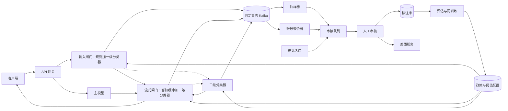

# 设计有害输出检测系统

## 题目

The interviewer's whole prompt is one sentence:

> We have a large language model (LLM) API and a chat product. Design a system that detects and
> handles harmful model output.

If you ask, the interviewer gives these numbers. They are practice assumptions, not any company's
real data.

**Traffic.**

- **1,000 requests/s** on average; peak is **3×** the average.
- A request averages **1,500 input tokens** (including conversation history) and **400 output
  tokens**.
- Most requests are streamed. The main model's median time to first token is about **600 ms**; after
  that it generates **50 tokens/s**.
- About 2 million active accounts a day. A few large API customers send up to 100,000 requests a day
  from a single key.

**What "harmful" means.** The usage policy sorts violations into three tiers. The classifiers give one
score per category, and each category's threshold can be tuned on its own.

| Tier | Examples | Share of responses that violate | Required handling |
| --- | --- | --- | --- |
| S0, most severe | Sexual content involving minors; substantive help with weapons of mass destruction | 1 in a million | Must block, must get human review, may lead to action on the account |
| S1, severe | Specific self-harm methods, violent threats against a specific person, ready-to-use malicious code | 1 in 20,000 | Block |
| S2, moderate | Hate and harassment; adult content that some products don't allow | About 4.5 in 10,000 | Set by the deployer: block, replace with a safe answer, or only log |

Across the three tiers, **1 in every 2,000** responses actually violates the policy.

**Goals.**

- Recall: at least **95%** across all tiers, and at least **99%** for S0 alone.
- False blocks: at most **5 per 10,000** benign responses.
- Latency: on a streamed response, the median time until the user sees the first token is at most
  **100 ms** later than without detection.
- People: the trust and safety team has **40 reviewers**. Each reviews for 6 effective hours a day,
  at 45 seconds per item on average.

**Components you can use as given.**

- **Stage-1 classifier**: a small model. One GPU processes 200,000 tokens/s; one call takes about
  15 ms. On all traffic it reaches 98% recall at a 2% false positive rate.
- **Stage-2 classifier**: a mid-size LLM that reads the full context plus a 1,000-token policy
  description. One GPU processes 20,000 tokens/s; one verdict takes about 400 ms. Among the samples
  stage 1 escalates, it catches 97% of true violations and clears 99% of the false positives.
- With thresholds tuned for S0 alone, stage 1 reaches 99.8% recall at a 0.5% false positive rate,
  and stage 2 catches 99.5% of true violations while keeping only 0.2% of the false positives. These
  are already included in the totals above.
- Stage 1 must see the first **12 tokens** of a harmful passage before its score crosses the
  threshold.
- The main model spends 1.5 GPU-seconds per request on average. Classifier GPUs are provisioned for a
  60% target utilization.

**Design:**

1. Requirements and a scale estimate: how many true violations there are a day, how many get
   flagged, how many reviewer hours that takes, and how much latency and compute each request gains.
2. The data model and API.
3. The architecture, walking through one streamed request.

**Topics the interviewer will dig into.**

- **(a) Cascades at a low base rate.** When violations are this rare, what recall, false positives
  and review volume does a cascade of classifiers give you?
- **(b) Streaming.** Where do the checks go in a streamed response, and what do you do about tokens
  that were already sent and cannot be taken back?
- **(c) Evaluation and drift.** How do you measure the system, and notice when it gets worse?
- **(d) Abuse across requests.** How do you catch abuse that no single request reveals?
- **(e) Enforcement, appeals, privacy and retention.**

**Out of scope:**

- Training the main model to refuse on its own. That is a separate line of defense; this problem
  covers only detection outside the model.
- Writing the policy text itself.
- Images and audio. Text in, text out only; tool calls are a follow-up.

## 参考解答

<details>
<summary>展开参考解答</summary>

动手设计之前值得先确认三件事。第一，“有害”由谁定义、是不是所有产品同一个标准。这份设计假设公司政策定档位：S0 对所有部署一视同仁，S2 允许部署方（operator，指在 API 上搭产品的客户）在公司划的范围内调松或调紧。第二，检测到之后要做到哪一步：只记录、拦掉这一条响应，还是处置账号。这里三种都要，按档位决定。第三，能不能把内容存下来。这里假设普通流量可以短期留存，但有一部分企业客户签了不留存协议，对他们只能在内存里判定。

整道题最容易答偏的地方是把它当成“训练一个好分类器”。面试官真正想听的是：违规的比例极低，这件事会把精确率、审核量、评估方法全部改写；流式输出让“拦截”变成一个有延迟代价的动作。下面的估算先把这两点算清楚。

### 需求与规模

**功能需求**

- 对每个请求的输入和输出按政策分类表打分，给出类别、分数和处置建议。
- 流式响应里，在有害内容被用户看到之前（或者尽量早）停止输出。
- 把判定结果送到人工审核、账号处置和申诉流程。
- 阈值和政策可以按类别、按部署调整，改动几分钟内生效，并且每条判定都能追溯到当时的政策版本和模型版本。

**非功能需求**

- 首个可见 token 的额外延迟中位数不超过 100 ms。
- 检测服务出故障时有明确的降级规则，不能悄悄变成“全部放行”。
- 被标记的内容大多数其实是正常的，所以存什么、存多久、谁能看都要有规则。

**流量。** 每天 $1{,}000 \times 86{,}400 = 86{,}400{,}000$ 个请求，高峰每秒 3,000 个。每个请求 $1{,}500 + 400 = 1{,}900$ 个 token 要过一遍分类器，平均每秒 190 万个 token，高峰每秒 570 万个。

**每天有多少真违规。** $86{,}400{,}000 / 2{,}000 = 43{,}200$ 条，其中 S0 约 86 条、S1 4,320 条、S2 约 38,794 条。正常响应有 86,356,800 条。

**先看一个行不通的方案。** 只用一个分类器，调到召回 95%、误报率 1%，听起来不错。算一下它每天标出多少条：

- 真违规被标出：$43{,}200 \times 0.95 = 41{,}040$ 条。
- 正常响应被误标：$86{,}356{,}800 \times 0.01 = 863{,}568$ 条。
- 合计 904,608 条，精确率（precision）只有 $41{,}040 / 904{,}608 = 4.5\%$。

每名审核员一天能看 $6 \times 3{,}600 / 45 = 480$ 条，全队 19,200 条。把 904,608 条都交给人看，需要 11,308 个工时，也就是 1,885 名审核员。团队只有 40 人。把这些响应全部自动拦掉也不行：每 100 条正常响应就误拦 1 条，是目标的 20 倍。

**级联方案。** 一级小模型看全量流量，只负责把可疑的挑出来；二级大模型只看一级挑出来的。

| | 一级之后 | 二级之后 |
| --- | --- | --- |
| 真违规 | $43{,}200 \times 0.98 = 42{,}336$ | $42{,}336 \times 0.97 \approx 41{,}066$ |
| 误报 | $86{,}356{,}800 \times 0.02 = 1{,}727{,}136$ | $1{,}727{,}136 \times 0.01 \approx 17{,}271$ |
| 合计 | 1,769,472（占流量 2.048%） | 58,337 |
| 精确率 | 2.4% | 70.4% |

- 端到端召回率是 $0.98 \times 0.97 = 95.06\%$，刚过 95% 的线。每天漏掉约 2,134 条：一级漏 864 条，二级漏约 1,270 条。
- 误拦率是 $0.02 \times 0.01 = 0.02\%$，即每 5,000 条正常响应误拦 1 条，在“万分之五”的目标之内。
- 即使这样，被拦下的响应里仍有约三成是误拦，每天约 17,271 个正常请求受影响。
- 如果被拦下的 58,337 条全部人工复核，要 729 个工时、122 名审核员，还是超过 40 人。所以人工只能看其中一部分，见下面的审核预算。

**S0 单独算。** S0 每天约 86 条。用它自己的阈值：召回 $0.998 \times 0.995 = 99.3\%$。误报是 $86{,}400{,}000 \times 0.005 \times 0.002 = 864$ 条。所以每天约 950 条 S0 警报，精确率只有 9%，但全部人工复核只要 11.9 个工时，两名审核员就够。最严重的类别可以接受很低的精确率，因为它的绝对数量小，而且账号处置之前一定有人看过。

**审核预算。** 40 人每天能看 19,200 条，按用途分：

| 用途 | 每天条数 | 说明 |
| --- | --- | --- |
| S0 警报 | 950 | 全部复核 |
| 申诉 | 2,138 | 假设被误拦的用户有 10% 申诉、被正确拦截的有 1% 申诉 |
| 影子抽样 | 855 | 用来估计一级分类器漏了多少，见深入话题 (c) |
| 质量抽样 | 5,000 | 从被拦和被放行的响应里分层抽样 |
| 合计 | 8,943 | 约 112 个工时，占容量的 46.6% |

剩下的一半容量留给突发事件和账号级的复核。

**算力。**

- 一级：每个请求 $1{,}900 / 200{,}000 = 9.5$ GPU·毫秒。高峰每秒 570 万个 token，满载需要 28.5 张 GPU，按 60% 利用率配置是 48 张。
- 二级：每次判定读 $1{,}900 + 1{,}000 = 2{,}900$ 个 token，花 145 GPU·毫秒。高峰每秒升级 $3{,}000 \times 2.048\% \approx 61.4$ 次，按 60% 利用率配置是 15 张。
- 合计 63 张。如果让二级直接看全量流量，要 725 张，是级联方案的 11.5 倍。
- 平均到每个请求：$9.5 + 2.048\% \times 145 \approx 12.47$ GPU·毫秒，约为主模型 1.5 GPU·秒的 0.83%。二级看全量则是 9.7%。

**延迟。**

- 输入检查和主模型处理输入同时进行。一级分类器 15 ms 就出结果，远早于主模型 600 ms 的首 token，所以正常请求的首 token 不受输入检查影响。
- 输出检查每 5 个 token 做一次。第一批 5 个 token 要等第 5 个生成出来（$4 / 50 = 80$ ms）再加 15 ms 的判定，所以首个可见 token 晚 95 ms，在 100 ms 的目标内。之后用户看到的文字平均比生成慢 55 ms。
- 被升级到二级的响应（约 2%）会在中途停顿一次，约 400 ms。

**存储。** 一级标出的每条记录连同上下文约 10 KB，每天 17.7 GB，留 30 天约 531 GB。存储不是难点，难的是这些记录 97.6% 属于正常用户，见深入话题 (e)。

### 数据模型与 API

**政策与配置**

| 表 | 主要字段 | 说明 |
| --- | --- | --- |
| `policy_categories` | `category_id, tier, name, adjustable, default_action` | 政策分类表（policy taxonomy）。`adjustable` 表示部署方能不能调 |
| `deployment_policies` | `deployment_id, category_id, flag_threshold, block_threshold, action, policy_version` | 每个部署、每个类别两条线：标记线和拦截线 |

每个类别有两个阈值而不是一个。分数过了标记线只是记录下来、可能被抽样；过了拦截线才动用户看得见的处置。S0 的两条线由公司定死，部署方改不了。

**判定与证据**

| 表 | 主要字段 | 说明 |
| --- | --- | --- |
| `verdicts` | `verdict_id, request_id, account_id, deployment_id, stage, category_id, score, action, token_span, classifier_version, policy_version, created_at` | 每次判定一行，只有元数据，不含内容 |
| `flagged_content` | `verdict_id, ciphertext, retention_class, expires_at` | 内容单独加密存放，带到期时间 |
| `review_items` | `item_id, verdict_id, queue, priority, sampling_prob, status, label, reviewer_id` | `sampling_prob` 记下这一条是以多大概率被抽中的，估计总体指标时要用它加权 |
| `enforcement_actions` | `action_id, account_id, type, evidence_verdict_ids, decided_by, expires_at` | 账号级处置，必须指向证据 |
| `appeals` | `appeal_id, target_id, status, outcome, reviewer_id` | 申诉及结论 |

元数据和内容分开存，是为了让两者有不同的留存期和访问权限：账号聚合、漂移监控只需要元数据。

**内部接口**

```text
CheckInput(request_id, deployment_id, messages)
    -> {decision: allow | block | escalate, category, score}

OpenGate(request_id, deployment_id, risk_hint)   -> gate_id
PushTokens(gate_id, tokens)
    -> {release_upto: int, decision: continue | pause | block, category}

Escalate(request_id, context, category)          -> {decision: allow | block, score}
```

`PushTokens` 的返回值 `release_upto` 告诉流式层“到第几个 token 为止可以发给用户”。流式闸门自己记着每条流的状态，所以每次只需要传新 token。

**对外行为**

- 被拦截的响应不是一个错误，而是一条正常结束的响应，带一个表示“因政策停止”的停止原因和类别。客户端能据此显示提示，而不是当成网络故障去重试。Anthropic 的公开 API 文档就是这种做法：安全分类器触发时，返回的是 HTTP 200 加上 `refusal` 这个停止原因，并在 `stop_details` 里给出触发的政策类别（[文档](https://platform.claude.com/docs/en/build-with-claude/handling-stop-reasons)，2026-11-17 查阅）。
- `POST /v1/appeals {request_id, reason}`：用户或部署方对一次拦截或一次账号处置提出申诉。

### 架构



顺着一个流式请求走一遍：

1. 请求到网关。网关把它同时交给输入闸门和主模型，主模型开始处理输入。
2. 输入闸门先过规则和哈希表（已知的违规内容、已知的越狱模板），这一步是微秒级的。然后一级分类器读完整输入。结果有三种：放行；分数过了拦截线，直接拦截并取消主模型的生成；分数落在中间，升级到二级，这时第一个 token 会被扣住，直到二级给出结论。
3. 主模型开始输出 token。流式闸门把 token 放进暂扣缓冲，每攒够 5 个就让一级分类器接着往下读。判定干净，这 5 个 token 才发给客户端。
4. 如果某一批的分数过线，闸门暂停放行，把到目前为止的完整上下文交给二级分类器。二级说放行，流继续；二级说拦截，闸门丢掉还没放行的 token，通知主模型停止生成（省下后面的算力），给客户端发一个带停止原因的收尾事件。
5. 每一次判定都写进判定日志。日志用 Kafka，按账号 ID 作分区键。Kafka 只保证同一分区内有序，这样同一个账号的事件一定按顺序到达账号聚合器。
6. 抽样器从日志里按规则挑出要人工看的条目，连同抽样概率写进审核队列。账号聚合器发现异常账号时，也往审核队列里放。
7. 审核员的结论有三个去向：进标注库，用于评估和再训练；触发处置服务；回答申诉。
8. 评估流程产出新的阈值或新的分类器版本，经配置服务下发，几分钟内在闸门上生效。

### 深入话题

**(a) 基准率很低时，级联的召回、误报和审核量**

违规的比例记作 $\pi$，分类器的召回率记作 $r$，误报率记作 $f$。被标出的响应里真违规的比例是

$$\text{精确率} = \frac{\pi r}{\pi r + (1-\pi) f}$$

$\pi = 1/2{,}000$ 时，分母几乎全是 $(1-\pi) f$ 这一项。$r = 0.95, f = 0.01$ 代进去就是 4.5%。这是基准率（base rate）带来的，换一个更好的单级分类器也救不了多少：要在 95% 召回下做到 90% 的精确率，误报率必须压到每 18,938 条正常响应只错 1 条。

三种做法：

- *只用一个小模型看全量。* 便宜（48 张 GPU），但精确率 4.5%，既不能自动拦截，也没法交给人看。
- *只用一个大模型看全量。* 质量最好，但要 725 张 GPU，每个请求多花 9.7% 的算力，而且 400 ms 的判定时间放不进流式路径。
- *级联（选定）。* 小模型看全量，大模型只看 2% 的流量，63 张 GPU。代价是召回率连乘、系统更复杂。

级联里有三条容易忽略的算术规则。

第一，召回率是连乘的。$0.98 \times 0.97 = 0.9506$。端到端要 95%，每一级都必须明显高于 95%，而且这里几乎没有余量：任何一级掉 1 个点，整体就不达标。所以一级的阈值要调得很松，宁可多升级。

第二，误报率也连乘，但第二个乘数不是二级分类器“平时”的误报率。一级挑出来的误报是最像违规的那一批正常内容，比如讲毒理学的课件、写犯罪情节的小说。二级在这批样本上的误报率（1%）会比在随机流量上高得多。估算时必须用“在一级升级上来的样本里”测出的数字，题目给的就是这个口径。

第三，级联之后精确率也只有 70.4%。如果对所有类别都自动拦截，每天有约 17,271 个正常请求被误拦。所以每个类别设两条线：

- S0 和 S1：过拦截线就拦。误拦的代价小于漏掉的代价。
- S2：只有高置信度才拦；中间一段只标记，进抽样池，不影响用户。部署方可以把这条线调紧（面向未成年人的产品）或调松（成人内容平台、医疗平台）。

人工审核不在同步路径上。45 秒一条的速度决定了人只能做四件事：给样本打标注、确认 S0、处理申诉、在账号处置前把关。

**(b) 流式输出：检查放在哪里，说出去的 token 收不回来**

检查可以放在三个位置，三个都要。

- *输入检查。* 在生成之前就能拦，一个 token 都不会漏出去，还省掉生成的算力。但它看不到输出：一个看起来正常的问题可能得到有害的回答，越狱提示的全部目的就是骗过只看输入的检查。
- *流式输出检查。* 直接看模型说了什么，是主防线，也是延迟代价的来源。
- *事后检查。* 响应结束后，用更慢、更准的模型离线重看完整对话。它拦不住这一条，但能发现前两道漏掉的，触发账号处置，并产出评估数据。

流式输出检查有三种做法：

- *整条响应生成完再检查。* 不会泄漏，但用户要等 $400 / 50 = 8$ 秒才看到第一个字，流式就没有意义了。
- *边生成边放行，事后再查。* 没有延迟，但有害内容可能整段发出去。
- *分块检查加暂扣（选定）。* 每 $k$ 个 token 检查一次，检查通过才放行。

选定方案里有三个量：检查间隔 $k$、额外暂扣 $h$（放行时再多压住最近的 $h$ 个 token）、分类器的检出滞后 $d$（要看到有害片段的前 $d$ 个 token 才会过线，题目给的是 12）。生成速度记作 $v = 50$ token/s，一次判定 $t_c = 15$ ms。

- 首个可见 token 的延迟：第一个覆盖到 $1 + h$ 个 token 的检查点是 $m = k \lceil (1+h)/k \rceil$，延迟是 $(m-1)/v + t_c$。
- 最坏情况下泄漏的有害 token 数：$\max(0,\ d - 1 - h)$。原因是在分类器过线之前，有害片段的前几个 token 所在的块都被判成“干净”并放行了。

| 配置 | 首个可见 token 晚多少 | 平均滞后 | 最坏泄漏 |
| --- | --- | --- | --- |
| $k=5, h=0$ | 95 ms | 55 ms | 11 个 token |
| $k=10, h=0$ | 195 ms | 105 ms | 11 个 token |
| $k=1, h=0$ | 15 ms | 15 ms | 11 个 token |
| $k=5, h=11$ | 295 ms | 270.5 ms | 0 |

从表里能读出两件事。把检查做得更密（$k=1$）只降低延迟，不减少泄漏；泄漏只由 $d$ 和 $h$ 决定。想做到零泄漏，暂扣必须不小于 $d - 1$，延迟就到了 295 ms，超出 100 ms 的目标。

所以推荐按风险调暂扣：

- 默认 $k=5, h=0$。最坏漏出 11 个 token，大约一句话的开头。对“危险的操作步骤”这类内容，危害在于完整、可执行的信息，开头几个词基本没有危害。
- 输入阶段分数偏高的请求（约 2%）改用 $h=11$。只有这部分用户多等 200 ms，但恰恰是它们最可能出问题。
- 对开头几个词本身就是危害的类别（比如直接输出某个人的身份证号），在对应的部署里默认就用 $h=11$，或者干脆不流式。

“收不回来”要分两种客户端说。聊天界面可以在收到拦截事件后把已显示的那半句话撤掉，换成提示，但用户可能已经看到。API 客户端已经拿到字节，撤不回来。所以设计时把“已经放行”当作“已经泄漏”，而不是指望事后撤回。

还有四个实现细节：

- *增量打分。* 一级分类器必须是能接着往下读的模型，每条流保留它的中间状态，每次只处理新来的 5 个 token。如果每次都重读最近 200 个 token 的窗口，一条 400 token 的响应要做 80 次调用、读 16,000 个 token，是增量方式的 40 倍，48 张 GPU 的估算就不成立了。
- *升级时的停顿。* 二级判定要 400 ms，这段时间流是停的。二级放行之后，这条响应余下的部分要把一级的升级线临时调高，否则同一个误报会反复触发停顿。
- *拦截之后存什么。* 被截断的那条助手消息要带着“已拦截”的标记存进对话历史，下一轮组装上下文时不能把那半句有害内容原样喂回给模型。对话历史怎么组装，见 [设计对话上下文管理器](#/anthropic/system-design/conversation-context-manager)。
- *另一种一级分类器。* 在主模型的中间层激活上接一个线性探针，几乎不花算力，也没有额外的读取延迟。代价是它和主模型的版本绑死，换模型就要重训，而且它和主模型共享同一套内部表示，容易一起被同一种攻击骗过。可以作为补充信号，不建议作为唯一的一级。

**(c) 评估与漂移**

评估要回答两个问题：现在的召回率和误拦率是多少；它们是不是在变差。基准率太低，使得“从线上随机抽样来标注”这条最直接的路走不通。

- 要把 S0 的召回率量到 99% ± 1%（一个标准误），需要约 $0.99 \times 0.01 / 0.01^2 = 99$ 个 S0 正样本。S0 的比例是百万分之一，随机抽样要标 9,900 万条，相当于 206,250 个审核员工作日。
- 想靠随机抽查被放行的响应来估计漏了多少也不行。被放行的 86,341,663 条里只有约 2,134 条是漏掉的违规，每 40,458 条里才有 1 条。每天抽 5,000 条，平均只能碰到 0.12 条。

所以标注集要靠三个来源拼起来：

- *定向构造的正样本。* 红队（red team）提交的攻击、按政策分类表合成的样本、历史上人工确认过的违规。它们用来量召回率，尤其是 S0。缺点是分布和线上不一样，量出来的召回率偏乐观还是偏悲观都有可能，所以只把它当作回归测试的基线：同一套样本上新版本不能比旧版本差。
- *线上分层抽样。* 按一级分数分层，分数越高抽得越密，每条记下抽样概率，估计时按概率的倒数加权。这样能在有限的标注量里得到无偏的线上误拦率。
- *影子抽样估计一级的漏检。* 一级漏掉的 864 条藏在 84,630,528 条从未被升级的响应里，人工抽样完全够不着。办法是每天随机抽 1% 的未升级响应（约 846,305 条），离线交给二级分类器看一遍，再把二级标出来的交给人确认。假设二级在这类“一级认为干净”的流量上误报率是 0.1%，每天会标出约 855 条，其中约 8.4 条是真违规，30 天攒到约 251 条，足够估计一级的漏检率。代价是每个请求多 1.42 GPU·毫秒，安全检查的总算力增加 11.4%。

要说清楚这个办法的边界：它量的是“一级漏了、但二级认得出来”的部分。两级都认不出来的违规，只有红队、用户举报和外部通报能发现。这一块的召回率没有办法从线上数据直接量出来，报告里要单独写明。

漂移（drift）有四个来源：主模型换版本后说话方式变了；出现新的越狱手法；流量里的语言和话题比例变了；产品上了新功能（比如新工具）。对应的监控：

- *看计数。* 每天拦截约 58,337 条，随机波动的标准差约 242 条，也就是 0.41%。总量变化 2% 当天就能发现。但 S0 每天只有约 86 条，标准差 9.3 条，是 10.8%。S0 的召回率掉 10%，从线上的计数根本看不出来。
- *所以每次发布都跑固定的回归集。* 主模型或任何一级分类器发新版本之前，必须在定向构造的样本集上逐类别、逐语言过一遍，S0 这类样本一条都不能少。
- *新分类器先进影子模式（shadow mode）。* 新版本和旧版本同时跑线上流量，只有旧版本的结论生效。两者一致的样本不需要看，只标注两者不一致的那一小部分，就能知道新版本在哪些类别上更好、哪些更差。然后小流量放量，随时能退回。

按语言拆开看指标是必须的。分类器的训练数据以英语为主，小语种的召回率通常更低，把内容翻译成小语种本身就是一种常见的绕过办法。两种补救：先翻译成英语再分类（多一步延迟，翻译会丢掉微妙的语气）；或者对弱语种把一级的升级线调低，让二级多看一些。后者的代价可以算：如果弱语种占流量的 5%，把其中升级的比例从 2.048% 提高到 20%，升级量就多出约 0.9 个百分点，二级的负载增加约 43.8%。

**(d) 跨请求的滥用检测**

逐条检查有三类攻击防不住：

- *拆分。* 把一个有害任务拆成很多个单看都正常的问题。
- *试探。* 同一个账号反复改写提示，直到某一次骗过分类器。每一次失败都被拦了，但只要成功一次就够。
- *换号。* 很多账号用同一套越狱模板。

对策是在账号和对话的层面聚合判定日志。信号包括：一段时间内被二级确认拦截的次数和类别；一级分数“差一点过线”的次数；对话内分数随轮次上升的趋势；被拦提示之间的相似度（不同账号发出几乎相同的文本）；账号年龄和请求速度。

阈值定在哪里，同样要先算误伤。平均每个账号每天 $86{,}400{,}000 / 2{,}000{,}000 = 43.2$ 个请求。正常账号每个请求有 0.02% 的概率被误拦，一天平均被误拦 $43.2 \times 0.0002 = 0.00864$ 次。把误拦近似成互相独立，一天内被误拦的次数服从泊松分布：

- “一天被拦 2 次就进入复核”：每天约 74 个正常账号中招。
- “一天被拦 3 次就进入复核”：每天约 0.2 个正常账号中招。

三次是一条合理的线。但这个算术有两个漏洞，都要在设计里补上。

- *流量不均匀。* 一个每天发 10 万个请求的 API 密钥，按同样的误拦率每天会被误拦约 20 次，任何按次数定的规则对它永远成立。所以规则必须按比例而不是按次数：用“被拦次数相对请求量是否显著高于基线误拦率”来判断。大客户背后有很多终端用户，还应该要求他们传一个匿名的终端用户标识，按终端用户聚合。
- *误拦并不独立。* 误拦集中在某些话题上。一位护士、一位写犯罪小说的作者、一位安全研究员，会比普通用户多被误拦很多倍。所以账号级的自动动作只限于“送去人工复核”和“临时限速”，封号之前必须有人看过证据。

聚合器是一个流处理任务，读按账号分区的判定日志，维护滑动窗口里的计数。它只需要 `verdicts` 里的元数据（类别、分数、时间），不需要内容。相似文本的聚类用提示的嵌入向量或局部敏感哈希，存的是向量和哈希，不是原文。

**(e) 处置、申诉、隐私与留存**

处置按轻重分级，能用轻的就不用重的：

| 层级 | 动作 | 谁决定 |
| --- | --- | --- |
| 单条响应 | 拦截；换成安全的回答（比如自残话题给出求助信息）；只标记 | 自动 |
| 对话 | 结束这段对话 | 自动，限 S0 和 S1 |
| 账号 | 警告、限速、暂停、封禁 | 限速可以自动，其余要人工确认 |
| 对外 | 某些类别在某些法域有上报义务 | 法务流程，不在本题范围内 |

申诉有两个作用。对用户，它是纠错的出口。对系统，它是一个便宜的精确率信号：按前面的假设，每天约 2,138 件申诉，其中 80.8% 来自真的被误拦的用户。申诉被推翻的比例突然上升，往往比抽样更早说明某个类别的阈值出了问题。申诉的结论要回写标注库。

隐私上最要紧的一个事实是：被标记不等于违规。一级标出的 1,769,472 条里，97.6% 是正常用户的正常对话。留存规则按这个事实来定：

- *元数据和内容分开。* 判定元数据（类别、分数、版本、时间）可以留得久，用于监控和账号聚合。内容单独加密存放。
- *内容按用途分留存期。* 只被一级标记、没被二级确认的内容，短期保留（这里取 30 天，约 531 GB），只用于抽样标注，到期自动删除。被二级确认拦截的内容按档位保留更久。S0 的证据按法务要求保全。具体天数是政策决定，这里的 30 天只是示例。
- *不留存协议的客户。* 分类器在内存里跑，只写元数据，不写内容。这些流量进不了抽样池，评估时要说明样本不包含它们。
- *访问控制。* 审核员只能看到分配给自己的条目，每次查看都留审计记录，能脱敏的个人信息先脱敏。S0 内容的审核要限制人员范围并控制每人每天的接触量。
- *删除请求和证据保全会冲突。* 用户要求删除数据时，正在走处置或法务流程的证据不能删，这一条要在对用户的说明里写清楚。

### 追问

**为什么不只靠训练主模型让它自己拒绝？** 两道防线出错的方式不同。主模型的拒绝行为可以被越狱提示绕过，而且更新它要重新训练和评估整个模型，周期以周计。外部分类器可以单独更新，阈值几分钟就能改。Anthropic 2025 年 2 月的一篇公开研究文章给过一组数字：在 1 万条合成的越狱提示上，不加分类器时越狱成功率是 86%，加上输入和输出分类器后降到 4.4%；代价是线上流量的拒绝率增加 0.38%，算力增加 23.7%（[Constitutional Classifiers](https://www.anthropic.com/research/constitutional-classifiers)，2026-11-17 查阅）。这是研究原型的数字，不代表线上系统现在的做法，但能说明外部分类器的收益和成本大概在什么量级。

**分类器服务挂了或者变慢，是放行还是拦截？** 按档位和部署分别定，并且提前写进配置。一级挂了：规则和哈希表还在，主模型自身的拒绝还在；面向公众的产品可以降级为“先放行、事后全量补查”，高风险部署（比如面向未成年人的产品）则宁可暂停服务。二级挂了：一级继续工作，把拦截线临时调严，中间地带的请求改成不流式、排队等二级恢复。任何降级都要报警并记录，事后对降级期间的流量补跑一遍。

**凌晨发现一种新的越狱手法，最快的手段是什么？** 按生效速度排：加规则或哈希（分钟级，只能挡住原样照抄的）；调对应类别的阈值、修改二级分类器的政策说明（分钟到小时，二级是 LLM，改说明就能改行为）；用新样本重训一级（天级）。同时用新规则回扫留存期内的判定日志，找出已经用过这种手法的账号。

**不同的部署方想要不同的规则怎么办？** 类别分成可调和不可调两种。S0 的两条线全局固定。S2 的阈值和动作由部署方在公司给的范围内选，配置带版本号，每条判定记下当时生效的版本。分类器只出分数，阈值在闸门上按部署查表，所以同一个分类器能服务所有部署。

**有害内容是分很多轮慢慢拼出来的，单看每一轮都正常，怎么办？** 一级分类器读的是带历史的输入，本身就有对话级的视野；二级读完整对话。再加上深入话题 (d) 里对话内分数趋势的信号和事后的整段复查。完全拆散到多个对话、多个账号的情况只能靠账号聚合和相似度聚类，这部分的召回率要坦白说不高。

**模型不只输出文本，还会调用工具，怎么检查？** 工具调用的参数在执行之前检查，相当于暂扣到底：动作一旦执行就没有“撤回”可言，所以不能边执行边查。工具返回的内容当作不可信的输入，也要过输入检查，因为它可能带着注入的指令。

<details>
<summary>估算核对（可运行）</summary>

```python
import math

import numpy as np
from scipy import stats

# ---- traffic ----
avg_qps, peak_factor = 1_000, 3
per_day = avg_qps * 86_400
peak_qps = avg_qps * peak_factor
tok_in, tok_out = 1_500, 400
tok_req = tok_in + tok_out
assert per_day == 86_400_000 and peak_qps == 3_000 and tok_req == 1_900
assert avg_qps * tok_req == 1_900_000 and peak_qps * tok_req == 5_700_000

# ---- base rates ----
tier_rate = {"S0": 1e-6, "S1": 1 / 20_000, "S2": 4.49e-4}
assert math.isclose(sum(tier_rate.values()), 1 / 2_000)
harm = per_day / 2_000
benign = per_day - harm
assert harm == 43_200 and benign == 86_356_800
assert round(per_day * tier_rate["S0"]) == 86
assert round(per_day * tier_rate["S1"]) == 4_320
assert round(per_day * tier_rate["S2"]) == 38_794

# ---- reviewers ----
sec_per_item, productive_hours, team = 45, 6, 40
items_per_reviewer = productive_hours * 3_600 / sec_per_item
team_capacity = team * items_per_reviewer
assert items_per_reviewer == 480 and team_capacity == 19_200


def hours(items):
    return items * sec_per_item / 3_600


def precision(pi, r, f):
    return pi * r / (pi * r + (1 - pi) * f)


# ---- straw man: one classifier at recall 95 %, FPR 1 % ----
tp, fp = harm * 0.95, benign * 0.01
assert round(tp) == 41_040 and round(fp) == 863_568 and round(tp + fp) == 904_608
assert round(100 * tp / (tp + fp), 1) == 4.5
assert math.isclose(tp / (tp + fp), precision(1 / 2_000, 0.95, 0.01))
assert round(hours(tp + fp)) == 11_308 and math.ceil((tp + fp) / items_per_reviewer) == 1_885
assert (tp + fp) / items_per_reviewer > team            # it does not fit the team ...
assert 0.01 / (5 / 10_000) == 20                        # ... and blocking misses the target 20-fold

# ---- cascade ----
r1, f1, r2, f2 = 0.98, 0.02, 0.97, 0.01
tp1, fp1 = harm * r1, benign * f1
escalated = tp1 + fp1
assert round(tp1) == 42_336 and round(fp1) == 1_727_136 and round(escalated) == 1_769_472
assert round(100 * escalated / per_day, 3) == 2.048
assert round(100 * tp1 / escalated, 1) == 2.4
tp2, fp2 = tp1 * r2, fp1 * f2
blocked = tp2 + fp2
assert round(tp2) == 41_066 and round(fp2) == 17_271 and round(blocked) == 58_337
assert round(100 * tp2 / blocked, 1) == 70.4
recall = tp2 / harm
assert round(100 * recall, 2) == 95.06 and recall >= 0.95
assert math.isclose(fp2 / benign, 0.0002) and round(benign / fp2) == 5_000
assert fp2 / benign <= 5 / 10_000
assert round(harm - tp2) == 2_134 and round(harm - tp1) == 864 and round(tp1 - tp2) == 1_270
assert round(hours(blocked)) == 729 and math.ceil(blocked / items_per_reviewer) == 122
assert blocked / items_per_reviewer > team              # reviewing every block does not fit either
assert round(100 * fp1 / escalated, 1) == 97.6          # share of stage-1 flags that are benign
# recall multiplies: one point lost at either stage misses the target
assert 0.97 * 0.97 < 0.95 and 0.98 * 0.96 < 0.95
# FPR a single classifier needs for 90 % precision at 95 % recall
fpr_90 = (harm * 0.95 / 9) / benign
assert round(1 / fpr_90) == 18_938
assert math.isclose(precision(1 / 2_000, 0.95, fpr_90), 0.90)

# ---- S0 with its own thresholds ----
s0 = per_day * tier_rate["S0"]
s0_recall = 0.998 * 0.995
s0_tp = s0 * s0_recall
s0_fp = (per_day - s0) * 0.005 * 0.002
assert round(100 * s0_recall, 1) == 99.3 and s0_recall >= 0.99
assert round(s0_fp) == 864 and round(s0_tp + s0_fp) == 950
assert round(100 * s0_tp / (s0_tp + s0_fp)) == 9
assert round(hours(s0_tp + s0_fp), 1) == 11.9 and math.ceil((s0_tp + s0_fp) / items_per_reviewer) == 2

# ---- appeals and the review budget ----
appeals = 0.10 * fp2 + 0.01 * tp2
assert round(appeals) == 2_138 and round(100 * 0.10 * fp2 / appeals, 1) == 80.8
never_escalated = per_day - escalated
shadow_n = 0.01 * never_escalated
shadow_true = 0.01 * (harm - tp1) * r2
shadow_fp = 0.01 * (never_escalated - (harm - tp1)) * 0.001
assert round(never_escalated) == 84_630_528 and round(shadow_n) == 846_305
assert round(shadow_true, 1) == 8.4 and round(shadow_true + shadow_fp) == 855
assert round(30 * shadow_true) == 251
budget = 950 + 2_138 + 855 + 5_000
assert budget == 8_943 and round(hours(budget)) == 112 and round(100 * budget / team_capacity, 1) == 46.6

# ---- compute ----
s1_tps, s2_tps, util, policy_prompt, main_gpu_s = 200_000, 20_000, 0.6, 1_000, 1.5
s1_ms = tok_req / s1_tps * 1_000
s2_tok = tok_req + policy_prompt
s2_ms = s2_tok / s2_tps * 1_000
assert s1_ms == 9.5 and s2_tok == 2_900 and s2_ms == 145
assert peak_qps * tok_req / s1_tps == 28.5
s1_gpus = math.ceil(peak_qps * tok_req / s1_tps / util)
esc_per_s = peak_qps * escalated / per_day
s2_gpus = math.ceil(esc_per_s * s2_tok / s2_tps / util)
all_s2_gpus = math.ceil(peak_qps * s2_tok / s2_tps / util)
assert s1_gpus == 48 and round(esc_per_s, 1) == 61.4 and s2_gpus == 15
assert s1_gpus + s2_gpus == 63 and all_s2_gpus == 725
assert round(all_s2_gpus / (s1_gpus + s2_gpus), 1) == 11.5
per_req_ms = s1_ms + escalated / per_day * s2_ms
assert round(per_req_ms, 2) == 12.47
assert round(100 * per_req_ms / (main_gpu_s * 1_000), 2) == 0.83
assert round(100 * s2_ms / (main_gpu_s * 1_000), 1) == 9.7
shadow_ms = shadow_n * s2_ms / per_day
assert round(shadow_ms, 2) == 1.42 and round(100 * shadow_ms / per_req_ms, 1) == 11.4
# re-reading a 200-token window on every check instead of scoring incrementally
checks = tok_out // 5
assert checks == 80 and checks * 200 == 16_000 and checks * 200 / tok_out == 40

# ---- storage ----
gb_per_day = escalated * 10 / 1e6            # 10 KB per flagged record
assert round(gb_per_day, 1) == 17.7 and round(30 * gb_per_day) == 531

# ---- evaluation arithmetic ----
n_pos = 0.99 * 0.01 / 0.01 ** 2
assert math.isclose(n_pos, 99)
assert round(n_pos / tier_rate["S0"]) == 99_000_000
assert round(n_pos / tier_rate["S0"] / items_per_reviewer) == 206_250
passed = per_day - blocked
assert round(passed) == 86_341_663 and round(passed / (harm - tp2)) == 40_458
assert round(5_000 * (harm - tp2) / passed, 2) == 0.12
assert round(math.sqrt(blocked)) == 242 and round(100 / math.sqrt(blocked), 2) == 0.41
assert round(math.sqrt(s0), 1) == 9.3 and round(100 / math.sqrt(s0), 1) == 10.8
# weak languages: 5 % of traffic, escalate 20 % of it instead of the usual 2.048 %
extra = 0.05 * (0.20 - escalated / per_day)
assert round(100 * extra, 1) == 0.9 and round(100 * extra / (escalated / per_day), 1) == 43.8


# ---- stream gate: delay and leak as a function of check interval k and hold-back h ----
def gate(n_tokens, rate, k, t_c, h, span_start=None, d=12):
    """Simulate one stream. Returns (display lag of every released token, leaked harmful tokens, cut?).

    Token i is generated at i / rate. After every k tokens the classifier has read the whole prefix;
    its verdict arrives t_c later. A clean verdict on the first m tokens releases tokens [0, m - h).
    The verdict turns harmful once the prefix holds d tokens of the harmful span starting at span_start.
    """
    gen = [i / rate for i in range(n_tokens)]
    bounds = list(range(k, n_tokens, k)) + [n_tokens]
    lags, leaked, released = [], 0, 0
    for m in bounds:
        t_verdict = gen[m - 1] + t_c
        if span_start is not None and m - span_start >= d:
            return lags, leaked, True
        upto = m if m == n_tokens else max(released, m - h)
        for i in range(released, upto):
            lags.append(t_verdict - gen[i])
            leaked += span_start is not None and i >= span_start
        released = upto
    return lags, leaked, False


RATE, T_C, D = 50, 0.015, 12
table = {}
for k, h in ((5, 0), (10, 0), (1, 0), (5, 11)):
    lags, _, cut = gate(tok_out, RATE, k, T_C, h)
    assert not cut and len(lags) == tok_out               # a clean stream is released in full
    worst = max(gate(tok_out, RATE, k, T_C, h, s, D)[1] for s in range(20, 300))
    table[k, h] = (round(1_000 * lags[0], 1), round(1_000 * sum(lags) / len(lags), 1), worst)
assert table[5, 0] == (95.0, 55.0, 11)
assert table[10, 0] == (195.0, 105.0, 11)
assert table[1, 0] == (15.0, 15.0, 11)
assert table[5, 11] == (295.0, 270.5, 0)
assert table[5, 0][0] <= 100 < table[5, 11][0]            # only the first one meets the 100 ms target
assert table[5, 11][0] - table[5, 0][0] == 200
assert tok_out / RATE == 8                                # buffering the whole response
# the closed forms quoted in the text, checked on a grid
for k in range(1, 11):
    for h in range(0, 16):
        lags, _, _ = gate(tok_out, RATE, k, T_C, h)
        m = k * math.ceil((1 + h) / k)
        assert math.isclose(lags[0], (m - 1) / RATE + T_C)
        worst = max(gate(tok_out, RATE, k, T_C, h, s, D)[1] for s in range(20, 300))
        assert worst == max(0, D - 1 - h)
# every harmful stream is cut, whatever the setting
assert all(gate(tok_out, RATE, 5, T_C, h, s, D)[2] for h in (0, 11) for s in range(20, 300))

# ---- account-level rule: how many innocent accounts trip it per day ----
accounts = 2_000_000
req_per_account = per_day / accounts
lam = req_per_account * fp2 / benign
assert req_per_account == 43.2 and math.isclose(lam, 0.00864)
trip2 = stats.poisson.sf(1, lam) * accounts               # P(X >= 2)
trip3 = stats.poisson.sf(2, lam) * accounts               # P(X >= 3)
assert round(trip2) == 74 and round(trip3, 1) == 0.2
assert math.isclose(100_000 * fp2 / benign, 20)           # a heavy API key: 20 false blocks a day
rng = np.random.default_rng(0)
days = 20
sim = sum(int((rng.poisson(lam, accounts) >= 2).sum()) for _ in range(days)) / days
assert abs(sim - trip2) < 5 * math.sqrt(trip2 / days)     # Monte Carlo agrees with the tail formula
heavy = rng.poisson(20, 10_000)
assert (heavy >= 3).mean() > 0.999                        # a count rule always fires on a heavy key

print(f"flagged/day: single-stage {tp + fp:,.0f}, stage 1 {escalated:,.0f}, blocked {blocked:,.0f}")
print(f"recall {recall:.4f}, false-block rate 1 in {benign / fp2:,.0f}, precision {tp2 / blocked:.3f}")
print(f"GPUs: {s1_gpus} + {s2_gpus} (vs {all_s2_gpus} for stage 2 on everything)")
print(f"stream gate (first ms, mean ms, worst leak): {table}")
print(f"innocent accounts tripping '2 a day': {trip2:.1f} (simulated {sim:.1f}); '3 a day': {trip3:.2f}")
print("all harmful-output-detection numbers check out")
```

</details>

</details>
